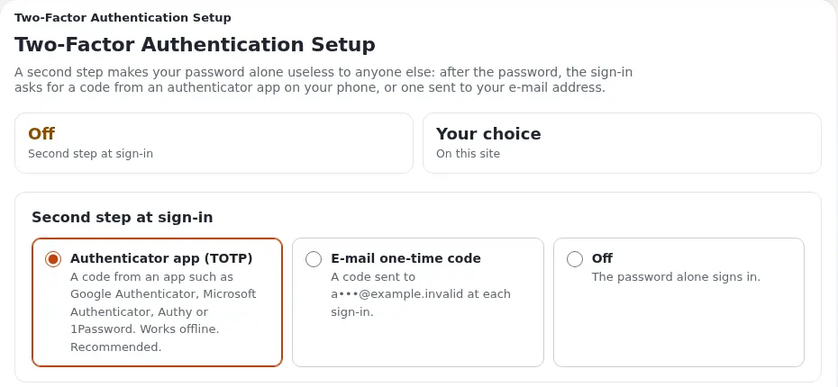

# Zwei-Faktor-Anmeldung

Diese Seite ist für Privatpersonen, die ein gestohlenes Passwort nutzlos machen möchten. Mit der zweistufigen
Anmeldung fragt die Website nach dem Passwort nach einem 6-stelligen Code aus einer Authenticator-App auf Ihrem
Smartphone oder nach einem, der per E-Mail geschickt wird. Sie wird mit Exponential als
`sevenx_authentication_2fa` geliefert (die `composer.json` im Wurzelverzeichnis verlangt sie; die Installer
aktivieren sie), und die vollständige Anleitung ist [Zweistufige Anmeldung](../../../anleitungen/zwei-faktor-anmeldung.md).

## Inhalt

1. [Warum gerade eine einzelne Person sie braucht](#warum-gerade-eine-einzelne-person-sie-braucht)
2. [Sie für sich selbst einrichten](#sie-für-sich-selbst-einrichten)
3. [App oder E-Mail](#app-oder-e-mail)
4. [Wenn sie noch nicht angeboten wird](#wenn-sie-noch-nicht-angeboten-wird)
5. [Optional oder verpflichtend für andere](#optional-oder-verpflichtend-für-andere)
6. [Ein verlorenes Smartphone](#ein-verlorenes-smartphone)
7. [Checkliste](#checkliste)

## Warum gerade eine einzelne Person sie braucht

Wenn Sie eine Website allein betreiben, ist Ihr Administratorkonto die ganze Website: Inhalte, Benutzer,
Einstellungen. Niemand sonst bemerkt, wenn sich ein Fremder anmeldet. Die zweistufige Anmeldung ist der stärkste
einzelne Schutz für dieses Konto. Schalten Sie sie vor dem Start ein.

## Sie für sich selbst einrichten

1. Melden Sie sich an und öffnen Sie **Mein Konto** > **Zweistufige Anmeldung** (`/user2fa/setup`).
2. Wählen Sie **Authenticator-App** und scannen Sie den QR-Code mit einer App, etwa einem beliebigen Authenticator
   nach RFC 6238 (die `README.md` der Erweiterung nennt Google Authenticator, Authy und Microsoft Authenticator),
   oder tippen Sie den angezeigten Schlüssel ein.
3. Geben Sie den Code ein, den die App anzeigt. Bis dahin ändert sich nichts.
4. Melden Sie sich ab und wieder an, um zu sehen, dass es funktioniert.

Der Schlüssel wird nicht noch einmal angezeigt. Wenn Ihre App eine verschlüsselte Sicherung ihrer Codes anbietet,
nutzen Sie sie.

## App oder E-Mail

| Methode | Gut | Weniger gut |
|---|---|---|
| Authenticator-App | Funktioniert ohne E-Mail; Codes wechseln alle 30 Sekunden | Braucht ein Smartphone und etwas Sorgfalt, wenn das Smartphone ersetzt wird |
| Code per E-Mail | Nichts zu installieren; gut für weniger technikaffine Verwandte | Nur so sicher wie das Postfach; hängt von funktionierender E-Mail ab |

Verwenden Sie für Ihr Administratorkonto die App. Bieten Sie Lesern, die mit Apps nicht zurechtkommen, Codes per
E-Mail an.

## Wenn sie noch nicht angeboten wird

Bei einer älteren oder eigenen Installation muss ein Administrator sie womöglich einmal einschalten
([Zweistufige Anmeldung, Einschalten](../../../anleitungen/zwei-faktor-anmeldung.md#einschalten)):

1. Die Erweiterung und ihr Login-Handler (`sevenxUser2fa` vor `standard`) in `settings/override/site.ini.append.php`.
2. Ein Feld vom Datentyp *7x 2FA Configuration* an der Benutzerklasse.
3. Die Richtlinien `user2fa/setup` und `user2fa/verify` für jede Rolle, die sich anmeldet (Member, Editor,
   Administrator).
4. Empfohlen: ein `SecretKey` in `settings/override/sevenxauthentication2fa.ini.append.php`, der die gespeicherten
   Geheimnisse verschlüsselt; bewahren Sie ihn sicher auf, denn geht er verloren, muss jeder die App neu einrichten.

Auf Ihrer eigenen Website sind Sie dieser Administrator.

## Optional oder verpflichtend für andere

| `[General] Enforce2FA` | `DefaultMethod` | Wirkung |
|---|---|---|
| `disabled` (Standard) | beliebig | Jede Person entscheidet selbst |
| `enabled` | `totp` | Wer noch keinen zweiten Schritt hat, richtet direkt nach dem Passwort die App ein |
| `enabled` | `email` | Wer noch keinen zweiten Schritt hat, erhält sofort Codes per E-Mail |

Eine sinnvolle Aufteilung für eine Familien- oder Vereinsseite: verpflichtend (App) für Administratoren und
Redakteure, optional für Leser. Richten Sie sie zuerst für sich selbst ein, damit Sie sich nie mit Ihrem eigenen
Schalter aussperren ([Konten, Passwörter und zweistufige Anmeldung](../../kunden/alltag/konten-passwoerter-und-zweistufige-anmeldung.md)).

## Ein verlorenes Smartphone

Für jemand anderen: Öffnen Sie dessen Benutzerobjekt in der Administration, setzen Sie das Feld *Zweistufige
Anmeldung* auf *E-mail one-time code* (Einmalcode per E-Mail) oder *Deaktiviert* und veröffentlichen Sie; die Person
meldet sich an und richtet die App neu ein.

Für Sie selbst als einzigen Administrator: Beugen Sie dem Problem vor.

- Halten Sie ein zweites Administratorkonto bereit (das einer Vertretung oder Ihr eigenes Notfallkonto mit einem
  langen, offline aufbewahrten Passwort)
  ([Die Arbeit mit Ehrenamtlichen teilen](../vereinsseiten/die-arbeit-mit-ehrenamtlichen-teilen.md#die-vertretung-des-administrators)).
- Oder stellen Sie Ihre eigene Methode vor dem Smartphone-Wechsel vorübergehend auf Codes per E-Mail um.

## Checkliste

- [ ] Ihr Administratorkonto nutzt die App.
- [ ] Ein zweites Administratorkonto existiert und ist geschützt.
- [ ] Redakteure und Ehrenamtliche nutzen die zweistufige Anmeldung.
- [ ] Leser können sie wahlweise einschalten.
- [ ] `SecretKey` gesetzt und an einem sicheren Ort gesichert.
- [ ] Sie wissen, wie Sie den zweiten Schritt einer Person zurücksetzen.

## Verwandte Seiten

- [Allein betreiben](README.md)
- [Zweistufige Anmeldung (Anleitung)](../../../anleitungen/zwei-faktor-anmeldung.md)
- [sevenx_authentication_2fa](../../../funktionen/6.0/erweiterungen/sevenx_authentication_2fa.md)
- [Konten und Anmeldung](../../konten-und-anmeldung.md)
- [Freie Dokumentation](../../freie-dokumentation.md): Diese Seite darf unter der GNU FDL 1.3 frei kopiert, übersetzt und verbessert werden.

<!-- exp-partner-block:start -->
**Werden Sie Exponential-Partner.** Partner teilen ihre Informationen, stellen Mittel bereit, geben Beiträge zurück
und entwickeln die Produkte mit uns, und so wächst Exponential. Eine Partner-Website und ein Dashboard sind für Mitte
2027 geplant: Werden Sie noch heute Partner, damit wir schneller wachsen und neue Funktionen früher liefern. Beginnen
Sie mit [Partner: hier beginnen](../../partner/partner-hier-beginnen.md) und
[Wie Sie sich bewerben](../../partner/wie-sie-sich-bewerben.md).
<!-- exp-partner-block:end -->
