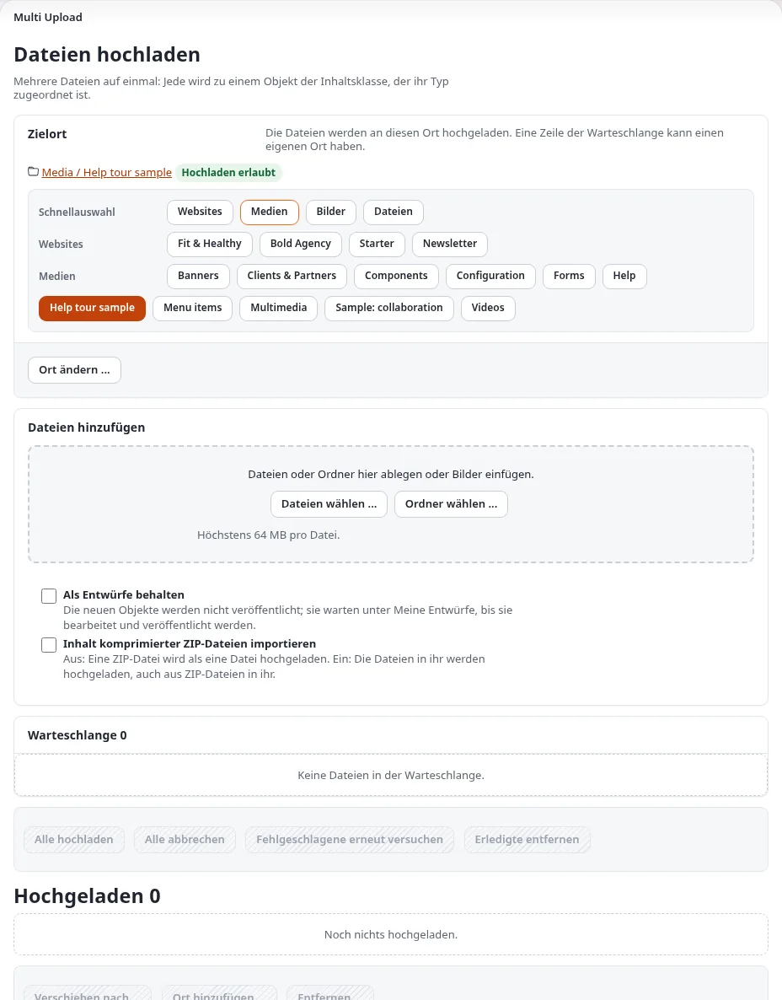

# Viele Bilder hochladen

Diese Seite ist für Privatpersonen mit vielen Bildern, die online sollen. Ein *Image*-Objekt nach dem anderen
anzulegen ist bei zehn Bildern in Ordnung und bei dreihundert mühsam. Die Erweiterung `ezmultiupload`, Teil der
Standardinstallation, fügt eine Upload-Seite hinzu, die pro Datei ein Objekt anlegt.

## Inhalt

1. [Wo der Upload erscheint](#wo-der-upload-erscheint)
2. [Die Dateien vorher vorbereiten](#die-dateien-vorher-vorbereiten)
3. [Hochladen](#hochladen)
4. [Eine ZIP-Datei hochladen](#eine-zip-datei-hochladen)
5. [Nach dem Upload](#nach-dem-upload)
6. [Wenn es nicht funktioniert](#wenn-es-nicht-funktioniert)

## Wo der Upload erscheint

Öffnen Sie einen *Folder* oder eine *Gallery* und klicken Sie auf **Mehrere Dateien hochladen**. Diese beiden
Klassen bieten ihn standardmäßig an (`ezmultiupload.ini [MultiUploadSettings] AvailableClasses[]`); die
Funktionsseite listet jede Einstellung auf ([ezmultiupload](../../../funktionen/6.0/erweiterungen/ezmultiupload.md)).

| Hochladen in | Standardmäßig angenommen |
|---|---|
| Eine Galerie | `*.jpg`, `*.png`, `*.gif`, `*.flv`, `*.mp4`, `*.mov` (auch in Großbuchstaben) |
| Einen Ordner | jeder Dateityp |

## Die Dateien vorher vorbereiten

Zehn Minuten an Ihrem Computer sparen Stunden in der Administration:

| Schritt | Warum |
|---|---|
| **Dateien umbenennen** nach dem Namen der Arbeit („hafen-im-morgengrauen.jpg") | Der Objektname stammt meist aus dem Dateinamen |
| **Verkleinern** auf eine sinnvolle Web-Größe (zum Beispiel höchstens ein paar tausend Pixel an der längsten Seite) | Schnellere Uploads; kleinere Kopien erzeugt die Website selbst |
| **Standortdaten entfernen** und andere Metadaten, die Sie nicht teilen möchten | Das Original wird so gespeichert, wie es hochgeladen wurde |
| **In einen Ordner pro Galerie sortieren** | Ein Upload pro Galerie |
| **Das Upload-Limit** Ihres Hostings prüfen (`upload_max_filesize`, `post_max_size` in `php.ini`) | Große Dateien scheitern sonst ohne Meldung ([PHP-Einstellungen für Exponential](../../hosting/grundlagen/php-einstellungen-fuer-exponential.md)) |

## Hochladen

1. Öffnen Sie die Zielgalerie.
2. Klicken Sie auf **Mehrere Dateien hochladen**.
3. Wählen Sie die Dateien aus oder ziehen Sie sie hinein. Jede Datei zeigt ein Vorschaubild, einen Zähler und eine
   Meldung, sobald sie gespeichert ist.
4. Wenn alle fertig sind, gehen Sie zurück zur Galerie: Jede Datei ist nun ein *Image*-Objekt darunter.

Wenn Sie abbrechen, bleiben die bereits gespeicherten Dateien erhalten; die nächsten Dateien, die Sie wählen, werden
normal hochgeladen.

## Eine ZIP-Datei hochladen

Die Upload-Seite kann auch ZIP-Dateien zu Inhalten entpacken: Jede Datei wird je nach Typ zu einem Bild- oder
Dateiobjekt, und *Keep the folder structure* (Ordnerstruktur beibehalten) legt für jeden Ordner des Archivs einen
Ordner an. Das ist ausgeschaltet, bis Sie *Import compressed zip file(s) contents* (Inhalte komprimierter ZIP-Dateien
importieren) einschalten. Einstellungen begrenzen Tiefe, Größe, Anzahl der Einträge und Kompressionsverhältnis.
**Bilder, deren Klasse einen Alternativtext verlangt, werden übersprungen**, weil eine ZIP-Datei keinen mitbringt
([Die Import- und Exportwerkzeuge von Exponential](../../../installation/migration/exponential-tools.md)).

## Nach dem Upload

Das Hochladen ist die halbe Arbeit. Für jedes Bild:

- [ ] Geben Sie ihm einen ordentlichen Namen, wenn der Dateiname keiner war.
- [ ] Schreiben Sie eine Bildunterschrift.
- [ ] Schreiben Sie einen Alternativtext.
- [ ] Fügen Sie Tags hinzu.
- [ ] Schneiden Sie zu oder drehen Sie, wo nötig ([Bilder mit ezie bearbeiten](bilder-mit-ezie-bearbeiten.md)).
- [ ] Legen Sie die Reihenfolge in der Galerie fest ([Eine Bildergalerie aufbauen](eine-bildergalerie-aufbauen.md#reihenfolge)).

Erledigen Sie das in Stapeln zu zwanzig; so bleiben die Bildunterschriften leichter einheitlich.

## Wenn es nicht funktioniert

| Symptom | Wahrscheinliche Ursache |
|---|---|
| Keine Schaltfläche **Mehrere Dateien hochladen** | Die Klasse steht nicht in `AvailableClasses[]`, oder Ihnen fehlt die Berechtigung, dort Inhalte anzulegen |
| Manche Dateien werden abgelehnt | Ihr Typ steht nicht in der Liste `FileType[]` der Galerie |
| Große Dateien scheitern | Die Upload-Limits des Hostings |
| Uploads brechen nach einigen Dateien ab | Zeit- oder Speicherlimits auf dem Server; laden Sie weniger auf einmal hoch |

## Verwandte Seiten

- [Portfolios](README.md)
- [Eine Bildergalerie aufbauen](eine-bildergalerie-aufbauen.md)
- [ezmultiupload](../../../funktionen/6.0/erweiterungen/ezmultiupload.md)
- [Pflege der Medienbibliothek](../../kunden/alltag/pflege-der-medienbibliothek.md)
- [Freie Dokumentation](../../freie-dokumentation.md): Diese Seite darf unter der GNU FDL 1.3 frei kopiert, übersetzt und verbessert werden.

<!-- exp-partner-block:start -->
**Werden Sie Exponential-Partner.** Partner teilen ihre Informationen, stellen Mittel bereit, geben Beiträge zurück
und entwickeln die Produkte mit uns, und so wächst Exponential. Eine Partner-Website und ein Dashboard sind für Mitte
2027 geplant: Werden Sie noch heute Partner, damit wir schneller wachsen und neue Funktionen früher liefern. Beginnen
Sie mit [Partner: hier beginnen](../../partner/partner-hier-beginnen.md) und
[Wie Sie sich bewerben](../../partner/wie-sie-sich-bewerben.md).
<!-- exp-partner-block:end -->
