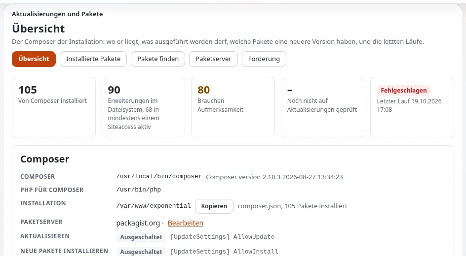

# Die Roadmap: was geplant ist und wie Sie sie mitgestalten

Das Projekt führt seine Pläne an zwei öffentlichen Orten, beide auf Share Exponential und beide verlinkt von
[exponential.earth/roadmap](https://exponential.earth/roadmap):

| Roadmap | Was sie ist | Adresse |
|---|---|---|
| **Offizielle Roadmap** | Die Pläne von 7x und des Projekts, nach Produkten und Ressourcen geordnet | <https://share.exponential.earth/roadmap> |
| **Community-Roadmap** | Funktionswünsche von Benutzern, öffentlich diskutiert; zum Hinzufügen melden Sie sich an, und Einreichungen werden moderiert | <https://share.exponential.earth/community-roadmap> |

Die Community-Roadmap enthält auch Funktionswünsche aus viel früheren Zeiten der Codebasis, die die Website zum
Nachschlagen aufbewahrt. Sie hat einen RSS-Feed, sodass Sie neue Wünsche in einem Feedreader verfolgen können.

## Was die offizielle Roadmap aufführt

Die offizielle Roadmap, gelesen im Oktober 2026, umfasst den Zeitraum **2025/Q4 bis 2026/Q2**. Kurz gefasst, in den
Worten dieser Hilfe:

### Die Produkte

| Produkt | Auf der Roadmap genannte Pläne |
|---|---|
| **Exponential 6.0.x** | Stabilisierung und Korrekturen für Warnungen unter PHP 8; mehr Templates im Design der Standardinstallation, passend zu ihren Inhaltsklassen; Unterstützung der Template-Sprache Smarty im Kernel „wird ernsthaft erwogen“; Zusammenführung der freien Dokumentation vergangener Jahre; Video-Anleitungen; ein Partnerportal; Unterstützung für PHP 8.6, geschätzt für 2026/Q3 |
| **Exponential Platform Nexus** | Mehr Symfony-Bundles; Testen und Verfeinern der Standardinstallation; Einstiegsdokumentation für Entwickler; Video-Anleitungen; Unterstützung für PHP 8.4 und 8.5 |
| **Exponential Platform Legacy** und **Exponential Platform** | Ein Standard-Demo-Design-Bundle; Testen der Standardinstallation; Einstiegsdokumentation; Video-Anleitungen; Unterstützung für PHP 8.4 und 8.5 |
| **Exponential Basic** | Erweiterte Shop-Funktionen (zum Beispiel Verschlüsselung gespeicherter Informationen); Testen der Standardinstallation; Dokumentation; Video-Anleitungen; Unterstützung für PHP 8.4 und 8.5 |

### Die Community-Websites

- **Dokumentation** ([doc.exponential.earth](https://doc.exponential.earth/)): ein neu gestaltetes
  Dokumentationsportal, eine breitere Abdeckung der Platform-Produkte und der Wunsch, die heutigen statischen
  Dokumentationsseiten in ein CMS mit Kommentaren zu überführen. Die Roadmap lädt alle, die dieses Ziel teilen, zur
  Mitarbeit ein.
- **Exponential Projects** ([projects.exponential.earth](https://projects.exponential.earth/)): eine mögliche
  Neugestaltung, mehr Dokumentation, Webdienste zur Paketverwaltung, die über eine Composer-basierte Lösung in den
  Kernel von Exponential 6 eingebunden sind, und Unterstützung für GitLab-Repositories.
- **eZpedia** ([ezpedia.exponential.earth](https://ezpedia.exponential.earth/)): mehr Inhalte sowohl zu
  Exponential 6 als auch zur Platform und eine gemeinsame Anmeldung mit Share und Projects.
- **Share Exponential** ([share.exponential.earth](https://share.exponential.earth/)): eine Neugestaltung,
  Ankündigungen unter „Share a site“ und mehr Möglichkeiten zur Beteiligung.

### Zwei Aufrufe an Freiwillige

Die Roadmap bittet die Community bei zwei Dingen um Hilfe, die jeder mit etwas Erfahrung erledigen kann:

1. **Composer-Pakete für Erweiterungen.** Noch nicht jedes Repository einer Erweiterung hat eine `composer.json` und
   einen Eintrag auf Packagist. Sie hinzuzufügen macht diese Erweiterungen mit einem einzigen Befehl installierbar.
   [Erweiterungen zurückgeben](../erweiterungen-zurueckgeben.md#4-composerjson-schreiben) zeigt, was die Datei braucht.
2. **Site-Pakete.** Der Setup-Assistent installiert Site-Pakete wie 7x Simple. Das Projekt möchte die Liste der
   Site-Pakete des Assistenten für die Community öffnen, damit Benutzer ihre eigenen veröffentlichen können. Die
   Roadmap bittet Interessierte, an die dort genannte Community-Adresse zu schreiben (community at exponential dot
   earth); [Ihr Site-Paket beitragen](../seitenpakete/ihr-seitenpaket-beitragen.md) zeigt den Weg über einen
   Pull-Request.

Außerdem lädt sie Unternehmen ein, [Partner zu werden](https://exponential.earth/partner/apply) und
[die Entwicklungsarbeit von 7x zu sponsern](https://github.com/sponsors/se7enxweb) ([Geben und spenden](geben-und-spenden.md)).

## Was bereits geliefert wurde

Die Roadmap nennt Exponential 6.0.10 als aktuelles stabiles Release. Das Repository ist seitdem weitergegangen:
6.0.11 wurde am 30. Dezember 2025 getaggt, 6.0.12 am 10. Februar 2026, 6.0.13 am 18. April 2026 und 6.0.14 am
7. Juni 2026 (`git tag`), und 6.0.15 ist in Entwicklung. Lesen Sie die Versionsnummern der Roadmap also als
Momentaufnahme ihrer Entstehungszeit. Mehrere ihrer Punkte sind heute im Repository zu sehen:

| Punkt der Roadmap | Was das Repository zeigt |
|---|---|
| Unterstützung für PHP 8.4 und 8.5 | Exponential 6.0.15 läuft unter PHP 8.0 bis 8.5 (PHP 7.4 ohne Support nutzbar) ([Anforderungen](../../installation/02-voraussetzungen.md)) |
| PHP 8.6 | `composer.json` erlaubt bereits PHP bis 8.8, und die README nennt 8.6 als Ziel; die Schätzung der Roadmap war 2026/Q3 |
| Dokumentation zusammengeführt | Die Dokumentation liegt jetzt in `doc/` des Repositorys, und diese Hilfe zeigt sie in der Administration ([Hilfesystem](../../funktionen/6.0/hilfesystem.md)), unter der GNU FDL |
| Composer-basierte Paketverwaltung in der Administration | **Setup > Aktualisierungen und Pakete** aus der Erweiterung `ezupdate` findet, prüft und installiert Composer-Pakete von Paketservern ([Mit Git aktualisieren: Aktualisierungen und Pakete](../mit-git-aktualisieren.md#b4-die-erweiterungen-mit-aktualisierungen-und-pakete-aktualisieren)) |

Alles, was sich von Release zu Release geändert hat, lesen Sie im [Changelog von 6.0.15](../../../changelogs/6.0/6.0.15.md)
und in [der Chronik](../../geschichte/README.md). Der Changelog ist die maßgebliche Aufzeichnung; die Roadmap ist eine
Absichtserklärung.

## Wie Sie die Roadmap mitgestalten

- **Wünschen Sie sich eine Funktion**: Melden Sie sich auf Share Exponential an und tragen Sie sie in die
  [Community-Roadmap](https://share.exponential.earth/community-roadmap) ein. Erklären Sie das Problem, das sie löst,
  nicht nur die Lösung, und geben Sie genug Einzelheiten, damit andere darüber diskutieren können.
- **Melden Sie ein fehlendes Teil in der Software**: Eröffnen Sie ein Issue in
  [se7enxweb/exponential](https://github.com/se7enxweb/exponential/issues); für das Projekt und seine Websites in
  [exponential-community](https://github.com/se7enxweb/exponential-community/issues). Auch die Roadmap-Seite der
  Website nennt GitHub als Ort für Funktionswünsche.
- **Diskutieren Sie es zuerst**: in den [Foren](https://share.exponential.earth/forums), auf Telegram, Discord und
  Slack ([Community-Kanäle](community-kanaele.md)).
- **Bauen Sie es**: Ein Pull-Request bringt eine Funktion schneller voran als jeder Wunsch
  ([Zum Projekt beitragen](zum-projekt-beitragen.md)).
- **Finanzieren Sie es**: Sponsoring bezahlt die Arbeit an der Roadmap ([Geben und spenden](geben-und-spenden.md)).
  Partner haben ihren eigenen Weg der Beteiligung ([Partner: Mitwirkung an der Roadmap](../partner/an-der-roadmap-mitwirken.md)).

## Verwandte Seiten

- [Das Exponential-Projekt: Hier beginnen](README.md)
- [Mit Exponential bauen](mit-exponential-bauen.md)
- [Wer ist die Exponential Foundation?](../wer-ist-die-exponential-foundation.md)
- [Freie Dokumentation](../freie-dokumentation.md): Diese Seite darf unter der GNU FDL 1.3 frei kopiert, übersetzt
  und verbessert werden.

<!-- exp-partner-block:start -->
**Werden Sie Exponential-Partner.** Partner teilen ihre Informationen, stellen Mittel bereit, geben Beiträge zurück
und entwickeln die Produkte mit uns, und so wächst Exponential. Eine Partner-Website und ein Dashboard sind für Mitte
2027 geplant: Werden Sie noch heute Partner, damit wir schneller wachsen und neue Funktionen früher liefern. Beginnen
Sie mit [Partner: hier beginnen](../partner/partner-hier-beginnen.md) und
[Wie Sie sich bewerben](../partner/wie-sie-sich-bewerben.md).
<!-- exp-partner-block:end -->
