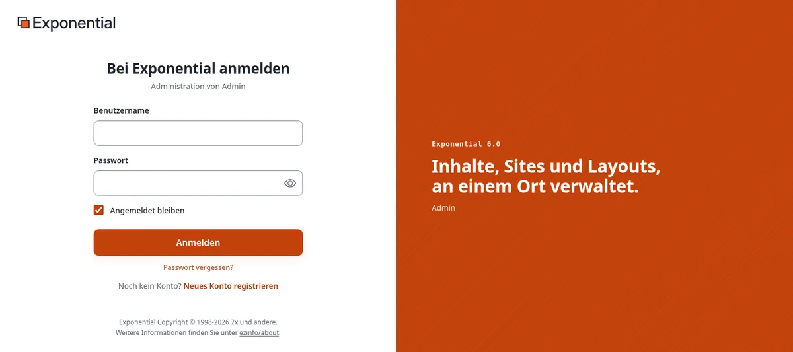
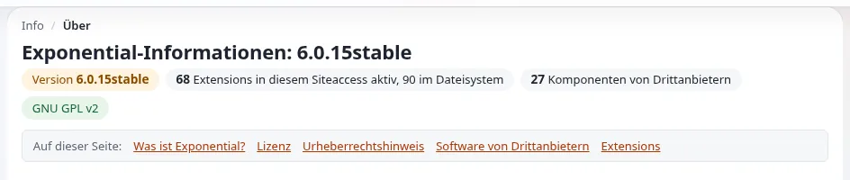
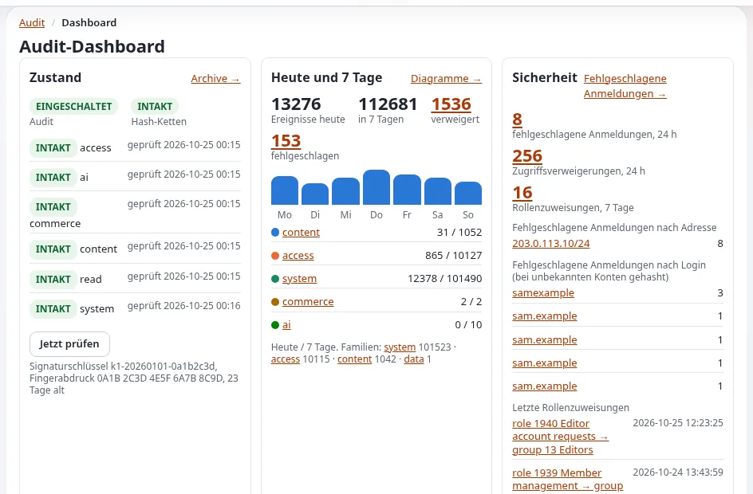

# Sicherheitshärtung

Diese Seite richtet sich an Administratoren und Entwickler, die eine aus dem Internet erreichbare Exponential-Site
betreiben. Sie betrachtet die Site so, wie ein Angreifer es tut: welche Türen es gibt, was jeden Tag an ihnen versucht
wird und welche davon Exponential 6 bereits geschlossen hält. Für jede Bedrohung nennt sie die eingebaute Abwehr und die
Einstellungen oder Befehle, die schließen, was noch offen ist.

Sie ergänzt [Kapitel 13 der Installationsanleitung, Sicherheitshärtung für den
Produktivbetrieb](../installation/13-sicherheitshaertung.md), ohne es zu wiederholen; dieses ist die Referenz Einstellung für
Einstellung und die Checkliste für den Livegang. Wo beide ein Thema behandeln, sagt diese Seite, warum, und verweist auf
den Abschnitt von Kapitel 13, der sagt, wie.

> **Hinweis:** Diese Seite beschreibt nur Abwehrmaßnahmen. Um eine Schwachstelle zu melden, schreiben Sie an
> **security@se7enx.com**, nicht an den öffentlichen Issue-Tracker ([Eine Schwachstelle melden](#eine-schwachstelle-melden)).

## Inhalt

1. [Grundsätze: sicher ab Werk](#grundsätze-sicher-ab-werk)
2. [Wer ein CMS angreift, und wie](#wer-ein-cms-angreift-und-wie)
3. [Die Bedrohungen im Einzelnen](#die-bedrohungen-im-einzelnen)
4. [Ein vorgeschalteter Schutzschild: request-shield](#ein-vorgeschalteter-schutzschild-request-shield)
5. [Beobachten: Logs, der Request-Klassifizierer und das Audit-Protokoll](#beobachten-logs-der-request-klassifizierer-und-das-audit-protokoll)
6. [Checkliste](#checkliste)
7. [Eine Schwachstelle melden](#eine-schwachstelle-melden)

## Grundsätze: sicher ab Werk

Die Arbeitsweise des OpenBSD-Projekts ist ein guter Maßstab für jede Serversoftware: Eine frische Installation ist ohne
zusätzliche Arbeit sicher, jeder Teil hat nur die Rechte, die er braucht, und jede Änderung wird geprüft. Exponential 6
folgt denselben Grundsätzen; Ihre Aufgabe ist es, sie in Kraft zu halten.

| Grundsatz | Was er hier bedeutet | Eingebaut | Ihr Teil |
|---|---|---|---|
| **Sicher ab Werk** | eine neue Installation ist sicher, bevor irgendjemand sie anpasst | strenge Rewrite-Regeln, Sicherheits-Header, Cookies mit `HttpOnly`/`SameSite`, Debug aus, Formular-Tokens, bcrypt-Hashes, erzeugte Administratorpasswörter, der Setup-Assistent auf einer installierten Site geschlossen | lockern Sie keine Vorgabe, um „etwas zum Laufen zu bringen“; suchen Sie die Ursache |
| **Minimale Rechte** | jedes Konto und jeder Prozess kann nur seine Aufgabe erledigen | Rollen und Richtlinien, die Rolle Anonymous ohne `user/login` für die Administration, Kommandozeilenskripte verweigern den Lauf als root ohne `--allow-root-user`, Velocity-Worker nie als root | Redakteure erhalten Redakteursrollen, ein persönliches Konto pro Person, `admin` stillgelegt ([Kontenhygiene](administratorpasswort-aendern.md#kontenhygiene)) |
| **Rechtetrennung** | die Teile, die dem Internet zugewandt sind, können die Teile nicht ändern, die Code ausführen | PHP unterhalb des Document Root wird nie ausgeliefert, Uploads werden nie ausgeführt, `ManagedByDeployment` hindert die Administration daran, Code und Einstellungen zu schreiben | Code gehört einem anderen Benutzer als dem Webserver und ist für diesen nur lesbar; die Administration auf einem eigenen Host |
| **Minimale Angriffsfläche** | was nicht gebraucht wird, ist nicht erreichbar | nur eine feste Liste von Asset-Pfaden wird als Dateien ausgeliefert, die Admin-Module verlangen eine Anmeldung, der Schutzschild und die Request-Regeln können ganze URL-Familien abweisen | schalten Sie Erweiterungen und Siteaccesses ab, die Sie nicht verwenden; beschränken Sie die Administration auf ein Netzwerk |
| **Prüfung** | jede Änderung ist nachvollziehbar, und Manipulation fällt auf | das Audit-Protokoll mit Hash-Ketten, `security.log`, `auth.log`, das CSP-Berichtslog, die Log-Anzeige | lesen Sie sie, alarmieren Sie bei Auffälligkeiten, leiten Sie sie von der Maschine weg |
| **Öffentlich vorwärts korrigieren** | ein veröffentlichtes Release wird nie geändert; Korrekturen kommen als nächstes Release | Releases sind unveränderliche Tags; mit `share/filelist.md5` lässt sich jede Datei prüfen | folgen Sie den Releases, aktualisieren Sie, prüfen Sie die Dateikonsistenz |

## Wer ein CMS angreift, und wie

Fast alle Angriffe auf eine Site wie Ihre sind automatisiert und nicht persönlich. Die Gruppen dahinter setzen dieselben
wenigen Techniken auf Millionen von Sites ein:

- **Botnetze und Scanner** suchen an jeder Adresse nach bekannten Dateien und Produkten (`/wp-login.php`, `/.env`,
  `/.git/config`, `/backup.zip`, `phpinfo.php`), probieren Injection-Zeichenketten in jedem Parameter und alte
  Schwachstellen anhand der Version.
- **Angreifer auf Zugangsdaten** probieren geleakte Paare aus Benutzername und Passwort aus anderen Einbrüchen
  (Credential Stuffing), Standardpasswörter (`admin` / `publish` bei dieser Software) und langsames Passwortraten,
  verteilt über viele Adressen.
- **Zugangshändler** machen aus einer funktionierenden Anmeldung oder einem hochgeladenen Skript einen dauerhaften
  Zugang und verkaufen ihn weiter; Ransomware und Datendiebstahl folgen. Ein vergessenes Administratorkonto oder eine
  alte Erweiterung genügt.
- **Scraper und KI-Crawler** zählen jede URL durch, `content/view/full/<number>` eingeschlossen, und füllen Caches.
- **Angreifer auf die Lieferkette** zielen auf Abhängigkeiten, Build-Pipelines und Update-Kanäle statt auf Ihre Site.

Gut abzuwehren heißt, all das billig abweisbar und teuer im Erfolg zu machen, und zu bemerken, wenn doch einer
durchkommt.

## Die Bedrohungen im Einzelnen

### Brute Force und Credential Stuffing bei der Anmeldung

**Das Risiko.** `/user/login` und `/admin/user/login` sind die am häufigsten angegriffenen URLs jeder Site. Geleakte
Passwörter anderer Dienste funktionieren überall dort, wo Menschen sie wiederverwenden.

**Eingebaut.** Passwörter werden als bcrypt-Hashes gespeichert (`HashType=php_default`). Die Anmeldung kostet bei einem
unbekannten Login genauso viel wie bei einem falschen Passwort, und **Passwort vergessen?** antwortet für jede Adresse
gleich, sodass keines von beiden verrät, welche Konten existieren. Die Alarmregeln des Audit-Protokolls `brute_force`
(20 Fehlversuche aus einem Netzwerk in 5 Minuten) und `brute_force_user` (10 für ein Konto in 15 Minuten) melden
Angriffe. Die Zwei-Faktor-Authentifizierung (`sevenx_authentication_2fa`) macht ein gestohlenes Passwort allein
wertlos. Jedes Formular, das ein Passwort setzt, weist bekannte und gängige Passwörter ab (`WeakPasswordCheck`, die
Liste, die Angreifer zuerst probieren), und ein Link aus **Passwort vergessen?** funktioniert einmal und eine Stunde lang
(`ForgotPasswordKeyLifetime`).

**Härten.**

- Schalten Sie die Zwei-Faktor-Authentifizierung ein und verlangen Sie sie mindestens für Administratoren
  ([Zwei-Faktor-Anmeldung](../anleitungen/zwei-faktor-anmeldung.md), `[General] Enforce2FA=enabled`).
- Eine Passwortrichtlinie: `MinPasswordLength=15`, `ForbidLogin`, `ForbidCurrentPassword`
  ([13.6](../installation/13-sicherheitshaertung.md#136-passwörter-und-anmeldung)).
- Sperren Sie Konten optional nach Fehlversuchen (`[UserSettings] MaxNumberOfFailedLogin=10`) und tragen Sie Ihr
  eigenes Netzwerk in `TrustedIPList[]` ein; bedenken Sie, dass eine Sperre es auch jedem erlaubt, ein bekanntes Konto
  zu sperren.
- Beschränken Sie die Administration auf Ihr Netzwerk oder ein VPN, oder setzen Sie mit
  [request-shield](#ein-vorgeschalteter-schutzschild-request-shield) eine Browserprüfung vor ihre Anmeldung. Hinter einem Proxy
  konfigurieren Sie zuerst `TrustedProxies[]`, sonst hat jeder Besucher die Adresse des Proxys
  ([13.10](../installation/13-sicherheitshaertung.md#1310-hinter-einem-proxy-vertrauenswürdige-header)).

### Standard- und geteilte Zugangsdaten

**Das Risiko.** Den Login `admin` gibt es in jeder Installation, und `publish` ist das Standardpasswort, das in jeder
alten Anleitung steht. Geteilte Konten verschleiern, wer was getan hat.

**Eingebaut.** Kein Installer von Exponential 6 lässt `publish` bestehen: Der Kickstarter und `exp:install` ersetzen ein
leeres, kurzes oder bekanntes Passwort durch ein zufälliges, und der Setup-Assistent weist ein kurzes oder bekanntes ab
([Das Standardpasswort des Administrators](standard-administratorpasswort.md)).

**Härten.** Ändern Sie das Administratorpasswort nach der Installation, löschen Sie `var/log/initial-admin-password`,
legen Sie für jede Person ein persönliches Administratorkonto an und legen Sie `admin` als Anmeldung still
([Kontenhygiene](administratorpasswort-aendern.md#kontenhygiene)). Prüfen Sie migrierte Sites auf ein altes
Initialpasswort: `./console exp:resetuserpassword --allow-root-user -u admin -g -l 24` setzt ein neues.

**Demo-Modus.** Eine öffentliche Demo, die ihr Administratorpasswort veröffentlicht, läuft mit der Umgebungsvariablen
`EXP_DEMO_MODE=1`: Die Installer akzeptieren das veröffentlichte Passwort, und niemand kann ein Administratorpasswort
ändern oder zurücksetzen. Auf einer echten Site wäre das ein bekanntes Passwort, das niemand ändern kann. Der Modus kann
nicht aus einer Einstellung oder einer Anfrage kommen, die Administration zeigt ein Banner, solange er aktiv ist, und
jeder Prozess protokolliert ihn; prüfen Sie, dass kein Prozess einer Produktivsite die Variable hat
([Demo-Modus](demomodus.md)).

### Ein offener Setup-Assistent oder Installer-Dateien

**Das Risiko.** Ein auf einer Live-Site erreichbarer Setup-Assistent erlaubt es jedem, sie mit einem eigenen
Administrator neu zu installieren. Installer-Dateien (`kickstart.ini`, eine erzeugte Passwortdatei) enthalten
Passwörter.

**Eingebaut.** Auf einer installierten Site zeigt `setup/init` nur „This site is already installed“ und schreibt nichts
(`expSetupWizardGuard`; installiert heißt: `var/site_installed.json` existiert, die Site wird normal ausgeliefert oder
die Datenbank enthält Inhalte). `[SetupSettings] AllowWizardOnInstalledSite` (Vorgabe `disabled`, nur für die
Entwicklung) ist der einzige Weg daran vorbei, und selbst dann ist eine Bestätigung mit einem Einmal-Token nötig. Der
Installer schreibt `[SiteAccessSettings] CheckValidity=false`. Mit `[ConfigurationSettings] ManagedByDeployment=enabled`
kann die Administration den Assistenten überhaupt nicht ausführen, keine Einstellungen oder Templates bearbeiten, keine
Erweiterungen aktivieren und keine Pakete installieren
([Konfiguration durch das Deployment verwaltet](../funktionen/6.0/durch-deployment-verwaltet.md)).

**Härten.** Behalten Sie `CheckValidity=false` und `AllowWizardOnInstalledSite=disabled` bei. Entfernen Sie
`kickstart.ini` und `var/log/initial-admin-password` nach der Installation. Schalten Sie `ManagedByDeployment` auf den
Administrations-Siteaccesses der Produktivumgebung ein, wenn Einstellungen und Templates aus der Versionsverwaltung
kommen.

### Missbrauch von Datei-Uploads

**Das Risiko.** Eine hochgeladene Datei, die der Server später ausführt (ein als Bild getarntes PHP-Skript), eine Datei,
die im Browser Skript ausführt (SVG, HTML), oder eine riesige oder fehlerhafte Datei, die den Server erschöpft.

**Eingebaut.**

- Nichts unterhalb des Document Root wird ausgeführt: Die Rewrite-Regeln liefern für jede `.php`-, `.phtml`- und
  `.phar`-Datei unterhalb des Wurzelverzeichnisses 404 und liefern aus den Speicherverzeichnissen nur Bilddateien aus;
  andere Uploads werden nur über `content/download` ausgeliefert, das die Rechte des Lesers prüft
  ([13.2](../installation/13-sicherheitshaertung.md#132-was-der-webserver-niemals-ausliefern-darf)).
- Bilder werden nach ihrem Inhalt angenommen, nicht nach ihrem Namen: `expImageUploadValidator` liest den Typ mit
  fileinfo von PHP und vergleicht ihn mit `image.ini [ImageUploadSettings] AllowedMIMETypes[]`.
- SVG-Dateien werden nie so gespeichert, wie sie hochgeladen wurden: `expSvgSanitizer` behält nur, was als sicher
  bekannt ist, und die gespeicherte Datei wird mit Headern ausgeliefert, die verhindern, dass sie etwas ausführt
  ([SVG-Bilder](../bc/6.0/svg-bilder.md)).
- Paket-Uploads brauchen die `package`-Richtlinien, und `ManagedByDeployment` sperrt sie.

**Härten.** Halten Sie die Rewrite-Regeln nach jedem Upgrade aktuell (`.htaccess_root` oder der daraus abgeleitete
nginx-Block). Geben Sie Upload-Rechte nur den Rollen, die sie brauchen. Halten Sie `TemporaryDir` privat für die Site
([13.11](../installation/13-sicherheitshaertung.md#1311-dateiberechtigungen-und-eigentümer)).

### Path Traversal und Zugriff auf interne Dateien

**Das Risiko.** `../`-Folgen oder kodierte Varianten, die die Anwendung eine Datei außerhalb ihres Verzeichnisses lesen
lassen, und direkte Anfragen nach `.git`, `settings/`, `var/`, `vendor/`, `composer.json` oder der SQLite-Datenbank.

**Eingebaut.** Nur eine feste Liste von Asset-Pfaden wird als Dateien ausgeliefert; alles andere geht an `index.php`,
sodass `/settings/site.ini` eine Exponential-Seite oder ein 404 ist, nie die Datei. Dateien und Verzeichnisse, die mit
einem Punkt beginnen, liefern 404. Velocity weist symbolische Links ab, die aus dem Document Root herausführen
(`FollowSymlinks=disabled`). Der Request-Klassifizierer schreibt jeden Traversal-Versuch in `security.log` (Regelsatz
`traversal`).

**Härten.** Liefern Sie die Installation nie mit einer allgemeinen Konfiguration „Datei ausliefern, wenn sie existiert“
aus. Führen Sie die Prüfung aus
[13.2](../installation/13-sicherheitshaertung.md#132-was-der-webserver-niemals-ausliefern-darf) nach jeder Änderung an der
Konfiguration des Webservers von außen aus.

### Cross-Site-Scripting (XSS) und die Content Security Policy

**Das Risiko.** Ein Wert, der unmaskiert in eine Seite gelangt, führt Skript im Browser eines Redakteurs oder
Administrators aus, mit dessen Sitzung.

**Eingebaut.** Templates maskieren mit `|wash`; der Rich Text wird als XML gespeichert und über Templates
dargestellt; hochgeladene SVG werden bereinigt. Eine Content Security Policy wird aus `site.ini [ContentSecurityPolicy]`
gesendet: `script-src 'self'` mit einer Nonce pro Anfrage, keine Inline-Skripte. Die Administrationen Admin 4, Admin 4 L
und AdminUI sind so geschrieben, dass sie unter einer durchgesetzten Richtlinie laufen. Verstöße werden an
`var/log/csp.log` gemeldet und unter **CSP reports** (`csp/report`) angezeigt.

**Härten.** Im Auslieferungszustand meldet `Mode=auto` auf Administrations-Siteaccesses nur (Report-Only) und ist auf den
Sites aus. Lesen Sie die Berichte und setzen Sie dann `Mode=enforce` auf dem Administrations-Siteaccess; das klassische
Design bleibt über `ReportOnlyDesigns[]` im Report-Only-Modus. Verfahren Sie ebenso mit den öffentlichen Siteaccesses,
sobald Ihre Designs und Erweiterungen nichts mehr melden
([Content Security Policy](../funktionen/6.0/content-security-policy.md)). Entwickler: Maskieren Sie jede Ausgabe, bauen
Sie in PHP nie HTML aus Anfragedaten und legen Sie Skripte in Dateien ab.

### Cross-Site Request Forgery (CSRF)

**Das Risiko.** Eine andere Site bringt den Browser eines angemeldeten Redakteurs dazu, ein Formular abzuschicken:
veröffentlichen, löschen, eine Rolle ändern.

**Eingebaut.** Die Erweiterung `ezformtoken` fügt jedem Formular ein Token pro Sitzung hinzu und prüft es bei jedem
POST; ein abgewiesenes Token führt zur Seite „Formular abgelaufen“. Sitzungscookies sind `SameSite=Lax`.

**Härten.** Behalten Sie `ezformtoken` in `ActiveExtensions[]`; eigener AJAX-Code sendet das Token ebenfalls
([13.8](../installation/13-sicherheitshaertung.md#138-formular-tokens-gegen-cross-site-request-forgery)).

### SQL-Injection durch eigenen Code

**Das Risiko.** Die Abfragen des Kernels sind parametrisiert oder maskiert; das Risiko liegt in Erweiterungen und
Site-Code, die SQL aus Anfragedaten zusammensetzen.

**Eingebaut.** Die eigenen Muster des Kernels wurden in der Härtung von 6.0.13 geprüft und korrigiert; Erweiterungen,
die von den RAD-Assistenten erzeugt werden, enthalten seit deren Korrektur sicheren Code; der Request-Klassifizierer
protokolliert Injection-Muster in URLs (Regelsatz `injection`), und die `@attacks`-Regeln von request-shield können sie
abweisen, bevor PHP läuft.

**Härten (Entwickler).** Verwenden Sie `eZPersistentObject` und die Content-API; wenn SQL unvermeidlich ist,
`$db->escapeString()` für jede Zeichenkette und `(int)` für jede Zahl; übergeben Sie Anfragedaten nie ohne
`escapeshellarg()` an eine Shell. Erzeugen Sie Erweiterungen neu, die mit den RAD-Assistenten vor deren Korrektur
erstellt wurden ([Härtungshinweise zu 6.0.13](../bc/6.0/haertung.md), [RAD-Werkzeuge: Sicherheit](../bc/6.0/rad-sicherheit.md),
[Härtung von Datentypen und Eingaben](../spezifikationen/6.0/datentyp-eingabehaertung.md)).

### Sitzungsübernahme

**Das Risiko.** Ein gestohlenes Sitzungscookie ist so viel wert wie das Passwort und übersteht auf vielen Systemen eine
Passwortänderung.

**Eingebaut.** Cookies sind `HttpOnly` und `SameSite=Lax` und über HTTPS `Secure`. Die Sitzungs-ID ändert sich bei der
Anmeldung. Eine Passwortänderung meldet über den Passwortstempel alle anderen Sitzungen des Benutzers ab
(`[PasswordSettings] EndOtherSessions=enabled`). Die Sitzungen eines deaktivierten Kontos enden bei ihrer nächsten
Anfrage.

**Härten.** `CookieSecure=true` auf einer reinen HTTPS-Site, ein kürzeres `SessionTimeout`, ein eigenes Sitzungscookie
pro Siteaccess (`SessionNameHandler=custom`), `session.use_strict_mode=1` in PHP
([13.7](../installation/13-sicherheitshaertung.md#137-sitzungen-und-cookies)). Nach einer vermuteten Kompromittierung: Ändern
Sie das Passwort und entfernen Sie alle Sitzungen (**Setup** > **Sitzungen**, mit dem Datenbank-Session-Handler).

### Offene Weiterleitungen und Phishing über Ihre Domain

**Eingebaut.** Jedes Weiterleitungsziel, das von außerhalb des Codes kommt (ein Formularfeld, die Sitzung, ein
URL-Parameter), einschließlich derer der Anmeldung und der Zwei-Faktor-Anmeldung, durchläuft die
[Regeln für sichere Weiterleitungen](../funktionen/6.0/sichere-weiterleitungen.md) (`eZRedirectManager`): Ein Ziel auf einem
anderen Host als dem der Site selbst oder `[SiteSettings] AllowedRedirectHosts` wird abgewiesen, ebenso Ziele mit
`javascript:` und `data:` und die üblichen Kodierungstricks.

**Härten.** Beschränken Sie `AllowedRedirectHosts` auf Hosts, die Sie kontrollieren.

### Veraltete Abhängigkeiten und die Lieferkette

**Das Risiko.** Eine bekannte Schwachstelle in einem alten Release des Kernels, einer Erweiterung, einer
Composer-Abhängigkeit, von PHP oder der Datenbank; eine manipulierte Datei auf dem Server.

**Eingebaut.** Releases sind unveränderliche Tags auf Packagist und GitHub, mit Changelogs. **Setup** >
**Upgrade-Prüfung** vergleicht jede Datei mit der `share/filelist.md5` des Release („Überprüfe Dateikonsistenz“) und das
Schema mit dem des Release („Überprüfe Datenbankkonsistenz“).

**Härten.** Folgen Sie den Releases von Exponential und jeder Erweiterung; aktualisieren Sie zuerst eine Kopie; führen
Sie `composer audit` aus, um bekannte Schwachstellen in den gesperrten Abhängigkeiten aufzulisten; halten Sie
`composer.lock` in der Versionsverwaltung; prüfen Sie nach jedem Update die Dateikonsistenz; aktualisieren Sie auch PHP,
den Datenbankserver, das Betriebssystem und die Engine von Velocity
([13.15](../installation/13-sicherheitshaertung.md#1315-auf-dem-neuesten-stand-bleiben)). Prüfen Sie den Code einer Erweiterung von
Dritten, bevor Sie sie installieren.

### Debug-Ausgabe im Produktivbetrieb

**Das Risiko.** Debug-Berichte zeigen SQL, Dateipfade, Template-Namen und Zeiten: eine Landkarte für einen Angreifer.

**Eingebaut.** `[DebugSettings] DebugOutput=disabled`, Template-Debug aus, Fehler werden protokolliert, nicht angezeigt.

**Härten.** Lassen Sie es aus; wenn Sie live debuggen müssen, beschränken Sie es mit `DebugByIP` auf Ihre eigene
Adresse und entfernen Sie es wieder. PHP selbst: `display_errors=Off`, `expose_php=Off`
([13.4](../installation/13-sicherheitshaertung.md#134-debug-ausgabe-und-fehleranzeige)).

### Cron- und Kommandozeilenskripte als root

**Das Risiko.** Ein als root ausgeführtes Skript schreibt Dateien, die der Webserver später nicht ändern kann oder die
mit den Rechten von root laufen.

**Eingebaut.** Die Kommandozeilenskripte von Exponential verweigern den Lauf als root-Benutzer des Betriebssystems, sofern
nicht `--allow-root-user` angegeben ist, und `resetuserpassword --allow-root-user` prüft, dass Sie wirklich root sind.

**Härten.** Führen Sie `runcronjobs.php` und die Konsole als Benutzer der Site aus dessen Crontab aus. Verwenden Sie
root nur für die wenigen dokumentierten Aufgaben und prüfen Sie danach, dass die Dateien in `var/` noch dem Benutzer und
der Gruppe der Site gehören.

### Velocity, PHP-FPM und Benutzertrennung

**Eingebaut.** Die Worker von Velocity laufen nie als root (`[ServerSettings] AllowRootWorkers=disabled`), sein
Dashboard, seine Kennzahlen und `/Q/phpinfo` sind nur lokal erreichbar, sofern Sie kein Token setzen, sein Control
Panel ist lokal und passwortgeschützt, und seine Konfigurationsdateien pro Site haben die Rechte `0600`. PHP-FPM-Pools
laufen als Benutzer der Site.

**Härten.** Binden Sie Velocity an `127.0.0.1`, wenn ein Proxy davor steht; setzen Sie `User` und `Group` auf den
Benutzer der Site; halten Sie den Code für diesen Benutzer schreibgeschützt; tragen Sie genau Ihre Proxys in
`Q.webserver.proxy.trusted` ein ([13.12](../installation/13-sicherheitshaertung.md#1312-velocity-spezifische-härtung)).

### TLS und Sicherheits-Header

**Eingebaut.** Fünf Sicherheits-Header auf jeder Seite (`X-Content-Type-Options`, `X-Frame-Options`,
`Content-Security-Policy: frame-ancestors 'self'`, `Referrer-Policy`, `Permissions-Policy`); Velocity liefert HTTPS mit
automatischen Zertifikaten und HSTS aus.

**Härten.** HTTPS auf jedem Namen, HTTP umgeleitet, HSTS erhöht, sobald alles funktioniert, Zertifikate überwacht
([13.9](../installation/13-sicherheitshaertung.md#139-sicherheits-header-und-https)).

### Sicherungen und Wiederherstellung

**Das Risiko.** Ransomware, ein fehlgeschlagenes Update oder ein versehentliches Löschen; Sicherungen, die Geheimnisse im
Klartext enthalten.

**Härten.** Sichern Sie die Datenbank, `var/storage` und `settings/override` (als Geheimnisse, verschlüsselt), bewahren
Sie mindestens eine Kopie außerhalb der Maschine und offline auf und stellen Sie regelmäßig eine auf einer Testmaschine
wieder her ([10.9 Sicherungen und Wiederherstellung](../installation/10-nach-der-installation.md#109-sicherung-und-wiederherstellung)). Bewahren
Sie das Notfallverfahren für den Administrator neben dem Wiederherstellungsverfahren auf.

## Ein vorgeschalteter Schutzschild: request-shield

[request-shield](https://request-shield.com) (Quelle: [cjw-network/request-shield](https://github.com/cjw-network/request-shield),
MIT-Lizenz) ist eine kleine Web Application Firewall für PHP vom CJW Network. Sie prüft jede Anfrage, **bevor der
Exponential-Kernel startet**: Echte Besucher passieren in Mikrosekunden, Scanner und fehlerhafte Anfragen werden
abgewiesen, Fluten werden gebremst, verdächtige Clients beweisen mit einer unsichtbaren Prüfung, dass sie ein Browser
sind, und die Administration kann auf ein Netzwerk beschränkt oder hinter diese Prüfung gestellt werden. Jede
Entscheidung nennt die Regel, die sie getroffen hat, und die Regeln sind reiner Text, eine pro Zeile. Sie wird für jede
aus dem Internet erreichbare Exponential-Site empfohlen.

### Wie sie den Request-Klassifizierer ergänzt

| | Request-Klassifizierer des Kernels | request-shield |
|---|---|---|
| Was er tut | **klassifiziert** nur: Sondierungen, Traversal, Injection, Angriffswerkzeuge, Häufungen von 404 | **entscheidet**: weist ab, bremst, prüft, sperrt für eine Weile oder protokolliert nur (Monitor-Modus) |
| Wo er läuft | im Kernel, nachdem die Anfrage begonnen hat | vor dem Kernel, sodass eine abgewiesene Anfrage etwa 30 µs kostet statt einer gerenderten Seite |
| Sein Log | `var/log/security.log` | ein eigenes Log und eine Live-Ansicht unter `/rs/` |
| Einstellungen | `settings/requestclassifier.ini` | ihre Regeldateien |

Wo sie sich überschneiden, verwenden beide dieselben Namen (die Sondierungs- und Injection-Regeln des Klassifizierers
folgen den Namen `WP-*`, `SCAN-*` und `ATK-*` von request-shield in Kleinbuchstaben), sodass sich eine Zeile im einen
Log im anderen wiederfinden lässt. Eine Anfrage, die der Schutzschild abweist, erreicht den Kernel nie und steht daher
nicht in `security.log`; im Monitor-Modus kann dieselbe Sondierung in beiden Logs stehen. Der HTTP-Cache von Exponential
arbeitet mit ihr zusammen: Eine Anfrage, die der Schutzschild mit `allow-uncached` markiert (ein ausgedachter Pfad oder
Parameter), wird beantwortet, aber nie gespeichert, sodass zufällige Adressen den Cache nicht füllen können
([HTTP-Cache: Mit vorgeschaltetem request-shield](../bc/6.0/httpcache.md#mit-vorgeschaltetem-request-shield)).
Einzelheiten: [Request-Logs: request-shield und der Klassifizierer](../funktionen/6.0/anfrageprotokolle.md#request-shield-und-der-klassifizierer).

### Installation

request-shield ist **nicht** Teil der `composer.json` von Exponential; Sie fügen es Ihrer Installation hinzu. Zwei Wege:

- **Mit Composer**: `composer require cjw-network/request-shield`.
- **Ohne Composer**: ein Checkout oder Release der Bibliothek in einem Verzeichnis **außerhalb** des Document Root.

Kopieren Sie dann die Exponential-Beispielregeln aus dem Verzeichnis `examples/exponential/` der Bibliothek in ein
Verzeichnis, das der Webserver nie ausliefert (die Bibliothek schlägt `settings/request-shield/` vor), und wählen Sie die
Hauptdatei für Ihre Administration:

| Datei | Wann |
|---|---|
| `exponential.rules` | die Frontend-Regeln; von einer der beiden folgenden eingebunden, nicht allein geladen |
| `exponential-admin-uri.rules` | die Administration ist der Siteaccess `/admin` auf demselben Host |
| `exponential-admin-host.rules` | die Administration hat einen eigenen Host (`admin.example.org`) |

### Einschalten

Der Schutzschild muss zu Beginn **jeder** Anfrage laufen.

- **Apache oder nginx mit PHP-FPM**: `config.php` läuft bei jeder Anfrage, daher funktioniert das Beispiel der
  Bibliothek, ein Aufruf von `Shield::protectFile()` am Anfang von `config.php`; ebenso PHPs `auto_prepend_file` mit
  Verweis auf die `bootstrap.php` der Bibliothek.
- **Exponential Velocity**: `config.php` läuft einmal pro Worker, nicht pro Anfrage. Seit 6.0.15 führt `index.php` zu
  Beginn jeder Anfrage die Datei aus, die `config.php` in der Konstanten `EXP_REQUEST_PREPEND_FILE` nennt; diese Datei
  lädt die Bibliothek und ruft `Shield::protectFile()` auf. `config.php-RECOMMENDED` zeigt das Muster (eine Bedingung,
  die nur in einem Velocity-Worker wahr ist, und ein Dateiname, den nur `config.php` setzen kann, nie einer, den der
  Webserver schreiben kann). Velocity beantwortet Seiten aus seinem eigenen Antwort-Cache, bevor ein Worker startet;
  der Schutzschild sieht also nur, was einen Worker erreicht.

Dann:

1. **Beginnen Sie im Monitor-Modus.** Die Beispiele werden mit `set mode monitor` ausgeliefert: Jede Entscheidung wird
   protokolliert, als ob sie getroffen würde, und niemand wird abgewiesen. Lesen Sie einige Tage lang das Log (oder die
   Live-Ansicht), während Redakteure arbeiten.
2. Passen Sie die wenigen site-spezifischen Zeilen an: die URI-Siteaccesses, die vorn stehen dürfen (`EXP-MODULES`), die
   Module Ihrer Erweiterungen, die Formulare annehmen (`EXP-POST`), die Hostnamen der Site und den Load Balancer
   (`host`, `trust`).
3. Prüfen und testen Sie die Regeln nach jeder Änderung: `bin/request-shield check <main file>` nennt Fehler nach Datei
   und Zeile, `bin/request-shield test <main file>` führt die neben jeder Regel geschriebenen Beispiele aus, und
   `bin/request-shield trace <main file> "GET https://www.example.org/..."` zeigt, wie eine Anfrage entschieden würde.
4. Wechseln Sie zu `set mode enforce`. Beobachten Sie `EXP-BAN` und `EXP-STRICT` weiter (`monitor` davor), bis ihre
   Logzeilen sauber sind.
5. Zum Ausschalten verwenden Sie `set mode off`, statt die Einbindung zu entfernen; unter Velocity würde ein
   persistenter Worker sonst die Markierungen der letzten Anfrage behalten.

### Was die Exponential-Beispielregeln tun

- **System-URLs im Frontend** (`EXP-SYSVIEW`): `/content/view/full/<node>` und ähnliche nummerierte URLs antworten auf
  der öffentlichen Site mit 404 (die Administration braucht sie); Sitemap und Tag-Wolke bleiben erreichbar.
- **Admin-Module im Frontend** (`EXP-MODULES`): `setup`, `class`, `role`, `workflow`, `package` und die anderen Module
  der Administration antworten auf den öffentlichen Siteaccesses mit 404.
- **Interne Dateien** (`EXP-INTERNAL`): `settings/`, `var/` und Ähnliches werden abgewiesen, als zweite Linie hinter den
  Regeln des Webservers.
- **Formulare, Anmeldung und Suche** (`EXP-POST`, `EXP-FORMS`, `EXP-LOGIN`): POST nur dort, wo Formulare hingehören, die
  Browserprüfung vor der Anmeldung, den Registrierungs- und Passwortformularen, ein Budget für Suchen.
- **Die Administration** (`EXP-ADMIN-*`): die Browserprüfung vor dem Anmeldeformular, jeder Parameter auf Angriffe
  untersucht, optional nur das Netzwerk des Büros (`EXP-ADMIN-NET`).
- **Die Hintergrundanfragen der Administration** (`EXP-ADMIN-BG`, auf einem Admin-Host `EXP-AH-BG`): Admin 4 lädt Teile
  seiner Seiten per Skript nach, heute die Bereiche des Mega-Menüs (`/admin/user/megamenu/<tab>`). Eine
  Hintergrundanfrage kann die Prüfseite nicht anzeigen, daher beantwortet der Schutzschild sie maschinenlesbar: Mit
  gültigem Passierschein geht sie durch; ohne einen erhält sie die Prüfung als JSON (Status 429,
  `Content-Type: application/json`), nie eine HTML-Seite, und das Skript der Seite lädt die Seite neu, um die Prüfung zu
  bestehen. Der Schutzschild erkennt solche Anfragen an `Sec-Fetch-Dest: empty` oder
  `X-Requested-With: XMLHttpRequest`, und die Beispiele nennen den Pfad des Mega-Menüs mit `api-path` für Clients, die
  keines von beiden senden. Fügen Sie die Pfade Ihrer eigenen Hintergrundaufrufe derselben Zeile hinzu.
- **Tempo und Sperren** (`EXP-PACE`, `EXP-BAN`): ab 120 Seiten pro Minute die Browserprüfung; zehn Abweisungen in zehn
  Minuten sperren eine Adresse für eine Stunde aus. Verifizierte Suchmaschinen werden nie gesperrt.

Der Schutzschild sieht keine statischen Dateien, die der Webserver selbst ausliefert, und er kann ein richtiges Passwort
nicht von einem falschen unterscheiden: Konten zu sperren bleibt Aufgabe von Exponential (`MaxNumberOfFailedLogin`,
Zwei-Faktor-Authentifizierung). Die vollständige Begründung jeder Regel steht in `docs/use-cases/exponential.md` der
Bibliothek.

## Beobachten: Logs, der Request-Klassifizierer und das Audit-Protokoll

Härtung ohne Beobachtung verzögert nur den Moment, in dem Sie von einem Angriff erfahren.

| Quelle | Was sie aufzeichnet | Wo Sie sie lesen |
|---|---|---|
| `var/log/security.log` | die Urteile des Request-Klassifizierers: Sondierungen, Traversal, Injection, Angriffswerkzeuge, Häufungen von 404 | **Setup** > **Logs**, `./console exp:logs` |
| das Audit-Protokoll | Anmeldungen und Fehlversuche, Passwortänderungen und -rücksetzungen, Änderungen an Rollen und Einstellungen, entfernte Inhalte, ausgeführte Befehle; per Hash verkettet | **Audit**, `./console exp:audit tail`, `exp:audit verify` |
| `var/log/auth.log` | jeden Schritt der Zwei-Faktor-Anmeldung (nie einen Code oder ein Geheimnis) | **Setup** > **Logs** |
| `var/log/csp.log` | Verstöße gegen die Content Security Policy | **CSP reports** (`csp/report`) |
| `error.log`, die Logs des Webservers | Fehler mit einer Referenz-ID | **Setup** > **Logs** ([Log-Anzeige](../funktionen/6.0/log-betrachter.md)) |
| das Log von request-shield | seine Entscheidungen | seine Live-Ansicht unter `/rs/` |

Tun Sie mindestens Folgendes:

1. Führen Sie die Cronjob-Gruppe `frequent` aus, damit die Alarmregeln des Audits laufen, und prüfen Sie, wer die
   Alarm-E-Mails erhält (`./console exp:audit alerts recipients`) ([13.14](../installation/13-sicherheitshaertung.md#1314-das-audit-protokoll)).
2. Leiten Sie das Audit-Protokoll mit einer Senke (`[AuditSink_syslog]`, `[AuditSink_webhook]`) an ein zentrales Log oder
   SIEM weiter, damit eine kompromittierte Maschine ihre eigene Geschichte nicht still umschreiben kann; führen Sie
   regelmäßig `exp:audit verify` aus.
3. Sehen Sie sich wöchentlich die Fehlerübersicht der Log-Anzeige und `security.log` an; ein plötzlicher Anstieg einer
   Regel ist einen Blick wert.
4. Geben Sie `audit/read` und die Log-Anzeige nur Administratoren.

Der Request-Klassifizierer klassifiziert nur: Wegen eines Urteils wird nichts blockiert. Blockieren ist die Aufgabe des
vorgeschalteten Schutzschilds, des Webservers oder eines Listeners, den Sie in
`requestclassifier.ini [ClassifierSettings] Listeners[]` registrieren ([Request-Logs](../funktionen/6.0/anfrageprotokolle.md)).

## Checkliste

- [ ] Administratorpasswort geändert, `var/log/initial-admin-password` und `kickstart.ini` entfernt.
- [ ] Ein persönliches Administratorkonto pro Person; `admin` als Anmeldung stillgelegt; ein getestetes Notfallverfahren.
- [ ] Zwei-Faktor-Authentifizierung für Administratoren verpflichtend; Passwortrichtlinie festgelegt.
- [ ] Demo-Modus aus: `EXP_DEMO_MODE` für keinen Prozess gesetzt; kein Banner **Demo-Modus** in der Administration.
- [ ] Die Administration auf einem eigenen Host, beschränkt per Netzwerk, VPN oder die Browserprüfung des Schutzschilds.
- [ ] `CheckValidity=false`, `AllowWizardOnInstalledSite=disabled`; `ManagedByDeployment`, wo die Konfiguration
      aus der Versionsverwaltung kommt.
- [ ] Rewrite-Regeln aktuell; die Prüfung von außen aus 13.2 liefert keine Datei.
- [ ] `ezformtoken` aktiv; Content Security Policy auf der Administration durchgesetzt, danach auf den Sites.
- [ ] Debug-Ausgabe aus; PHP `display_errors=Off`.
- [ ] HTTPS überall, HSTS, `CookieSecure=true`.
- [ ] Code für den Benutzer der Site schreibgeschützt; Worker und Cronjobs nie als root.
- [ ] request-shield vorgeschaltet, zuerst im Monitor-Modus, dann durchgesetzt.
- [ ] Audit-Alarme gehen an eine Person, das Protokoll wird von der Maschine weggeleitet; Logs wöchentlich gelesen.
- [ ] Sicherungen außerhalb der Maschine, Wiederherstellung getestet; Updates verfolgt und getestet; `composer audit` sauber.

Die Checkliste für den Livegang, Einstellung für Einstellung, ist [13.16](../installation/13-sicherheitshaertung.md#1316-checkliste-für-den-livegang).

## Eine Schwachstelle melden

Melden Sie Sicherheitsprobleme vertraulich an **security@se7enx.com** oder als privates Advisory auf GitHub
(<https://github.com/se7enxweb/exponential/security/advisories/new>). Eröffnen Sie kein öffentliches Issue. Geben Sie die
Version, die PHP-Version, die Engine, die die Site ausliefert, und die Schritte zum Nachvollziehen an; lassen Sie
Passwörter, Geheimnisse und personenbezogene Daten weg. Die Richtlinie und die unterstützten Versionen stehen in
[SECURITY.md](https://github.com/se7enxweb/exponential/blob/main/SECURITY.md). Die
[Seite zum Melden](wenn-etwas-schiefgeht.md) der Hilfe erklärt die anderen Tracker.

## Verwandte Seiten

- [Kapitel 13: Sicherheitshärtung für den Produktivbetrieb](../installation/13-sicherheitshaertung.md)
- [Sicherheit und Audit: absichern und sehen, wer was getan hat](../anleitungen/sicherheit-und-audit.md), der Rundgang in 30 Minuten
- [Das Administratorpasswort ändern](administratorpasswort-aendern.md),
  [Das Standardpasswort des Administrators](standard-administratorpasswort.md)
- [Sicherheitsvorgaben vom September 2026](../spezifikationen/6.0/sicherheitsvorgaben-2026-09.md),
  [die Sicherheitspatches vom August 2026](../spezifikationen/6.0/sicherheitshaertung-2026-08.md)
- [Content Security Policy](../funktionen/6.0/content-security-policy.md), [Request-Logs](../funktionen/6.0/anfrageprotokolle.md),
  [Log-Anzeige](../funktionen/6.0/log-betrachter.md), [Audit](../bc/6.0/audit.md), [Wartungsmodus](../anleitungen/wartungsmodus.md)
- OWASP [Top Ten](https://owasp.org/projects/top-ten) und
  [Authentication Cheat Sheet](https://cheatsheetseries.owasp.org/cheatsheets/Authentication_Cheat_Sheet.html);
  NIST [SP 800-63B-4](https://pages.nist.gov/800-63-4/sp800-63b.html)

<!-- exp-partner-block:start -->
**Werden Sie Exponential-Partner.** Partner teilen ihre Informationen, stellen Mittel bereit, geben Beiträge zurück
und entwickeln die Produkte mit uns, und so wächst Exponential. Eine Partner-Website und ein Dashboard sind für Mitte
2027 geplant: Werden Sie noch heute Partner, damit wir schneller wachsen und neue Funktionen früher liefern. Beginnen
Sie mit [Partner: hier beginnen](partner/partner-hier-beginnen.md) und
[Wie Sie sich bewerben](partner/wie-sie-sich-bewerben.md).
<!-- exp-partner-block:end -->
