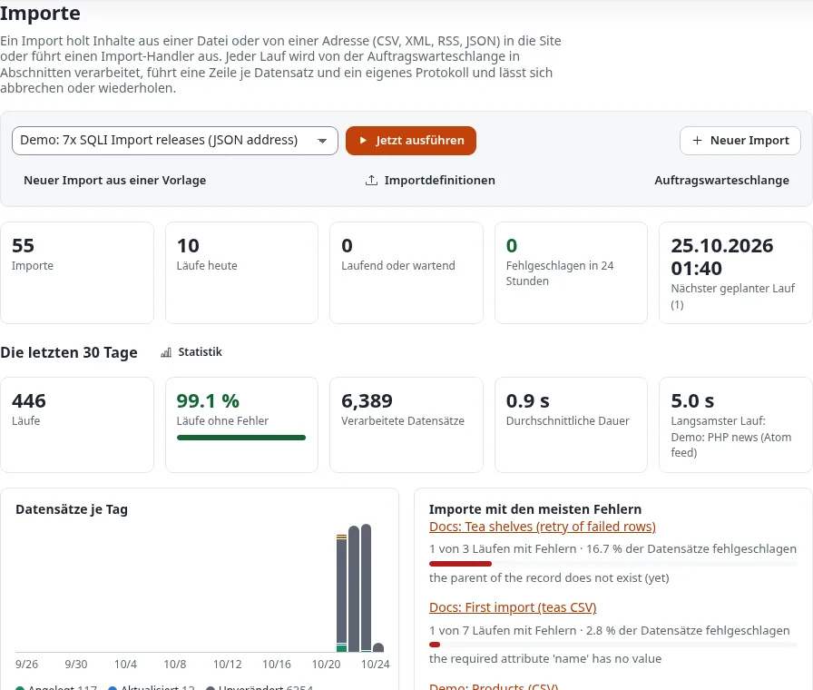

# 7x SQLI Import: hier beginnen

**7x SQLI Import** (die Erweiterung `se7enxweb/sqliimport`) holt Daten von außen nach Exponential: den CSV-Export
eines ERP-Systems, eine Tabelle, eine XML-Datei, einen RSS- oder Atom-Feed, die JSON-Antwort einer REST-API, einen
WordPress-Export, eine Tabelle einer anderen Datenbank. Jeder Datensatz wird ein Inhaltsobjekt oder eine Zeile einer
Datentabelle. Ein Import läuft einmal, für eine Migration, oder nach Zeitplan, für einen nächtlichen Abgleich.
Version 2.0 ist der Nachfolger von SQLI Import 1.x und lässt jeden Handler von 1.x weiterlaufen.

## Inhalt

1. [Für wen es gedacht ist](#für-wen-es-gedacht-ist)
2. [Was es tut](#was-es-tut)
3. [Was 2.0 enthält](#was-20-enthält)
4. [Die Seiten dieses Abschnitts](#die-seiten-dieses-abschnitts)
5. [Das Handbuch der Erweiterung](#das-handbuch-der-erweiterung)
6. [Verwandte Seiten](#verwandte-seiten)

## Für wen es gedacht ist

- **Administratoren** legen Importe im Import-Editor an, prüfen sie mit einem Probelauf, starten Läufe, verfolgen
  sie im Reiter **Importe** und machen einen missglückten Lauf rückgängig.
- **Integratoren** planen Importe aus anderen Systemen, lassen diese Systeme einen Import über einen Webhook starten
  und wählen zwischen einer Zuordnung ohne Programmierung und einem Handler.
- **Entwickler** schreiben Handler, Quellen und Umwandlungen in PHP.

Programmieren müssen Sie dafür nicht: Ein typischer Import ist eine Datei, eine Zuordnung, die **Auto-match by
name** ausfüllt, ein Probelauf und **Save and run**.

Die Oberfläche ist noch überwiegend auf Englisch; die Namen der Schaltflächen und Seiten stehen hier so, wie sie
erscheinen.

## Was es tut

- **Liest viele Formate**, im **Catalogue** (Katalog) in Gruppen geordnet: Data (CSV, TSV, Tabellen XLSX und ODS,
  JSON, NDJSON, XML, YAML, TOML, Avro, Arrow, Google Sheets, REST-APIs mit seitenweisem Abruf, Sitemaps,
  Webseiten), NoSQL databases (MongoDB, Elasticsearch oder OpenSearch, Redis, DuckDB und weitere), Content (RSS- und
  Atom-Feeds, OPML, Markdown, iCalendar, vCard, WordPress-Exporte), Platforms (SQL-Datenbanken, eine andere
  Exponential-Website, Drupal, Joomla, Airtable, Notion, Salesforce, HubSpot, Dateien von Export und CIE), Commerce
  (Shopify, WooCommerce, Google Merchant) und Media (Mediendateien, YouTube). Eine Quelle ist eine hochgeladene
  Datei, eine `http(s)`-Adresse, die bei jedem Lauf gelesen wird, eine Datei in einem erlaubten Verzeichnis auf dem
  Server oder eine Datenbankverbindung.
- **Ordnet ohne Programmierung zu.** Der **Import-Editor** führt durch sechs Schritte: Quelle, Verarbeitung,
  Zuordnung, Vorschau, Zeitplan und Prüfung. Quellfelder füllen die Attribute einer Inhaltsklasse, mit Umwandlungen
  wie `trim`, `date`, `number`, `richtext`, `image` und `lookup`.
- **Zeigt, bevor es veröffentlicht.** Die Vorschau und ein **Dry run** (Probelauf) sagen für jeden Datensatz, was
  angelegt, aktualisiert, unverändert gelassen würde oder fehlschlüge, mit dem alten und dem neuen Wert jedes
  geänderten Felds.
- **Läuft sicher.** Jeder Lauf geht in Abschnitten über die Job-Warteschlange (expqueue), und seine Seite verfolgt
  ihn live. Ein Lauf lässt sich abbrechen, seine fehlgeschlagenen Datensätze lassen sich wiederholen, und der ganze
  Lauf lässt sich innerhalb von 30 Tagen **rückgängig machen**. Eine **Konfliktregel** entscheidet, was mit einem
  Objekt geschieht, das jemand seit dem letzten Lauf bearbeitet hat. Eine neue Version wird nur veröffentlicht, wenn
  sich ein Feld geändert hat.
- **Startet von selbst** nach Zeitplan, in einer Zeitzone, oder wenn ein anderes System den **Webhook** des Imports
  mit einer Signatur oder einem API-Schlüssel aufruft.
- **Benachrichtigt** mit einem Hinweis auf der Übersicht, einer Glocke in der Kopfzeile der Administration und auf
  Wunsch einer E-Mail.
- **Füllt Datentabellen**: Ein Import kann Zeilen der Tabelle eines Moduls schreiben statt Inhalte und bietet **New
  data table from its fields** an, um eine solche Tabelle mit dem Modultabellen-Assistenten des Kernels anzulegen.
- **Arbeitet mit den anderen Werkzeugen**: Dateien von Export (xrowextract) und CIE lassen sich mit zugeordneten
  Spalten wieder importieren, und jeder Lauf steht im Laufverlauf aller Import- und Exportwerkzeuge.

## Was 2.0 enthält

Die Engine, die Kommandozeile `./console ext:sqliimport:*` und den Reiter **Importe** mit:

- der Übersicht (Kennzahlen, die letzten 30 Tage, die Importe mit **Run now**, **Dry run**, **Edit** und **More**,
  die Läufe) und einem Block **Imports** auf dem Dashboard der Administration;
- dem **Import-Editor** (`sqliimport/edit`) mit sechs Schritten;
- einer **Live-Seite pro Lauf** mit **Cancel**, **Retry failed rows**, **Undo this run** und **Download results
  (CSV)**;
- den Seiten **Schedules** (Zeitpläne), **Statistics** (Statistik), **Catalogue** (die Formate nach Gruppen, mit je
  einer Beispieldatei, die Handler, die Umwandlungen und die Gruppe **Data tables**) und **Settings** (Export und
  Import von Importdefinitionen als JSON).

Zwei Richtlinien regeln den Zugriff: **Manage imports** (`sqliimport/manage`) und **Run imports**
(`sqliimport/run`), beide mit einer Handler-Einschränkung. Für 1.x angelegte Rollen funktionieren weiter.

Voraussetzungen: PHP 8.0 oder neuer, Exponential 6.0.14 oder neuer (6.0.15 für die Glocke, die Datentabellen und das
Transfer-Register) und die Erweiterungen expqueue und expui. Tabellenquellen brauchen die PHP-Erweiterung zip.

## Die Seiten dieses Abschnitts

| Seite | Was sie beantwortet |
|---|---|
| [Erste Schritte](erste-schritte.md) | Installation, die Cron-Teile, der Reiter Importe, die beiden Richtlinien, ein erster Import aus einer CSV-Datei mit Probelauf |
| [Der Import-Editor](der-import-editor.md) | Die sechs Schritte an einem durchgehenden Beispiel, Auto-match, Umwandlungen, Konfliktregeln, Tage zum Rückgängigmachen, Benachrichtigungen |
| [Importe und Läufe](importe-und-laeufe.md) | Die Übersicht, die Live-Seite eines Laufs, Abbrechen, Wiederholen, Rückgängigmachen, die Ergebnisse als CSV, die Glocke, die Statistik |
| [Zeitpläne und Cron](zeitplaene-und-cron.md) | Arten von Zeitplänen, Zeitzonen, die Seite Schedules, die Cron-Teile, einen Import aus einem anderen System starten |
| [Aktualisierung von 1.x](aktualisierung-von-1x.md) | 2.0 über 1.x installieren und Handler, Zeitpläne, Verlauf und Rollen migrieren |

Weitere Hilfeseiten, die es nutzen: [Welches Import- oder Exportwerkzeug brauche ich?](../import-oder-export-werkzeug.md)
und [Datentabellen](../../funktionen/6.0/datentabellen.md#zeilen-mit-7x-sqli-import-importieren).

## Das Handbuch der Erweiterung

Diese Hilfeseiten decken die tägliche Arbeit ab. Das eigene Handbuch der Erweiterung hat jede Einzelheit und für
jedes Format ein durchgerechnetes Beispiel. Es erscheint in der Hilfe unter **Erweiterungen**, wenn die Erweiterung
aktiv ist; öffnen Sie eine Seite über ihre Hilfeadresse:

| Thema | Hilfeadresse |
|---|---|
| Die Startseite des Handbuchs | `/exphelp/viewer/ext/sqliimport/ger-de/index.md` |
| Erste Schritte, Schritt für Schritt | `/exphelp/viewer/ext/sqliimport/ger-de/getting-started.md` |
| Der Import-Editor | `/exphelp/viewer/ext/sqliimport/ger-de/editor.md` |
| Zuordnungen und Umwandlungen | `/exphelp/viewer/ext/sqliimport/ger-de/mappings.md`, `/exphelp/viewer/ext/sqliimport/ger-de/transforms.md` |
| Jede Quelle und ihre Optionen | `/exphelp/viewer/ext/sqliimport/ger-de/sources.md` |
| Beispiele nach Art der Quelle | `/exphelp/viewer/ext/sqliimport/ger-de/source-examples-files.md`, `source-examples-feeds-web.md`, `source-examples-apis.md`, `source-examples-databases.md`, `source-examples-platforms.md` (im selben Ordner) |
| Läufe, Rückgängigmachen und Benachrichtigungen | `/exphelp/viewer/ext/sqliimport/ger-de/runs.md` |
| Zeitpläne | `/exphelp/viewer/ext/sqliimport/ger-de/schedules.md` |
| Webhook- und API-Auslöser | `/exphelp/viewer/ext/sqliimport/ger-de/triggers.md` |
| REST und Fetch-Funktionen | `/exphelp/viewer/ext/sqliimport/ger-de/rest-and-fetch.md` |
| Statistik | `/exphelp/viewer/ext/sqliimport/ger-de/statistics.md` |
| Datentabellen | `/exphelp/viewer/ext/sqliimport/ger-de/datatables.md` |
| Die anderen Import- und Exportwerkzeuge | `/exphelp/viewer/ext/sqliimport/ger-de/transfer.md` |
| Handler in PHP | `/exphelp/viewer/ext/sqliimport/ger-de/handlers.md` |
| Aktualisierung von 1.x | `/exphelp/viewer/ext/sqliimport/ger-de/migration-1x.md` |
| Fehlersuche | `/exphelp/viewer/ext/sqliimport/ger-de/troubleshooting.md` |

Das englische Handbuch hat dieselben Seiten ohne `ger-de/`.

## Verwandte Seiten

- [Welches Import- oder Exportwerkzeug brauche ich?](../import-oder-export-werkzeug.md)
- [Idempotente Importe über die remote_id](../integratoren/idempotente-importe-ueber-die-remote-id.md)
- [Ein Importskript schreiben](../integratoren/ein-importskript-schreiben.md)
- [Caching nach Importen](../integratoren/caching-nach-importen.md)
- [Cronjobs für Integrationen](../integratoren/cronjobs-fuer-integrationen.md)
