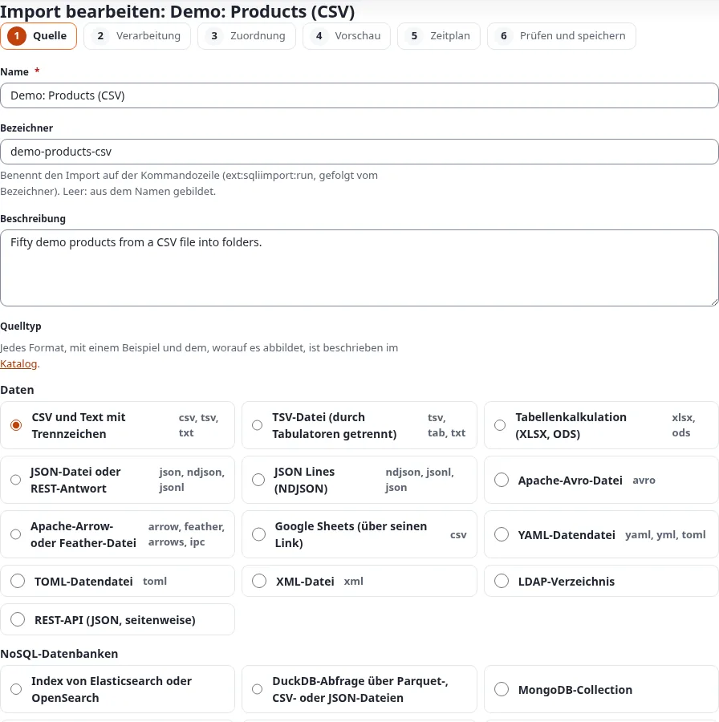
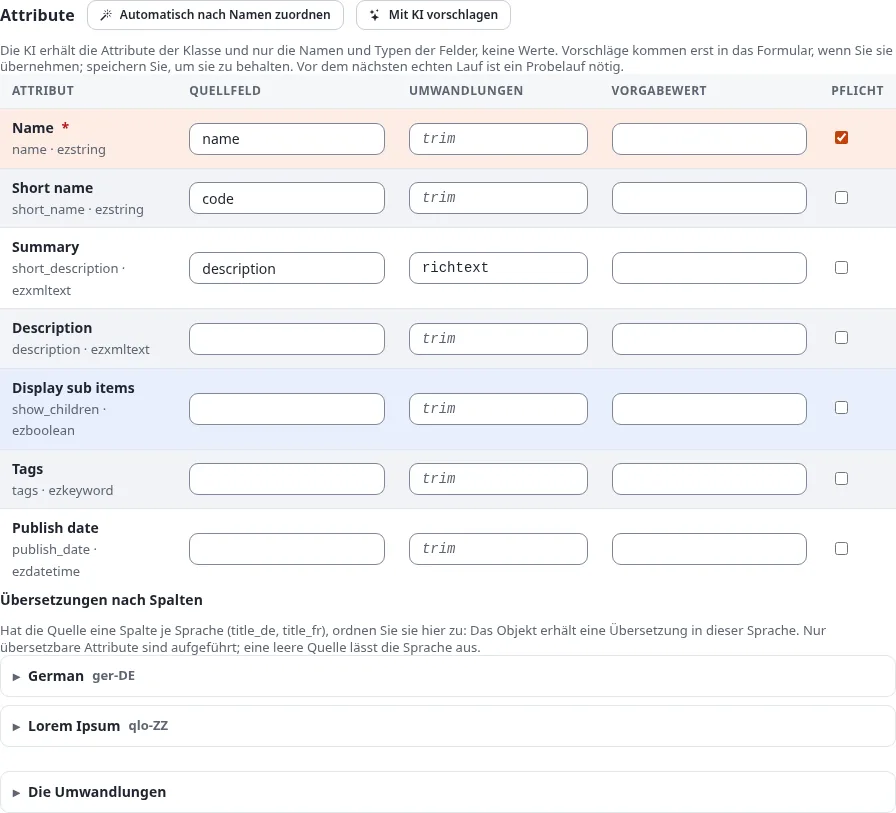
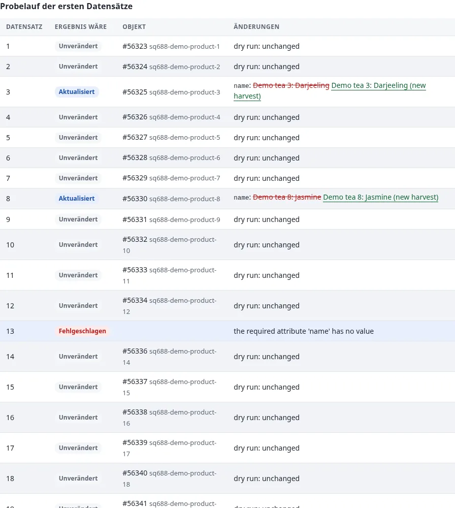
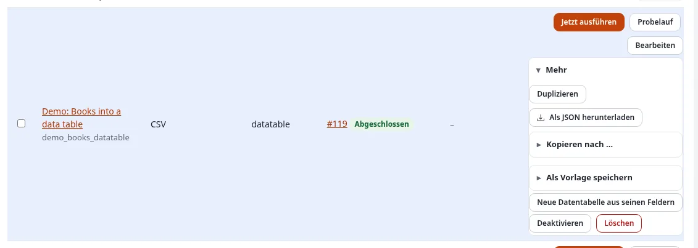

# Der Import-Editor von 7x SQLI Import

Der Import-Editor (`sqliimport/edit`) legt Importe in der Administration an und ändert sie, ohne PHP. Er führt
einen Import durch sechs Schritte. Jeder Schritt ist ein Formular, das für sich gespeichert wird; so geht nichts auf
halbem Weg verloren, und jeder Schritt lässt sich später über die Leiste der Schritte oben wieder öffnen.

Die Oberfläche ist noch überwiegend auf Englisch; die Namen der Schaltflächen stehen hier so, wie sie auf der Seite
erscheinen.

## Inhalt

1. [Den Editor öffnen](#den-editor-öffnen)
2. [Schritt 1: Quelle](#schritt-1-quelle)
3. [Schritt 2: Verarbeitung](#schritt-2-verarbeitung)
4. [Schritt 3: Zuordnung](#schritt-3-zuordnung)
5. [Schritt 4: Vorschau](#schritt-4-vorschau)
6. [Schritt 5: Zeitplan](#schritt-5-zeitplan)
7. [Schritt 6: Prüfung und Speichern](#schritt-6-prüfung-und-speichern)
8. [Kopieren, deaktivieren und löschen](#kopieren-deaktivieren-und-löschen)

Die vollständige Referenz jedes Felds steht im Handbuch der Erweiterung: `/exphelp/viewer/ext/sqliimport/ger-de/editor.md`.

## Den Editor öffnen

- **New import** auf der Übersicht des Reiters Importe oder in seinem linken Menü öffnet `sqliimport/edit/new`.
- **Edit** neben einem Import in der Liste öffnet den Import bei seinem ersten Schritt.
- **Edit** auf der Seite Schedules öffnet den Schritt Zeitplan des Imports.
- **Import/Export > Import into this folder…** an einem Ordner öffnet einen neuen Import, dessen Objekte unter diesem
  Ordner entstehen, und **Import objects of this class…** auf der Seite einer Klasse beginnt die Zuordnung mit dieser
  Klasse.
- **New import** auf einer Karte des **Catalogue** öffnet einen neuen Import mit diesem Quelltyp.

Der Editor braucht die Richtlinie **Manage imports** (`sqliimport/manage`) oder `sqliimport/manageimports` von 1.x.
Ein Benutzer nur mit **Run imports** (`sqliimport/run`) sieht die Importe und führt sie aus, kann sie aber nicht
ändern.

Jeder Schritt hat die Schaltflächen **Save and continue** (speichern, dann der nächste Schritt), **Save** (speichern
und bleiben) und **Back to the imports** (zurück zu den Importen). Jeder Wert wird auf dem Server geprüft; ein
Schritt mit Fehlern wird mit markierten Feldern erneut gezeigt.

## Schritt 1: Quelle

Name, Bezeichner (für die Kommandozeile; leer: aus dem Namen gebildet) und Beschreibung, dann der **Quelltyp** und
**woher die Daten kommen**: eine hochgeladene Datei, eine Adresse (`http` oder `https`, bei jedem Lauf gelesen), eine
Datei auf dem Server (wenn die Einstellungen ein Verzeichnis erlauben) oder, bei Datenbanken und Diensten, die Quelle
selbst mit ihren Optionen.

Die Quelltypen sind gruppiert wie im **Catalogue** (Katalog): Data, NoSQL databases, Content, Platforms, Commerce und
Media. Jede Karte des Katalogs beschreibt das Format, bietet eine Beispieldatei zum Herunterladen und hat eine
Schaltfläche **New import**. Das durchgerechnete Beispiel jeder Quelle steht im Handbuch
(`/exphelp/viewer/ext/sqliimport/ger-de/sources.md` und die Seiten `source-examples-*.md` daneben).



Es folgen die Optionen des gewählten Typs: bei einer CSV-Datei das Trennzeichen (`auto` erkennt es), das
Begrenzungszeichen, die Kodierung und **Key field**, die Spalte, die einen Datensatz benennt (`id` im Produktbeispiel).
Ein neuer Import wird angelegt, wenn dieser Schritt zum ersten Mal gespeichert wird, und zwar deaktiviert.

## Schritt 2: Verarbeitung

Dieser Schritt legt fest, was aus jedem Datensatz wird und wie sich ein Lauf verhält.


- **How the records are processed**: **Mapping to a content class (no code)** (Zuordnung zu einer Inhaltsklasse),
  **Rows of a data table (a persistent class)** (Zeilen einer Datentabelle, siehe
  [Datentabellen](../../funktionen/6.0/datentabellen.md#zeilen-mit-7x-sqli-import-importieren)) oder ein Handler mit
  seinen Optionen.
- **Target** (Ziel): der Elternknoten neuer Inhalte, ihre Sektion und Sprache und der Benutzer, als der ein Lauf
  läuft (`0`: der Benutzer, der den Lauf startet oder plant).
- **Existing content** (bestehende Inhalte): **Create new, update existing** (neue anlegen, bestehende
  aktualisieren), **Only create, leave existing as they are** (nur anlegen) oder **Only update existing** (nur
  aktualisieren).
- **When someone edited an object since the last run** (die Konfliktregel). Der Import merkt sich, was er in jedes
  Feld geschrieben hat. Hat eine Redakteurin ein Feld danach geändert, entscheidet die Regel:

  | Regel | Was der nächste Lauf mit einem bearbeiteten Objekt tut |
  |---|---|
  | **Overwrite with the source** (Vorgabe) | Schreibt jedes Feld aus der Quelle; die Änderung der Redaktion wird ersetzt |
  | **Merge: keep the fields that were edited** | Schreibt nur die Felder, die niemand bearbeitet hat |
  | **Only fill empty fields** | Schreibt nur Felder, die jetzt leer sind |
  | **Skip the object** | Lässt das Objekt in Ruhe; der Datensatz meldet „edited since the last run“ |

  Beispiel: Der Import schrieb die Zusammenfassung „Fresh tea“, eine Redakteurin korrigierte sie zu „Fresh green
  tea“. Mit **Merge** aktualisiert der nächste Lauf weiter die übrigen Felder aus der Datei, behält aber ihre
  Zusammenfassung.
- **Days a run can be undone** (Tage, in denen ein Lauf rückgängig gemacht werden kann): leer übernimmt die
  Einstellung (`[RunSettings] UndoDays`, 30 Tage), `0` schaltet das Rückgängigmachen für diesen Import ab.
- **Records per chunk** (Datensätze pro Abschnitt) und **At most this many records per run** (`0`: keine Grenze).
- **Notifications** (Benachrichtigungen): **Tell when a run** failed or had errors (Vorgabe), failed, ended (jeder
  Lauf) oder never; **A notice for the user who started the run** (auf der Übersicht und in der Glocke der Kopfzeile);
  **E-mail addresses**, eine pro Zeile, die die Zahlen, die ersten Fehler und den Verweis auf den Lauf bekommen.
  Probeläufe verschicken keine E-Mail.

## Schritt 3: Zuordnung

Wählen Sie die Inhaltsklasse und speichern Sie den Schritt, um ihre Attribute zu sehen. Legen Sie dann fest, wie ein
Datensatz sein Objekt findet: über eine Remote-ID aus dem Datensatz, etwa `product-{id}`, oder über den Wert eines
Attributs. Jede Zeile des Rasters ist ein Attribut:



| Spalte | Bedeutung |
|---|---|
| Source field | Ein Feld des Datensatzes, etwa `title` oder `author.name`; die Felder der Stichprobe stehen über dem Raster |
| Transforms | Eine Kette von Umwandlungen als eine Textzeile |
| Default | Der Wert, wenn der Quellwert leer ist |
| Required | Der Datensatz schlägt fehl, wenn der Wert noch leer ist |

Eine Umwandlungskette trennt die Schritte mit `|` und schreibt die Argumente in Klammern:

```text
trim | date(format=d.m.Y, timezone=Europe/Berlin)
date(format=excel)
map(table={"D":"Germany","A":"Austria"}, otherwise=Other)
replace(search=",", replace=.)
```

Ein Wert mit Komma, Klammer oder `|` steht in doppelten Anführungszeichen; eine Tabelle oder Liste wird als JSON
geschrieben. `date(format=excel)` liest die Datumszahlen einer Tabelle, etwa `45231` für den 1. November 2023. Jede
Umwandlung mit ihren Argumenten steht unter **The transforms** unter dem Raster und im Handbuch
(`/exphelp/viewer/ext/sqliimport/ger-de/transforms.md`).

**Auto-match by name** füllt die Zeilen, die noch kein Quellfeld haben: Es vergleicht die Namen der Attribute mit
den Feldnamen der Stichprobe, ohne Groß- und Kleinschreibung und Akzente, und ergänzt `richtext`, `date`, `image`
oder `bool`, wo der Datentyp es braucht. Es nutzt keinen externen Dienst. Prüfen Sie die gefüllten Zeilen und
speichern Sie dann.

**Translations by column** (Übersetzungen nach Spalte): Hat die Quelle eine Spalte pro Sprache (`title_de`,
`title_fr`), öffnen Sie die Sprache unter dem Raster und ordnen diese Spalten zu; das Objekt bekommt eine Übersetzung
in dieser Sprache.

**Download mapping (JSON)** und **Load a mapping…** übertragen eine Zuordnung in einen anderen Import oder eine andere
Installation.

## Schritt 4: Vorschau

Die Vorschau läuft in der Anfrage selbst; sie startet keinen Job und speichert keinen Lauf. Sie zeigt die ersten
20 Datensätze der Quelle als Tabelle, mit dem, was die Quelle erkannt hat (Trennzeichen und Kodierung einer
CSV-Datei, die Blätter einer Tabelle), und einen Probelauf dieser Datensätze: für jeden, was geschähe, und die Felder,
die sich änderten, mit dem durchgestrichenen aktuellen und dem neuen Wert daneben.



Nichts wird veröffentlicht, und kein Bild und keine Datei wird heruntergeladen. Ändern Sie Quelle oder Zuordnung und
öffnen Sie die Vorschau erneut, bis alles stimmt.

## Schritt 5: Zeitplan

Nie, einmal, alle N Minuten, stündlich, täglich, wöchentlich, monatlich oder ein Cron-Ausdruck, in einer Zeitzone,
mit E-Mail-Adressen für Fehler; nach dem Speichern erscheinen die nächsten fünf Laufzeiten. Darunter schaltet der
Abschnitt **Started by another system (webhook or API)** den Auslöser des Imports ein. Beides erklärt
[Zeitpläne und Cron](zeitplaene-und-cron.md).

## Schritt 6: Prüfung und Speichern

Die Zusammenfassung des Imports (Quelle, Verarbeitung, Ziel, Zeitplan), was noch fehlt (etwa eine Zuordnung ohne
Abgleichsregel), und **The import is enabled**. **Save** speichert ihn; **Save and run** speichert den aktivierten
Import, startet sofort einen Lauf und öffnet seine Seite.

## Kopieren, deaktivieren und löschen

Neben jedem Import in der Liste finden Benutzer mit **Manage imports** die Schaltfläche **Edit** und unter **More**:



- **Duplicate**: eine deaktivierte Kopie mit Quelle, Verarbeitung und Zuordnung, ohne Zeitpläne und Läufe, die im
  Editor geöffnet wird;
- **New data table from its fields** (Exponential 6.0.15, Richtlinie `setup/setup`): öffnet den
  Modultabellen-Assistenten mit den Feldern des Imports
  ([Datentabellen](../../funktionen/6.0/datentabellen.md#zeilen-mit-7x-sqli-import-importieren));
- **Enable** oder **Disable**: schaltet den Import ein oder aus;
- **Delete**: entfernt den Import mit Zuordnung und Zeitplänen nach einer Rückfrage. Seine Läufe bleiben im Verlauf.
  Ein Import, der gerade läuft, lässt sich nicht löschen.

Um Importe von einer Staging-Installation in die Live-Installation zu bringen, exportieren Sie sie auf der Seite
**Settings** des Reiters Importe als JSON und importieren die Datei dort. Hochgeladene Quelldateien gehören nicht zu
einem Export; laden Sie sie im Schritt Quelle erneut hoch.

Weiter: [Importe und Läufe](importe-und-laeufe.md).
