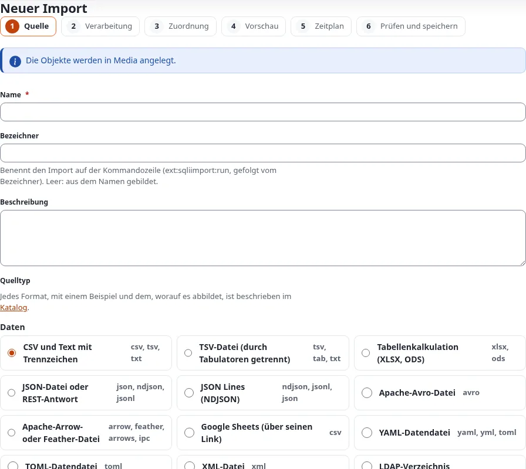

# Erste Schritte mit 7x SQLI Import

Diese Seite installiert 7x SQLI Import 2.0, prüft, ob es funktioniert, und geht einen ersten Import einer CSV-Datei
Schritt für Schritt durch.

## Inhalt

1. [Voraussetzungen](#voraussetzungen)
2. [Installieren](#installieren)
3. [Der Reiter Importe](#der-reiter-importe)
4. [Ein erster Import, Schritt für Schritt](#ein-erster-import-schritt-für-schritt)
5. [Auf der Kommandozeile](#auf-der-kommandozeile)

## Voraussetzungen

- Exponential 6.0.14 oder neuer, PHP 8.0 oder neuer. Exponential 6.0.15 bringt die Glocke in der Kopfzeile, die
  Datentabellen und die Kästen **Looking for…?** der Import- und Exportwerkzeuge dazu.
- Die Erweiterung **expqueue** (die Job-Warteschlange): Ihre Worker verarbeiten jeden Lauf.
- Die Erweiterung **expui** (die gemeinsamen Bausteine der Administration).
- Optional: die PHP-Erweiterung **zip**, für Tabellenquellen (XLSX und ODS).

## Installieren

1. Das Paket anfordern:

   ```bash
   composer require se7enxweb/sqliimport:^2.0@alpha
   ```

2. `expqueue`, `expui` und `sqliimport` in `settings/override/site.ini.append.php` aktivieren
   (`[ExtensionSettings] ActiveExtensions[]`), oder nur für die Administration in `ActiveAccessExtensions[]`.
3. Die Autoloads neu erzeugen und die Tabellen anlegen. Beide Befehle `install-schema` lassen sich gefahrlos
   wiederholen; der zweite aktualisiert auch die Tabellen von 1.x:

   ```bash
   php bin/php/ezpgenerateautoloads.php -e
   ./console ext:expqueue:install-schema
   ./console ext:sqliimport:install-schema
   ```

4. Beide Cron-Teile jede Minute laufen lassen:

   ```bash
   * * * * * cd /path/to/exponential && php runcronjobs.php -q expqueue
   * * * * * cd /path/to/exponential && php runcronjobs.php -q sqliimport
   ```

5. Den INI-Cache leeren: `php bin/php/ezcache.php --clear-tag=ini`.

Das Handbuch der Erweiterung hat dieselben Schritte mit jeder Einstellung
(`/exphelp/viewer/ext/sqliimport/ger-de/getting-started.md` und `/exphelp/viewer/ext/sqliimport/ger-de/install.md`).

## Der Reiter Importe

Die Erweiterung fügt der Administration den Reiter **Imports** (Importe) hinzu. Ein Siteaccess, der
`[TopAdminMenu] Tabs[]` in seiner eigenen `menu.ini.append.php` zurücksetzt (eine Zeile `Tabs[]` ohne Wert), muss
`Tabs[]=sqliimport` dort selbst aufführen, sonst erscheint der Reiter in diesem Siteaccess nicht.

Zwei Richtlinien regeln den Reiter, beide mit einer Handler-Einschränkung (`SQLIImport_Type`):

| Richtlinie | Erlaubt |
|---|---|
| **Manage imports** (`sqliimport/manage`) | Alles: Importe anlegen, bearbeiten, kopieren, aktivieren, deaktivieren und löschen, Zeitpläne, Auslöser, die Seite Settings mit Export und Import von Definitionen, und Ausführen |
| **Run imports** (`sqliimport/run`) | Den Reiter ansehen und Importe ausführen: Run now, Dry run, Cancel, Retry failed rows, Undo this run |

Für 1.x angelegte Rollen funktionieren weiter: `sqliimport/manageimports` zählt als Manage imports, und
`sqliimport/listimports` lässt einen Benutzer den Reiter ansehen.

Das linke Menü des Reiters verweist auf die Übersicht (**Overview**), **Statistics**, **New import**, **Schedules**,
**Catalogue**, **Settings**, **Running runs**, **Failed runs** und die **Job queue**, darunter auf die anderen
Import- und Exportwerkzeuge der Website. Ein Verweis erscheint nur für Benutzer, die seine Seite öffnen dürfen.

## Ein erster Import, Schritt für Schritt

Das Beispiel importiert eine Liste von Produkten aus einer CSV-Datei als Ordner. Es ist der Demo-Import
„Demo: Products (CSV)“ der Testinstallation; jede kleine CSV-Datei funktioniert genauso.

Die Datei `products.csv` (die ersten Zeilen von 50):

```text
id,name,code,description
1,Demo tea 1: Assam,T001,"A demo product of the CSV import, line 1."
2,Demo tea 2: Ceylon,T002,"A demo product of the CSV import, line 2."
3,Demo tea 3: Darjeeling,T003,"A demo product of the CSV import, line 3."
```

1. **Den Editor öffnen.** Klicken Sie unter **Imports** auf **New import**. Sollen die Objekte unter einem
   bestimmten Ordner entstehen, öffnen Sie stattdessen diesen Ordner und wählen **Import/Export > Import into this
   folder…**: Der Editor sagt dann, wo die Objekte angelegt werden.

   

2. **Schritt 1, Quelle.** Name: `Products (CSV)`. Lassen Sie den Bezeichner leer (er wird `products-csv`). Wählen
   Sie **CSV and delimited text**, dann **An uploaded file**, und wählen Sie `products.csv`. Setzen Sie die Option
   *Key field* auf `id`. Klicken Sie auf **Save and continue**. Der Import existiert jetzt, noch deaktiviert.
3. **Schritt 2, Verarbeitung.** Lassen Sie **Mapping to a content class (no code)** gewählt. Tragen Sie die
   Knoten-ID des Elternordners ein, lassen Sie **Create new, update existing** stehen und klicken Sie auf **Save and
   continue**.
4. **Schritt 3, Zuordnung.** Wählen Sie die Klasse **Folder** und speichern Sie. Wählen Sie unter *How a record finds
   its object* eine Remote-ID mit dem Muster `product-{id}`: Dieselbe Zeile der Datei findet immer denselben Ordner,
   ein zweiter Lauf aktualisiert also, statt zu verdoppeln. Klicken Sie auf **Auto-match by name**: `name` landet in
   *Name*. Tragen Sie `code` bei *Short name* und `description` mit der Umwandlung `richtext` bei *Summary* ein.
   Haken Sie *Required* bei *Name* an. Speichern und weiter.
5. **Schritt 4, Vorschau.** Die ersten 20 Zeilen der Datei erscheinen als Tabelle, dazu ein Probelauf dieser
   Zeilen: Beim ersten Lauf sagt jeder Datensatz **Created**. Noch ist nichts veröffentlicht.
6. **Schritt 5, Zeitplan.** Lassen Sie vorerst **Never** stehen. Speichern und weiter.
7. **Schritt 6, Prüfung.** Haken Sie **The import is enabled** an und klicken Sie auf **Save and run**. Die Seite des
   Laufs öffnet sich und verfolgt ihn live; nach wenigen Sekunden endet er mit **50 created**.

Die 50 Ordner existieren jetzt unter dem Elternordner, jeder mit der Remote-ID `product-1` bis `product-50`. Lassen
Sie den Import ein zweites Mal unverändert laufen: Der Lauf meldet **50 unchanged**, und keine neue Version wird
veröffentlicht.

Ändert sich die Datei später, klicken Sie zuerst auf **Dry run**. Mit zwei umbenannten Produkten und einer Zeile ohne
Namen sagt der Probelauf Feld für Feld, was geschähe, bevor etwas geschrieben wird:


Wie es weitergeht: [Der Import-Editor](der-import-editor.md) erklärt jeden Schritt genauer, und
[Importe und Läufe](importe-und-laeufe.md), was mit der fehlgeschlagenen Zeile zu tun ist und wie sich ein Lauf
rückgängig machen lässt.

## Auf der Kommandozeile

Die Importe auflisten und einen zuerst als Probelauf ausführen:

```bash
./console ext:sqliimport:list
./console ext:sqliimport:run products-csv --dry-run --wait
./console ext:sqliimport:run products-csv --wait
./console ext:sqliimport:status <run id>
```

Warnt die Übersicht, dass die Tabellen oder die Job-Warteschlange fehlen, führen Sie den passenden Befehl
`install-schema` aus. Hilfe, wenn etwas nicht funktioniert: `/exphelp/viewer/ext/sqliimport/ger-de/troubleshooting.md`.

Weiter: [Der Import-Editor](der-import-editor.md).
