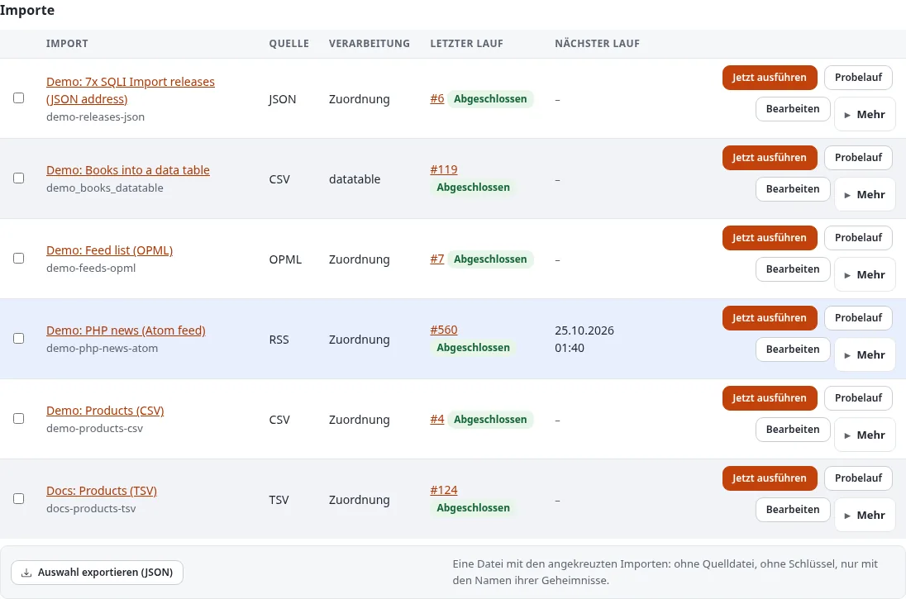
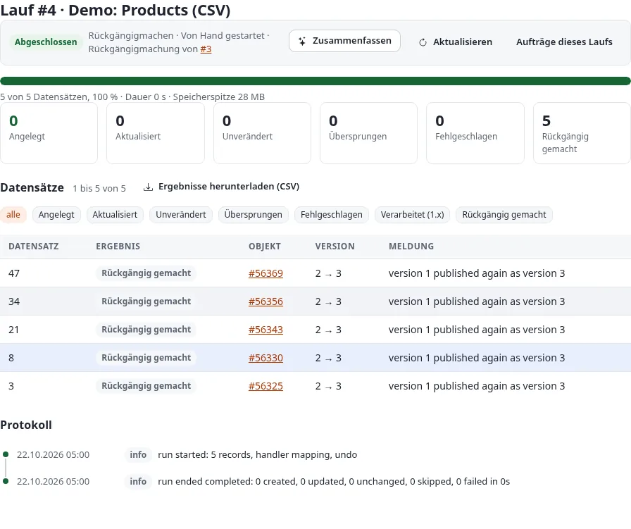
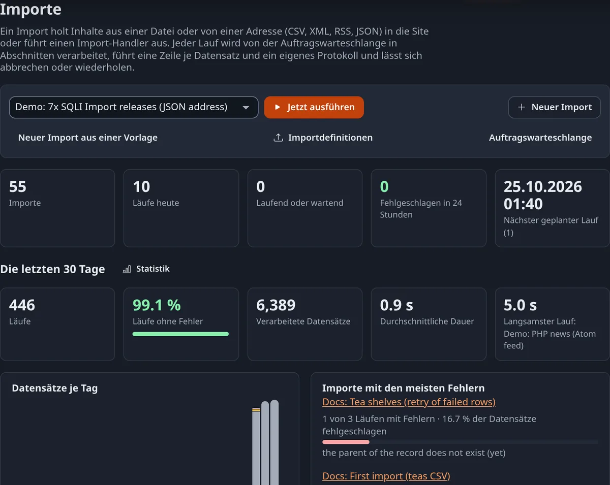

# Importe und Läufe in 7x SQLI Import

Ein **Import** ist die Definition: woher die Daten kommen, was aus ihnen wird und wohin sie gehen. Ein **Lauf** ist
eine Ausführung eines Imports. Diese Seite zeigt, wie Sie Läufe starten, verfolgen und das, was sie getan haben,
korrigieren oder rückgängig machen.

## Inhalt

1. [Die Übersicht](#die-übersicht)
2. [Wie ein Lauf arbeitet](#wie-ein-lauf-arbeitet)
3. [Die Seite eines Laufs](#die-seite-eines-laufs)
4. [Beispiel: ein Lauf mit einer fehlgeschlagenen Zeile](#beispiel-ein-lauf-mit-einer-fehlgeschlagenen-zeile)
5. [Einen Lauf rückgängig machen](#einen-lauf-rückgängig-machen)
6. [Benachrichtigungen und die Glocke](#benachrichtigungen-und-die-glocke)
7. [Statistik](#statistik)
8. [Auf der Kommandozeile](#auf-der-kommandozeile)

## Die Übersicht

**Imports** (`sqliimport/list`) zeigt die Kennzahlen (Importe, Läufe heute, laufende oder wartende Läufe, in den
letzten 24 Stunden fehlgeschlagene Läufe, der nächste geplante Lauf), die letzten 30 Tage, die Importe und ihre
Läufe. Die Leiste **Run now** oben startet jeden Import; **New import** öffnet den Editor.



- **Run now** (bei einem aktivierten Import) und **Dry run** sehen Benutzer mit Run imports oder Manage imports.
- **Edit** und **More** (Duplicate, New data table from its fields, Enable oder Disable, Delete) sehen Benutzer mit
  Manage imports ([Der Import-Editor](der-import-editor.md#kopieren-deaktivieren-und-löschen)).
- Die Läufe darunter lassen sich nach Status filtern (alle, laufend oder wartend, fehlgeschlagen, abgeschlossen,
  abgebrochen) und nach Werkzeug: Imports, ein anderes Import- oder Exportwerkzeug der Website oder alle zusammen.

Das Dashboard der Administration hat einen Block **Imports** mit den letzten Läufen und einer Warnung, wenn in den
letzten 24 Stunden Läufe fehlgeschlagen sind.

## Wie ein Lauf arbeitet

Ein Lauf wird von der Job-Warteschlange verarbeitet, nicht von der Seite, die ihn startet: Ein Start-Job liest die
Quelle und zählt die Datensätze, Abschnitts-Jobs verarbeiten je 200 Datensätze (`[RunSettings] ChunkSize`) in der
Reihenfolge der Quelle, und ein Abschluss-Job leert die Caches der geänderten Objekte, indiziert sie und schreibt die
Zusammenfassung. Sie können die Seite verlassen; der Lauf geht weiter.

- Ein Import läuft nur einmal gleichzeitig; verschiedene Importe laufen parallel.
- Ein Abschnitt speichert alle 20 Datensätze einen Prüfpunkt; stirbt ein Worker, macht der nächste Versuch dort
  weiter.
- Ein **Dry run** (Probelauf) veröffentlicht nichts. Er liest die ersten 20 Datensätze (`[RunSettings] DryRunRows`)
  und hält fest, was geschähe, mit den geänderten Feldern.

| Status | Bedeutung |
|---|---|
| Queued | Wartet auf einen Worker der Job-Warteschlange |
| Running | Wird verarbeitet |
| Completed | Beendet, kein Datensatz fehlgeschlagen |
| Completed with errors | Beendet, einige Datensätze fehlgeschlagen |
| Failed | Abgebrochen, etwa weil die Quelle nicht lesbar war |
| Cancelled | Von einem Benutzer abgebrochen |

Jeder Datensatz bekommt eine Zeile mit seinem Ergebnis: **Created** (angelegt), **Updated** (ein Feld hat sich
geändert, also wurde eine neue Version veröffentlicht), **Unchanged** (nichts zu veröffentlichen), **Skipped**
(übersprungen, etwa durch die Konfliktregel), **Failed** (fehlgeschlagen, mit der Meldung), **Undone** (durch einen
Rückgängig-Lauf) oder **Processed (1.x)** (von einem Handler von 1.x verarbeitet).

## Die Seite eines Laufs

`sqliimport/run/<id>` zeigt den Status, den Fortschrittsbalken mit Dauer und Speicherspitze, die Ergebnisse als
Zahlen (jede filtert die Datensätze), die Datensätze mit Objekt, Version und Meldung und das Protokoll des Laufs.

Solange ein Lauf wartet oder läuft, verfolgt ihn die Seite **live**: Alle zwei Sekunden zeigt sie den neuen
Fortschritt, die Zähler und neue Protokollzeilen, ohne die Seite neu zu laden. Die Schaltflächen:

- **Cancel** hält einen Lauf an, der noch nicht beendet ist. Bereits verarbeitete Datensätze bleiben, wie sie sind.
- **Retry failed rows** startet einen neuen Lauf, der nur die fehlgeschlagenen Datensätze eines beendeten Laufs
  verarbeitet (nicht für Handler von 1.x).
- **Undo this run** macht rückgängig, was der Lauf getan hat ([unten](#einen-lauf-rückgängig-machen)).
- **Download results (CSV)**: eine Zeile pro Datensatz mit Ergebnis, Objekt, Remote-ID, Versionen, geänderten Feldern
  und Meldung, um einen Lauf in einer Tabellenkalkulation zu prüfen oder weiterzugeben.
- **Jobs of this run** öffnet seine Jobs in der Job-Warteschlange; **Refresh** lädt die Seite von Hand.

## Beispiel: ein Lauf mit einer fehlgeschlagenen Zeile

Die Produktdatei aus [Erste Schritte](erste-schritte.md#ein-erster-import-schritt-für-schritt) kommt mit fünf
umbenannten Produkten zurück, und Zeile 13 hat ihren Namen verloren:

```text
13,,T013,"A demo product of the CSV import, line 13."
```

**Run now** ergibt diese Seite:


1. Klicken Sie auf die Zahl **1 Failed**, um nur den fehlgeschlagenen Datensatz mit seiner Meldung zu sehen.
2. Hier sind die Daten selbst falsch: Korrigieren Sie Zeile 13 in der Datei, laden Sie sie im Schritt Quelle des
   Editors erneut hoch und klicken Sie auf **Run now**. Zeile 13 wird angelegt; die anderen Datensätze sind
   unverändert, also bekommt nichts sonst eine neue Version.
3. **Retry failed rows** ist für Fehler gedacht, deren Ursache außerhalb des Datensatzes lag, etwa ein Elternordner,
   den es noch nicht gab, oder ein Server, der nicht antwortete: Beheben Sie die Ursache, dann wiederholen Sie. Die
   Wiederholung verarbeitet nur die fehlgeschlagenen Datensätze, so wie der Lauf sie gespeichert hat, und lässt die
   anderen in Ruhe.

## Einen Lauf rückgängig machen

**Undo this run** kehrt einen Lauf um, der Objekte angelegt oder aktualisiert hat: Was er **angelegt** hat, kommt in
den Papierkorb, was er **aktualisiert** hat, bekommt die Version von vor dem Lauf erneut veröffentlicht, als neue
Version. Ein Objekt, das jemand nach dem Lauf geändert hat, bleibt in Ruhe und wird aufgeführt. Ein Lauf lässt sich
einmal rückgängig machen, innerhalb von 30 Tagen (`[RunSettings] UndoDays` oder die eigene Angabe des Imports **Days
a run can be undone**). Das Rückgängigmachen ist ein eigener Lauf mit eigener Seite:



Die Seite des rückgängig gemachten Laufs sagt dann **This run was undone by run #4**. Ein Rückgängig-Lauf lässt sich
nicht rückgängig machen; brauchen Sie die neueren Werte wieder, lassen Sie den Import erneut laufen. Läufe in eine
Datentabelle schreiben Zeilen, keine Inhalte; was das Rückgängigmachen dort tut, steht im Handbuch
(`/exphelp/viewer/ext/sqliimport/ger-de/runs.md`).

## Benachrichtigungen und die Glocke

Wer von einem beendeten Lauf erfährt, wird pro Import im Schritt Verarbeitung unter **Notifications** festgelegt.
Der Benutzer, der den Lauf gestartet hat, sieht einen Hinweis unter **New since you last looked** auf der Übersicht,
bis er die Seite des Laufs öffnet oder **Mark all as read** wählt. Ab Exponential 6.0.15 hat die Kopfzeile der
Administration (admin4) außerdem eine **Glocke** mit der Zahl der ungelesenen Hinweise; ihr Feld listet die
neuesten Läufe mit ihrem Ergebnis, und **All imports** öffnet die Übersicht. Die E-Mail-Adressen des Imports bekommen
eine E-Mail mit den Zahlen, den ersten Fehlern und dem Verweis auf den Lauf.

## Statistik

**Statistics** im linken Menü (`sqliimport/statistics`) beantwortet, wie oft die Importe liefen, wie viele
Datensätze sie verarbeitet haben, wie lange sie brauchten und wie oft sie fehlschlugen, pro Tag, Woche oder Monat,
verglichen mit einem anderen Zeitraum. Filtern Sie nach Import, Quelltyp, Benutzer und Werkzeug; **Table as CSV**
lädt die Zahlen herunter. **Suggestions** (Vorschläge) zeigen, was sich verbessern lässt, etwa ein Import, dessen
Datensätze fast immer unverändert sind und der seltener laufen könnte.


Probeläufe und Rückgängig-Läufe zählen nicht mit, außer Sie wählen sie unter **Runs**. Einzelheiten:
`/exphelp/viewer/ext/sqliimport/ger-de/statistics.md`.

Die Seiten folgen auch dem dunklen Modus der Administration:



## Auf der Kommandozeile

```bash
./console ext:sqliimport:run <identifier>            # einen Lauf einreihen
./console ext:sqliimport:run <identifier> --wait     # hier verarbeiten und das Ergebnis ausgeben
./console ext:sqliimport:run <identifier> --dry-run --wait
./console ext:sqliimport:status <run id>             # der Lauf mit seinem Protokoll
./console ext:sqliimport:cancel <run id>
./console ext:sqliimport:retry <run id>
./console ext:sqliimport:undo <run id> --wait
./console ext:sqliimport:report <run id> > run.csv   # die Ergebnisse als CSV
```

Beendete Läufe, die älter als 90 Tage sind (`[RunSettings] KeepDays`), entfernt der Cron-Teil samt Zeilen und
Protokoll.

Weiter: [Zeitpläne und Cron](zeitplaene-und-cron.md).
