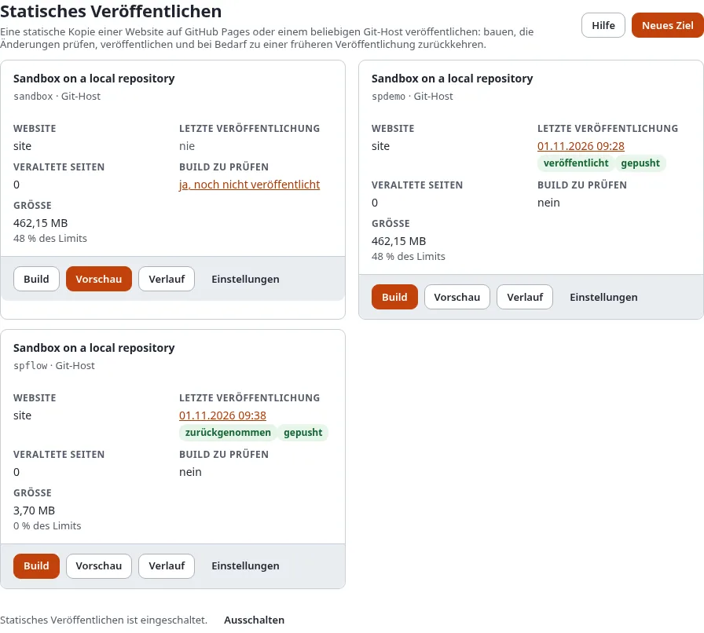
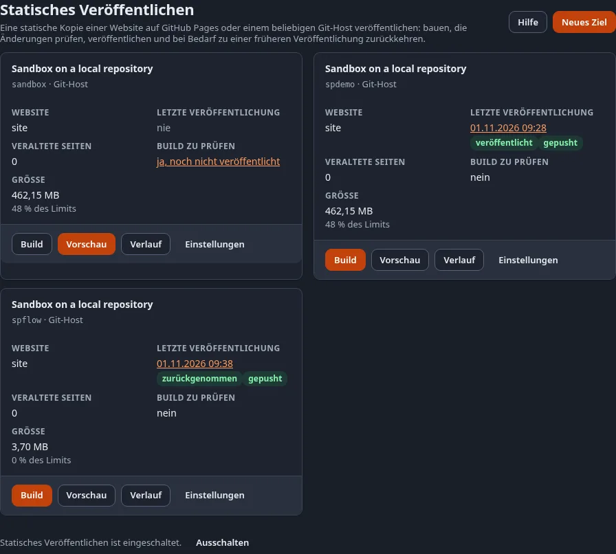

# Statisches Veröffentlichen

**Statisches Veröffentlichen** macht aus einer Site Ihrer Exponential-Installation einen Ordner mit einfachen
HTML-Seiten und Dateien und veröffentlicht ihn in ein Git-Repository: auf **GitHub Pages**, wo er kostenlos gehostet
wird, oder auf einen anderen Git-Host. Redakteure arbeiten wie bisher in Exponential weiter; Besucher bekommen die
statische Kopie, hinter der kein PHP und keine Datenbank steht, also gibt es auf der öffentlichen Seite nichts zu
aktualisieren, zu patchen oder anzugreifen.

Sie tun es unter **Setup > Statisches Veröffentlichen**: Legen Sie einmal mit dem Assistenten ein Ziel an, dann bauen
Sie, prüfen, was sich ändert, und veröffentlichen. Jede Veröffentlichung wird aufbewahrt, sodass Sie immer zu einer
früheren zurückkehren können.

Jedes Ziel auf der Seite zeigt seine veröffentlichte **Version** (die Nummer `n` seines neuesten Tags
`static/<ziel>/<n>`), die kurze **Commit**-Kennung dieser Version (ein Link auf den Commit bei GitHub, wenn das
Repository dort liegt) und seine **letzte Veröffentlichung** mit dem Zustand des Pushs: gepusht, Push ausstehend,
fehlgeschlagen, nichts geändert oder nicht gepusht; der Zeitpunkt öffnet die Seite des Laufs. Den Zustand des Builds
von GitHub Pages zeigt die Seite **Verlauf**, die GitHub danach fragt.

## Inhalt

1. [Hier beginnen](#hier-beginnen)
2. [Die Schritte](#die-schritte)
3. [Die Seiten unter Setup > Statisches Veröffentlichen](#die-seiten-unter-setup--statisches-veröffentlichen)
4. [Mehr](#mehr)

## Hier beginnen

- **Jetzt eine kostenlose Website**: [In 15 Minuten eine kostenlose Website](in-15-minuten-eine-kostenlose-website.md).
  Zum ersten Mal bei GitHub? [Ein GitHub-Konto und Repository anlegen](ein-github-konto-und-repository-anlegen.md).
- **Wissen, was es ist und ob es passt**: [Was statisches Veröffentlichen ist](was-statisches-veroeffentlichen-ist.md),
  [Passt statisch zu meiner Website?](passt-statisch-zu-meiner-website.md) und die [FAQ](faq.md).
- **Richtig einrichten**: das Tutorial
  [Statische Websites auf GitHub Pages hosten](../../anleitungen/statische-websites-auf-github-pages-hosten.md): von
  einer bestehenden Site bis zu einer erreichbaren `github.io`-Adresse.
- Was es ist und was es dem statischen Cache hinzufügt:
  [Statisches Veröffentlichen](../../funktionen/6.0/statisches-veroeffentlichen.md).
- Entwicklung und CI: Beginnen Sie mit dem Vorlagen-Repository [exponential-static-site-starter](https://github.com/se7enxweb/exponential-static-site-starter),
  das eine statische Kopie mit GitHub Actions baut und auf GitHub Pages veröffentlicht.
- Eine statische Kopie ansehen: die Demo-Site unter [https://se7enxweb.github.io/exponential-demo-site-static/](https://se7enxweb.github.io/exponential-demo-site-static/) (in Kürze).

## Die Schritte

1. **Ein Ziel anlegen** mit dem Assistenten: welche Site, welches Repository, wie sich der Push anmeldet, wie Links
   geschrieben werden. [Der Einrichtungsassistent](der-einrichtungsassistent.md)
2. **Bauen**: Jede Seite wird so abgerufen, wie ein nicht angemeldeter Besucher sie sieht, Links werden umgeschrieben
   und Dateien kopiert. [Build, Vorschau und Veröffentlichen](build-vorschau-und-veroeffentlichen.md)
3. **Den Build prüfen**: was sich ändert, der Bericht, die Größe gegenüber den Grenzen des Hosts und die Kopie selbst
   in Ihrem Browser. [Build, Vorschau und Veröffentlichen](build-vorschau-und-veroeffentlichen.md#den-build-prüfen)
4. **Veröffentlichen**: ein Commit, ein Tag, ein Push, nie erzwungen.
   [Build, Vorschau und Veröffentlichen](build-vorschau-und-veroeffentlichen.md#veröffentlichen-oder-verwerfen)
5. **Zurückkehren**, wenn Sie es brauchen: [Verlauf und Rücknahme](verlauf-und-ruecknahme.md)

Wer welchen Schritt ausführen darf, legen Richtlinien fest:
[Wer veröffentlichen darf](wer-veroeffentlichen-darf-rollen-und-richtlinien.md).

## Die Seiten unter Setup > Statisches Veröffentlichen

| Seite | Adresse | Wobei sie hilft | Hilfe |
|---|---|---|---|
| Statisches Veröffentlichen | `/staticpublish/dashboard` | jedes Ziel mit seiner letzten Veröffentlichung, seinen veralteten Seiten und seiner Größe; die Funktion ein- oder ausschalten | diese Seite |
| Neues Ziel, Einstellungen | `/staticpublish/target/new`, `/staticpublish/target/<id>` | ein Ziel anlegen oder ändern | [Der Einrichtungsassistent](der-einrichtungsassistent.md) |
| Build | `/staticpublish/build/<id>` | im Hintergrund bauen und es verfolgen | [Build, Vorschau und Veröffentlichen](build-vorschau-und-veroeffentlichen.md) |
| Vorschau und Veröffentlichung | `/staticpublish/preview/<id>` | die Änderungen, der Bericht, die Grenzen, die Vorschau, Veröffentlichen und Verwerfen | [Build, Vorschau und Veröffentlichen](build-vorschau-und-veroeffentlichen.md#den-build-prüfen) |
| Verlauf | `/staticpublish/history/<id>` | die Veröffentlichungen, Tags und Commits; zurücknehmen | [Verlauf und Rücknahme](verlauf-und-ruecknahme.md) |
| Die Seite eines Auftrags | `/staticpublish/log/<run-id>` | ein Build, eine Veröffentlichung oder eine Rücknahme: Fortschritt und Bericht | [Build, Vorschau und Veröffentlichen](build-vorschau-und-veroeffentlichen.md#die-seite-eines-auftrags) |
| Deploy-Key | `/staticpublish/keys/<id>` | den SSH-Schlüssel erstellen, mit dem sich der Push anmeldet | [SSH-Deploy-Keys](../../anleitungen/statisches-veroeffentlichen-deploy-keys.md) |

Das **Dashboard** der Administration hat einen Block **Statisches Veröffentlichen** mit den veralteten Seiten und der
letzten Veröffentlichung jedes Ziels. Vor dem ersten Ziel zeigt er eine Zeile mit einem Link zum Assistenten und zum
Tutorial; **ausblenden** entfernt ihn für Sie. Auch **Setup > Cache > Statischer Inhalts-Cache** verlinkt hierher.

Jede Seite hat eine Schaltfläche **Hilfe**, die die Seite dieses Handbuchs dazu öffnet.

## Mehr

- Die Kommandozeile und CI:
  [Statische Websites auf GitHub Pages hosten](../../anleitungen/statische-websites-auf-github-pages-hosten.md) und die
  Befehle `exp:static:build`, `exp:static:publish`, `exp:static:rollback`.
- GitHub: [Mit GitHub verbinden: Token, Deploy-Key oder GitHub App](mit-github-verbinden-token-key-oder-app.md),
  [Branch oder GitHub Actions wählen](branch-oder-github-actions-waehlen.md),
  [Eigene Domain verwenden](eigene-domain-verwenden.md) und
  [Grenzen und Bedingungen von GitHub Pages](grenzen-und-bedingungen-von-github-pages.md).
- Repositorys, Token und Pushes:
  [Repositorys und Zugangsdaten](../../anleitungen/statisches-veroeffentlichen-repositorys-und-zugangsdaten.md)
- Das Format eines Builds: [Das Build-Format](../../spezifikationen/6.0/statisches-veroeffentlichen-build-format.md)
- Suche, Formulare und Kommentare: [Suche, Formulare und Kommentare auf einer statischen Site](suche-formulare-und-kommentare-auf-einer-statischen-site.md),
  [Sprachen auf einer statischen Site](sprachen-auf-einer-statischen-site.md), [SEO auf einer statischen Site](seo-auf-einer-statischen-site.md) und der
  [Formular-Endpunkt](../../spezifikationen/6.0/statisches-veroeffentlichen-formular-endpunkt.md).
- Ohne Knopfdruck: [Automatisch veröffentlichen](automatisch-veroeffentlichen.md) und
  [Benachrichtigungen und Webhooks](benachrichtigungen-und-webhooks.md).
- Links, Dateien und Datenschutz: [Links und Basispfad](links-und-basispfad.md),
  [Bilder, Dateien und Downloads](bilder-dateien-und-downloads.md), [Private Inhalte privat halten](private-inhalte-privat-halten.md).
- Nicht auf GitHub: [Andere Git-Hosts: GitLab, Gitea und eigener Server](andere-git-hosts-gitlab-gitea-und-eigener-server.md).
- Etwas ging schief: [Wenn eine Veröffentlichung fehlschlägt](wenn-eine-veroeffentlichung-fehlschlaegt.md).
- Von der Seite selbst: [Der Bereich in der Website-Seitenleiste](der-bereich-in-der-website-seitenleiste.md) zeigt,
  ob eine Seite veraltet ist, und veröffentlicht nur diese Seite.

## Nächster Schritt

[Legen Sie Ihr erstes Ziel mit dem Einrichtungsassistenten an](der-einrichtungsassistent.md).
