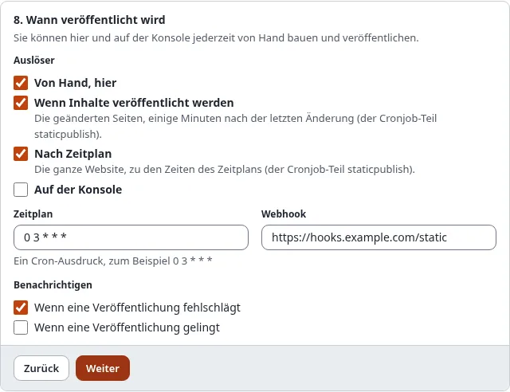

# Automatisch veröffentlichen

Ein Ziel kann sich selbst veröffentlichen: nachdem Redakteure Inhalte veröffentlicht haben, oder zu festen Zeiten.
Beides läuft im Cronjob-Teil `staticpublish`, den Ihre Installation alle paar Minuten ausführen muss.

## Was Sie am Ende haben

Eine statische Kopie, die den Inhalten der Site folgt, ohne dass jemand **Veröffentlichen** drückt.



## Den Cronjob-Teil ausführen

Nehmen Sie `staticpublish` in einen Cronjob-Teil auf, den der Server oft ausführt, oder führen Sie ihn allein aus:

```
*/5 * * * * cd /pfad/zu/exponential && php runcronjobs.php staticpublish
```

Derselbe Teil pusht auch jede Veröffentlichung erneut, deren Push fehlgeschlagen ist.

## Nach jeder Veröffentlichung von Inhalten

Kreuzen Sie im Assistenten, Schritt 8, **Wenn Inhalte veröffentlicht werden** an. Von da an:

1. Sobald Inhalte veröffentlicht, verschoben oder verborgen werden, werden die Seiten der betroffenen Knoten (dieselben
   Seiten, deren Ansichts-Cache geleert wird) für dieses Ziel als **veraltet** markiert. Eine neue Seite wird ebenfalls
   vorgemerkt.
2. Der Cronjob-Teil wartet, bis sich 2 Minuten lang nichts geändert hat (`[StaticPublishSettings] PublishDebounce`),
   sodass ein Redakteur, der zehnmal hintereinander veröffentlicht, eine einzige Veröffentlichung auslöst.
3. Er baut nur die veralteten Seiten (mehr als 200 ergeben einen vollständigen Build) und veröffentlicht.

Die Übersicht unter Setup > Statisches Veröffentlichen zeigt die Zahl der veralteten Seiten jedes Ziels. Ein
fehlgeschlagener Build lässt sie veraltet; der nächste Lauf versucht es erneut, und die Benachrichtigungen des Ziels
sagen es Ihnen ([Benachrichtigungen und Webhooks](benachrichtigungen-und-webhooks.md)).

## Nach Zeitplan

Kreuzen Sie **Nach Zeitplan** an und tragen Sie in **Zeitplan** einen Cron-Ausdruck ein, in der Zeitzone des Servers:

| Ausdruck | Bedeutet |
| --- | --- |
| `0 3 * * *` | jeden Tag um 03:00 |
| `30 6 * * 1-5` | werktags um 06:30 |
| `0 */6 * * *` | alle sechs Stunden |
| `@daily`, `@hourly`, `@weekly`, `@monthly` | die üblichen Kurzformen |

Ein geplanter Lauf ist ein vollständiger Build mit Veröffentlichung. Lief der Cronjob-Teil nicht genau zur Minute,
holt er es innerhalb eines Tages einmal nach.

## Nächster Schritt

[Benachrichtigungen und Webhooks](benachrichtigungen-und-webhooks.md).
