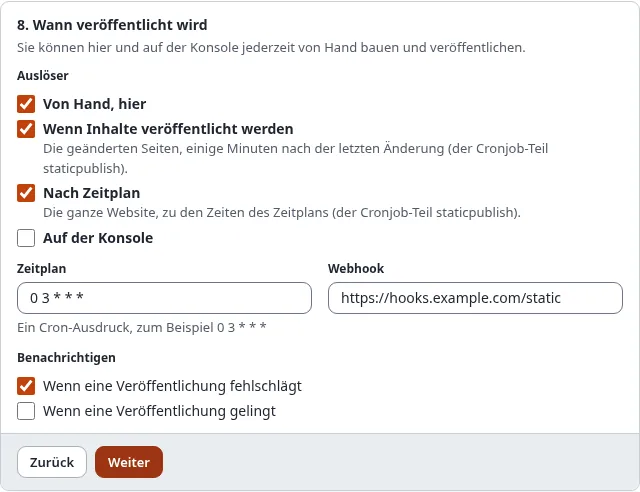

# Benachrichtigungen und Webhooks

Veröffentlicht wird oft, ohne dass jemand zusieht: nach Veröffentlichungen von Inhalten oder nach Zeitplan. Ein Ziel
kann Ihnen sagen, wie es lief, per E-Mail und per Webhook.

## Was Sie am Ende haben

Eine E-Mail, wenn eine Veröffentlichung fehlschlägt (und auf Wunsch, wenn eine gelingt), und einen Post an eine
Adresse Ihrer Wahl nach jeder Veröffentlichung und Rücknahme.



## E-Mail

Im Assistenten, Schritt 8, **Benachrichtigen**:

- **Wenn eine Veröffentlichung fehlschlägt**: voreingestellt.
- **Wenn eine Veröffentlichung gelingt**: Nur eine Veröffentlichung, die etwas geändert hat, wird gemeldet.

Die E-Mail geht an `[StaticPublishSettings] NotifyEmail` in `staticcache.ini`, oder, wenn das leer ist, an die
Administratoradresse der Site (`site.ini [MailSettings] AdminEmail`). Sie entsteht wie die anderen Hinweise, die das
System an Administratoren sendet (eine Anmeldung von einem neuen Gerät, ein Benutzerkonto, das auf Freigabe wartet):

- **Reiner Text**, aus dem Template `design:staticpublish/notice_mail.tpl` im Layout
  `design:mail/layout_text.tpl`. Überschreiben Sie das Template in Ihrem Design, um den Wortlaut zu ändern.
- **Übersetzt**: Betreff und Texte stehen in den Sprachkatalogen der Administration.
- **Absender**: `site.ini [MailSettings] EmailSender`, sonst `AdminEmail`.
- **Betreff**: „Statisches Veröffentlichen von *Ziel* auf *Site* fehlgeschlagen", bei Erfolg „... erfolgreich". Die
  Site ist der Name der öffentlichen Site, nie der der Administration.
- **E-Mail-Kategorie `admin`** (Setup > E-Mail-Einstellungen): ein notwendiger Hinweis, er wird also immer gesendet
  und hat keine Abmeldefußzeile. Abschalten können Sie ihn mit **Benachrichtigen** im Ziel, nicht in den
  E-Mail-Einstellungen.

Sie nennt das Ziel, die Kennung des Laufs, das Ergebnis (fehlgeschlagen, veröffentlicht, zurückgenommen oder nichts
geändert), den Commit, den Tag, den Push, die öffentliche Adresse und etwaige Fehler, nie ein Token oder einen
Schlüssel. Ein fehlgeschlagener Lauf heißt „fehlgeschlagen", auch wenn er nichts geändert hat (das sagt dann
„Änderungen: nichts geändert"). Die Zeile **Protokoll** verweist auf das Protokoll des Laufs in der Administration
(`/staticpublish/log/<Lauf-Kennung>`), gebildet aus der Adresse der Administration
(`site.ini [UserSettings] RegistrationAdminBaseURL`, sonst die SiteURL des Administrations-Siteaccess); ohne sie
fehlt die Zeile.

```text
Statisches Veröffentlichen von Öffentliche Site (github-public) auf Beispiel fehlgeschlagen

Ziel: Öffentliche Site (github-public)
ID: 20261101-030000-1a2b3c
Ergebnis: fehlgeschlagen
Änderungen: nichts geändert
Push: nicht gepusht
Öffentliche Adresse: https://owner.github.io/my-site/

Fehler:
- not pushed: the secret github_pages_token is not set

Protokoll: https://admin.example.com/staticpublish/log/20261101-030000-1a2b3c

--
Diese E-Mail wurde von Beispiel gesendet, weil das Ziel des statischen Veröffentlichens github-public darum bittet.
```

## Webhook

Tragen Sie unter **Webhook** eine `https://`-Adresse ein (einfaches `http://` nur zum Server selbst). Nach jeder
Veröffentlichung und Rücknahme erhält sie einen `POST` mit einem JSON-Inhalt:

```json
{
  "schema": "exp-static-webhook/1",
  "event": "publish.done",
  "target": "github-public",
  "name": "Public site on GitHub Pages",
  "public_url": "https://owner.github.io/my-site/",
  "run_id": "20261101-030000-1a2b3c",
  "state": "done",
  "commit": "4f1c...",
  "tag": "static/github-public/12",
  "push_state": "pushed",
  "counts": { "pages": 120, "files": 840 },
  "errors": [],
  "at": "2026-11-01T03:01:12+00:00"
}
```

`event` ist `publish.done`, `publish.failed`, `rollback.done` oder `rollback.failed`.

Damit der Empfänger prüfen kann, dass der Post von Ihnen kommt, legen Sie unter Setup > Secrets einen zufälligen Wert
ab und tragen seinen **Namen** in `[StaticPublishSettings] WebhookSecret` ein. Jeder Post hat dann den Header
`X-Exp-Static-Signature: sha256=<hex>`, den HMAC-SHA256 des Inhalts mit diesem Wert. In den Einstellungen steht nur
der Name; der Wert verlässt den Secret-Speicher nie und wird mit Paketen und Migrationen nicht exportiert.

Ein Webhook oder eine E-Mail, die nicht gesendet werden kann, kommt ins Debug-Protokoll; eine Veröffentlichung schlägt
deswegen nie fehl.

## Nächster Schritt

[Wer veröffentlichen darf](wer-veroeffentlichen-darf-rollen-und-richtlinien.md).
