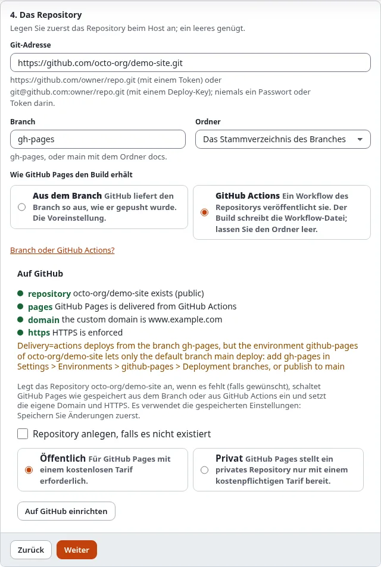

# Branch oder GitHub Actions wählen

Jede Veröffentlichung pusht den Build in einen Branch des Repositorys. GitHub Pages liefert ihn dann auf eine von zwei
Arten aus; die Einstellung `Delivery` des Ziels wählt, welche.

## Was Sie am Ende haben

GitHub Pages so eingestellt, dass es Ihr Ziel auf die gewählte Art ausliefert, und die Einstellungen des Ziels passend
dazu.

## Aus dem Branch (der Standard)

GitHub Pages liefert die Dateien des Branches so aus, wie sie gepusht werden.

- **Branch** `gh-pages` mit dem Ordner an der Wurzel, oder `main` mit dem Ordner `/docs` (GitHub Pages bietet nur
  diese beiden Ordner an).
- Mehr ist nicht nötig. Die Datei `.nojekyll` (standardmäßig unter den Zusatzdateien) hält GitHub davon ab, Jekyll
  auszuführen, das jede Datei und jeden Ordner auslassen würde, die mit `_` oder `.` beginnen.
- Im Assistenten: Schritt 4, **Aus dem Branch**. Einstellung: `Delivery=branch`.

Nehmen Sie diesen Weg, wenn nichts dagegen spricht.

## GitHub Actions

GitHub Pages wird von einem Workflow des Repositorys bereitgestellt. Der Build schreibt ihn für Sie:
`.github/workflows/static-publish-pages.yml`. Er läuft bei jedem Push in den Branch, lädt die Dateien unverändert hoch
(er baut nichts) und stellt sie mit GitHubs eigener Action `deploy-pages` bereit.

- Der Build muss an der **Wurzel des Branches** liegen (lassen Sie **Ordner** leer): GitHub liest Workflows nur von
  dort.
- Ein Token braucht die Berechtigung **Workflows: Read and write**, um die Workflow-Datei zu pushen.
- GitHubs Umgebung `github-pages` erlaubt Bereitstellungen nur aus dem Standard-Branch, sofern Sie unter
  **Settings > Environments** keine weiteren hinzufügen. Verwenden Sie den Standard-Branch des Repositorys (oft
  `main`), oder fügen Sie Ihren dort hinzu.
- `./console exp:static:github status <ziel>`, der Kasten „Auf GitHub“ und **Auf GitHub einrichten** im Assistenten
  warnen, wenn der Branch des Ziels nicht der Standard-Branch des Repositorys ist.
- Im Assistenten: Schritt 4, **GitHub Actions**. Einstellung: `Delivery=actions`.

Nehmen Sie diesen Weg, wenn das Repository auch andere Workflows enthalten soll, wenn Sie den Bereitstellungsverlauf
von GitHub möchten oder wenn eine Organisation Actions verlangt.

## GitHub Pages einschalten

Mit einem Token oder einer GitHub App schaltet **Auf GitHub einrichten** in Schritt 4 des Assistenten (oder
`./console exp:static:github setup <ziel>`) GitHub Pages so ein, wie das Ziel es angibt. Ein Branch muss existieren,
bevor GitHub Pages ihn ausliefern kann, also bei einem neuen Repository: einmal veröffentlichen, dann erneut
einrichten.

Von Hand: Repository > **Settings** > **Pages** > **Build and deployment** > **Source**: **Deploy from a branch**
(Branch und Ordner wählen) oder **GitHub Actions**.

## Prüfen

**Verlauf** und **Vorschau** zeigen den Kasten **Auf GitHub** mit der Auslieferung und dem Zustand des letzten
Pages-Builds: **built**, **building**, **queued** oder **failed**, mit einem Link zu den Einzelheiten.
`./console exp:static:github status <ziel>` gibt dasselbe aus und sagt, wenn die Einstellungen bei GitHub von denen
des Ziels abweichen.

## Nächster Schritt

[Eigene Domain verwenden](eigene-domain-verwenden.md), oder
[Build, Vorschau und Veröffentlichen](build-vorschau-und-veroeffentlichen.md).
