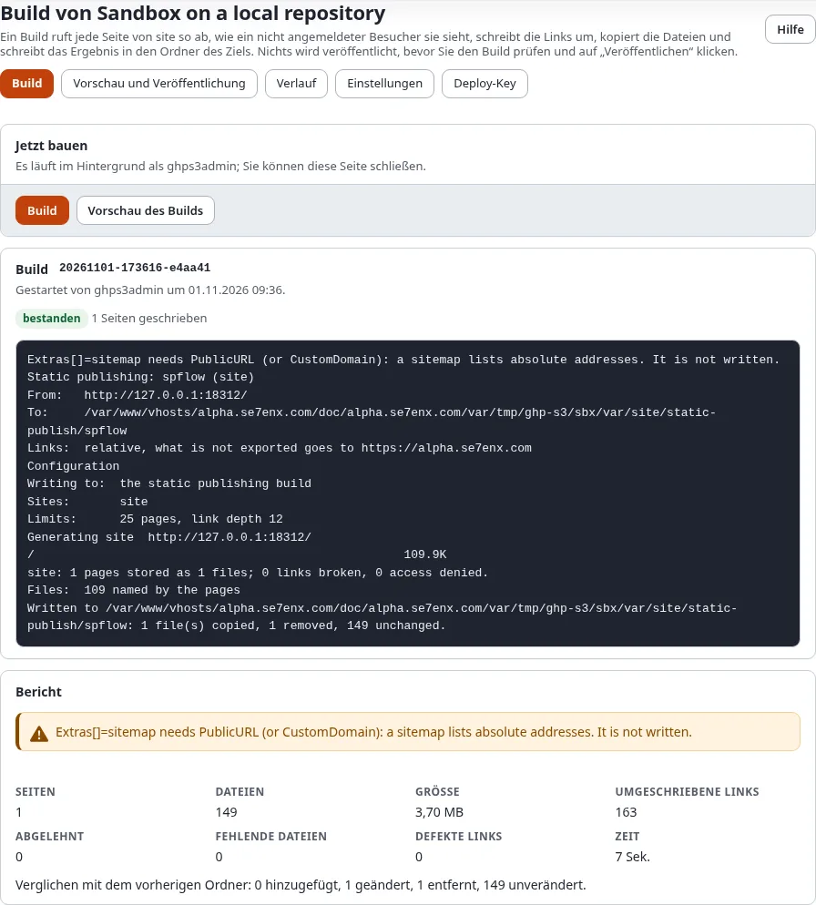

# Build, Vorschau und Veröffentlichen

Ein Ziel geht in drei Schritten an die Öffentlichkeit: **Build** schreibt die statische Kopie in den Ordner des Ziels,
**Vorschau und Veröffentlichung** zeigt, was sich ändert, und lässt Sie sie ansehen, und **Veröffentlichen** committet,
taggt und pusht sie. Bis Sie auf Veröffentlichen drücken, verlässt nichts den Server.

## Was Sie am Ende haben

Die Site, im Repository des Ziels veröffentlicht, als Commit mit dem Tag `static/<target>/<n>`.

## Build

Öffnen Sie die Seite **Build** des Ziels (Setup > Statisches Veröffentlichen > **Build**) und drücken Sie auf
**Build**. Der Build läuft im Hintergrund unter Ihrem Benutzer, Sie können die Seite also schließen; er läuft weiter,
und die Seite findet ihn wieder.

Während er läuft, zeigt die Seite die bisher geschriebenen Seiten und jede Zeile des Fortschritts. Wenn er beendet ist,
lädt die Seite neu und zeigt den **Bericht**: Seiten, Dateien, Größe, umgeschriebene Links, abgelehnte Seiten, Dateien,
die nicht gesammelt werden konnten, und defekte Links. Eine Seite, die nach dem Bereinigen noch Debug-Ausgaben, ein
Formular-Token oder eine Session-ID enthält, wird abgelehnt, und der Build wird nicht verwendet.

Von einem Ziel läuft immer nur ein Build, eine Veröffentlichung oder eine Rücknahme zur selben Zeit, auch eine auf der
Konsole gestartete.

## Den Build prüfen

**Vorschau und Veröffentlichung** vergleicht den Build mit der letzten Veröffentlichung:

- **Was sich ändert**: jede hinzugefügte, geänderte oder entfernte Seite und Datei, mit ihrer Größe (und bei einer
  geänderten der Größe davor). Vor der ersten Veröffentlichung ist jede Datei neu.
- **Größe und Grenzen**: der Build gegenüber der Grenze (GitHub Pages: 1 GB je Site, 100 MB je Datei), mit der größten
  Datei. Über 90 % wird der Kasten gelb, über der Grenze rot.
- **Bericht des Builds**: der Bericht des letzten Builds.
- **Den Build ansehen**: **Vorschau öffnen** liefert den Build aus dem Ordner des Ziels so aus, wie der Host es tun
  wird. Der Link ist für Sie signiert und funktioniert eine Stunde lang. Auf dem Server tut
  `./console exp:static:serve <target>` dasselbe.

## Veröffentlichen oder verwerfen

- **Veröffentlichen** (die Richtlinie `staticpublish/publish`): Haken Sie **Ich habe die Änderungen geprüft** an,
  fügen Sie nach Belieben eine Nachricht hinzu und drücken Sie auf Veröffentlichen. **Bestätigen Sie, dass Sie es
  sind** fragt nach Ihrem Passwort. Die Veröffentlichung läuft im Hintergrund, und ihre Seite zeigt sie: ein Commit
  mit den Dateien des Builds, das nächste Tag `static/<target>/<n>` und der Push. Ein Push wird nie erzwungen; schlägt
  er fehl, bleiben Commit und Tag erhalten, und der Push wird später erneut versucht.
- **Build verwerfen** (die Richtlinie `staticpublish/build`): Der Ordner kehrt zur letzten Veröffentlichung zurück. Die
  öffentliche Site ändert sich nicht.

## Die Seite eines Auftrags

Jeder hier gestartete Build, jede Veröffentlichung und jede Rücknahme hat eine Seite, `/staticpublish/log/<run-id>`:
der Fortschritt, der Bericht und, bei einer Veröffentlichung oder Rücknahme, ihre Aufzeichnung (Zustand, wer, wann,
Dateien, Commit, Tag, Push). Der Verlauf verlinkt darauf.

## Nächster Schritt

[Verlauf und Rücknahme](verlauf-und-ruecknahme.md).
