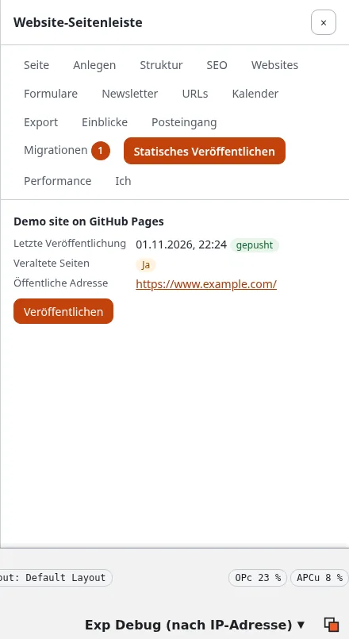

# Der Bereich in der Website-Seitenleiste

Die Website-Seitenleiste (die Erweiterung expwt) hat einen Bereich **Statisches Veröffentlichen**: Auf jeder Seite der
Website sehen Sie, wie diese Seite im statischen Veröffentlichen dasteht, und können genau diese Seite veröffentlichen,
ohne zu Setup > Statisches Veröffentlichen zu wechseln.

## Was Sie am Ende haben

Eine Seite, die Sie gerade geändert haben, in ihrer statischen Kopie veröffentlicht, von der Seite selbst aus.

**Wer den Bereich sieht:** Benutzer, die die Seitenleiste verwenden dürfen (`expwt/use`) und `staticpublish/read` für
mindestens ein Ziel haben. Ohne diese Richtlinie oder auf einem Kernel ohne statisches Veröffentlichen gibt es keinen
Reiter.

## Was der Bereich zeigt

Für jedes Ziel, das Sie lesen dürfen (die Einschränkung Ziel von `staticpublish/read` entscheidet, welche):

- **Letzte Veröffentlichung**: wann, und ob sie **gepusht**, **nicht gepusht**, **fehlgeschlagen** ist oder nichts
  geändert hat; **nie** vor der ersten Veröffentlichung.
- **Veraltete Seiten**: **Ja**, wenn Inhalt dieser Seite veröffentlicht wurde, nachdem die Seite für das Ziel gebaut
  wurde, die statische Kopie also eine ältere Fassung zeigt; **Nein**, wenn sie aktuell ist; **Nicht im Build.**, wenn
  die letzte Veröffentlichung keine Seite davon enthält (eine ausgeschlossene Seite oder eine, die der Crawl nicht
  erreicht hat).
- **Öffentliche Adresse**: die Adresse dieser Seite auf dem Ziel, aus seiner öffentlichen Adresse oder eigenen Domain.
- Ein laufender Auftrag des Ziels, mit wem ihn gestartet hat und einem Link auf seine Seite.

Ist das statische Veröffentlichen ausgeschaltet, sagt der Bereich das. Ohne Ziel sagt er „Noch kein Ziel."; Benutzer,
die Ziele einrichten dürfen (`staticpublish/setup`), bekommen **Ziel anlegen** und **Anleitung lesen**.

## Diese Seite veröffentlichen

**Veröffentlichen** steht bei den Zielen, für die Sie `staticpublish/publish` haben:

1. Drücken Sie **Veröffentlichen** unter dem Ziel.
2. „Bestätigen Sie, dass Sie es sind" fragt in einem kleinen Fenster nach Ihrem Passwort (oder Passkey), wie
   Veröffentlichen unter Setup > Statisches Veröffentlichen, außer Sie haben es eben erst bestätigt.
3. Der Auftrag startet im Hintergrund, als Sie: ein **inkrementeller Build** des Knotens dieser Seite in den letzten
   Build (der Rest der Website bleibt, wie er veröffentlicht wurde), dann ein Commit, ein Tag und ein Push, nie
   erzwungen. Der Bereich sagt „Es läuft im Hintergrund als ..." und verlinkt die Seite des Auftrags in der
   Administration ([Die Seite eines Auftrags](build-vorschau-und-veroeffentlichen.md#die-seite-eines-auftrags)).
4. Wenn er beendet ist, zeigt der Bereich die neue Veröffentlichung und **Veraltete Seiten: Nein**.

Solange ein Auftrag des Ziels läuft, gibt es kein Veröffentlichen; warten Sie, bis er beendet ist. Jede solche
Veröffentlichung steht wie jede andere im Verlauf, Sie können also zu einer früheren zurückkehren
([Verlauf und Rücknahme](verlauf-und-ruecknahme.md)).

Auf der Konsole ist dasselbe `./console exp:static:publish <target> --nodes=<Knoten-ID>`.

## Nächster Schritt

[Wer veröffentlichen darf](wer-veroeffentlichen-darf-rollen-und-richtlinien.md): Geben Sie Redakteuren
`staticpublish/read` und `publish` für ein Ziel, damit sie den Bereich verwenden können.
