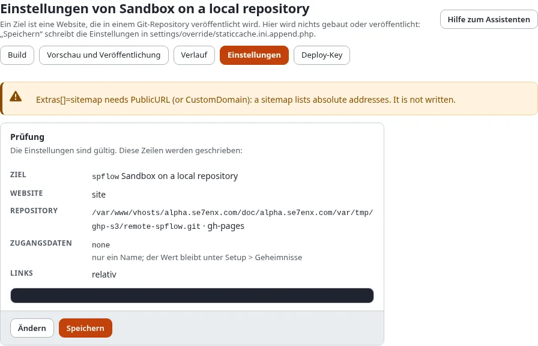

# Der Einrichtungsassistent

Ein **Ziel** ist eine Site Ihrer Installation, veröffentlicht in ein Git-Repository. Der Assistent unter **Setup >
Statisches Veröffentlichen > Neues Ziel** legt eines in neun kurzen Schritten an; **Einstellungen** an einem Ziel
öffnet denselben Assistenten mit dessen Einstellungen. Hier wird nichts gebaut oder veröffentlicht: **Speichern**
schreibt nur die Einstellungen.

## Was Sie am Ende haben

Ein Ziel mit seinen Einstellungen in `settings/override/staticcache.ini.append.php`, bereit zum Bauen.

## Bevor Sie beginnen

- Die Richtlinie `staticpublish/setup` ohne Einschränkung nach Ziel (Target) (Administrator hat sie).
- Ein Repository auf dem Host. Ein leeres genügt. Auf GitHub: **New repository**, öffentlich für einen kostenlosen
  Tarif.
- Für ein Token: das Token, unter einem Namen Ihrer Wahl in **Setup > Geheimnisse** gespeichert (für GitHub ein
  fine-grained Token mit **Contents: Read and write** auf diesem Repository). Für einen Deploy-Key brauchen Sie noch
  nichts.

Die Schrittliste oben zeigt, wo Sie sind; **Zurück** und **Weiter** wechseln zwischen den Schritten, und ein Schritt
lässt sich aus der Liste öffnen. Ohne JavaScript stehen alle Schritte auf einer Seite.

## 1. Die Website

- **Id**: Kleinbuchstaben, Ziffern, `_` und `-`, zum Beispiel `github-public`. Sie benennt den Ordner des Ziels und
  seine Tags (`static/<id>/<n>`) und lässt sich später nicht ändern.
- **Name**: in Listen angezeigt.
- **Zu veröffentlichende Website**: einer der Front-Siteaccesses. Administrations- und Bearbeitungs-Siteaccesses werden nie
  angeboten: Eine statische Kopie ist immer das, was ein nicht angemeldeter Besucher sieht.

## 2. Der Host

**GitHub Pages** oder **ein anderer Git-Host** (GitLab, Gitea, Ihr eigener Server). Der Kasten nennt die Grenzen von
GitHub: eine Site bis 1 GB, eine Datei bis 100 MB, etwa 100 GB Datenverkehr im Monat, ein öffentliches Repository bei
einem kostenlosen Tarif und keine Shops.

## 3. Anmeldung am Repository

| Auswahl | Für | Was gespeichert wird |
|---|---|---|
| Ein Token aus Setup > Geheimnisse | eine `https://`-Adresse | `Credential=token:<name>` |
| Ein für dieses Ziel erstellter Deploy-Key | eine SSH-Adresse (`git@github.com:owner/repo.git`) | `Credential=sshkey:staticpublish.<id>.deploy_key` |
| Keine | der Server meldet sich selbst an, oder das Repository liegt auf diesem Server | `Credential=none` |

Nur der Name wird beim Ziel gespeichert; das Token oder der Schlüssel bleibt in Setup > Geheimnisse und erscheint nie in
einem Log oder einem Bericht. Mit einem Deploy-Key öffnet **Speichern** die Seite **Deploy-Key** des Ziels, wo
**Schlüssel erstellen** ihn anlegt und die öffentliche Hälfte zeigt, die Sie dem Repository hinzufügen
([SSH-Deploy-Keys](../../anleitungen/statisches-veroeffentlichen-deploy-keys.md)). Die Anmeldung mit einer GitHub App
kommt mit der GitHub-Anbindung.

## 4. Das Repository

- **Git-Adresse**: die Adresse des Repositorys, nie mit einem Passwort oder Token darin.
- **Branch**: `gh-pages` oder `main` mit dem Ordner `docs`.
- **Ordner**: die Wurzel des Branches oder `/docs` (GitHub Pages liefert eines von beiden aus).
- **Wie GitHub Pages den Build erhält**: aus dem Branch (der Standard) oder durch einen GitHub-Actions-Workflow.

## 5. Links und Basispfad

Eine GitHub-**Projekt**-Site liegt unterhalb von `/<repository>/` (`https://owner.github.io/my-site/`). **Relative**
Links funktionieren dort und unterhalb jedes anderen Pfads, deshalb sind sie der Standard. **Unterhalb eines
Basispfads** schreibt jeden Link beginnend mit dem Basispfad. Der Kasten zeigt während der Eingabe, wie ein Link von der
Seite `/news/` auf `/about-us/team` geschrieben wird. **Öffentliche Adresse** ist die Adresse der veröffentlichten
Site; die Sitemap und die kanonischen Links brauchen sie.

## 6. Ihre eigene Domain

Optional: `www.example.com`. Sie wird in die Datei `CNAME` geschrieben, und die Site wird dann an der Wurzel der Domain
ausgeliefert, lassen Sie den Basispfad also leer. Richten Sie das DNS der Domain auf den Host aus, wie dieser es
erklärt; HTTPS kann eine Weile dauern.

## 7. Was der Build enthält

- **Dateien**: was die Seiten nennen, und jedes Bild veröffentlichter Inhalte (der Standard), oder nur, was die Seiten
  nennen.
- **Zusatzdateien**: `.nojekyll` (auf GitHub Pages nötig), `404.html`, `robots.txt`, `sitemap.xml`. Das Manifest wird immer
  geschrieben.
- **Nachbearbeitung**: Debug-Ausgaben, Formular-Token, Session-IDs und Nonces werden immer herausgenommen. Eine Seite,
  die noch eines davon enthält, wird abgelehnt, und nichts wird veröffentlicht.
- **Suchseite** und **Formulare**, **die meisten Seiten**, **auszulassende** Seiten und Sektionen, und von wo die Seiten
  **abgerufen** werden und wohin Links zur **Live-Website** gehen.

## 8. Wann veröffentlicht wird

Von Hand hier und auf der Konsole. Das Veröffentlichen, wenn Inhalte veröffentlicht werden, und nach Zeitplan,
Benachrichtigungen und der Webhook werden jetzt gespeichert und treten mit einem späteren Release in Kraft.

## 9. Prüfen und speichern

**Prüfung** kontrolliert jede Einstellung und zeigt die Zeilen, die geschrieben werden. Beheben Sie, was es auflistet,
und drücken Sie erneut auf **Prüfung**. Ist das statische Veröffentlichen noch ausgeschaltet, ist **Statisches
Veröffentlichen einschalten** für Sie angehakt. **Speichern** schreibt die Einstellungen (mit einer Sicherung der Datei
und einem Eintrag im Auditprotokoll) und fragt **Bestätigen Sie, dass Sie es sind**. Danach öffnet sich die Seite
**Build** des Ziels.

## Nächster Schritt

[Build, Vorschau und Veröffentlichen](build-vorschau-und-veroeffentlichen.md).
