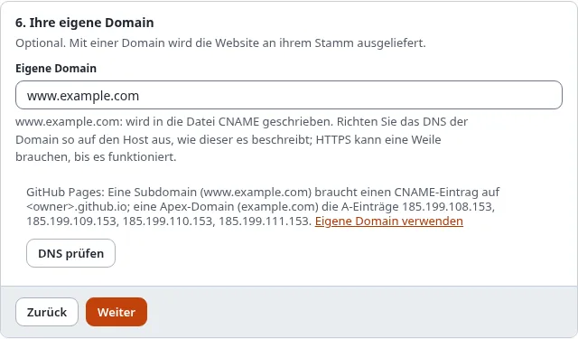
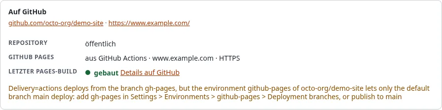

# Eigene Domain verwenden

Eine GitHub-Pages-Website liegt unter `https://<owner>.github.io/<repository>/`. Mit Ihrer eigenen Domain wird sie
stattdessen unter `https://www.example.com/` ausgeliefert, mit einem kostenlosen HTTPS-Zertifikat von GitHub.

## Was Sie am Ende haben

Ihre Website unter Ihrer eigenen Domain, über HTTPS.





## 1. Die Domain beim Ziel setzen

Im Assistenten, Schritt 6, **Eigene Domain**: `www.example.com`. Der Build schreibt sie in die Datei `CNAME`, die
GitHub Pages liest. Die Website wird dann an der Wurzel der Domain ausgeliefert, lassen Sie also in Schritt 5 den
**Basispfad** leer (relative Links funktionieren ohnehin) und setzen Sie die **Öffentliche Adresse** auf
`https://www.example.com/`.

Nehmen Sie nach Möglichkeit `www.example.com` statt `example.com`: Eine Subdomain braucht einen DNS-Eintrag und folgt
GitHub, falls sich dessen Adressen einmal ändern. Setzen Sie beide, leitet GitHub die eine auf die andere um.

## 2. Das DNS auf GitHub Pages ausrichten

Beim Anbieter der Domain (wo Sie sie gekauft haben oder wo ihr DNS verwaltet wird):

| Domain | Eintrag | Wert |
|---|---|---|
| eine Subdomain, `www.example.com` | `CNAME` | `<owner>.github.io` (Ihr Konto oder Ihre Organisation, nie das Repository) |
| die Apex-Domain, `example.com` | `A` (alle vier) | `185.199.108.153`, `185.199.109.153`, `185.199.110.153`, `185.199.111.153` |
| die Apex-Domain, optional | `AAAA` | `2606:50c0:8000::153`, `2606:50c0:8001::153`, `2606:50c0:8002::153`, `2606:50c0:8003::153` |

Entfernen Sie andere `A`- oder `AAAA`-Einträge mit demselben Namen (ein alter Host), sonst erreichen Besucher zufällig
den einen oder den anderen.

## 3. Das DNS prüfen

**DNS prüfen** in Schritt 6 des Assistenten schlägt die Domain nach und sagt, ob sie auf GitHub Pages zeigt. Wenn
nicht, listet es die zu setzenden Einträge auf. Auf der Konsole:

```
./console exp:static:dns www.example.com
./console exp:static:dns example.com --owner=octo-org
```

Der Owner kommt von dem Ziel, dessen eigene Domain es ist, oder von `--owner`. Es kann bis zu einem Tag dauern, bis
DNS-Änderungen überall zu sehen sind (die TTL der Einträge).

## 4. GitHub Bescheid geben, und HTTPS

Mit einem Token oder einer GitHub App setzt **Auf GitHub einrichten** in Schritt 4 (oder
`./console exp:static:github setup <ziel>`) die Domain bei GitHub Pages und schaltet **Enforce HTTPS** ein. GitHub
stellt das Zertifikat aus, sobald es die DNS-Einträge sieht, was bis zu 24 Stunden dauern kann; bis dahin führt die
Einrichtung HTTPS als geplant auf. Führen Sie sie später erneut aus.

Von Hand: Repository > **Settings** > **Pages** > **Custom domain**, dann **Enforce HTTPS**, sobald es sich ankreuzen
lässt.

Verifizieren Sie die Domain für Ihr Konto oder Ihre Organisation auf GitHub (**Settings** > **Pages** > **Verified
domains**), damit niemand sonst sie für seine Website übernehmen kann, falls Ihr Repository einmal entfernt wird.

## Wenn es nicht funktioniert

| Was Sie sehen | Was zu tun ist |
|---|---|
| Die DNS-Prüfung listet zu setzende Einträge auf | Sie beim Anbieter der Domain setzen und die TTL abwarten |
| `... is a CNAME to <owner>.github.io/repo` | Ein CNAME nennt das Konto (`<owner>.github.io`), nie das Repository |
| Die Website antwortet unter der Domain mit 404 | Die Datei `CNAME` fehlt: die eigene Domain beim Ziel setzen, erneut bauen und veröffentlichen |
| Der Browser warnt vor dem Zertifikat | GitHub hat es noch nicht ausgestellt; warten, dann erneut einrichten |
| CSS und Bilder fehlen unter der Domain | Das Ziel hat noch einen Basispfad: ihn leeren, bauen und veröffentlichen |

## Nächster Schritt

[Grenzen und Bedingungen von GitHub Pages](grenzen-und-bedingungen-von-github-pages.md).
