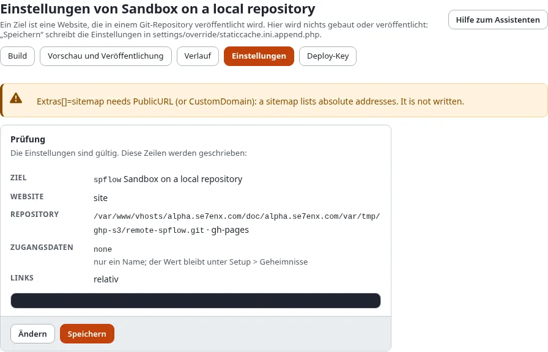
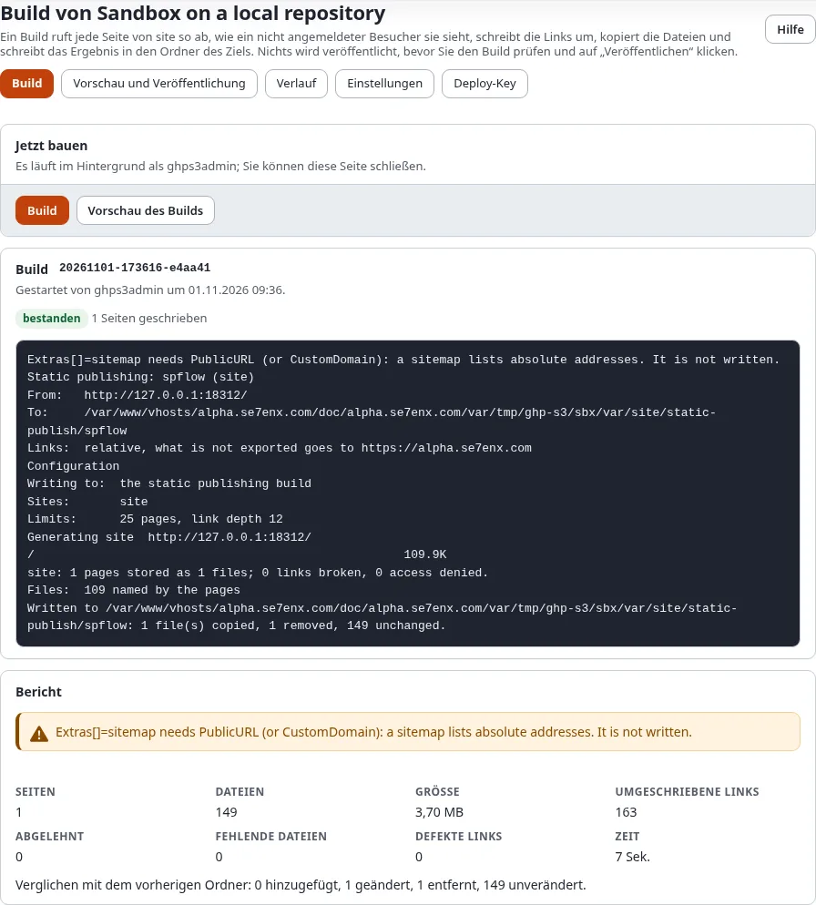
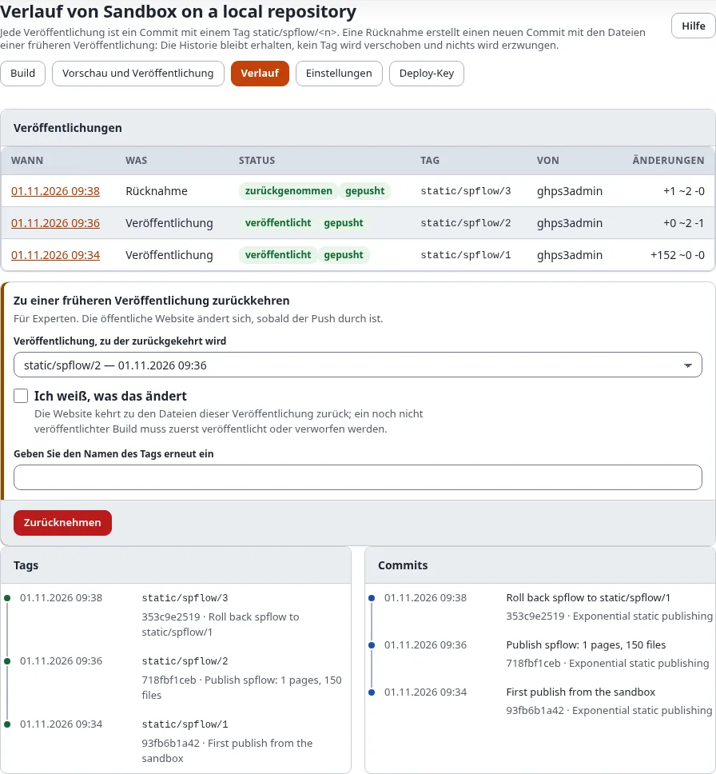

# In 15 Minuten eine kostenlose Website

Dieses Tutorial nimmt eine Exponential-Website, die Sie schon haben, und stellt eine Kopie davon kostenlos ins Netz,
unter `https://<ihr-konto>.github.io/<repository>/`. Sie bearbeiten weiter in Exponential; die öffentliche Kopie
besteht aus einfachen Dateien, die GitHub Pages ausliefert.

## Was Sie am Ende haben

- Eine öffentliche Website unter einer `github.io`-Adresse, mit Ihren Seiten, Bildern und Menüs.
- Ein Ziel unter **Setup > Statisches Veröffentlichen**, das sie mit zwei Klicks erneut baut und veröffentlicht.
- Einen ersten Eintrag im Verlauf, sodass Sie immer zurückkehren können.

## Was Sie brauchen

- Ein Administratorkonto in Exponential (die Richtlinie `staticpublish/setup`).
- Ein kostenloses GitHub-Konto. Neu bei GitHub? [Ein GitHub-Konto und Repository anlegen](ein-github-konto-und-repository-anlegen.md)
  dauert fünf Minuten.
- Eine Website, die zu einer statischen Kopie passt. Unsicher? [Passt statisch zu meiner Website?](passt-statisch-zu-meiner-website.md)

## Schritt 1: Repository und Token anlegen (3 Minuten)

1. Auf GitHub **New repository**: ein Name, zum Beispiel `my-site`, **Public**, leer anlegen.
2. In Ihren GitHub-Einstellungen **Developer settings > Fine-grained tokens > Generate new token**: nur das
   Repository `my-site`, die Berechtigungen **Contents: Read and write** und **Pages: Read and write**.
3. In Exponential **Setup > Geheimnisse**: das Token unter einem Namen speichern, zum Beispiel `github_my_site`. Es
   wird nie wieder angezeigt, auch Ihnen nicht.

## Schritt 2: Der Assistent (5 Minuten)

Öffnen Sie **Setup > Statisches Veröffentlichen** und wählen Sie **Neues Ziel**.

Jeder Schritt hat **Weiter** (und **Zurück**); **Abbrechen** daneben verlässt den Assistenten, ohne etwas zu speichern.

1. **Die Website**: eine Id wie `github`, ein Name, und unter **Zu veröffentlichende Siteaccesses** den Siteaccess
   Ihrer Website anhaken (er ist dann **Im Stamm**).
2. **Der Host**: GitHub Pages.
3. **Anmeldung**: **Ein Token aus Setup > Geheimnisse**, dann der Name `github_my_site`.
4. **Das Repository**: `https://github.com/<ihr-konto>/my-site.git`, Branch `gh-pages`, Ordner: Wurzel.
5. **Links**: **Relative** lassen. Öffentliche Adresse: `https://<ihr-konto>.github.io/my-site/`.
6. Die eigene Domain vorerst überspringen.
7. **Was der Build enthält**: so lassen.
8. **Wann veröffentlicht wird**: so lassen.
9. **Prüfung**, dann **Speichern**. Exponential fragt **Bestätigen Sie, dass Sie es sind**.

Öffnen Sie danach Schritt 4 erneut und wählen Sie **Auf GitHub einrichten**: Es schaltet GitHub Pages für den Branch
ein. Bei einem ganz neuen Repository wählen Sie es nach der ersten Veröffentlichung noch einmal.

## Schritt 3: Bauen (3 Minuten)

Die Seite **Bauen** des Ziels öffnet sich. Wählen Sie **Bauen** und sehen Sie zu, wie die Seiten ankommen.

## Schritt 4: Prüfen (2 Minuten)

**Vorschau und Veröffentlichung** zeigt, was sich ändert, die Größe gegenüber den Grenzen von GitHub und den Bericht.
Wählen Sie **Vorschau öffnen** und klicken Sie sich durch einige Seiten: Genau das sehen die Besucher.

## Schritt 5: Veröffentlichen (2 Minuten)

Haken Sie **Ich habe die Änderungen geprüft** an und wählen Sie **Veröffentlichen**. Ein, zwei Minuten später ist die
Website unter `https://<ihr-konto>.github.io/my-site/` erreichbar. **Setup > Statisches Veröffentlichen** zeigt das Ziel
dann mit **Version** 1, seinem **Commit** (ein Link auf den Commit bei GitHub) und dem Badge der letzten
Veröffentlichung.

## Wenn etwas nicht klappt

[Wenn eine Veröffentlichung fehlschlägt](wenn-eine-veroeffentlichung-fehlschlaegt.md) geht die üblichen Anzeichen
durch. Am häufigsten: ein 404 auf `github.io` direkt nach der ersten Veröffentlichung, weil GitHub Pages noch nicht
eingeschaltet ist (Schritt 2, **Auf GitHub einrichten**).

Ein fertiges Beispiel: Die Exponential-Demo-Website wird so unter
[https://se7enxweb.github.io/exponential-demo-site-static/](https://se7enxweb.github.io/exponential-demo-site-static/) veröffentlicht (in Kürze).

## Nächster Schritt

- Ihre eigene Adresse: [Eigene Domain verwenden](eigene-domain-verwenden.md).
- Veröffentlichen ohne Knopfdruck: [Automatisch veröffentlichen](automatisch-veroeffentlichen.md).
- Was privat bleibt: [Private Inhalte privat halten](private-inhalte-privat-halten.md).
