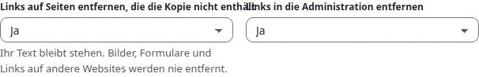

# Links und Basispfad

## Was Sie am Ende haben

Die richtige Link-Einstellung für Ihr Ziel und keine fehlenden Stylesheets oder kaputten Links auf der veröffentlichten
Website.

## Wo eine GitHub-Pages-Website liegt

| Repository | Adresse | Pfad der Website |
|---|---|---|
| `<owner>/<owner>.github.io` (eine Benutzer- oder Organisationsseite) | `https://<owner>.github.io/` | `/` |
| jedes andere, zum Beispiel `<owner>/my-site` (eine Projektseite) | `https://<owner>.github.io/my-site/` | `/my-site/` |
| jedes, mit eigener Domain | `https://www.example.com/` | `/` |

Auf Ihrer Exponential-Website ist die Seite „Über uns“ `/about-us`. Auf einer Projektseite muss sie
`/my-site/about-us/` sein. Der Build erledigt das auf eine von zwei Arten (Schritt 5 des Assistenten).

## Relative Links (Standard)

Jeder Link wird relativ zu seiner Seite geschrieben: Von `/news/` aus wird die Seite `/about-us/team` zu
`../about-us/team/`. Die Kopie funktioniert dann unter jedem Pfad: unter `/`, unter `/my-site/`, in der Vorschau und
aus einem Ordner auf Ihrer Festplatte. Wählen Sie das, wenn nichts dagegen spricht.

## Unter einem Basispfad

Mit **Unter einem Basispfad** (`Links=base-path`) beginnt jeder Link mit dem Basispfad, zum Beispiel
`/my-site/about-us/team/`. Manche Werkzeuge und Hosts wollen absolute Links. Die Kopie funktioniert dann nur unter
diesem einen Pfad, also muss der Basispfad genau dem Namen des Repositorys entsprechen, mit einem Schrägstrich an
jedem Ende.

`404.html` verwendet immer den Basispfad: GitHub Pages liefert sie für eine fehlende Adresse in jeder Tiefe aus, wo
relative Links an die falsche Stelle zeigen würden.

## Die öffentliche Adresse

**Öffentliche Adresse** (`PublicURL`) ist die volle Adresse der veröffentlichten Website, etwa
`https://<owner>.github.io/my-site/`. Die Sitemap, `robots.txt`, kanonische Links und Social Cards brauchen sie, um
absolut zu sein. Ihr Pfad sollte der Basispfad sein.

## Links, die die Kopie nicht enthält

Die Suchergebnisseite, die Anmeldung, das Ziel eines Formulars, eine Seite mit Query-String oder eine ausgelassene
Seite sind nicht in der Kopie. Links auf sie führen zu Ihrer Live-Website (`LiveURL`, standardmäßig die Adresse der
Website in Exponential). Ist die eigene Adresse der Website eine lokale, etwa `localhost` auf einem Build-Server,
bleiben solche Links, wie sie sind, und der Build warnt. Links auf andere Websites, `mailto:` und `#anker` werden nie
geändert.

Schritt 7 des Assistenten kann solche Links stattdessen herausnehmen: **Links auf Seiten entfernen, die die Kopie nicht
enthält** (`OutsideLinks=unlink`) und **Links in die Administration entfernen** (`AdminLinks=unlink`). Mit **Ja** bleibt
der Link mit seinem Text und seinen Stilen an seinem Platz, ausgegraut und ohne Adresse: Ein Menü behält seine Form,
aber kein Besucher landet auf der Live-Website oder bei der Anmeldung der Administration. Bilder, Stylesheets,
Formulare und Links auf andere Websites werden nie entfernt. Beide stehen standardmäßig auf **Nein**.

## Wenn es schiefgeht

| Anzeichen | Lösung |
|---|---|
| Seiten erscheinen ohne Stile unter `/my-site/` | `Links=base-path` mit falschem `BasePath`: korrigieren, oder auf relative Links wechseln |
| Links verlassen die Website und führen zur Live-Website | die Seite ist nicht in der Kopie (ausgelassen, jenseits von `MaxDepth` oder nur mit Query erreichbar) |
| Die Sitemap fehlt | die öffentliche Adresse setzen |

## Nächster Schritt

[Eigene Domain verwenden](eigene-domain-verwenden.md) oder [Build, Vorschau und Veröffentlichen](build-vorschau-und-veroeffentlichen.md).
