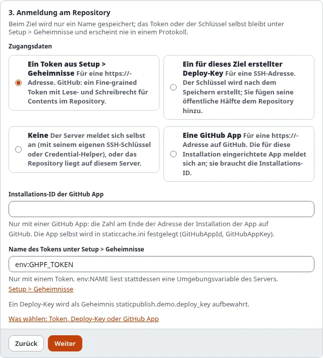

# Mit GitHub verbinden: Token, Deploy-Key oder GitHub App

Ein Ziel meldet sich mit **Zugangsdaten** an seinem Repository an. Das Ziel speichert nur deren **Namen**; der Wert
bleibt unter **Setup > Geheimnisse** und gelangt über die Umgebung des einen git-Prozesses zu git (`GIT_ASKPASS` oder
`GIT_SSH_COMMAND`), nie über die Adresse des Repositorys, eine Befehlszeile oder ein Log.

## Was Sie am Ende haben

Ein Ziel, das zu GitHub pushen kann und, mit einem Token oder einer GitHub App, die GitHub-Schritte des Assistenten
nutzen kann.



## Welchen Weg Sie wählen

| | Token | Deploy-Key | GitHub App |
|---|---|---|---|
| Einstellung | `Credential=token:<geheimnis>` | `Credential=sshkey:<geheimnis>` | `Credential=app:<installations-id>` |
| Adresse des Repositorys | `https://github.com/owner/repo.git` | `git@github.com:owner/repo.git` | `https://github.com/owner/repo.git` |
| Pusht | ja | ja | ja |
| Legt das Repository an, schaltet GitHub Pages ein, setzt die Domain, zeigt den Pages-Build | ja | nein | ja |
| Gültig | bis es abläuft (das wählen Sie) | bis Sie ihn entfernen | eine Stunde je Token, für jeden Push neu erstellt |
| Am besten für | eine Website, den Einstieg | einen Server, der nur dieses eine Repository erreichen soll | Organisationen, viele Websites |

Beginnen Sie mit einem **Token**. Wählen Sie einen **Deploy-Key**, wenn der Server nichts halten darf, das andere
Repositorys erreicht, und eine **GitHub App**, wenn eine Organisation mehrere Websites veröffentlicht.

## Ein fine-grained Token

1. Auf GitHub: Ihr Bild > **Settings** > **Developer settings** > **Personal access tokens** > **Fine-grained
   tokens** > **Generate new token**.
2. **Resource owner**: das Konto oder die Organisation des Repositorys. **Repository access**: nur das Repository der
   Website (wählen Sie alle Repositorys nur, wenn der Assistent neue anlegen soll).
3. **Repository permissions**: **Contents: Read and write** (zum Pushen), **Pages: Read and write** (um GitHub Pages
   einzuschalten und die Domain zu setzen), **Administration: Read and write** nur zum Anlegen von Repositorys,
   **Workflows: Read and write** nur mit GitHub Actions (der Build schreibt eine Workflow-Datei).
4. Kopieren Sie das Token einmal und speichern Sie es unter **Setup > Geheimnisse** unter einem Namen wie
   `github_pages_token`.
5. Im Assistenten, Schritt 3: **Ein Token aus Setup > Geheimnisse** mit diesem Namen. Die Einstellung ist
   `Credential=token:github_pages_token`.

`token:env:NAME` liest das Token stattdessen aus einer Umgebungsvariablen des Servers (für CI).

### Anmelden, statt ein Token zu kopieren

Mit einer OAuth App, bei der der Device Flow eingeschaltet ist (ihre Client-ID in `[StaticPublishSettings]
GitHubOAuthClientId`), meldet die Konsole Sie an und bewahrt das Token für Sie auf:

```
./console exp:static:github signin --secret=github_pages_token
```

Sie gibt eine Adresse und einen Code aus; öffnen Sie die Adresse, geben Sie den Code ein und erlauben Sie den Zugriff.
Das Token geht in den Geheimnisspeicher, nie auf den Bildschirm.

## Ein Deploy-Key

Ein Deploy-Key erreicht genau ein Repository. **Speichern** im Assistenten öffnet die Seite **Deploy-Key** des Ziels;
**Schlüssel erstellen** legt einen ed25519-Schlüssel an, bewahrt seine private Hälfte unter Setup > Geheimnisse auf
und zeigt die öffentliche Hälfte. Auf GitHub: Repository > **Settings** > **Deploy keys** > **Add deploy key**, fügen
Sie sie ein und kreuzen Sie **Allow write access** an. Die Adresse des Ziels muss die SSH-Adresse sein
(`git@github.com:owner/repo.git`). Einzelheiten:
[SSH-Deploy-Keys](../../anleitungen/statisches-veroeffentlichen-deploy-keys.md).

Ein Deploy-Key pusht nur: Legen Sie das Repository selbst an und schalten Sie GitHub Pages in dessen Einstellungen
selbst ein.

## Eine GitHub App

Eine GitHub App gehört einem Konto oder einer Organisation und wird auf ausgewählten Repositorys installiert. Das
statische Veröffentlichen erstellt für jeden Push aus dem privaten Schlüssel der App ein kurzlebiges Token.

1. Auf GitHub: **Settings** > **Developer settings** > **GitHub Apps** > **New GitHub App**. Schalten Sie den Webhook
   aus. **Repository permissions**: Contents, Pages und (zum Anlegen von Repositorys) Administration, jeweils
   **Read and write**; mit GitHub Actions auch Workflows.
2. **Generate a private key**: GitHub lädt eine `.pem`-Datei herunter. Speichern Sie ihren ganzen Text unter
   **Setup > Geheimnisse**, zum Beispiel als `github_app_key`.
3. Notieren Sie die **App ID** und setzen Sie in `settings/override/staticcache.ini.append.php`:
   ```
   [StaticPublishSettings]
   GitHubAppId=123456
   GitHubAppKey=github_app_key
   ```
4. **Install App** auf dem Repository der Website. Die Adresse der Installation endet mit ihrer **Installations-ID**
   (`.../settings/installations/45678901`).
5. Im Assistenten, Schritt 3: **Eine GitHub App**, mit der Installations-ID. Die Einstellung ist
   `Credential=app:45678901`.

## Prüfen

- `./console exp:static:status <ziel>` sagt, ob die Zugangsdaten gelesen werden können (nie ihren Wert).
- `./console exp:static:github status <ziel>` meldet sich damit an und zeigt das Repository und GitHub Pages.

## Wenn es nicht funktioniert

| Meldung | Was zu tun ist |
|---|---|
| `the secret ... is not set` | Das Token unter diesem Namen unter Setup > Geheimnisse speichern |
| `GitHub answered 401: Bad credentials` | Das Token ist abgelaufen oder wurde widerrufen: ein neues erstellen und unter demselben Namen speichern |
| `GitHub answered 403` oder `404` für das Repository | Das Token deckt dieses Repository nicht ab, oder ihm fehlt eine der oben genannten Berechtigungen |
| `the GitHub steps need a token or a GitHub App` | Das Ziel meldet sich mit einem Deploy-Key oder gar nicht an: für die GitHub-Schritte ein Token oder eine App verwenden |
| `the GitHub App is not set up` | `GitHubAppId` und `GitHubAppKey` setzen |
| `the GitHub App ... gave no token` | Die App ist nicht auf dem Repository installiert, oder die Installations-ID ist falsch |

## Nächster Schritt

[Branch oder GitHub Actions wählen](branch-oder-github-actions-waehlen.md).
