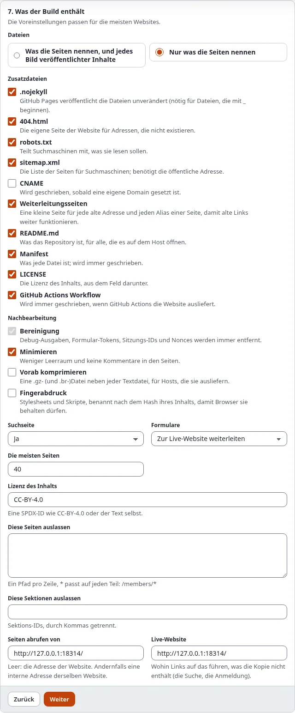

# SEO auf einer statischen Site

Der Umzug einer Site auf statische Dateien darf sie ihren Platz in den Suchmaschinen nicht kosten. Statisches
Veröffentlichen schreibt die Dateien, die Suchmaschinen lesen, hält jede alte Adresse am Leben und kann die Dateien
kleiner und schneller machen.

## Was Sie am Ende haben

Eine statische Kopie mit Sitemap, Robots-Regeln, absoluten Canonical-Links und einer kleinen Seite für jede alte
Adresse, die Besucher und Suchmaschinen weiterschickt.

## Die Dateien, die Suchmaschinen lesen

Im Assistenten, Schritt 7, **Extras**:

- **sitemap.xml**: jede Seite unter ihrer öffentlichen Adresse mit dem Datum der letzten Änderung ihres Inhalts. Sie
  braucht die öffentliche Adresse des Ziels.
- **robots.txt**: Alles darf gelesen werden, und die Sitemap wird genannt.
- **404.html**: die eigene Seite „Seite nicht gefunden“ der Site.

Canonical-Links, `hreflang`-Alternativen und Social-Card-Bilder (`og:image`, `twitter:image`) werden auf die
öffentliche Adresse umgeschrieben und nennen so nie die Adresse, von der der Build stammt.

## Alte Adressen: Weiterleitungsseiten

Ein statischer Host kennt keine URL-Aliase. Kreuzen Sie **redirects** an, und jeder Build schreibt eine kleine Seite
für:

- jede **alte Adresse** einer Seite (der Verlauf, der beim Umbenennen oder Verschieben von Inhalten bleibt);
- jeden **eigenen Alias**, der auf eine Seite zeigt (Setup > URL-Übersetzer);
- jeden **URL-Platzhalter** ohne `*`, der zu einer Seite der Kopie führt.

So eine Seite schickt den Besucher sofort weiter (ein Meta-Refresh), nennt die neue Adresse als Canonical und bittet
Suchmaschinen, sie nicht aufzunehmen. Eine Adresse, an der die Kopie eine eigene Seite oder Datei hat, bekommt nie
eine. Platzhalter mit `*` lassen sich nicht als Dateien ausdrücken und fallen weg.

## Schnellere Dateien

In Schritt 7, **Nachbearbeitung**:

- **minify**: weniger Leerraum und keine Kommentare in den Seiten (der Inhalt von `pre`, `textarea`, Skripten und
  Styles bleibt unberührt).
- **precompress**: eine `.gz` neben jeder Seite, jedem Stylesheet und Skript ab 1 KB (und eine `.br`, wenn PHP die
  Brotli-Erweiterung hat), für Hosts, die sie ausliefern (GitHub Pages komprimiert selbst).
- **fingerprint**: Stylesheets und Skripte werden nach dem Hash ihres Inhalts benannt (`site.3f2a9c1b.css`), und jeder
  Link auf sie ändert sich mit, sodass ein Host Browser sie behalten lassen kann. Nie eine `?v=`-Abfrage. Ein
  Teil-Build behält die Namen, die er hat.

## Nächster Schritt

[Sprachen auf einer statischen Site](sprachen-auf-einer-statischen-site.md).
