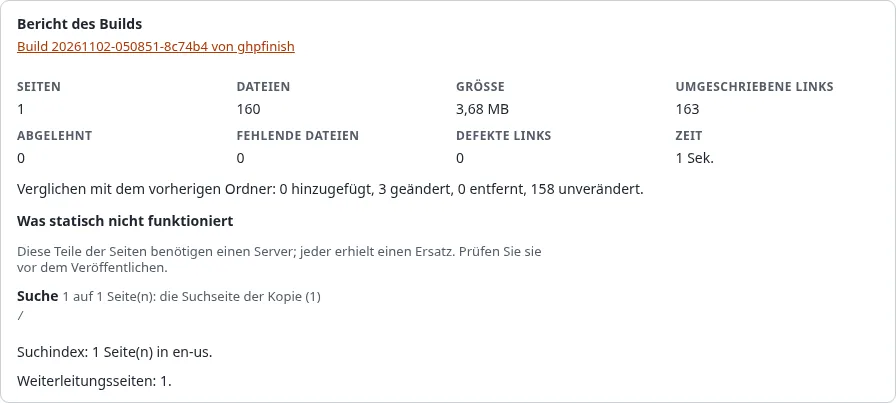

# Sprachen auf einer statischen Site

## Was Sie am Ende haben

Jede Sprache der Site als eigene statische Kopie, mit Sprachlinks, die Besucher an die richtige Stelle führen.

## Ein Ziel je Siteaccess

Ein Ziel veröffentlicht einen Front-Siteaccess und folgt damit dessen Sprachen und Adressschema. Eine Site mit den
Siteaccesses `eng` und `ger` bekommt zwei Ziele, zum Beispiel zwei Ordner eines Repositorys (`Folder`) oder zwei
Repositorys, jedes mit seiner eigenen öffentlichen Adresse.

## Sprachlinks

Die Links `<link rel="alternate" hreflang="...">` jeder Seite werden als absolute Adressen geschrieben: zur Seite in
dieser Kopie, wenn sie sie enthält, sonst zur Live-Site. Ein Sprachumschalter, dessen Links zu einem anderen
Siteaccess gehen, führt ebenfalls zur Live-Site, weil die Kopie die Seiten dieser Sprache nicht enthält. Hat die
andere Sprache ein eigenes Ziel, geben Sie als **Live-Site** des Ziels die Adresse dieser Sprache an, oder verlinken
Sie die Kopien im Design miteinander.

## Suche

Die Suchseite führt einen Index je Sprache, gelesen aus dem Attribut `lang` des `<html>` jeder Seite. Die Suchseite
lädt zuerst den Index ihrer eigenen Sprache.

## Nächster Schritt

[SEO auf einer statischen Site](seo-auf-einer-statischen-site.md).
