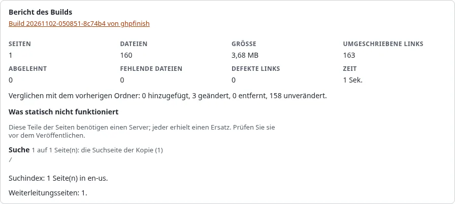

# Suche, Formulare und Kommentare auf einer statischen Site

Ein statischer Host liefert Dateien aus, sonst nichts: Es gibt keine Datenbank zum Durchsuchen und keinen Server, der
ein Formular annimmt. Statisches Veröffentlichen findet diese Teile in jeder Seite, die es baut, und gibt jedem einen
Ersatz, damit Besucher nie auf ein Formular treffen, das nichts tut. Der **Bericht** jedes Builds listet auf, was es
gefunden hat.

## Was Sie am Ende haben

Eine statische Kopie, deren Suche ohne Server funktioniert, deren Kontaktformulare Ihre Live-Site erreichen (oder
sagen, wohin man stattdessen geht), und einen Bericht, welche Seiten welche dieser Teile hatten.

## Was mit jedem Teil geschieht

| Teil der Site | Auf der statischen Kopie | Im Assistenten, Schritt 7 |
| --- | --- | --- |
| Suchformular | Geht zur eigenen Suchseite der Kopie, `search.html` | **Suchseite**: Ja |
| Suchformular ohne Suchseite | Geht zur Suche der Live-Site | **Suchseite**: Nein |
| Informationssammler (Kontaktformular, Umfrage, Rückmeldung) | Sendet an die Live-Site, die ihn wie gewohnt sammelt | **Formulare**: An die Live-Site senden |
| Informationssammler, Formulare verborgen | Ein kurzer Text mit einem Link zur selben Seite auf der Live-Site | **Formulare**: Verbergen |
| Kommentare, Warenkorb, Merkliste | Der kurze Text mit dem Link | immer |
| Anmeldeformular | Fällt weg; die Links zur Anmeldung gehen zur Live-Site | immer |
| Skripte, die den Server aufrufen (ezjscore) | Gemeldet; sie rufen die Live-Site auf oder nichts | immer |
| Jedes andere Formular, das sendet | Bleibt, wie es ist, sendet also an die Live-Site; gemeldet | immer |

Der kurze Text lautet *This form works on the live site only. Open this page there*. Eine Site ändert ihn mit
`[StaticPublishSettings] FormFallbackText` und `FormFallbackLink` in `staticcache.ini` und gestaltet ihn über die
Klasse `exp-static-fallback`.

## Die Suchseite

Mit **Suchseite** schreibt jeder Build:

- `search.html`, eine schlichte Seite mit einem Suchfeld und den Ergebnissen;
- einen Index je Sprache, `static-search/index-<sprache>.json`, mit Titel, Adresse, einem kurzen Anrisstext und den
  Wörtern, die am meisten über jede Seite sagen;
- ein kleines Skript, `static-search/search.js`, ohne Bibliothek.

Die Suchformulare der Site zeigen auf `search.html` und behalten ihr Feld `SearchText`, sodass die eingegebenen Wörter
dort ankommen. Die Suche läuft im Browser des Besuchers und braucht keinen Server. Seiten mit `noindex` stehen nicht
im Index. Ein Index bleibt unter 2 MB (`SearchMaxBytes`); bei einer sehr großen Site behält er zuerst weniger Wörter
je Seite, dann lässt er die letzten Seiten weg, und der Bericht sagt, wie viele.

## Formulare, die an die Live-Site senden

Mit **Formulare: An die Live-Site senden** sendet ein Informationssammler auf einer statischen Seite an den
Formular-Endpunkt Ihrer Installation, `/staticpublish/form`, der ihn an die normale Informationssammlung übergibt:
dieselbe Prüfung, dieselbe E-Mail, dieselben gesammelten Informationen in der Administration.

Das braucht:

- die **öffentliche Adresse** der Kopie (oder ihre eigene Domain) im Ziel, denn der Endpunkt nimmt nur von dort an;
- eine aus dem Internet erreichbare **Live-Site** (die Adresse **Live-Site** des Ziels);
- `[StaticPublishSettings] FormEndpoint=enabled` (die Voreinstellung).

Jedes Formular trägt ein Token, das der Build für dieses Ziel und dieses Formular signiert. Ein Token gilt 400 Tage
(`FormTokenDays`); eine neue Veröffentlichung schreibt neue. Eine Adresse darf 5 Mal in 10 Minuten senden
(`FormRateLimit`, `FormRateWindow`). Nach dem Senden kommt der Besucher mit `#exp-static-form-sent` (oder
`#exp-static-form-failed`) am Ende der Adresse auf die Seite zurück. Die Einzelheiten stehen in der
[Spezifikation des Formular-Endpunkts](../../spezifikationen/6.0/statisches-veroeffentlichen-formular-endpunkt.md).

Ohne Live-Site wählen Sie **Verbergen**: Die Formulare zeigen dann den kurzen Text.

## Der Bericht

Der Bericht eines Builds, in der Vorschau und auf der Seite des Jobs, hat einen Abschnitt **Was statisch nicht
funktioniert**: jeder gefundene Teil, auf wie vielen Seiten, was damit geschah und die ersten Seiten, die ihn haben.
Sehen Sie ihn vor dem Veröffentlichen an: Eine Seite, die von einem Formular lebt, das Sie nicht verlieren wollten,
fällt dort sofort auf.

## Nächster Schritt

[Automatisch veröffentlichen](automatisch-veroeffentlichen.md), oder lesen Sie die Anleitung
[Dynamische Funktionen](../../anleitungen/statisches-veroeffentlichen-dynamische-funktionen.md) für die Einzelheiten.
