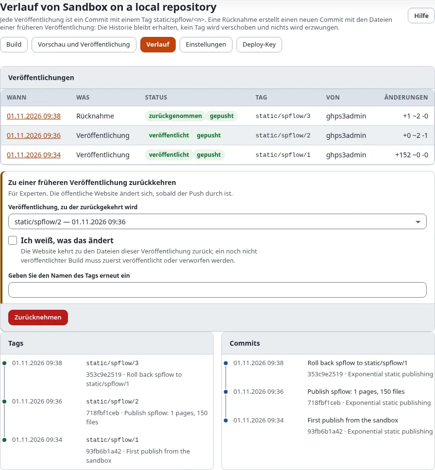
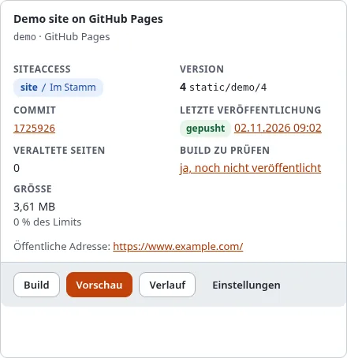

# Verlauf und Rücknahme

Jede Veröffentlichung eines Ziels ist ein Commit mit einem eigenen Tag, `static/<target>/<n>`, und bleibt im Verlauf.
Die Rückkehr löscht nichts: Sie erzeugt einen **neuen** Commit mit den Dateien einer früheren Veröffentlichung, taggt
ihn mit der nächsten Nummer und pusht ihn. Kein Tag wird je verschoben, und nichts wird erzwungen.

## Was Sie am Ende haben

Die öffentliche Site, die wieder eine frühere Veröffentlichung zeigt, mit der Rücknahme im Verlauf.

## Der Verlauf

Öffnen Sie **Verlauf** am Ziel. Er listet auf:

- **Veröffentlichungen**: jede Veröffentlichung und Rücknahme, die neueste zuerst, mit Zeitpunkt, Zustand, Version
  (die Nummer ihres Tags, ein Strich, wenn sie keinen gemacht hat), kurzer Commit-Kennung (ein Link auf den Commit bei
  GitHub, wenn das Repository dort liegt), Push-Zustand, wer und wie viele Dateien sich geändert haben. Das Datum
  öffnet die Seite des Laufs. Auf einem schmalen Bildschirm ist jeder Lauf ein Block beschrifteter Zeilen.
- **Tags**: die neuesten zuerst, jedes mit seinem Commit (ein Link auf den Commit bei GitHub, wenn das Repository dort
  liegt).
- **Commits**: die letzten Commits des Branches.

Die Karte des Ziels in **Setup > Statisches Veröffentlichen** zeigt dasselbe in Kurzform: die veröffentlichte
**Version** mit ihrem Tag, den **Commit** (ein Link auf den Commit bei GitHub, wenn das Repository dort liegt) und das
Badge unter **Letzte Veröffentlichung**.

## Zurücknehmen

**Zu einer früheren Veröffentlichung zurückkehren** ist für Fachleute und braucht die Richtlinie
`staticpublish/publish`:

1. Wählen Sie die Veröffentlichung, zu der Sie zurückkehren möchten.
2. Haken Sie **Ich weiß, was das ändert** an.
3. Geben Sie den Namen des Tags noch einmal ein, zum Beispiel `static/github-public/2`.
4. Drücken Sie auf **Zurücknehmen** und bestätigen Sie mit **Bestätigen Sie, dass Sie es sind**.

Die Rücknahme läuft im Hintergrund, und ihre Seite öffnet sich. Ein noch nicht veröffentlichter Build blockiert eine
Rücknahme: Veröffentlichen oder verwerfen Sie ihn zuerst
([Build, Vorschau und Veröffentlichen](build-vorschau-und-veroeffentlichen.md#veröffentlichen-oder-verwerfen)).

Um eine Rücknahme rückgängig zu machen, nehmen Sie erneut zur Veröffentlichung davor zurück, oder bauen und
veröffentlichen Sie einfach.

## Auf der Konsole

`./console exp:static:rollback <target> <n>` listet auf, was sich ändern würde; mit `--apply` nimmt es zurück. Mehr in
[Verlauf und Zurücknehmen auf der Konsole](../../anleitungen/statisches-veroeffentlichen-verlauf-und-zuruecknehmen.md).

## Nächster Schritt

[Wer veröffentlichen darf](wer-veroeffentlichen-darf-rollen-und-richtlinien.md).
