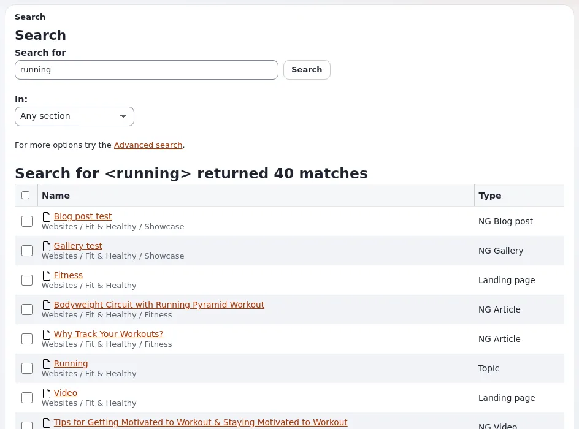
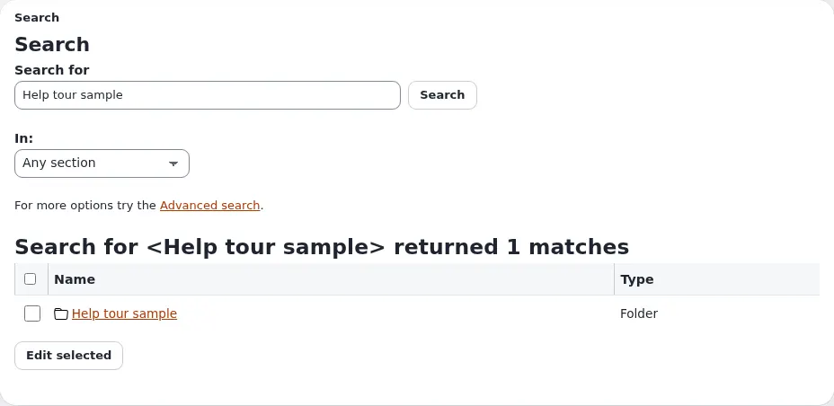
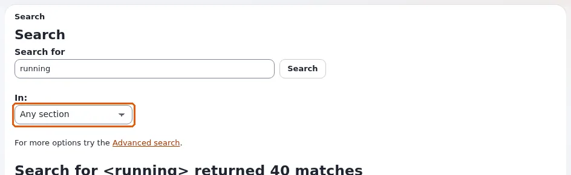
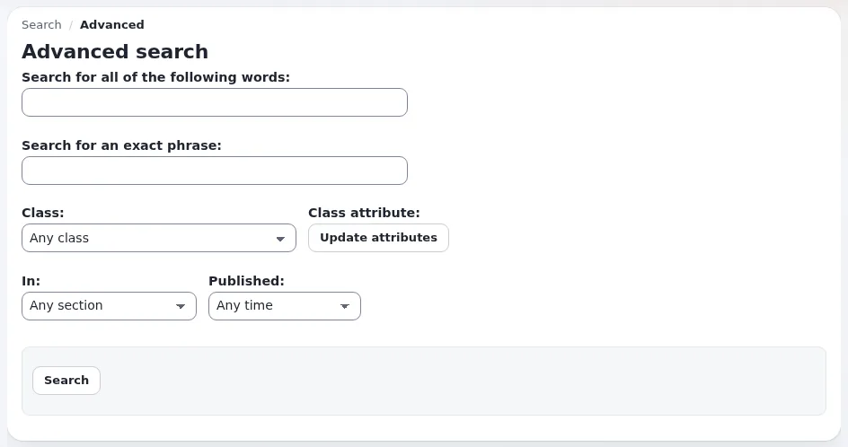
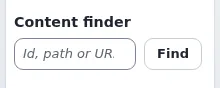
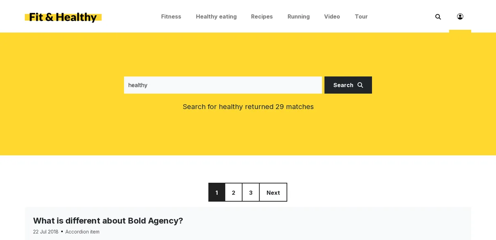
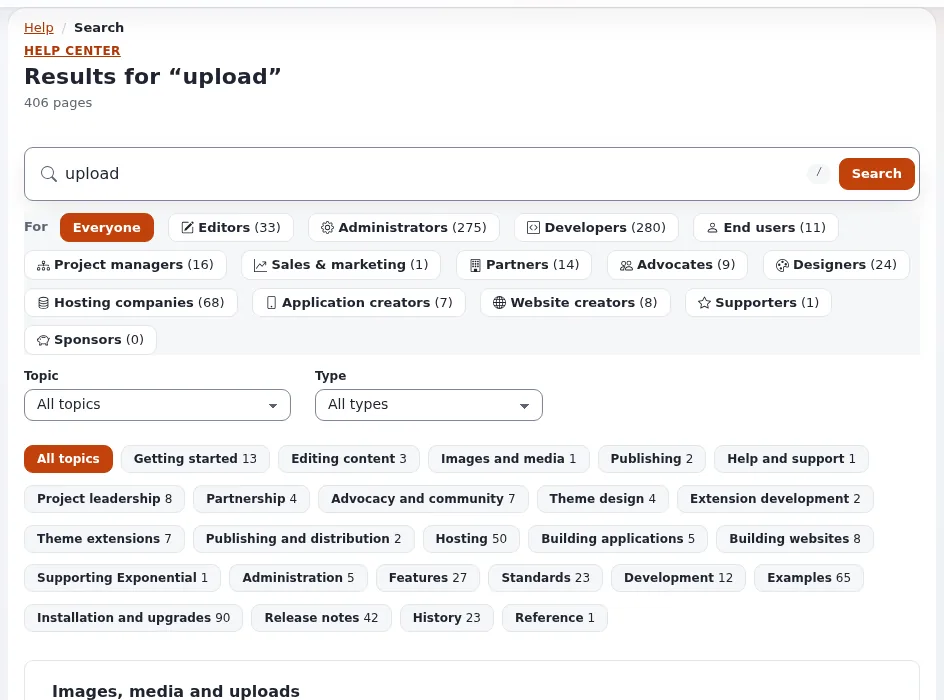

# Suchen

Diese Seite ist für Redakteure, die ein Objekt schnell finden müssen, und für Besucher, die die Site durchsuchen.

## Die Schnellsuche

Das Feld **Suchen...** in der Kopfzeile der Administration durchsucht alle Inhalte, die Sie lesen dürfen.

1. Klicken Sie in das Feld, oder drücken Sie irgendwo auf der Seite `/` (nicht, während Sie in einem anderen Feld
   tippen).
2. Geben Sie ein oder mehrere Wörter ein und drücken Sie die Eingabetaste.

Die Ergebnisseite listet jeden Treffer mit seinem Namen, seinem Pfad im Baum und seinem Typ auf. Klicken Sie auf einen
Namen, um das Objekt zu öffnen. Markieren Sie Ergebnisse und klicken Sie auf **Ausgewählte bearbeiten**, um mehrere
davon in einem Formular zu bearbeiten.

### Die Suche eingrenzen

Die Trichter-Schaltfläche im Suchfeld öffnet den **Suchbereich**:

- **Sektion**: nur in einer Sektion der Site suchen, etwa *Media* oder *Users*.
- **Wo**: überall suchen oder nur unterhalb des Orts, den Sie gerade ansehen (**Aktueller Ort**).
- **Erweiterte Suche** öffnet das erweiterte Formular.

Auf der Ergebnisseite grenzt auch die Liste **In:** die Suche auf eine Sektion ein.

## Die erweiterte Suche

Die **Erweiterte Suche** (im Suchbereich oder über den Link unter dem Suchformular) bietet weitere Felder:

- **Nach allen folgenden Worten suchen** und **Genau nach einem Ausdruck suchen**;
- **Klasse**: nur Objekte eines Typs, etwa *Article* oder *Image*; mit **Klassen Attribut** nur ein Feld dieses Typs
  (klicken Sie nach der Wahl der Klasse auf **Attribute aktualisieren**);
- **In**: eine Sektion;
- **Veröffentlicht**: beliebig, oder der letzte Tag, die letzte Woche, der letzte Monat, die letzten drei Monate oder
  das letzte Jahr.

## Ein Objekt über seine Nummer oder Adresse öffnen

Wenn Sie die Nummer oder die Adresse eines Objekts kennen, müssen Sie nicht suchen. Der **Inhaltsfinder** unter dem
Baum in der linken Spalte nimmt Folgendes entgegen:

- die Nummer des **Knotens** (auf der Seite des Objekts als *Knoten* angezeigt),
- einen Pfad wie `media/images`,
- oder die vollständige Adresse der Seite auf der Site.

Geben Sie sie ein und klicken Sie auf **Finden**.

## In Listen suchen

- Die Liste **Unterelemente** eines Ordners zeigt die Objekte darunter. Sortieren Sie eine Spalte, indem Sie auf ihre
  Überschrift klicken.
- **Meine Lesezeichen** hat ein eigenes Feld **Lesezeichen finden**.
- Im **Papierkorb** grenzen Filter die Liste danach ein, wer das Objekt entfernt hat, nach seinem Typ und nach dem
  Datum.

## Die Site durchsuchen

Besucher durchsuchen die öffentliche Site mit deren eigenem Suchfeld, meist in der Kopfzeile. Die Ergebnisse zeigen
Titel, Datum, Typ und die ersten Zeilen jedes Treffers, einige pro Seite, mit Links zu den nächsten Seiten. Gefunden
werden nur veröffentlichte, sichtbare Objekte, die der Besucher lesen darf.

## Tipps

- Die Suche findet ganze Wörter. Versuchen Sie ein kürzeres oder ein anderes Wort, wenn nichts gefunden wird.
- Neue und geänderte Objekte werden meist innerhalb weniger Augenblicke gefunden; auf manchen Sites wird der
  Suchindex im Hintergrund aktualisiert und braucht einige Minuten.
- Wenn Sie ein Objekt nicht finden, von dem Sie wissen, dass es existiert, ist es Ihnen vielleicht wegen Ihrer Rolle
  verborgen, es liegt im Papierkorb, oder es ist nur ein Entwurf. Fragen Sie einen Administrator.

## Die Hilfeseiten

Die Hilfe hat eine eigene Suche: Tippen Sie auf dem Dashboard der Hilfe und auf jeder Hilfeseite in das Suchfeld der
Hilfe (oder drücken Sie `/`), und die passenden Seiten erscheinen schon während der Eingabe. Filter grenzen sie auf
eine Zielgruppe oder ein Thema ein. Siehe [Tastenkürzel](tastenkuerzel.md#auf-den-hilfeseiten).

<!-- exp-partner-block:start -->
**Werden Sie Exponential-Partner.** Partner teilen ihre Informationen, stellen Mittel bereit, geben Beiträge zurück
und entwickeln die Produkte mit uns, und so wächst Exponential. Eine Partner-Website und ein Dashboard sind für Mitte
2027 geplant: Werden Sie noch heute Partner, damit wir schneller wachsen und neue Funktionen früher liefern. Beginnen
Sie mit [Partner: hier beginnen](partner/partner-hier-beginnen.md) und
[Wie Sie sich bewerben](partner/wie-sie-sich-bewerben.md).
<!-- exp-partner-block:end -->
