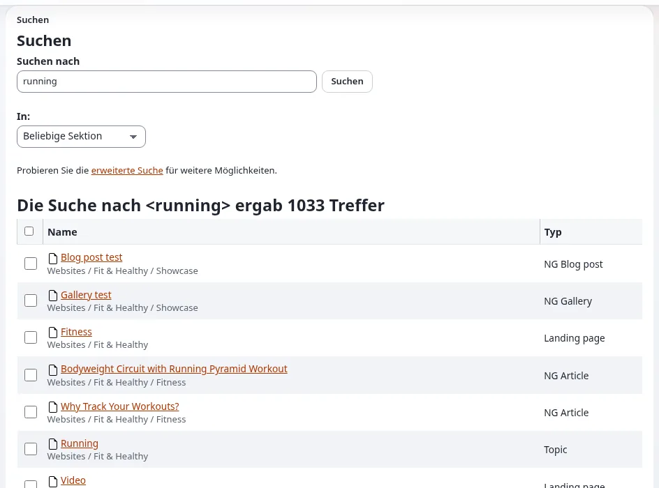
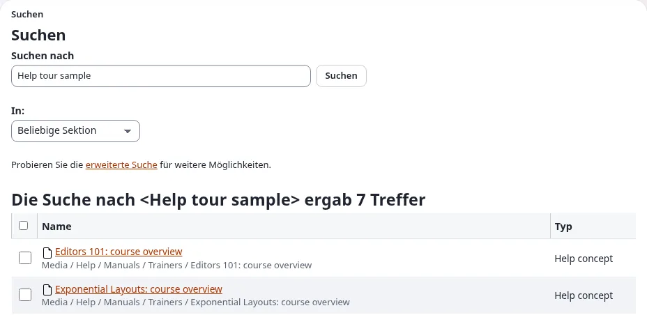
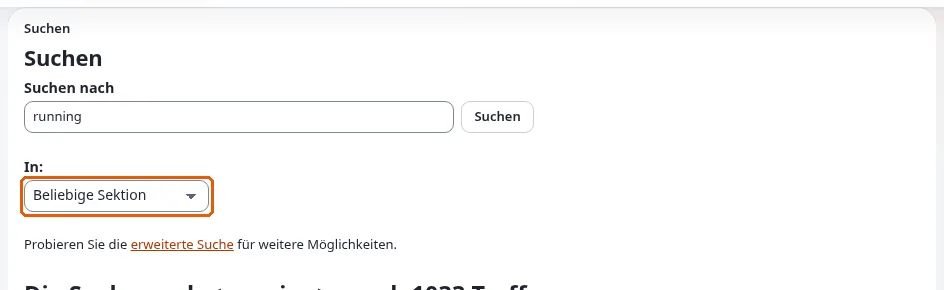
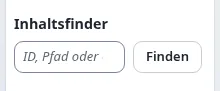
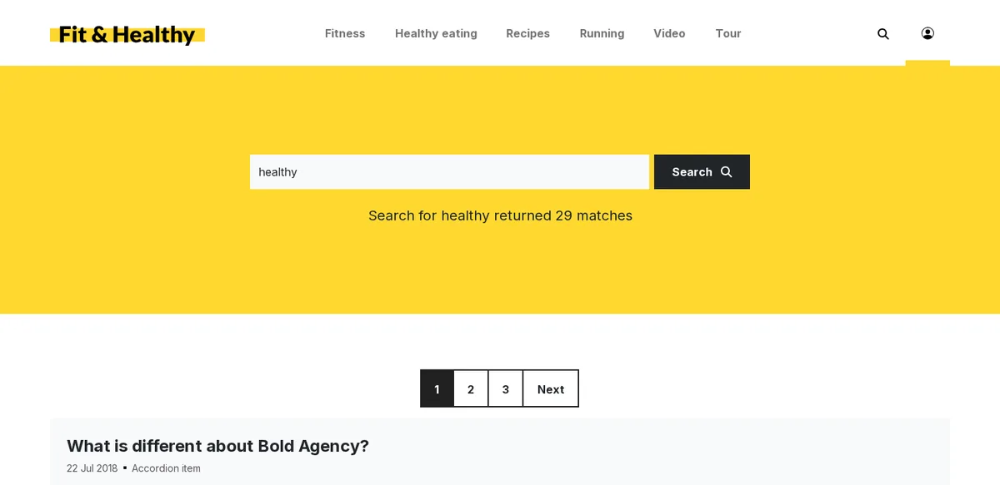
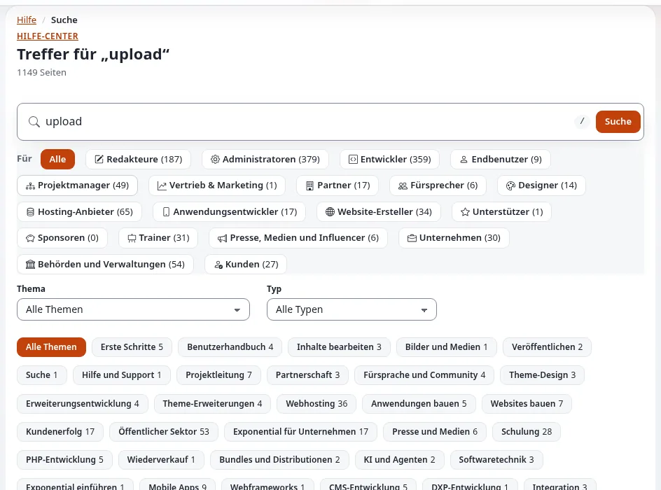

# Suchen

Diese Seite ist für Redakteure, die ein Objekt schnell finden müssen, und für Besucher, die die Site durchsuchen.

## Die Schnellsuche

Das Feld **Suchen...** in der Kopfzeile der Administration durchsucht alle Inhalte, die Sie lesen dürfen.

1. Klicken Sie in das Feld, oder drücken Sie irgendwo auf der Seite `/` (nicht, während Sie in einem anderen Feld
   tippen).
2. Geben Sie ein oder mehrere Wörter ein und drücken Sie die Eingabetaste.

Die Ergebnisseite listet jeden Treffer mit seinem Namen, seinem Pfad im Baum und seinem Typ auf. Klicken Sie auf einen
Namen, um das Objekt zu öffnen. Markieren Sie Ergebnisse und klicken Sie auf **Ausgewählte bearbeiten**, um mehrere
davon in einem Formular zu bearbeiten.

### Vorschläge beim Tippen

Ab dem dritten Zeichen öffnet sich beim Tippen eine Liste unter dem Feld. Sie zeigt in Gruppen:

- **Inhalte**: Objekte, deren Text passt, jedes mit seinem Typ und seinem Platz im Baum.
- **Dokumentseiten**: die Seiten einer PDF-Datei, die die Wörter enthalten, mit einem Link, der das Dokument auf
  dieser Seite öffnet (nur auf Sites, die PDF-Seiten indexieren; sonst wird ein Dokument als Ganzes unter **Inhalte**
  gefunden).
- **Benutzer**: Benutzerkonten nach Login, E-Mail-Adresse oder Name.
- **Inhaltsklassen**: Klassen nach Name oder Bezeichner, wenn Sie die Klassenliste öffnen dürfen.
- **Administration**: Seiten aus den Menüs der Administration, etwa *Setup › Cache-Verwaltung*.

Sie sehen nur, was Sie öffnen dürfen. Die eingegebenen Wörter sind hervorgehoben. **Alle Ergebnisse anzeigen** am Ende
öffnet die vollständige Ergebnisseite mit der Zahl der Treffer.

- `↓` / `↑` bewegen sich durch die Liste, die Eingabetaste öffnet den gewählten Eintrag (oder sucht, wenn keiner
  gewählt ist).
- `Esc` oder ein Klick außerhalb schließt die Liste.
- `Strg` + `/` (`Cmd` + `/` auf einem Mac) springt von überall in das Feld, auch aus einem anderen Feld heraus.

Für Administratoren: Die Gruppen, ihre Reihenfolge, wie viele Einträge jede zeigt und die Zahl der Zeichen, bevor sich
die Liste öffnet, stehen in `admininterface.ini` `[SearchSuggestSettings]`; `Enabled=false` schaltet die Vorschläge
ab. Die Liste füllt die Ansicht `content/suggest`, die die Suchmaschine der Site verwendet (eZ Find, wenn es
installiert und aktiv ist, sonst die eingebaute Suche). Sie braucht die Richtlinie `content/read`: Eine Rolle ohne sie
erhält keine Vorschläge, auch nicht die Seiten der Administration. Ein Wort wird schon gefunden, während es noch
getippt wird („Oste“ findet „Ostern“), nur mit `site.ini` `[SearchSettings] EnableWildcard=true` (oder
`Wildcard=enabled` in `[SearchSuggestSettings]`); sonst passt die Liste auf ganze Wörter.

### Die Suche eingrenzen

Die Trichter-Schaltfläche im Suchfeld öffnet den **Suchbereich**:

- **Sektion**: nur in einer Sektion der Site suchen, etwa *Media* oder *Users*.
- **Wo**: überall suchen oder nur unterhalb des Orts, den Sie gerade ansehen (**Aktueller Ort**).
- **Erweiterte Suche** öffnet die Suchseite mit ihren Filtern.

## Die Suchseite und ihre Filter

Die Suchseite (**Suchen** in der Kopfzeile oder `content/search`) hat das Suchfeld oben, die **Filter** neben den
Treffern (auf einem schmalen Bildschirm darüber, eingeklappt unter **Filter anzeigen**) und die Treffer in einer
Tabelle. Sie hat auch die frühere erweiterte Suche aufgenommen: Ein alter Link auf `content/advancedsearch` öffnet
diese Seite. Die Adresse einer Suche enthält jeden Filter (`content/search/(text)/ostern/(class)/2,16`), sodass Sie sie
als Lesezeichen speichern oder einer Kollegin schicken können.

- **Wörter**: **Alle Wörter** (die Voreinstellung), **Eines der Wörter** oder **Genaue Wortfolge**;
- **Inhaltstyp**: ein oder mehrere Typen, nach Klassengruppe geordnet; die seltener genutzten stehen unter **Mehr
  anzeigen**. Ist genau ein Typ gewählt, sucht **Klassenattribut** nur in einem Feld dieses Typs;
- **Sektion**: eine oder mehrere Sektionen;
- **Geändert** und **Veröffentlicht**: beliebig, der letzte Tag, 7 Tage, Monat oder Jahr, oder ein **Eigener
  Zeitraum** mit einem Von- und einem Bis-Datum;
- **Eigentümer**: die ID, das Login oder die E-Mail-Adresse eines Benutzers;
- **Sprache**: nur die Übersetzungen in einer Sprache;
- **Ort**: alle Inhalte oder der Ort, von dem die Suche ausging (**Aktueller Ort** der Kopfzeile);
- **Treffer pro Seite**.

Wählen Sie Filter und klicken Sie auf **Anwenden** (aktiv, sobald sich etwas geändert hat); **Zurücksetzen** behält die
Wörter und entfernt jeden Filter. Die Seite funktioniert auch ohne JavaScript: Dann wird jedes Feld mit **Anwenden**
gesendet.

Über den Treffern:

- die Überschrift **Treffer für „Wörter“ (Anzahl)**;
- jeder aktive Filter als Chip: Klicken Sie ihn an, um ohne diesen Filter erneut zu suchen;
- **Sortieren nach**: Relevanz, Name A–Z oder Z–A, geändert oder veröffentlicht, neueste oder älteste zuerst. Die
  Seiten behalten die Sortierung und alle Filter;
- **Meinten Sie:** mit einem Schreibvorschlag, wenn die Suchmaschine einen anbietet.

Jeder Treffer zeigt seinen Typ, seinen Namen mit seinem Platz im Baum und den gefundenen Wörtern, wann er geändert
wurde, seinen Inhaltstyp, seine Übersetzungen (jede ein Link auf das Objekt in dieser Sprache) und **Bearbeiten**.
Markieren Sie Treffer und klicken Sie auf **Ausgewählte bearbeiten**, um mehrere davon in einem Formular zu
bearbeiten. Eine PDF-Datei listet die Seiten auf, die die Wörter enthalten, wenn die Tiefensuche für Dokumente
installiert ist.

Was die Filter können, hängt von der Suchmaschine ab. Mit eZ Find sind alle da, mit Zahlen neben den Inhaltstypen,
Sektionen und Sprachen. Mit der eingebauten Suche gibt es kein **Eines der Wörter**, kein **Geändert**, keinen
**Eigentümer**, keine **Sprache**, keine Zahlen und keine Sortierung nach Relevanz, und eine Suche braucht Wörter.

## Ein Objekt über seine Nummer oder Adresse öffnen

Wenn Sie die Nummer oder die Adresse eines Objekts kennen, müssen Sie nicht suchen. Der **Inhaltsfinder** unter dem
Baum in der linken Spalte nimmt Folgendes entgegen:

- die Nummer des **Knotens** (auf der Seite des Objekts als *Knoten* angezeigt),
- einen Pfad wie `media/images`,
- oder die vollständige Adresse der Seite auf der Site.

Geben Sie sie ein und klicken Sie auf **Finden**.

## In Listen suchen

- Die Liste **Unterelemente** eines Ordners zeigt die Objekte darunter. Sortieren Sie eine Spalte, indem Sie auf ihre
  Überschrift klicken.
- **Meine Lesezeichen** hat ein eigenes Feld **Lesezeichen finden**.
- Im **Papierkorb** grenzen Filter die Liste danach ein, wer das Objekt entfernt hat, nach seinem Typ und nach dem
  Datum.

## Die Site durchsuchen

Besucher durchsuchen die öffentliche Site mit deren eigenem Suchfeld, meist in der Kopfzeile. Die Ergebnisse zeigen
Titel, Datum, Typ und die ersten Zeilen jedes Treffers, einige pro Seite, mit Links zu den nächsten Seiten. Gefunden
werden nur veröffentlichte, sichtbare Objekte, die der Besucher lesen darf.

### Vorschläge auf der Site

Ab dem dritten Zeichen öffnet das Suchfeld der Site beim Tippen eine Liste mit Vorschlägen: die passenden Seiten, jede
mit Namen, Typ und einem kleinen Bild. Mit den Pfeiltasten nach oben und unten wählt man aus, Enter öffnet den
gewählten Vorschlag (oder sucht, wenn keiner gewählt ist), Escape schließt die Liste, und Strg+/ (Cmd+/ auf dem Mac)
springt von überall auf der Seite ins Feld. Der letzte Eintrag, „Alle Ergebnisse anzeigen“, öffnet die Suchseite.

Vorgeschlagen werden nur Inhalte, und nur solche, die der Besucher lesen darf: ein anonymer Besucher sieht, was
öffentlich ist. Benutzerkonten, Inhaltsklassen, Seiten und Einstellungen der Administration werden nie vorgeschlagen.
Auf einer Site mit einem eigenen Teil des Baums (etwa /bold) werden nur die Seiten dieses Teils gefunden.

### Auf der Site suchen

Die Suchseite der Site arbeitet wie die der Administration: Suchwörter und Filter stehen in der Adresse
(`/content/search/(text)/ostern/(class)/16`), eine Suche lässt sich also als Lesezeichen speichern und weitergeben.
Eine Filterleiste neben den Ergebnissen grenzt die Suche nach Inhaltstyp ein und ändert die Sortierung. Jeder aktive
Filter steht als Chip über den Ergebnissen; ein Klick darauf entfernt ihn. Ist eZ Find die Suchmaschine, bietet
„Meinten Sie“ dieselbe Suche mit korrigierten Wörtern an. Ein alter Link der Form `/content/search?SearchText=...`
öffnet die leere Suchseite.

### Einstellungen der Site-Suche (für Administratoren)

Die Vorschläge sind für jeden Siteaccess eingeschaltet. Eingestellt werden sie in `site.ini
[SiteSearchSuggestSettings]`, je Siteaccess in dessen `site.ini.append.php`:

| Einstellung | Vorgabe | Bedeutung |
| --- | --- | --- |
| `Enabled` | `true` | `false`: ein einfaches Suchfeld; `content/sitesuggest` antwortet 404 |
| `MinLength` | `3` | so viele Zeichen müssen getippt sein, bevor Vorschläge geholt werden |
| `Limit` | `6` | höchstens so viele Vorschläge (0 bis 20) |
| `ExcludeClasses[]` | `user`, `user_group` | Klassen, die nie vorgeschlagen werden (eine Klasse mit Benutzerkonto nie) |
| `ThumbnailAlias` | `small` | der Bildalias des kleinen Bildes; leer: das Klassensymbol |
| `PublicCacheTTL` | `60` | so viele Sekunden wird eine anonyme Antwort aufbewahrt (auf dem Server und in geteilten Caches) |
| `RateLimit`, `RateWindow` | `60`, `60` | Anfragen einer Adresse je Zeitfenster; weitere werden mit 429 beantwortet |

Der Besucher braucht die Richtlinie `content/read`, wie für die Suche selbst. Die Vorschläge eines angemeldeten
Benutzers werden nie zwischengespeichert.

Für ein Design: `{include uri='design:parts/front_search_suggest.tpl'}` in das Suchformular der Kopfzeile setzen (mit
`method="post"` und einem Feld namens `SearchText`), und das `content/search.tpl` des Designs
`{include uri='design:content/front_search_page.tpl'}` enthalten lassen. Beide zeichnet `stylesheets/front_search.css`
mit `--exps-*`-Tokens, die ein Design auf seine eigenen Farben setzt, hell und dunkel.

## Tipps

- Die Suche findet ganze Wörter. Versuchen Sie ein kürzeres oder ein anderes Wort, wenn nichts gefunden wird.
- Neue und geänderte Objekte werden meist innerhalb weniger Augenblicke gefunden; auf manchen Sites wird der
  Suchindex im Hintergrund aktualisiert und braucht einige Minuten.
- Wenn Sie ein Objekt nicht finden, von dem Sie wissen, dass es existiert, ist es Ihnen vielleicht wegen Ihrer Rolle
  verborgen, es liegt im Papierkorb, oder es ist nur ein Entwurf. Fragen Sie einen Administrator.

## Die Hilfeseiten

Die Hilfe hat eine eigene Suche: Tippen Sie auf dem Dashboard der Hilfe und auf jeder Hilfeseite in das Suchfeld der
Hilfe (oder drücken Sie `/`), und die passenden Seiten erscheinen schon während der Eingabe. Filter grenzen sie auf
eine Zielgruppe oder ein Thema ein. Siehe [Tastenkürzel](tastenkuerzel.md#auf-den-hilfeseiten).

<!-- exp-partner-block:start -->
**Werden Sie Exponential-Partner.** Partner teilen ihre Informationen, stellen Mittel bereit, geben Beiträge zurück
und entwickeln die Produkte mit uns, und so wächst Exponential. Eine Partner-Website und ein Dashboard sind für Mitte
2027 geplant: Werden Sie noch heute Partner, damit wir schneller wachsen und neue Funktionen früher liefern. Beginnen
Sie mit [Partner: hier beginnen](partner/partner-hier-beginnen.md) und
[Wie Sie sich bewerben](partner/wie-sie-sich-bewerben.md).
<!-- exp-partner-block:end -->
