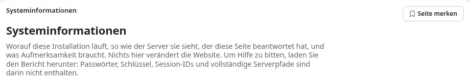
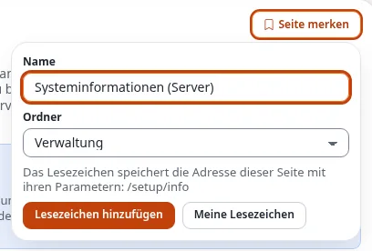
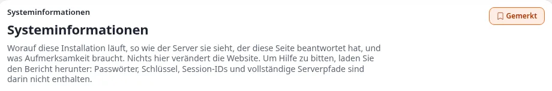
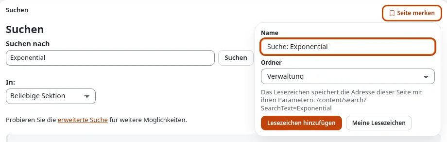
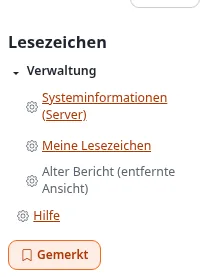
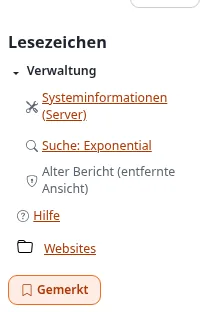
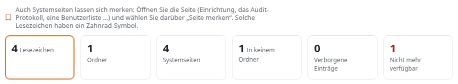
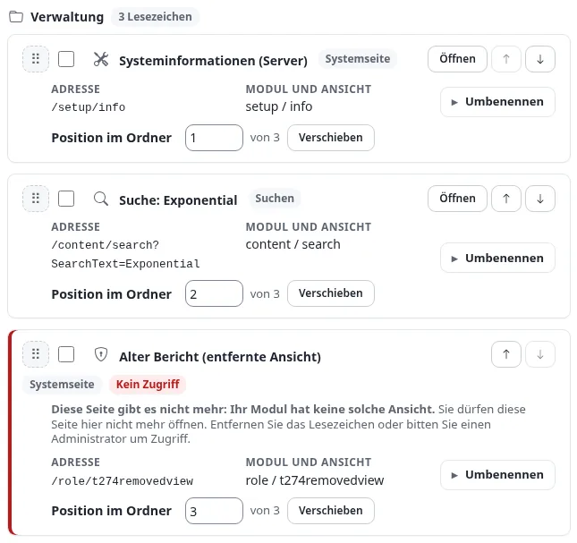
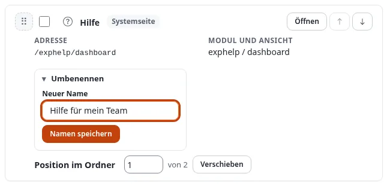
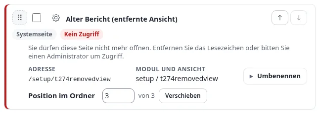

# Systemseiten als Lesezeichen

Lesezeichen zeigten bisher nur auf Inhalte: einen Artikel, einen Ordner, ein Bild. Seit Exponential 6.0.15 können Sie
auch die **Seiten der Administration selbst** merken, die Systemseiten: die Systeminformationen, die Cache-Seite, die
Hilfe-Übersicht, das Audit-Protokoll gefiltert auf einen Benutzer, den Papierkorb, eine Liste ab einer bestimmten
Seite und eine **Suche** mit ihrem Suchtext. Sie liegen in denselben Ordnern wie Ihre Inhalts-Lesezeichen, im Kasten
**Lesezeichen** am Rand jeder Seite und auf der Seite **Meine Lesezeichen**.

Diese Seite zeigt Schritt für Schritt, wie Sie eine Systemseite merken, wie Sie sie wiederfinden, wie Sie sie
umbenennen, verschieben und entfernen und was ein ausgegrautes Lesezeichen bedeutet. Sie richtet sich an alle, die in
der Administration arbeiten; Sie brauchen das Recht, Lesezeichen zu verwenden (die Richtlinie *content/bookmark*, die
Redakteure und Administratoren haben).

Jeder Schritt hat ein Bild des Standard-Designs der Administration (admin4) im hellen Modus, mit deutscher
Oberfläche. Darunter ist derselbe Schritt im dunklen Modus, im klassischen Design (admin, das nur ein helles Theme
hat) und in der Redaktionsoberfläche (dem Siteaccess *editor*) verlinkt, so sehen Sie ihn so, wie Ihre Administration
aussieht.

[Hilfe](README.md) · Siehe auch: [die Anleitung zu Lesezeichen](../anleitungen/lesezeichen.md) ·
[Lesezeichen für Systemseiten (Funktion)](../funktionen/6.0/lesezeichen-fuer-systemseiten.md) ·
[Ein Rundgang durch die Administration](rundgang-durch-die-administration.md)

## Kurz gesagt

- Auf jeder Systemseite gibt es über der Seite, rechts neben dem Pfad, die Schaltfläche **Seite merken**, und dieselbe
  Schaltfläche im Kasten **Lesezeichen** der rechten Spalte.
- Die Schaltfläche öffnet ein kleines Formular: den **Namen** (den Titel der Seite, den Sie ändern können) und den
  **Ordner**. Wählen Sie **Lesezeichen hinzufügen**, und Sie sind wieder auf der Seite; die Schaltfläche heißt jetzt
  **Gemerkt**.
- Das Lesezeichen behält die Adresse der Seite mit ihren Parametern (`/content/bookmark/(folder)/top`,
  `/audit/console/(user)/14`) und bei einer Suche den Suchtext (`/content/search?SearchText=news`). Es behält weder den
  Hostnamen noch den Siteaccess, so öffnet es sich auf jedem Host und in jeder Administration der Installation.
- Lesezeichen von Systemseiten haben das **Symbol ihres Bereichs**: einen Werkzeugkasten für die Einrichtung, eine Lupe
  für eine Suche, ein Schild für Rollen, ein Fragezeichen für die Hilfe. Inhalts-Lesezeichen behalten das Symbol ihrer
  Klasse.
- Eine Systemseite, die Sie dort, wo Sie gerade sind, nicht öffnen können, ist **ausgegraut**, ohne Link, und sagt
  **warum**: in diesem Siteaccess abgeschaltet, keine Rolle erlaubt sie, die Seite gibt es nicht mehr. Sie können sie
  trotzdem umbenennen, verschieben oder entfernen.

## 1. Eine Seite merken

1. Öffnen Sie die Seite, zu der Sie zurückkehren möchten, zum Beispiel **Einrichtung > Systeminformationen**. (In der
   Redaktionsoberfläche, die keine Einrichtung hat, zeigen die Bilder den **Papierkorb**.)
2. Sehen Sie oben auf der Seite rechts neben dem Pfad nach: die Schaltfläche **Seite merken**.

   

   Andere Ansichten: [admin4, dunkel](images/bookmarks/bookmark-this-page-button--admin4-dark.webp) ·
   [klassisch](images/bookmarks/bookmark-this-page-button--admin-light.webp) ·
   [Redaktion, hell](images/bookmarks/bookmark-this-page-button--editor-light.webp) ·
   [Redaktion, dunkel](images/bookmarks/bookmark-this-page-button--editor-dark.webp)

3. Wählen Sie **Seite merken**. Unter der Schaltfläche öffnet sich ein kleines Formular:

   

   Andere Ansichten: [admin4, dunkel](images/bookmarks/bookmark-this-page-form--admin4-dark.webp) ·
   [klassisch](images/bookmarks/bookmark-this-page-form--admin-light.webp) ·
   [Redaktion, hell](images/bookmarks/bookmark-this-page-form--editor-light.webp) ·
   [Redaktion, dunkel](images/bookmarks/bookmark-this-page-form--editor-dark.webp)

   - **Name**: vorausgefüllt mit dem Titel der Seite, wie ihn der Reiter des Browsers zeigt. Ändern Sie ihn so, wie
     er Ihnen hilft, zum Beispiel in *Systeminformationen (Server)*.
   - **Ordner**: *Kein Ordner (oberste Ebene)* oder einer Ihrer Lesezeichen-Ordner. Ordner legen Sie auf der Seite
     Meine Lesezeichen an (siehe [die Anleitung zu Lesezeichen](../anleitungen/lesezeichen.md#5-ordner)).
   - Unter den Feldern zeigt das Formular die **Adresse**, die das Lesezeichen behält.
4. Wählen Sie **Lesezeichen hinzufügen**. Die Seite lädt neu, und die Schaltfläche heißt jetzt **Gemerkt**:

   

   Andere Ansichten: [admin4, dunkel](images/bookmarks/bookmarked-button--admin4-dark.webp) ·
   [klassisch](images/bookmarks/bookmarked-button--admin-light.webp) ·
   [Redaktion, hell](images/bookmarks/bookmarked-button--editor-light.webp) ·
   [Redaktion, dunkel](images/bookmarks/bookmarked-button--editor-dark.webp)

Das Formular funktioniert ohne JavaScript; es ist ein Teil der Seite, der sich öffnet und schließt. Wählen Sie die
Schaltfläche noch einmal, um es ohne Speichern zu schließen.

**Aus dem Kasten Lesezeichen.** Der Kasten **Lesezeichen** in der rechten Spalte bietet auf jeder Systemseite dieselbe
Schaltfläche unter Ihren Lesezeichen an. Sie öffnet dasselbe Formular. Auf einer Inhaltsseite behält der Kasten wie
bisher seine Schaltfläche **Lesezeichen setzen** für den Eintrag.

**Name oder Ordner später ändern.** Öffnen Sie die Seite wieder und wählen Sie **Gemerkt**. Das Formular zeigt den
gespeicherten Namen und Ordner; ändern Sie sie und wählen Sie **Lesezeichen speichern**. Eine Seite wird nur einmal
gemerkt: Erneutes Speichern legt nie ein zweites Lesezeichen derselben Adresse an.

## 2. Eine Suche speichern

Eine Suche ist auch eine Systemseite, und ihr Lesezeichen behält, wonach Sie gesucht haben: Wenn Sie es öffnen, läuft
dieselbe Suche noch einmal.

1. Suchen Sie mit dem Suchfeld oben in der Administration, zum Beispiel nach *Exponential*.
2. Wählen Sie auf der Ergebnisseite **Seite merken**. Die Adresse unter den Feldern endet auf
   `?SearchText=Exponential`: Der Suchtext gehört zum Lesezeichen.

   

   Andere Ansichten: [admin4, dunkel](images/bookmarks/saved-search-form--admin4-dark.webp) ·
   [klassisch](images/bookmarks/saved-search-form--admin-light.webp) ·
   [Redaktion, hell](images/bookmarks/saved-search-form--editor-light.webp) ·
   [Redaktion, dunkel](images/bookmarks/saved-search-form--editor-dark.webp)

3. Geben Sie ihm einen Namen, etwa *Suche: Exponential*, wählen Sie einen Ordner und dann **Lesezeichen hinzufügen**.

Das Lesezeichen behält den Suchtext, den Bereich und den Ort, an dem Sie gesucht haben, sonst nichts. Gespeicherte
Suchen haben ein **Lupen**-Symbol und auf Meine Lesezeichen den Typ **Suche**.

## 3. Wiederfinden

Der Kasten **Lesezeichen** listet Ihre Lesezeichen in ihren Ordnern, auf jeder Seite. Jede Systemseite hat das Symbol
ihres Bereichs; eine Seite, die Sie hier nicht öffnen können, ist ausgegraut:

Andere Ansichten: [admin4, dunkel](images/bookmarks/bookmarks-box-system-pages--admin4-dark.webp) ·
[klassisch](images/bookmarks/bookmarks-box-system-pages--admin-light.webp) ·
[Redaktion, hell](images/bookmarks/bookmarks-box-system-pages--editor-light.webp) ·
[Redaktion, dunkel](images/bookmarks/bookmarks-box-system-pages--editor-dark.webp)

Wählen Sie den Namen, um die Seite zu öffnen. Inhalts-Lesezeichen und Systemseiten stehen gemeinsam in Ihrer
Reihenfolge:

Andere Ansichten: [admin4, dunkel](images/bookmarks/bookmarks-box-both-kinds--admin4-dark.webp) ·
[klassisch](images/bookmarks/bookmarks-box-both-kinds--admin-light.webp) ·
[Redaktion, hell](images/bookmarks/bookmarks-box-both-kinds--editor-light.webp) ·
[Redaktion, dunkel](images/bookmarks/bookmarks-box-both-kinds--editor-dark.webp)

Auf **Meine Lesezeichen** (Dashboard > Meine Lesezeichen) zählt die Übersicht Ihre **Systemseiten**, und eine Zeile
darüber sagt, wie Sie eine hinzufügen:

Andere Ansichten: [admin4, dunkel](images/bookmarks/bookmark-page-overview--admin4-dark.webp) ·
[klassisch](images/bookmarks/bookmark-page-overview--admin-light.webp) ·
[Redaktion, hell](images/bookmarks/bookmark-page-overview--editor-light.webp) ·
[Redaktion, dunkel](images/bookmarks/bookmark-page-overview--editor-dark.webp)

Jede Systemseite hat eine Karte wie ein Inhalts-Lesezeichen. Sie zeigt das Symbol, den Namen, den Typ
(**Systemseite**, bei einer gespeicherten Suche **Suche**), die **Adresse** und **Modul und Ansicht**, zu denen die
Seite gehört, **Öffnen**, **Nach oben** und **Nach unten** sowie **Umbenennen**:

Andere Ansichten: [admin4, dunkel](images/bookmarks/bookmark-page-system-page-card--admin4-dark.webp) ·
[klassisch](images/bookmarks/bookmark-page-system-page-card--admin-light.webp) ·
[Redaktion, hell](images/bookmarks/bookmark-page-system-page-card--editor-light.webp) ·
[Redaktion, dunkel](images/bookmarks/bookmark-page-system-page-card--editor-dark.webp)

**Lesezeichen finden** durchsucht auf dieser Seite auch die Adressen; `systemupgrade`, `audit/` oder `SearchText`
findet also die Systemseiten mit dieser Adresse. In der Sortierung **Typ** stehen Systemseiten unter *Systemseite* und
gespeicherte Suchen unter *Suche*, neben den Klassennamen Ihrer Inhalts-Lesezeichen.

## 4. Umbenennen, verschieben, entfernen

**Umbenennen** (nur Systemseiten):

1. Suchen Sie auf **Meine Lesezeichen** die Karte und wählen Sie unter ihrer Adresse **Umbenennen**.
2. Geben Sie den neuen Namen ein und wählen Sie **Name speichern** (oder drücken Sie im Feld die Eingabetaste).

   

   Andere Ansichten: [admin4, dunkel](images/bookmarks/bookmark-page-rename--admin4-dark.webp) ·
   [klassisch](images/bookmarks/bookmark-page-rename--admin-light.webp) ·
   [Redaktion, hell](images/bookmarks/bookmark-page-rename--editor-light.webp) ·
   [Redaktion, dunkel](images/bookmarks/bookmark-page-rename--editor-dark.webp)

3. Die Seite meldet *Das Lesezeichen wurde in „…“ umbenannt.* Der Kasten Lesezeichen zeigt den neuen Namen sofort.

Ein Inhalts-Lesezeichen zeigt immer den aktuellen Namen seines Eintrags und hat deshalb kein Umbenennen.

**Verschieben** in einen anderen Ordner: Haken Sie die Karte an und verwenden Sie unter der Liste **Ausgewählte
Lesezeichen verschieben nach**, oder ziehen Sie die Karte auf einen Ordner der Ordnerliste; auf der Seite selbst können
Sie auch **Gemerkt** wählen und einen anderen Ordner auswählen. **Nach oben**, **Nach unten**, der Griff und das
Positionsfeld ordnen Systemseiten und Inhalts-Lesezeichen gemeinsam, in einer Reihenfolge je Ordner.

**Entfernen**: Haken Sie die Karte an, wählen Sie **Ausgewählte entfernen** und bestätigen Sie. Entfernt wird nur das
Lesezeichen, nie die Seite. Ein entfernter Ordner nimmt seine Lesezeichen von Systemseiten nur mit, wenn Sie *Den gesamten
Inhalt mit entfernen* wählen.

## 5. Ein ausgegrautes Lesezeichen

Ob Sie eine Systemseite öffnen dürfen, wird jedes Mal geprüft, wenn Ihre Lesezeichen gezeigt werden, mit denselben
Regeln wie beim Öffnen der Seite: Ihre Rollen und Richtlinien, die Regeln des Siteaccess, in dem Sie gerade sind, und
ob Modul und Ansicht noch existieren. Können Sie sie dort nicht öffnen, ist das Lesezeichen kein Link: Der Kasten
Lesezeichen zeigt es ausgegraut (zeigen Sie darauf, um den Grund zu lesen), und seine Karte auf Meine Lesezeichen sagt
**Kein Zugriff** und nennt den Grund:

Andere Ansichten: [admin4, dunkel](images/bookmarks/bookmark-page-no-access--admin4-dark.webp) ·
[klassisch](images/bookmarks/bookmark-page-no-access--admin-light.webp) ·
[Redaktion, hell](images/bookmarks/bookmark-page-no-access--editor-light.webp) ·
[Redaktion, dunkel](images/bookmarks/bookmark-page-no-access--editor-dark.webp)

Die Gründe, die Sie sehen können:

| Die Karte sagt | Was es bedeutet | Was zu tun ist |
|---|---|---|
| Diese Seite ist in diesem Siteaccess (editor) abgeschaltet. Öffnen Sie das Lesezeichen in einem Siteaccess, der sie hat. | Die Seite gibt es, aber die Administration, in der Sie sind, bietet ihr Modul nicht an. Die Redaktionsoberfläche etwa hat keine Einrichtung, keine Rollen und kein Audit-Protokoll. Die Bilder der Redaktion oben zeigen ein Lesezeichen der Systeminformationen, das in der vollen Administration angelegt wurde. | Öffnen Sie das Lesezeichen in der vollen Administration. Mit dem Lesezeichen ist alles in Ordnung. |
| Keine Ihrer Rollen erlaubt Ihnen, diese Seite zu öffnen. | Ihre Rollen haben sich geändert oder haben diese Seite nie erlaubt. | Fragen Sie einen Administrator, oder entfernen Sie das Lesezeichen. |
| Sie dürfen diesen Siteaccess nicht benutzen. | Ihr Konto darf sich an dieser Administration nicht anmelden. | Fragen Sie einen Administrator. |
| Sie dürfen den Inhalt, den diese Seite zeigt, nicht lesen. | Die Seite zeigt einen Inhalt (eine Version, das Audit-Protokoll eines Knotens), den Sie nicht lesen dürfen. | Fragen Sie einen Administrator, oder entfernen Sie das Lesezeichen. |
| Diese Seite gibt es nicht mehr: Ihr Modul hat keine solche Ansicht. | Die Seite wurde entfernt, etwa durch ein Update oder eine abgeschaltete Erweiterung. | Entfernen Sie das Lesezeichen. |
| Das Modul dieser Seite ist hier nicht installiert oder nicht aktiviert. | Die Erweiterung, die die Seite mitbringt, ist nicht aktiv. | Fragen Sie einen Administrator, oder entfernen Sie das Lesezeichen. |
| Diese Art Seite kann nicht gemerkt werden. | Ein Administrator hat die Seite in die Liste der Seiten aufgenommen, die nicht gemerkt werden können. | Entfernen Sie das Lesezeichen. |

Bekommen Sie den Zugriff zurück, oder öffnen Sie das Lesezeichen dort, wo die Seite verfügbar ist, kommt der Link von
selbst zurück. Die Übersicht zählt ausgegraute Lesezeichen unter **Nicht mehr verfügbar**.

## 6. Was sich merken lässt und was nicht

Sie können die Seite jeder **Modulansicht** merken, die Sie öffnen dürfen: die Einrichtung, die Hilfe, Benutzer und
Rollen, Listen, den Papierkorb, das Audit-Protokoll, Suchen, die Seiten von Erweiterungen. Eine Liste behält die
Parameter, die Teil ihrer Adresse sind, etwa `/(offset)/20`, `/(folder)/top` oder `/(user)/14`.

**Seite merken** wird nicht angeboten:

- auf einem **Inhaltseintrag** (dort verwenden Sie *Lesezeichen setzen*, das den Eintrag merkt, nicht die Seite),
- beim **Bearbeiten** oder **Durchsuchen** und auf einer **Fehlerseite**,
- auf Seiten, die nur **ein Formular verarbeiten** oder Seiten **eines Moments** sind: Speichern, Entfernen,
  Kopieren, An- und Abmelden, eine Bestätigung, ein Download, die Bearbeitungsformulare von Klassen, Rollen,
  Bereichen, Zuständen und Workflows. Ein Lesezeichen einer solchen Seite würde eine leere Seite öffnen oder eine
  Aktion wiederholen. Ihr Administrator kann die Liste ansehen und erweitern (`bookmark.ini`, siehe
  [die Funktionsseite](../funktionen/6.0/lesezeichen-fuer-systemseiten.md#einstellungen)).

Gemerkt werden nur Adressen dieser Installation: nie eine andere Site, nie ein Skript.

## 7. Fragen und Antworten

**Ich sehe Seite merken nicht.** Siehe *Was sich merken lässt* oben. Die Schaltfläche fehlt außerdem überall, wenn Sie
keine Lesezeichen verwenden dürfen (bitten Sie um die Richtlinie *content/bookmark*) oder wenn das Datenbank-Update
von Exponential 6.0.15 auf Ihrer Installation noch nicht ausgeführt wurde (Ihr Administrator führt
`update/common/scripts/6.0/createbookmarkviewtable.php` aus; siehe
[Lesezeichen für Systemseiten](../funktionen/6.0/lesezeichen-fuer-systemseiten.md#installieren-und-aktualisieren)).

**Das Lesezeichen öffnet die Seite ohne meinen Filter.** Das Lesezeichen behält die Parameter, die Teil der Adresse
sind, etwa `/(folder)/top` oder `/(user)/14`, und den Suchtext einer Suche. Andere Filter, die eine Seite nach einem
`?` in der Adresse oder nur in einem Formular hält, gehören nicht zum Lesezeichen: Sie beschreiben meist einen Moment.
Die meisten Listen der Administration halten ihre Filter in der Adresse; öffnen Sie die gefilterte Liste und merken
Sie sie von dort.

**Ich habe die Seite in einer anderen Administration oder unter einem anderen Hostnamen gemerkt.** Lesezeichen
behalten die Adresse ohne Host und ohne Siteaccess; ein Lesezeichen aus einer Administration (zum Beispiel der
englischen, oder unter einem anderen Hostnamen derselben Installation) öffnet dieselbe Seite in der, in der Sie gerade
arbeiten, wenn diese Administration sie anbietet. Bietet sie sie nicht an, ist das Lesezeichen dort ausgegraut und
sagt das.

**Wer sieht meine Lesezeichen?** Niemand sonst. Lesezeichen sind persönlich, für Systemseiten wie für Inhalte.

**Die Lesezeichenliste des Online-Editors zeigt meine Systemseiten nicht.** Sie listet Inhalte, die Sie verlinken
oder einbetten können; Systemseiten sind keine Inhalte.
