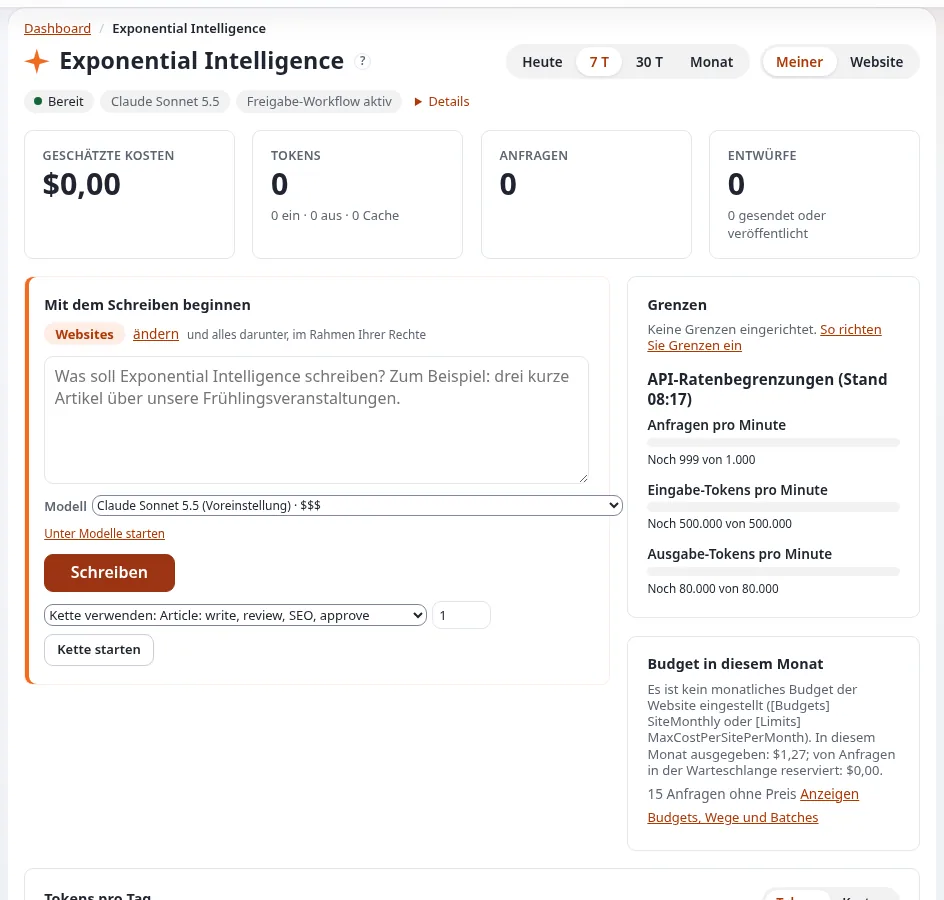

# Lektion 1.2: Das Exponential-Intelligence-Dashboard

Auf der Dashboard-Seite **Exponential Intelligence** sehen Redakteure, was der Assistent für sie getan hat, was es
gekostet hat und wo sie eine Anfrage beginnen. Diese Lektion liest sie von oben nach unten, noch ohne eine Anfrage zu
schicken.

## Auf einen Blick

| | |
|---|---|
| Kurs | [Exponential Intelligence](../README.md) |
| Modul | [Modul 1: Exponential Intelligence kennenlernen](README.md) |
| Dauer | 45 Minuten (20 Präsentation, 25 Übung) |
| Niveau | Einsteiger |
| Zielgruppe | Redakteure und Administratoren |
| Voraussetzungen | [Lektion 1.1](was-exponential-intelligence-ist.md); ein Schulungskonto mit der Richtlinie `expai/write` |

## Lernziele

Nach dieser Lektion können die Teilnehmenden:

- die Seite über die linke Spalte des Dashboards öffnen und ihre Statuszeile lesen (**Ready**, das Modell, der
  Freigabe-Workflow);
- den Zeitraum wechseln (**Today**, **7d**, **30d**, **Month**) und, mit der Berechtigung, **Mine** und **Site**;
- die vier Kennzahlen lesen: geschätzte Kosten, Tokens, Anfragen, Entwürfe;
- **Start writing**, die Limits, das Budget, das Diagramm, die Modelle und die neuesten Entwürfe finden;
- den Block **Exponential Intelligence: my drafts** auf dem Haupt-Dashboard finden.

## Hinweise für Trainer

### So präsentieren Sie es

Quelle: die Dashboard-Dokumentation der Erweiterung (`extension/expai/doc/dashboard.md`, unter **EI: Help**).

1. **Dorthin gelangen** (2 Minuten). Reiter Dashboard, linke Spalte: **Exponential Intelligence** (nur mit
   `expai/write` angezeigt). Das „?“ neben dem Titel öffnet seine Hilfeseite.
2. **Kopf und Statuszeile** (4 Minuten). Der Zeitraum (**Today**, **7d**, **30d**, **Month**) und **Mine** / **Site**
   für Rollen, die die Nutzung aller sehen dürfen. Die Statuszeile: **Ready** (oder ausgeschaltet, oder nicht
   konfiguriert), das verwendete Modell, ob vor dem Veröffentlichen ein Freigabe-Workflow läuft, und **Details** (der
   Inhaltszugriff des Benutzers in Worten, das Datum der Preistabelle; der Schlüssel wird nie angezeigt).
3. **Vier Kennzahlen** (4 Minuten): **Estimated cost**, **Tokens** (ein, aus, zwischengespeichert), **Requests**,
   **Drafts** (wie viele abgeschickt oder veröffentlicht wurden). Kosten sind Schätzungen aus einer Preistabelle; die
   Rechnung des Anbieters ist maßgeblich.
4. **Start writing** (3 Minuten). Ein Ort (mit **change**), das Feld *What should Exponential Intelligence write?*, die
   Liste **Model** (mit Preisklassen wie $ bis $$$ und Hinweisen wie „read only“), **Write** und, wo Ketten eingerichtet
   sind, **Use chain**, **Items** und **Start the chain**. Lektion 2.1 verwendet es.
5. **Der Rest** (5 Minuten). **Limits** (oder *No limits configured.*), die vom Anbieter gemeldeten API-Ratenlimits,
   **Budget this month**, das Diagramm (**Tokens per day** oder Kosten), **Models** (die Bilanz jedes Modells),
   **Recent drafts** (die letzten fünf Versionen, die er für Sie geschrieben hat, mit Links). Auf dem Haupt-Dashboard
   listet sie auch der Block **Exponential Intelligence: my drafts** auf.

### Häufige Fragen

**Warum sieht meine Kollegin Site und ich nicht?** Die Ansicht **Site** braucht die Richtlinie `expai/log`.

**Warum werden die Kosten mit „≈“ oder „< $0.01“ angezeigt?** Kleine Beträge und Beträge, die mit Ersatzpreisen
berechnet wurden, werden gekennzeichnet; manche Anfragen haben möglicherweise gar keinen Preis, und die Seite sagt,
wie viele.

**Was bedeutet „read only“ neben einem Modell?** Dieses Modell darf antworten, aber keine Entwürfe schreiben (es hat die
Tool-Calling-Probe der Website nicht bestanden, oder es ist nicht zum Schreiben konfiguriert). Modul 7 erklärt es.

### Stolperfallen

- **Die Kosten als Rechnung lesen.** Sie sind eine Schätzung.
- **Versehentlich eine Anfrage schicken.** **Write** füllt die Anfrage nur in den Tab Intelligence ein; der Redakteur
  klickt dort noch auf Senden. Klicken Sie in dieser Lektion nicht darauf.
- **Unterschiedliche Modelllisten.** Die Liste hängt von den Anbietern der Website und den Berechtigungen des Benutzers
  ab.

## Praktische Übung

Verwenden Sie die Schulungsinstallation und Ihr Schulungskonto.

1. Öffnen Sie im Reiter Dashboard in der linken Spalte **Exponential Intelligence**.
2. Lesen Sie die Statuszeile und notieren Sie: den Zustand, das Modell und ob ein Freigabe-Workflow läuft.
3. Wechseln Sie den Zeitraum auf **30d** und zurück auf **7d**. Wenn **Site** angeboten wird, wechseln Sie dorthin und
   zurück zu **Mine**.
4. Notieren Sie die vier Kennzahlen.
5. Lesen Sie in **Start writing** den Ort und die Modellliste. Notieren Sie, welche Modelle als „read only“
   gekennzeichnet sind und welche Preisklassen vorkommen. Klicken Sie nicht auf **Write**.
6. Lesen Sie **Limits** und **Budget this month**: Sind Limits konfiguriert?
7. Suchen Sie **Models** und **Recent drafts** (bei einem frischen Konto möglicherweise leer).
8. Öffnen Sie das Haupt-**Dashboard** und suchen Sie den Block **Exponential Intelligence: my drafts**.
9. Klicken Sie auf das „?“ neben dem Seitentitel und überfliegen Sie die Hilfeseite, die sich öffnet.

## Erwartetes Ergebnis

- Die Notizen enthalten den Status, das Modell, den Freigabestand, die vier Kennzahlen, die Preisklassen und den
  Stand der Limits.
- Es wurde keine Anfrage geschickt.
- Der Trainer prüft das, indem er eine Person bittet, den Unterschied zwischen **Mine** und **Site** zu erklären.

## Quiz

1. Welche Richtlinie ist nötig, um die Seite überhaupt zu sehen?
2. Nennen Sie die vier Kennzahlen.
3. Was sagt Ihnen die Statuszeile?
4. Richtig oder falsch: Die geschätzten Kosten sind die Rechnung des Anbieters.
5. Wo werden die vom Assistenten geschriebenen Entwürfe noch aufgelistet?
   A. Nur im Papierkorb B. Im Block **Exponential Intelligence: my drafts** des Haupt-Dashboards und unter **Meine
   Entwürfe** C. Auf der öffentlichen Website D. Nirgends

Antworten

1. `expai/write`.
2. Geschätzte Kosten, Tokens, Anfragen, Entwürfe.
3. Ob er bereit ist, das verwendete Modell und ob vor dem Veröffentlichen ein Freigabe-Workflow läuft.
4. **Falsch.** Sie sind eine Schätzung aus einer Preistabelle.
5. **B.** Es sind gewöhnliche Entwürfe, deshalb listet **Meine Entwürfe** sie ebenfalls auf.

## Weiterführende Informationen

- [expai: Exponential Intelligence](../../../../funktionen/6.0/erweiterungen/expai.md#für-redakteure)
- Die Seiten zum Dashboard und zur Nutzung unter **EI: Help** (`extension/expai/doc/dashboard.md`,
  `extension/expai/doc/usage-tracking.md`).

## Verwandte Seiten

- [Modul 1: Exponential Intelligence kennenlernen](README.md)
- [Exponential Intelligence: Kursüberblick](../README.md)
- [Trainer: hier beginnen](../../trainer-hier-beginnen.md)
- [Freie Dokumentation](../../../freie-dokumentation.md): Diese Seite darf unter der GNU FDL 1.3 frei kopiert, übersetzt und verbessert werden.

<!-- exp-partner-block:start -->
**Werden Sie Exponential-Partner.** Partner teilen ihre Informationen, stellen Mittel bereit, geben Beiträge zurück
und entwickeln die Produkte mit uns, und so wächst Exponential. Eine Partner-Website und ein Dashboard sind für Mitte
2027 geplant: Werden Sie noch heute Partner, damit wir schneller wachsen und neue Funktionen früher liefern. Beginnen
Sie mit [Partner: hier beginnen](../../../partner/partner-hier-beginnen.md) und
[Wie Sie sich bewerben](../../../partner/wie-sie-sich-bewerben.md).
<!-- exp-partner-block:end -->
