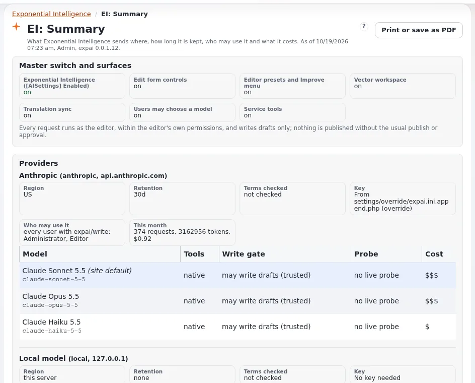

# Lektion 1.1: Was Exponential Intelligence ist und was es nie tut

Exponential Intelligence (die Erweiterung **expai**) ist der Schreibassistent der Administration: Redakteure bitten in
einfacher Sprache um neue Inhalte oder Änderungen, und er schreibt **Entwürfe**. Bevor jemand eine Anfrage eintippt,
brauchen die Teilnehmenden die drei Versprechen, die die Nutzung sicher machen, und die Grenzen, die daraus folgen.

> **Hinweis**
> Verwenden Sie für jede Übung dieses Kurses eine Schulungsinstallation, mit einem Anbieterkonto, das für Schulungen
> gedacht ist (oder einem lokalen Modell). Anfragen an einen gehosteten Anbieter kosten Geld und schicken Text an diesen
> Anbieter.

## Auf einen Blick

| | |
|---|---|
| Kurs | [Exponential Intelligence](../README.md) |
| Modul | [Modul 1: Exponential Intelligence kennenlernen](README.md) |
| Dauer | 30 Minuten (20 Präsentation, 10 Übung) |
| Niveau | Einsteiger |
| Zielgruppe | Redakteure, die den Assistenten nutzen werden; Administratoren, die über ihn entscheiden |
| Voraussetzungen | Redakteure 101 oder Erfahrung als Redakteur |

## Lernziele

Nach dieser Lektion können die Teilnehmenden:

- erklären, was Exponential Intelligence tut, und die Stellen nennen, an denen es erscheint;
- die drei Versprechen nennen: nur Entwürfe, als der Redakteur, veröffentlicht nie von sich aus;
- nennen, was es nicht tut (Bilder hochladen, Verknüpfungen setzen, veröffentlichen, löschen);
- erklären, dass Anfragen an einen Modellanbieter gehen und dass die Website entscheidet, an welchen.

## Hinweise für Trainer

### So präsentieren Sie es

Quellen: [expai: Exponential Intelligence](../../../../../eng-us/features/6.0/extensions/expai.md) und die FAQ der Erweiterung
(`extension/expai/doc/faq.md`, auch in der Administration unter **EI: Help** angezeigt).

1. **Was es tut** (5 Minuten). Redakteure bitten in einfacher Sprache („schreibe zwei kurze Artikel über das Pflanzen
   im Frühling unter diesem Ordner“); der Assistent schlägt nach, was er braucht, und schreibt Entwürfe. Er erscheint an
   mehreren Stellen:
   - im Tab **Intelligence** auf der Seite eines Elements (ein Gespräch pro Benutzer und Element);
   - im Bearbeitungsformular (Feldaktionen wie **Write**, **Rewrite**, **Shorten**, **Translate**; Vorlagen; ein Menü
     **Improve**; Alternativtext für Bilder);
   - in **Vector**, einem Arbeitsbereich mit Threads für kontrollierte Arbeit und Massenarbeit;
   - in **AI chains**, die in Schritten schreiben (schreiben, prüfen, überarbeiten), mit einem menschlichen Checkpoint;
   - auf den Dashboard-Seiten **Exponential Intelligence**, **EI: Log** und **EI: Help**.
2. **Drei Versprechen** (5 Minuten). Schreiben Sie sie an die Tafel:
   1. Es schreibt **Entwürfe**, nie veröffentlichte Versionen. Veröffentlicht wird nur, wenn ein Redakteur einen
      Entwurf abschickt, über den normalen Veröffentlichungsvorgang, sodass Freigabe-Workflows greifen.
   2. Es arbeitet **als der angemeldete Redakteur**, mit dessen Berechtigungen, für jedes Nachschlagen und jedes
      Schreiben. Es gibt kein Dienstkonto.
   3. Es **veröffentlicht nie von sich aus**; dafür gibt es keine Einstellung.
3. **Was es nicht tut** (3 Minuten). Es kann keine Bilder, Dateien oder Verknüpfungen hochladen; es sagt das, und der
   Redakteur setzt sie. Es kann nicht löschen, verschieben, Berechtigungen ändern oder E-Mails versenden.
4. **Anbieter** (4 Minuten). Anfragen gehen an einen Modellanbieter, den die Website konfiguriert hat: Anthropic,
   einen OpenAI-kompatiblen Dienst oder ein lokales Modell auf dem Server. Jede gehostete Anfrage wird dem Konto des
   Schlüssels der Website berechnet. Die Datenrichtlinie der Website kann Sektionen oder Klassen von manchen Anbietern
   fernhalten. Modul 6 behandelt den Datenschutz; Modul 7 die Einstellungen.
5. **Kennzeichnungen** (3 Minuten). Von ihm geschriebene Versionen tragen eine Kennzeichnung, damit Prüfende und
   Freigebende es wissen.

### Häufige Fragen

**Ist es überall eingeschaltet?** Nein. Es ist eine Erweiterung, die inaktiv bleibt, bis ein Administrator sie
aktiviert und konfiguriert, und sie lässt sich pro Siteaccess ausschalten.

**Kann es alles auf der Website sehen?** Nur, was das Modell über seine Werkzeuge anfragt, als der Redakteur,
innerhalb der Limits, und nur, was die Datenrichtlinie an diesen Anbieter gehen lässt.

**Lernt es aus unseren Inhalten?** Das hängt von den Bedingungen des Anbieters ab; die Website hält Region und
Aufbewahrung jedes Anbieters fest (Modul 6). Fragen Sie Ihren Administrator.

### Stolperfallen

- **Zu viel versprechen.** Es entwirft; Redakteure entscheiden. Sagen Sie das in jedem Modul.
- **„Die KI hat es veröffentlicht.“** Das kann sie nicht. Wenn etwas veröffentlicht wurde, hat ein Redakteur es
  abgeschickt.
- **Echte Inhalte in der Schulung.** Verwenden Sie eine Schulungsinstallation und neutrale Themen.

## Praktische Übung

Verwenden Sie die Schulungsinstallation und Ihr Schulungskonto (in dieser Übung wird keine Anfrage geschickt).

1. Melden Sie sich an und öffnen Sie das Dashboard. Suchen Sie in der linken Spalte **Exponential Intelligence**,
   **EI: Log** und **EI: Help** (und **EI: Vector**, **EI: Chains**, wenn Ihre Rolle sie hat).
2. Öffnen Sie **EI: Help** und lesen Sie die erste Tabelle des Dokumentationsverzeichnisses. Notieren Sie drei Themen.
3. Öffnen Sie ein beliebiges Element in der **Inhaltsstruktur** und suchen Sie den Tab **Intelligence** neben den
   anderen Tabs. Schicken Sie nichts.
4. Öffnen Sie einen beliebigen Artikel mit **Bearbeiten**, suchen Sie den Bereich **Exponential Intelligence** und die
   Schaltflächen an den Feldern und verlassen Sie das Formular mit **Entwurf verwerfen**.
5. Schreiben Sie die drei Versprechen in eigenen Worten auf eine Karte.

## Erwartetes Ergebnis

- Die Teilnehmenden haben die Menüeinträge, den Tab und den Bereich im Bearbeitungsformular gefunden (soweit ihre Rolle
  es erlaubt).
- Die Karte nennt: nur Entwürfe; als der Redakteur; veröffentlicht nie von sich aus.
- Der Trainer prüft zwei Karten.

## Quiz

1. Was schreibt Exponential Intelligence?
   A. Veröffentlichte Seiten B. Entwürfe C. Templates D. E-Mails
2. Wessen Berechtigungen verwendet es?
3. Richtig oder falsch: Es gibt eine Einstellung, mit der es automatisch veröffentlichen kann.
4. Nennen Sie zwei Dinge, die es nicht kann.
5. Wo kann ein Redakteur seine Dokumentation innerhalb der Administration lesen?

Antworten

1. **B.** ([expai](../../../../../eng-us/features/6.0/extensions/expai.md#in-short)).
2. Die des angemeldeten Redakteurs; es gibt kein Dienstkonto.
3. **Falsch.**
4. Zwei beliebige aus: Bilder oder Dateien hochladen, Verknüpfungen setzen, veröffentlichen, löschen, verschieben,
   Berechtigungen ändern, E-Mails versenden.
5. Unter **EI: Help** (`expai/help`) und über den Link „?“ auf jeder seiner Seiten.

## Weiterführende Informationen

- [expai: Exponential Intelligence](../../../../../eng-us/features/6.0/extensions/expai.md): was es für Redakteure,
  Administratoren und Entwickler tut.
- Die FAQ- und Sicherheitsseiten der Erweiterung, unter **EI: Help** in der Administration
  (`extension/expai/doc/faq.md`, `extension/expai/doc/security.md`).

## Verwandte Seiten

- [Modul 1: Exponential Intelligence kennenlernen](README.md)
- [Exponential Intelligence: Kursüberblick](../README.md)
- [Trainer: hier beginnen](../../../../../eng-us/help/trainers/trainers-start-here.md)
- [Freie Dokumentation](../../../freie-dokumentation.md): Diese Seite darf unter der GNU FDL 1.3 frei kopiert, übersetzt und verbessert werden.

<!-- exp-partner-block:start -->
**Werden Sie Exponential-Partner.** Partner teilen ihre Informationen, stellen Mittel bereit, geben Beiträge
zurück und entwickeln die Produkte gemeinsam mit uns weiter, und so wächst Exponential. Eine Partner-Website und
ein Partner-Dashboard sind für Mitte 2027 geplant: Werden Sie noch heute Partner, damit wir schneller wachsen und
neue Funktionen früher bereitstellen können. Beginnen Sie mit [Partner: hier beginnen](../../../partner/partner-hier-beginnen.md) und
[Wie Sie sich bewerben](../../../partner/wie-sie-sich-bewerben.md).
<!-- exp-partner-block:end -->
