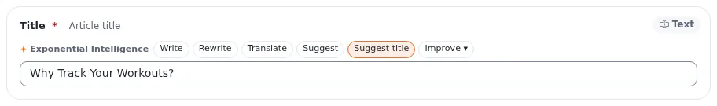

# Lektion 3.1: Feldaktionen im Bearbeitungsformular

Im Bearbeitungsformular arbeitet der Assistent Feld für Feld: Jedes Textfeld bekommt eine kleine Leiste mit
Schaltflächen. Ein Vorschlag kommt in das Feld, damit der Redakteur ihn liest; nichts wird gespeichert, bis der
Redakteur den Entwurf speichert oder veröffentlicht. Diese Lektion übt die Feldaktionen.

## Auf einen Blick

| | |
|---|---|
| Kurs | [Exponential Intelligence](../README.md) |
| Modul | [Modul 3: Das Bearbeitungsformular](README.md) |
| Dauer | 45 Minuten (15 Präsentation, 30 Übung) |
| Niveau | Einsteiger |
| Zielgruppe | Redakteure |
| Voraussetzungen | [Modul 2](../modul-02-der-intelligence-tab/README.md); ein Artikel im Kursordner der Person |

## Lernziele

Nach dieser Lektion können die Teilnehmenden:

- an einem Feld die Leiste *Exponential Intelligence* mit **Write**, **Rewrite**, **Shorten**, **Translate** und
  **Suggest** finden;
- die Zeile mit den Standardwerten lesen: Modell, Region, Spur und geschätzte Kosten pro Klick;
- eine Aktion mit einer Anweisung ausführen, den Vorschlag lesen und mit **Undo** rückgängig machen;
- mit der Prüfung umgehen, die statt des Schreibens erscheint (**Apply anyway**, **Keep the original**);
- die Aufzeichnung der Anfrage mit **View record** öffnen.

## Hinweise für Trainer

### So präsentieren Sie es

Quellen: die Seiten zum Bearbeitungsformular und zu Vorlagen unter **EI: Help**
(`extension/expai/doc/edit-view-integration.md`, `extension/expai/doc/presets.md`).

1. **Die Leiste** (3 Minuten). Jedes beschreibbare Textfeld zeigt nach seiner Beschriftung eine Leiste wie
   *Exponential Intelligence [Write] [Rewrite] [Shorten] [Translate]*; manche Felder haben auch **Suggest**. Eine
   Schaltfläche, die eine Eingabe braucht, öffnet ein kleines Feld (eine Anweisung oder eine Sprache) mit Go und
   Cancel.
2. **Die Zeile mit den Standardwerten** (2 Minuten). Über den Feldern nennt eine Zeile, was ein Klick verwendet: das
   Modell, seine Region, die Spur und die geschätzten Kosten eines Klicks, und dass nichts gespeichert wird, bis Sie
   den Entwurf speichern.
3. **Was geschickt wird** (2 Minuten). Der Name und die Klasse des Elements, das Feld, sein aktueller Wert, die
   aktuellen Werte der anderen Felder (höchstens etwa 30 KB) und Ihre Anweisung. Nie Ihr Name, Ihr Login oder Ihr
   Passwort.
4. **Die Antwort** (3 Minuten). Der Wert wird in das Feld gesetzt und hervorgehoben, mit einem Hinweis, **Undo** und
   **View record**. Rich Text behält seine Struktur; wenn eine Antwort Struktur verlieren würde (eingebettete Objekte,
   eine Tabelle) oder sich das Feld inzwischen geändert hat, zeigt die Leiste stattdessen eine Prüfung: den Grund,
   **Apply anyway**, **Keep the original** und, wo möglich, **Copy text**.
5. **Speichern** (2 Minuten). Der Entwurf wird wie gewohnt gespeichert; das automatische Speichern kann ihn speichern,
   wie bei getipptem Text. Nichts wird veröffentlicht.

### Häufige Fragen

**Kann ich Feldaktionen bei einem veröffentlichten Artikel verwenden?** Beim Entwurf, den Sie bearbeiten; die
veröffentlichte Version bleibt, wie sie ist, bis Sie veröffentlichen.

**Warum ist eine Schaltfläche deaktiviert?** Der Datentyp ist für den Assistenten nicht beschreibbar (Bilder,
Verknüpfungen, Dateien), oder der Assistent ist ausgeschaltet.

**Übersetzt Translate das ganze Element?** Es übersetzt den Wert des Feldes in die gewählte Sprache; ein Element in
eine andere Sprache zu übersetzen, geschieht mit einer Übersetzung (Redakteure 201) und kann durch den
Übersetzungsabgleich unterstützt werden.

### Stolperfallen

- **Annehmen, ohne zu lesen.** Lesen Sie jeden Vorschlag; **Undo** ist da.
- **Apply anyway aus Gewohnheit.** Es kann eingebettete Bilder oder Tabellen verwerfen; lesen Sie zuerst den Grund.
- **Kosten pro Klick.** Jeder Klick ist eine Anfrage; wiederholtes Klicken summiert sich.

## Praktische Übung

Verwenden Sie die Schulungsinstallation und Ihren veröffentlichten Artikel aus Modul 2.

1. Öffnen Sie den Artikel mit **Bearbeiten**. Suchen Sie über den Feldern die Zeile mit den Standardwerten und
   notieren Sie das Modell und die Kosten pro Klick.
2. Klicken Sie bei **Intro** (oder dem ersten Textfeld) auf **Shorten**. Lesen Sie den Vorschlag.
3. Klicken Sie auf **Undo**. Der ursprüngliche Text ist zurück.
4. Klicken Sie bei **Intro** auf **Rewrite**, geben Sie die Anweisung `Friendlier tone, for complete beginners` ein und
   klicken Sie auf Go.
5. Lesen Sie den Vorschlag und den Hinweis; klicken Sie auf **View record** (es öffnet sich in einem neuen Tab) und
   sehen Sie sich die Aufzeichnung an.
6. Klicken Sie bei **Title** auf **Suggest** (oder **Write** mit einer Anweisung) und behalten Sie das Ergebnis, das
   Ihnen am besten gefällt.
7. Klicken Sie bei **Body** auf **Translate**, wählen Sie eine andere Sprache und sehen Sie sich das Ergebnis an;
   dann **Undo**.
8. Klicken Sie auf **Entwurf speichern und beenden**, öffnen Sie den Entwurf erneut und klicken Sie auf **Zur
   Veröffentlichung schicken** (oder verwerfen Sie ihn, wenn Ihnen das Original lieber ist).

## Erwartetes Ergebnis

- Die Person hat vier Aktionen verwendet, zwei rückgängig gemacht und den Entwurf gespeichert oder verworfen.
- Die Aufzeichnung hat Modell, Tokens und geschätzte Kosten der Anfrage gezeigt.
- Der Trainer prüft das, indem er zwei Teilnehmende fragt, was die Zeile mit den Standardwerten gesagt hat.

## Quiz

1. Wo im Bearbeitungsformular ist die Schaltflächenleiste des Assistenten?
2. Was sagt Ihnen die Zeile mit den Standardwerten?
3. Richtig oder falsch: Eine Feldaktion speichert den Entwurf sofort.
4. Wann erscheint eine Prüfung mit **Apply anyway** und **Keep the original**?
5. Was wird bei einer Feldaktion an den Anbieter geschickt?
   A. Ihr Passwort B. Name und Klasse des Elements, das Feld und die Werte der anderen Felder sowie Ihre Anweisung
   C. Ihre E-Mail-Adresse D. Die Entwürfe anderer Benutzer

Antworten

1. Nach der Beschriftung jedes beschreibbaren Textfelds.
2. Das Modell, seine Region, die Spur und die geschätzten Kosten eines Klicks.
3. **Falsch.** Der Wert kommt in das Formular; Sie speichern oder veröffentlichen wie gewohnt.
4. Wenn die Antwort Struktur verlieren würde (eingebettete Objekte, Tabellen) oder sich das Feld geändert hat, während
   sie geschrieben wurde.
5. **B.**

## Weiterführende Informationen

- [expai: Für Redakteure](../../../../../eng-us/features/6.0/extensions/expai.md#for-editors)
- Die Seiten zum Bearbeitungsformular, zu Vorlagen und zur Sicherheit unter **EI: Help**.

## Verwandte Seiten

- [Modul 3: Das Bearbeitungsformular](README.md)
- [Exponential Intelligence: Kursüberblick](../README.md)
- [Trainer: hier beginnen](../../../../../eng-us/help/trainers/trainers-start-here.md)
- [Freie Dokumentation](../../../freie-dokumentation.md): Diese Seite darf unter der GNU FDL 1.3 frei kopiert, übersetzt und verbessert werden.

<!-- exp-partner-block:start -->
**Werden Sie Exponential-Partner.** Partner teilen ihre Informationen, stellen Mittel bereit, geben Beiträge
zurück und entwickeln die Produkte gemeinsam mit uns weiter, und so wächst Exponential. Eine Partner-Website und
ein Partner-Dashboard sind für Mitte 2027 geplant: Werden Sie noch heute Partner, damit wir schneller wachsen und
neue Funktionen früher bereitstellen können. Beginnen Sie mit [Partner: hier beginnen](../../../partner/partner-hier-beginnen.md) und
[Wie Sie sich bewerben](../../../partner/wie-sie-sich-bewerben.md).
<!-- exp-partner-block:end -->
