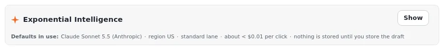

# Lektion 3.2: Fill the fields, Vorlagen und das Menü Improve

Drei weitere Helfer wohnen im Bearbeitungsformular: **Fill the fields** schreibt ein ganzes neues Element aus einem
Auftrag, **Vorlagen** erledigen Routinearbeiten (einen Titel, eine Zusammenfassung, Metadaten) mit einem Klick, und das
Menü **Improve** poliert einen Text. Alle setzen Werte zur Prüfung in das Formular; keiner speichert oder
veröffentlicht etwas.

## Auf einen Blick

| | |
|---|---|
| Kurs | [Exponential Intelligence](../README.md) |
| Modul | [Modul 3: Das Bearbeitungsformular](README.md) |
| Dauer | 45 Minuten (15 Präsentation, 30 Übung) |
| Niveau | Einsteiger |
| Zielgruppe | Redakteure |
| Voraussetzungen | [Lektion 3.1](feldaktionen.md) |

## Lernziele

Nach dieser Lektion können die Teilnehmenden:

- den Bereich **Exponential Intelligence** des Bearbeitungsformulars öffnen und **Fill the fields** mit einem Auftrag
  verwenden;
- die Vorlagen **Suggest title**, **Write summary**, **Meta description** und **Keywords** verwenden, wo eine Klasse
  sie hat;
- das Menü **Improve** verwenden: **Shorten**, **Expand**, **Clarify**, **Fix grammar**, **Simplify for new readers**,
  **More formal**, **More casual**;
- alle eingefüllten Werte auf einmal rückgängig machen.

## Hinweise für Trainer

### So präsentieren Sie es

Quelle: die Seiten zum Bearbeitungsformular und zu Vorlagen unter **EI: Help**
(`extension/expai/doc/edit-view-integration.md`, `extension/expai/doc/presets.md`).

1. **Der Bereich** (3 Minuten). Über den Feldern ist der Bereich **Exponential Intelligence** bis **Show**
   geschlossen; die Wahl wird gemerkt. Sein erster Abschnitt ist **Fill the fields**.
2. **Fill the fields** (4 Minuten). Geben Sie einen Auftrag ein; das Modell bekommt die beschreibbaren Felder der
   Klasse (mit Formathinweisen, Pflichtkennzeichen und Höchstlängen) und antwortet mit Werten, die in das Formular
   gesetzt werden. **Undo** stellt alle wieder her. Bilder, Verknüpfungen und Dateien werden nicht gefüllt.
3. **Vorlagen** (3 Minuten). Eine Schaltfläche pro Vorlage neben den Feldern, denen eine Klasse sie zuordnet: bei einem
   Standardartikel **Suggest title** am Titel und **Write summary** an der Einleitung; Klassen mit einem Metadatenfeld
   bekommen außerdem **Meta description** und **Keywords**. Eine Klasse ohne Zuordnung bekommt keine Vorlagen.
4. **Improve** (3 Minuten). An jedem Textfeld bietet das Menü **Improve** sieben Umformulierungen an. Jede funktioniert
   wie eine Feldaktion: Die Antwort kommt mit einem Hinweis, **Undo** und **View record** in das Feld.
5. **Die menschliche Stimme behalten** (2 Minuten). Verwenden Sie Vorlagen für Routinearbeit; schreiben Sie die Teile,
   die Ihr Wissen brauchen, selbst.

### Häufige Fragen

**Ist Fill the fields dasselbe, wie im Tab Intelligence zu fragen?** Ähnliches Ergebnis, anderer Ort: Der Tab legt
Entwürfe unter einem Element an; Fill the fields füllt das Formular, das Sie geöffnet haben.

**Warum sehe ich keine Vorlagen?** Die Klasse hat auf Ihrer Installation keine Vorlagenzuordnung.

**Ist die Meta-Beschreibung wichtig?** Suchmaschinen zeigen sie oft an; eine Vorlage ist ein guter Anfang, aber lesen
Sie sie.

### Stolperfallen

- **Über vorhandene Arbeit füllen.** **Fill the fields** ersetzt Werte; verwenden Sie es bei einem neuen Element, oder
  **Undo**.
- **Allgemeine Metadaten.** Für jede Seite vorgeschlagene Schlüsselwörter sehen gleich aus; passen Sie sie an.
- **Expand bei kurzen Texten.** Es erfindet Einzelheiten; prüfen Sie die Fakten.

## Praktische Übung

Verwenden Sie die Schulungsinstallation und Ihren Kursordner.

1. Klicken Sie in Ihrem Kursordner auf **Neu erstellen** und wählen Sie **Article**.
2. Öffnen Sie den Bereich **Exponential Intelligence** mit **Show**.
3. Geben Sie in **Fill the fields** einen Auftrag ein, zum Beispiel `A short article for beginners on watering
   houseplants in winter, about 150 words, friendly tone, no brand names.` Schicken Sie ihn ab.
4. Lesen Sie jedes gefüllte Feld. Klicken Sie einmal auf **Undo**, um alle Werte verschwinden zu sehen, und füllen Sie
   dann erneut.
5. Verwenden Sie am Titel **Suggest title** (falls angeboten) und wählen Sie einen Titel.
6. Verwenden Sie an der Einleitung **Write summary** (falls angeboten).
7. Öffnen Sie am Haupttext **Improve** und wählen Sie **Fix grammar**, dann **Simplify for new readers**. Machen Sie
   das rückgängig, was Ihnen nicht gefällt.
8. Veröffentlichen Sie den Artikel mit **Zur Veröffentlichung schicken** oder speichern Sie ihn als Entwurf.

## Erwartetes Ergebnis

- Ein neuer Artikel, aus dem Auftrag gefüllt, mit Titel und Zusammenfassung aus Vorlagen, wo angeboten, mit **Improve**
  poliert, von der Person gespeichert oder veröffentlicht.
- Der Trainer prüft das, indem er den Artikel einer Person öffnet und fragt, welche Teile sie von Hand geändert hat.

## Quiz

1. Was bewirkt **Fill the fields**?
2. Nennen Sie drei Einträge des Menüs **Improve**.
3. Warum zeigt ein Artikelformular möglicherweise keine Vorlagen?
4. Richtig oder falsch: Vorlagen veröffentlichen das Element.
5. Welche Felder füllt **Fill the fields** nicht?
   A. Textfelder B. Rich-Text-Felder C. Bilder, Verknüpfungen und Dateien D. Den Titel

Antworten

1. Es schreibt aus einem Auftrag Werte für die beschreibbaren Felder des Formulars und setzt sie in das Formular.
2. Drei beliebige aus **Shorten**, **Expand**, **Clarify**, **Fix grammar**, **Simplify for new readers**, **More
   formal**, **More casual**.
3. Die Klasse hat auf dieser Installation keine Vorlagenzuordnung.
4. **Falsch.** Sie setzen Werte in das Formular; nichts wird gespeichert, bis Sie den Entwurf speichern.
5. **C.**

## Weiterführende Informationen

- Die Seiten zu Vorlagen und zum Bearbeitungsformular unter **EI: Help**.
- [Inhalte erstellen und bearbeiten](../../../inhalte-bearbeiten.md#exponential-intelligence): der Assistent im
  Bearbeitungsformular.

## Verwandte Seiten

- [Modul 3: Das Bearbeitungsformular](README.md)
- [Exponential Intelligence: Kursüberblick](../README.md)
- [Trainer: hier beginnen](../../trainer-hier-beginnen.md)
- [Freie Dokumentation](../../../freie-dokumentation.md): Diese Seite darf unter der GNU FDL 1.3 frei kopiert, übersetzt und verbessert werden.

<!-- exp-partner-block:start -->
**Werden Sie Exponential-Partner.** Partner teilen ihre Informationen, stellen Mittel bereit, geben Beiträge zurück
und entwickeln die Produkte mit uns, und so wächst Exponential. Eine Partner-Website und ein Dashboard sind für Mitte
2027 geplant: Werden Sie noch heute Partner, damit wir schneller wachsen und neue Funktionen früher liefern. Beginnen
Sie mit [Partner: hier beginnen](../../../partner/partner-hier-beginnen.md) und
[Wie Sie sich bewerben](../../../partner/wie-sie-sich-bewerben.md).
<!-- exp-partner-block:end -->
