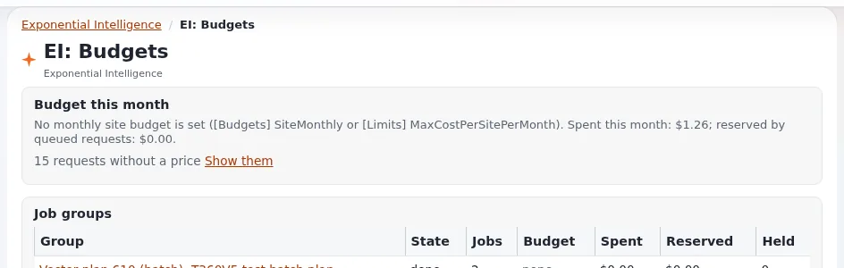

# Lektion 6.3: Kosten, Limits und faire Nutzung

Jede Anfrage an ein gehostetes Modell wird dem Konto der Website berechnet. Der Assistent schätzt alle Kosten, die
Website kann Limits und ein Monatsbudget setzen, und Redakteure können mit ein paar Gewohnheiten viel sparen. Diese
kurze Lektion behandelt alle drei.

## Auf einen Blick

| | |
|---|---|
| Kurs | [Exponential Intelligence](../README.md) |
| Modul | [Modul 6: Verantwortungsvoller Einsatz](README.md) |
| Dauer | 30 Minuten (15 Präsentation, 15 Übung) |
| Niveau | Fortgeschrittene |
| Zielgruppe | Alle, die den Assistenten nutzen; Administratoren |
| Voraussetzungen | [Lektion 6.2](ki-ergebnisse-pruefen.md) |

## Lernziele

Nach dieser Lektion können die Teilnehmenden:

- die geschätzten Kosten eines Klicks (Zeile mit den Standardwerten), eines Durchgangs (Aufzeichnung) und eines
  Zeitraums (Dashboard) lesen;
- Nutzungslimits und das Monatsbudget erklären und was geschieht, wenn eines erreicht ist;
- ein günstigeres Modell wählen, wo es die Aufgabe erfüllt, anhand der Preisklassen der Modellliste;
- drei Gewohnheiten nennen, die Kosten sparen.

## Hinweise für Trainer

### So präsentieren Sie es

Quellen: [expai: Für Administratoren](../../../../funktionen/6.0/erweiterungen/expai.md#für-administratoren) und die Seiten
zur Nutzung und zu Budgets unter **EI: Help** (`extension/expai/doc/usage-tracking.md`, `extension/expai/doc/budgets.md`).

1. **Überall Schätzungen** (3 Minuten). Die Zeile mit den Standardwerten im Bearbeitungsformular (Kosten pro Klick),
   die Aufzeichnung jedes Durchgangs, **Estimated cost** auf dem Dashboard, **EI: Log**. Schätzungen kommen aus einer
   Preistabelle; die Rechnung des Anbieters ist maßgeblich. Ein lokales Modell kostet keine Gebühren.
2. **Limits und Budget** (4 Minuten). Die **Limits** des Dashboards zeigen für jedes gesetzte Limit einen Balken (pro
   Benutzer, Tag, Monat, Website, Anbieter), mit dem Zeitpunkt des Zurücksetzens, oder *No limits configured.*
   **Budget this month** zeigt, falls gesetzt, das monatliche Budget der Website für Arbeit in der Warteschlange und
   was ausgegeben und reserviert wurde. Wenn ein Limit erreicht ist, stoppen Anfragen mit einer Meldung, bis es
   zurückgesetzt wird.
3. **Gewohnheiten** (5 Minuten):
   - für Routinearbeit das günstigere Modell wählen (die Modellliste zeigt Preisklassen wie $ bis $$$);
   - für ein neues Thema ein **New conversation** beginnen; lange Gespräche machen jede Anfrage größer;
   - klare Aufträge schreiben, damit weniger Runden nötig sind;
   - für Massenarbeit den Plan von Vector verwenden: Seine Schätzung zeigt die Kosten, bevor etwas läuft;
   - für große Hintergrundarbeit können Administratoren günstigere Batch-Spuren verwenden.
4. **Faire Nutzung** (3 Minuten). Schulungskonten teilen sich das Budget der Website mit echten Redakteuren; halten Sie
   Experimente klein.

### Häufige Fragen

**Warum sind die Kosten „< $0.01“ oder mit „≈“?** Sehr kleine Beträge und Beträge, die mit Ersatzpreisen berechnet
wurden, werden gekennzeichnet.

**Wer setzt Limits?** Administratoren, in den Einstellungen der Erweiterung (Modul 7).

**Ist das günstigste Modell immer in Ordnung?** Für kurze Umformulierungen oft ja; bei langen Texten mit Struktur
braucht ein stärkeres Modell möglicherweise weniger Korrekturen. Vergleichen Sie an Ihren eigenen Inhalten.

### Stolperfallen

- **Wiederholtes Klicken** auf dieselbe Feldaktion, bis sich der Text „richtig anfühlt“. Bearbeiten Sie stattdessen
  von Hand.
- **Riesige Umfänge** in Vector, ohne die Schätzung zu lesen.
- **Vergessene Arbeit in der Warteschlange.** Ketten und Aufträge für Alternativtexte laufen im Hintergrund und kosten
  ebenfalls.

## Praktische Übung

Verwenden Sie die Schulungsinstallation und Ihr Schulungskonto.

1. Öffnen Sie die Dashboard-Seite **Exponential Intelligence**. Notieren Sie Ihre geschätzten Kosten und Anfragen für
   **7d**.
2. Lesen Sie **Limits** und **Budget this month**: Welche Limits gelten für Sie?
3. Lesen Sie in **Start writing** die Modellliste und ihre Preisklassen. Notieren Sie das günstigste Modell, das
   Entwürfe schreiben darf (nicht als „reads only“ gekennzeichnet).
4. Öffnen Sie einen Artikel mit **Bearbeiten** und lesen Sie die Kosten pro Klick in der Zeile mit den
   Standardwerten. Wechseln Sie Ihr Modell, wo die Website Sie eines wählen lässt, und lesen Sie erneut.
5. Öffnen Sie **EI: Log** und suchen Sie Ihren teuersten Durchgang in diesem Kurs. Was hat ihn teuer gemacht (viele
   Schritte, ein langes Gespräch, ein starkes Modell)?
6. Schreiben Sie Ihre drei Gewohnheiten zum Kostensparen auf eine Karte.

## Erwartetes Ergebnis

- Die Notizen enthalten die Kosten des Zeitraums, die geltenden Limits, das günstigste schreibende Modell und den
  teuersten Durchgang mit einem Grund.
- Jede Karte nennt drei Gewohnheiten.
- Der Trainer prüft zwei Karten.

## Quiz

1. Wo sehen Sie im Bearbeitungsformular die Kosten eines Klicks?
2. Was geschieht, wenn ein Nutzungslimit erreicht ist?
3. Nennen Sie drei Gewohnheiten, die Kosten sparen.
4. Richtig oder falsch: Die geschätzten Kosten sind genau das, was der Anbieter berechnet.
5. Was zeigt Vector, bevor Massenarbeit läuft?
   A. Nichts B. Einen Plan mit Kostenschätzung C. Die Rechnung D. Die Bedingungen des Anbieters

Antworten

1. In der Zeile mit den Standardwerten über den Feldern.
2. Anfragen stoppen mit einer Meldung, bis das Limit zurückgesetzt wird.
3. Drei beliebige aus: ein günstigeres Modell für Routinearbeit; neue Gespräche für neue Themen; klare Aufträge; Pläne
   für Massenarbeit; Batch-Spuren für große Hintergrundarbeit; von Hand bearbeiten statt wiederholt klicken.
4. **Falsch.** Sie sind eine Schätzung; die Rechnung ist maßgeblich.
5. **B.**

## Weiterführende Informationen

- [expai: Für Administratoren](../../../../funktionen/6.0/erweiterungen/expai.md#für-administratoren)
- Die Seiten zur Nutzungserfassung, zu Budgets und zu Spuren unter **EI: Help**.

## Verwandte Seiten

- [Modul 6: Verantwortungsvoller Einsatz](README.md)
- [Exponential Intelligence: Kursüberblick](../README.md)
- [Trainer: hier beginnen](../../trainer-hier-beginnen.md)
- [Freie Dokumentation](../../../freie-dokumentation.md): Diese Seite darf unter der GNU FDL 1.3 frei kopiert, übersetzt und verbessert werden.

<!-- exp-partner-block:start -->
**Werden Sie Exponential-Partner.** Partner teilen ihre Informationen, stellen Mittel bereit, geben Beiträge zurück
und entwickeln die Produkte mit uns, und so wächst Exponential. Eine Partner-Website und ein Dashboard sind für Mitte
2027 geplant: Werden Sie noch heute Partner, damit wir schneller wachsen und neue Funktionen früher liefern. Beginnen
Sie mit [Partner: hier beginnen](../../../partner/partner-hier-beginnen.md) und
[Wie Sie sich bewerben](../../../partner/wie-sie-sich-bewerben.md).
<!-- exp-partner-block:end -->
