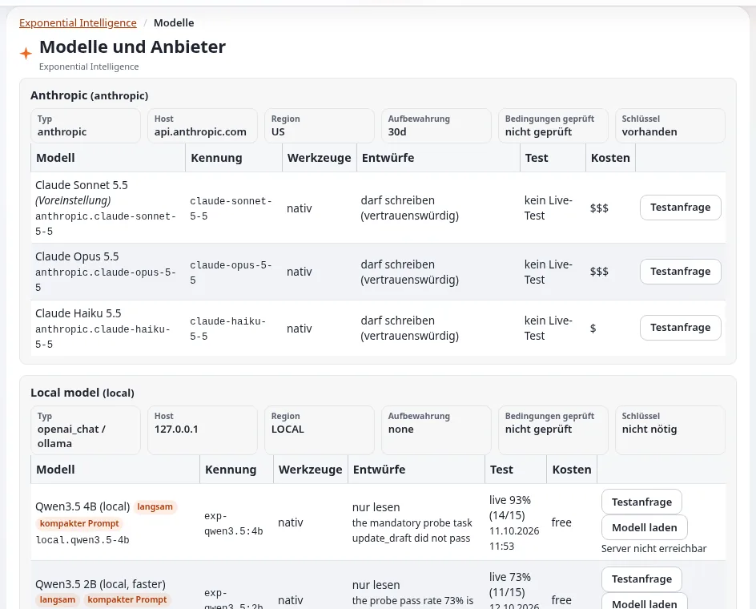

# Lektion 7.1: Anbieter und Modelle

Welche Unternehmen (oder lokalen Server) die Anfragen des Assistenten beantworten und welche Modelle Entwürfe schreiben
dürfen, entscheidet der Administrator. Diese Lektion liest die Seite **Models and providers** und erklärt die Regeln
dahinter: Anbieter, Schlüssel, die Probe und das Write Gate.

## Auf einen Blick

| | |
|---|---|
| Kurs | [Exponential Intelligence](../README.md) |
| Modul | [Modul 7: Administration](README.md) |
| Dauer | 45 Minuten (20 Präsentation, 25 Übung) |
| Niveau | Experten |
| Zielgruppe | Administratoren, die den Assistenten betreiben |
| Voraussetzungen | Module 1 bis 6; die Richtlinie `expai/model_manage` |

## Lernziele

Nach dieser Lektion können die Teilnehmenden:

- **EI: Models** (**Models and providers**) lesen: Anbieter, Modelle, Vorhandensein von Schlüsseln, Ergebnisse von
  Probe und Test;
- Region, Aufbewahrung und „terms checked“ eines Anbieters erklären;
- das Write Gate erklären: Nur Modelle mit nativem Tool Calling, die die Probe bestanden haben (oder vertrauenswürdig
  sind), schreiben Entwürfe;
- einen **Test prompt** ausführen und sein Ergebnis lesen;
- entscheiden, welche Modelle Redakteure wählen dürfen (`expai/model_use`, die erlaubten Modelle).

## Hinweise für Trainer

### So präsentieren Sie es

Quellen: [expai: Für Administratoren](../../../../funktionen/6.0/erweiterungen/expai.md#für-administratoren) und die Seiten zu
Anbietern, zur Probe und zu lokalen Modellen unter **EI: Help** (`extension/expai/doc/providers.md`,
`extension/expai/doc/probe.md`, `extension/expai/doc/local-models.md`).

1. **Anbieter** (4 Minuten). Die Erweiterung spricht mit Anthropic, mit jedem OpenAI-kompatiblen Dienst und über Ollama
   mit einem lokalen Open-Weight-Modell. Jeder Anbieter hat eine Region (`us`, `eu`, `local`), eine Aufbewahrung und das
   Datum, an dem seine Bedingungen geprüft wurden (`TermsCheckedAt`; die Seite zeigt „not checked“, bis es gesetzt
   ist). Die mitgelieferten Werte sind ein Ausgangspunkt, keine rechtliche Aussage.
2. **Die Seite** (4 Minuten). Setup > **EI: Models**: ein Abschnitt pro Anbieter mit seinen Modellen (**Model**,
   **Id**, **Tools**, **Probe**, **Test**, **Drafts**, **Cost**), der lokale Modellserver (Aktionen wie **Start the
   server**, **Stop the server**, **Pull the model**, **Remove the model**, **Refresh the status**, mit **Send to the
   helper** an einen Helfer geschickt, der root gehört), **Load model**, **Test prompt** und **MCP tools**. Schlüssel
   werden nie angezeigt; nur, ob einer vorhanden ist.
3. **Das Write Gate** (5 Minuten). Ein Modell darf Entwürfe nur anlegen und ändern mit nativem Tool Calling und
   entweder `WriteGate=trusted` oder einer Live-Probe mit einer Erfolgsquote von mindestens 90 Prozent und jeder
   bestandenen Pflichtaufgabe (darunter eine Aufgabe zu Prompt Injection). Andernfalls liest es nur: Redakteure sehen
   „reads only“. Die Probe wird über die Kommandozeile ausgeführt (`extension/expai/bin/php/expaiprobe.php`).
4. **Wer welches Modell nutzen darf** (3 Minuten). Das Standardmodell der Website ist immer verfügbar; Modelle anderer
   Anbieter brauchen `expai/model_use` (Einschränkung Provider), außer bei Anbietern, die als offen aufgeführt sind.
   Benutzer dürfen unter den erlaubten Modellen wählen, wo die Website es zulässt.
5. **Ersatzmodell** (2 Minuten). Wenn das gewählte Modell nicht antworten kann, antwortet das Standardmodell der
   Website, und der Redakteur sieht eine Zeile, die das sagt.

### Häufige Fragen

**Welchen Anbieter sollten wir verwenden?** Das hängt von Ihren Datenschutzregeln, der Region, der Aufbewahrung und dem
Budget ab; die Dokumentation nennt keinen bevorzugten. Lesen Sie die Bedingungen der Anbieter und halten Sie das Datum
fest.

**Ist ein lokales Modell gut genug?** Für kurze Aufgaben; auf einem gewöhnlichen Server braucht ein lokales Modell pro
Schritt Minuten und darf möglicherweise nur lesen (es muss die Probe bestehen, um zu schreiben).

**Wo werden Schlüssel gespeichert?** In `settings/override/expai.ini.append.php` oder an einem nicht versionierten Ort
für Schlüssel, nie committet; Lektion 7.2.

### Stolperfallen

- **Das Gate von Hand öffnen** für ein Modell, das die Injection-Aufgabe der Probe nicht bestanden hat. Tun Sie das
  nicht.
- **„Terms not checked“ stehen lassen.** Lesen Sie die Bedingungen und setzen Sie das Datum.
- **Mit echten Inhalten testen.** **Test prompt** schickt eine Anfrage; verwenden Sie einen neutralen Prompt.

## Praktische Übung

Verwenden Sie die Schulungsinstallation mit einem Administratorkonto (oder folgen Sie am Beamer).

1. Öffnen Sie Setup > **EI: Models**. Notieren Sie jeden Anbieter mit Region und Aufbewahrung und ob seine Bedingungen
   geprüft wurden.
2. Lesen Sie für jedes Modell **Tools** und **Probe**: Welche dürfen Entwürfe schreiben, welche lesen nur, und warum?
3. Suchen Sie den Schlüsselstatus jedes Anbieters (vorhanden oder fehlend). Bestätigen Sie, dass auf der Seite kein
   Schlüssel sichtbar ist.
4. Führen Sie **Test prompt** beim günstigsten Modell mit einem neutralen Prompt aus (wie die Seite ihn anbietet) und
   lesen Sie das Ergebnis: Zeit bis zum ersten Token, Tokens pro Sekunde, gesamt.
5. Öffnen Sie den Link des Ergebnisses in **EI: Log** (Aktion `test`).
6. Öffnen Sie auf der Dashboard-Seite **Exponential Intelligence** **Details** und lesen Sie, was ein Administrator mit
   `expai/settings` über das Standardmodell sieht.
7. Notieren Sie, welche Modelle Sie Redakteuren zur Wahl erlauben würden, und warum.

## Erwartetes Ergebnis

- Die Notizen listen Anbieter mit Region, Aufbewahrung und Stand der Bedingungen auf, Modelle mit dem Stand ihres Write
  Gate und ein Ergebnis des Test-Prompts.
- Die Teilnehmenden können erklären, warum ein Modell nur liest.
- Der Trainer prüft die Modellauswahl und die Begründungen von zwei Teilnehmenden.

## Quiz

1. Welche drei Dinge werden pro Anbieter für die Datenrichtlinie und die Zusammenfassung festgehalten?
2. Wann darf ein Modell Entwürfe schreiben?
3. Was sehen Redakteure neben einem Modell, das nicht schreiben darf?
   A. Nichts B. „reads only“ C. „blocked“ D. Seinen Schlüssel
4. Welche Richtlinie erlaubt einem Redakteur, Modelle eines Anbieters außerhalb der offenen Liste zu wählen?
5. Was geschieht, wenn das gewählte Modell nicht antworten kann?

Antworten

1. Region, Aufbewahrung und das Datum, an dem die Bedingungen geprüft wurden.
2. Mit nativem Tool Calling und entweder einem vertrauenswürdigen Write Gate oder einer Live-Probe mit ausreichend
   hoher Erfolgsquote und jeder bestandenen Pflichtaufgabe.
3. **B.**
4. `expai/model_use` (Einschränkung Provider).
5. Das Standardmodell der Website antwortet (wo das Ersatzmodell eingeschaltet ist), und der Redakteur sieht eine
   Zeile, die das sagt.

## Weiterführende Informationen

- [expai: Für Administratoren](../../../../funktionen/6.0/erweiterungen/expai.md#für-administratoren)
- Die Seiten zu Anbietern, zur Probe, zu lokalen Modellen und zur Anbieterunterstützung unter **EI: Help**.

## Verwandte Seiten

- [Modul 7: Administration](README.md)
- [Exponential Intelligence: Kursüberblick](../README.md)
- [Trainer: hier beginnen](../../trainer-hier-beginnen.md)
- [Freie Dokumentation](../../../freie-dokumentation.md): Diese Seite darf unter der GNU FDL 1.3 frei kopiert, übersetzt und verbessert werden.

<!-- exp-partner-block:start -->
**Werden Sie Exponential-Partner.** Partner teilen ihre Informationen, stellen Mittel bereit, geben Beiträge zurück
und entwickeln die Produkte mit uns, und so wächst Exponential. Eine Partner-Website und ein Dashboard sind für Mitte
2027 geplant: Werden Sie noch heute Partner, damit wir schneller wachsen und neue Funktionen früher liefern. Beginnen
Sie mit [Partner: hier beginnen](../../../partner/partner-hier-beginnen.md) und
[Wie Sie sich bewerben](../../../partner/wie-sie-sich-bewerben.md).
<!-- exp-partner-block:end -->
