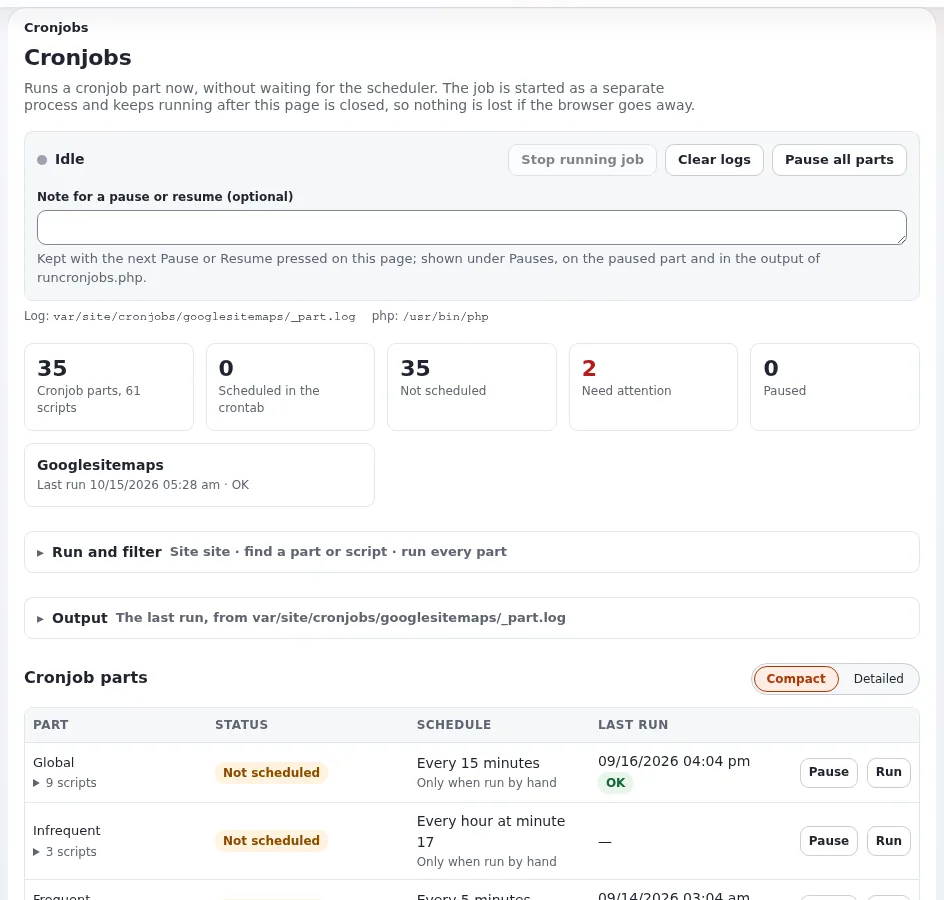

# Lektion 4.3: Die Cronjob-Konsole

Support-Mitarbeitende haben auf dem Server eines Kunden oft keine Shell. Die Seite **Setup**, **Cronjobs** der
Administration zeigt, was die Crontab ausführt, startet Teile, verfolgt ihre Ausgabe und hält sie während eines
Wartungsfensters an. Diese Lektion vermittelt die Seite, was sie vom PHP der Hosting-Plattform braucht und wie man
entscheidet, wer sie verwenden darf.

## Auf einen Blick

| | |
|---|---|
| Kurs | [Hosting und Betrieb](../README.md) |
| Modul | [Modul 4: Bereitstellung und Cron](README.md) |
| Dauer | 40 Minuten (15 Präsentation, 25 Übung) |
| Niveau | Fortgeschrittene |
| Zielgruppe | Support-Mitarbeitende im Hosting und Website-Administratoren |
| Voraussetzungen | [Lektion 4.2](cron-auf-dem-server.md); ein Administratorkonto auf der Schulungsinstallation der Person |

## Lernziele

Nach dieser Lektion können die Teilnehmenden:

- die Abschnitte der Seite lesen und erkennen, ob ein Teil geplant, angehalten oder nicht aktiviert ist;
- einen Teil für eine gewählte Website starten und seine Ausgabe verfolgen;
- einen Teil mit einer Notiz anhalten und fortsetzen und erklären, wen ein Anhalten betrifft;
- nennen, was die Seite von der Plattform braucht (ein PHP-Programm für die Kommandozeile, `proc_open`, `exec`,
  `posix_kill`);
- erklären, warum einige Teile gesperrt sind und wer die Richtlinie `setup/managecronjobs` bekommen sollte.

## Hinweise für Trainer

### So präsentieren Sie es

Quelle: [Die Cronjob-Konsole](../../../hosting/betrieb/die-cronjob-konsole.md),
[Cronjob-Konsole](../../../../../eng-us/features/6.0/cronjobs-console.md) und
[Cronjob-Teile anhalten](../../../../../eng-us/features/6.0/cronjob-pause.md).

1. **Ein Rundgang** (5 Minuten). Im Design admin4 hat die Seite **Cronjobs** die Abschnitte **Übersicht**, **Jetzt**,
   **Starten und filtern**, **Cronjob-Teile**, **Verfügbar, aber nicht aktiviert**, **Letzte Läufe**, **Pausen**,
   **Crontab** und **Ausgabe**. Der Abschnitt **Crontab** zeigt, was die Crontab enthält, und schlägt Zeilen für Teile
   vor, die nichts ausführt.
2. **Starten** (3 Minuten). **Starten** startet einen Teil oder ein Skript für die Website, die in der Website-Liste
   daneben gewählt ist; **Ausgabe** verfolgt ihn live; **Laufenden Job anhalten** sendet `SIGTERM`, damit das Skript
   seine Sperre freigeben kann. Es läuft jeweils nur ein von der Seite gestarteter Job.
3. **Anhalten** (4 Minuten). Ein angehaltener Teil wird von `runcronjobs.php` ausgelassen, egal wer es startet: die
   Crontab, die Konsolenbefehle oder die Seite. Der Hinweis nennt, seit wann, von wem und warum. Übersprungene Läufe
   werden in `cronjob_skipped.log` protokolliert. Auf mehreren Servern müssen die Pausendateien auf gemeinsam genutztem
   Speicher liegen.
4. **Plattform und Berechtigungen** (3 Minuten). Die Seite braucht ein PHP-CLI-Programm (`[AdminSettings] PhpCliPath`
   auf Rechnern mit mehreren PHP-Versionen), `proc_open`, `exec` und `posix_kill`, und sagt, was fehlt, statt
   fehlzuschlagen. `cluster_maintenance` und `unlock` stehen in `ForbiddenParts[]`. Die Richtlinie
   `setup/managecronjobs` gehört in einer neuen Installation zur Rolle Administrator; entscheiden Sie pro Tarif, wer sie
   sonst noch bekommt.

### Häufige Fragen

**Ein Teil wird als nicht geplant angezeigt, obwohl er läuft.** Die Seite liest die Crontab des Benutzers, unter dem der
Webserver läuft; eine Crontab unter root oder einem Bereitstellungsbenutzer wird nicht angezeigt. Verschieben Sie die
Crontab zum Benutzer der Website.

**Hält der Wartungsmodus Cron an?** Nein. Halten Sie die Teile an, die während des Fensters nicht laufen dürfen.

**Laufenden Job anhalten schlägt mit „could not be signalled“ fehl.** Der Job läuft unter einem anderen Systembenutzer
als der Webserver, der geantwortet hat, zum Beispiel Velocity-Worker und PHP-FPM als verschiedene Benutzer. Stoppen Sie
ihn aus einer Shell.

**Beachten Warteschlangen-Worker ein Anhalten?** Warteschlangen-Worker, die als systemd-Dienst laufen, sind keine
Cronjobs und arbeiten weiter.

### Stolperfallen

- **Aufwendige Teile auf einem gemeinsam genutzten Schulungsserver ausführen.** Jede Person führt Teile nur auf ihrer
  eigenen Installation aus.
- **Das Fortsetzen vergessen.** Beenden Sie die Übung mit jedem Teil fortgesetzt und prüfen Sie den Abschnitt
  **Pausen**.
- **Beschriftungen unterscheiden sich je nach Design.** Diese Lektion beschreibt das Design admin4; prüfen Sie in
  anderen Designs zuerst die Beschriftungen.

## Praktische Übung

Verwenden Sie Ihre eigene Schulungsinstallation, als Administrator in ihrer Administration angemeldet.

1. Öffnen Sie **Setup**, dann **Cronjobs**.
2. Suchen Sie in **Übersicht** und **Cronjob-Teile** die Teile **Frequent** und **Global** und notieren Sie, ob jeder
   geplant ist und wann er zuletzt lief.
3. Öffnen Sie den Abschnitt **Crontab** und vergleichen Sie ihn mit der Crontab, die Sie in Lektion 4.2 installiert
   haben.
4. Wählen Sie unter **Starten und filtern** Ihre öffentliche Website in der Website-Liste und klicken Sie für den Teil
   **Frequent** auf **Starten**.
5. Verfolgen Sie den Job in **Ausgabe**, bis er endet, und suchen Sie ihn dann in **Letzte Läufe** mit Ergebnis und
   Dauer.
6. Klicken Sie für **Frequent** auf **Anhalten** und schreiben Sie eine Notiz wie `Training: pause test` in
   **Notiz zum Anhalten oder Fortsetzen (optional)**.
7. Führen Sie in einem Terminal `php runcronjobs.php -s <siteaccess> frequent` aus und lesen Sie den Hinweis, den es
   ausgibt.
8. Suchen Sie den übersprungenen Lauf in `cronjob_skipped.log` im Log-Verzeichnis (zum Beispiel mit `ls var/log/` und
   `tail` auf die Datei).
9. Setzen Sie auf der Seite **Frequent** fort und prüfen Sie, dass **Pausen** keinen angehaltenen Teil auflistet.
10. Suchen Sie einen Teil, der unter **Verfügbar, aber nicht aktiviert** aufgelistet ist, und lesen Sie, was seine
    Skripte tun.

## Erwartetes Ergebnis

- Schritt 5: Der Lauf erscheint in **Letzte Läufe** mit seinem Ergebnis.
- Schritt 7 gibt einen Hinweis aus, dass der Teil angehalten ist, mit Zeit, Benutzer und Notiz.
- Schritt 8: `cronjob_skipped.log` hat eine Zeile für den übersprungenen Lauf.
- Schritt 9: Kein Teil ist angehalten.
- Der Trainer prüft das, indem er jede Person bittet, den Hinweis aus Schritt 7 laut vorzulesen.

## Quiz

1. Welche Läufe hält ein Anhalten auf der Cronjob-Seite zurück?
   A. nur Läufe, die von der Seite gestartet werden B. nur Läufe aus der Crontab C. jeden Lauf von `runcronjobs.php`,
   egal wer ihn startet D. nur die Warteschlangen-Worker
2. Ein Teil läuft aus der Crontab von root, aber die Seite sagt, er sei nicht geplant. Warum?
3. Welche PHP-Funktionen muss die Plattform erlauben, damit die Seite Jobs starten und stoppen kann?
4. Warum sind `cluster_maintenance` und `unlock` auf der Seite gesperrt?
5. Welche Richtlinie gibt Zugriff auf die Seite?

Antworten

1. **C.** Ein angehaltener Teil wird ausgelassen, egal wer ihn startet ([Cronjob-Teile anhalten](../../../../../eng-us/features/6.0/cronjob-pause.md)).
2. Die Seite liest die Crontab des Benutzers, unter dem der Webserver läuft, nicht die von root.
3. `proc_open` zum Starten, `exec` zum Lesen der Crontab, `posix_kill` zum Stoppen.
4. Beide sind zerstörerisch und gehören in die Hand eines Administrators in einer Shell, nicht hinter eine Schaltfläche
   (`ForbiddenParts[]`).
5. `setup/managecronjobs`.

## Weiterführende Informationen

- [Die Cronjob-Konsole](../../../hosting/betrieb/die-cronjob-konsole.md): Anforderungen an die Plattform und
  Support-Szenarien.
- [Cronjobs: ausführen, planen und verfolgen](../../../../anleitungen/cronjobs.md): die Benutzeranleitung.
- [Cronjob-Teile anhalten](../../../../../eng-us/features/6.0/cronjob-pause.md): wie Pausen gespeichert und geteilt werden.
- [Wartungsmodus](../../../hosting/betrieb/wartungsmodus.md): Wartungsfenster und Cron zusammen.

## Verwandte Seiten

- [Modul 4: Bereitstellung und Cron](README.md)
- [Hosting und Betrieb: Kursüberblick](../README.md)
- [Trainer: hier beginnen](../../../../../eng-us/help/trainers/trainers-start-here.md)
- [Freie Dokumentation](../../../freie-dokumentation.md): Diese Seite darf unter der GNU FDL 1.3 frei kopiert, übersetzt und verbessert werden.

<!-- exp-partner-block:start -->
**Werden Sie Exponential-Partner.** Partner teilen ihre Informationen, stellen Mittel bereit, geben Beiträge zurück
und entwickeln die Produkte mit uns, und so wächst Exponential. Eine Partner-Website und ein Dashboard sind für Mitte
2027 geplant: Werden Sie noch heute Partner, damit wir schneller wachsen und neue Funktionen früher liefern. Beginnen
Sie mit [Partner: hier beginnen](../../../partner/partner-hier-beginnen.md) und
[Wie Sie sich bewerben](../../../partner/wie-sie-sich-bewerben.md).
<!-- exp-partner-block:end -->
