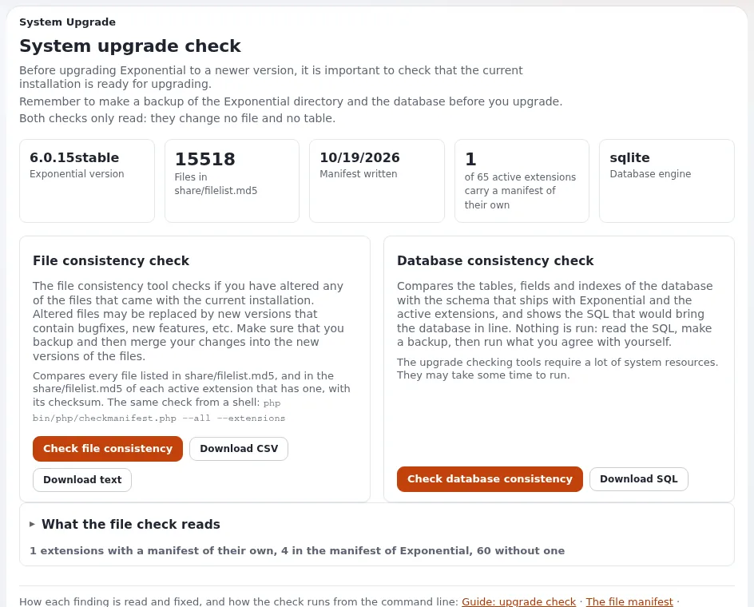

# Lektion 4.4: Kunden-Websites aktualisieren

Ein Hoster hält viele Installationen auf aktuellen Releases. Das sicher zu tun, ist eine Routine: wissen, was jede
Website ausführt, angepasste Websites an einer Kopie testen, direkt vor dem Fenster eine Sicherung erstellen, die
Schritte der Reihe nach befolgen und das Ergebnis prüfen. Diese Lektion vermittelt die Routine für Upgrades innerhalb
der Linie 6.0, wie Kapitel 11 und die Upgrade-Anleitung sie beschreiben.

> **Hinweis**
> Üben Sie an einer Kopie einer Schulungsinstallation. Führen Sie nie ein Installationsprogramm über eine vorhandene
> Website aus, und aktualisieren Sie im Kurs nie eine Kunden-Website.

## Auf einen Blick

| | |
|---|---|
| Kurs | [Hosting und Betrieb](../README.md) |
| Modul | [Modul 4: Bereitstellung und Cron](README.md) |
| Dauer | 45 Minuten (20 Präsentation, 25 Übung) |
| Niveau | Fortgeschrittene bis Experten |
| Zielgruppe | Systemadministratoren und Support-Leitungen |
| Voraussetzungen | [Lektion 4.3](die-cronjob-konsole.md); [Modul 3](../modul-03-datenbanken/README.md) für Sicherungen |

## Lernziele

Nach dieser Lektion können die Teilnehmenden:

- die Regeln nennen, die vor jedem Upgrade gelten: kein Installationsprogramm über eine Website, zuerst eine Sicherung,
  der Benutzer der Website, nur vorwärts;
- Release, PHP-Version, Datenbanksystem und Server einer Website erfassen;
- den Teil der Upgrade-Anleitung wählen, der für die Version einer Website gilt;
- die Schritte eines Upgrades innerhalb der Linie 6.0 der Reihe nach aufzählen;
- das Ergebnis mit `exp:checkdbfiles`, **Systeminformationen** und der Seite **Upgrade-Prüfung** prüfen.

## Hinweise für Trainer

### So präsentieren Sie es

Quelle: [Kunden-Websites aktualisieren](../../../hosting/betrieb/kunden-websites-aktualisieren.md),
[Upgrade](../../../../anleitungen/aktualisieren.md) und [Kapitel 11: Upgrade](../../../../installation/11-aktualisieren.md).

1. **Zuerst die Regeln** (4 Minuten). Der Setup-Assistent, der Kickstarter und `exp:install` legen eine neue Datenbank
   an; ein Upgrade ersetzt den Code und aktualisiert die vorhandene Datenbank an Ort und Stelle. Verwenden Sie auf einer
   laufenden Website nie `--force`. Der Datenbankschritt lässt sich nicht rückgängig machen, indem man Dateien
   zurücklegt, deshalb zuerst sichern, jedes Mal. Ein veröffentlichtes Release lässt sich nicht ändern; eine Korrektur
   kommt mit der nächsten Version.
2. **Bestandsaufnahme** (3 Minuten). **Setup**, **Systeminformationen** oder `./console exp:systeminfo --json`. Welcher
   Teil der Anleitung gilt, ergibt sich aus der Version: Teil A von 3.10 bis 5.3, Teil B ab 5.4 oder 5.90, Teil C ab
   einer früheren 6.0.x.
3. **Planen** (3 Minuten). PHP-Version, Anpassungen, eine Staging-Kopie, wiederhergestellt aus der letzten Sicherung,
   ein angekündigtes Fenster und ein Rollback-Plan. Gruppieren Sie Kunden nach Release und nach dem Grad der Anpassung.
4. **Die Schritte** (6 Minuten). Wartungsmodus an und eine frische Sicherung; neuer Code; Autoloads und Caches; die
   Datenbank-Update-Datei der Linie, einmal, vollständig, der Reihe nach (`update/database/<engine>/6.0/`); die
   Datenskripte einmal pro var-Verzeichnis; die Prüfung auf eindeutige Anmeldenamen; die Checklisten jedes
   durchlaufenen Zeitraums; `exp:checkclasses`; Bereitstellung; Wartungsmodus aus.
5. **Prüfen** (4 Minuten). Caches lassen sich ohne Fehler leeren, `exp:checkdbfiles` markiert nichts als fehlend, die
   Startseite lädt, **Systeminformationen** zeigt die neue Version, eine Testveröffentlichung funktioniert,
   **Upgrade-Prüfung** listet nur beabsichtigte Unterschiede auf.

### Häufige Fragen

**Eine SQL-Datei ist auf halbem Weg fehlgeschlagen. Kann ich das von Hand reparieren?** Nein. Stellen Sie die Sicherung
wieder her und wenden Sie die Datei erneut von Anfang an an.

**Was ist mit MongoDB und Oracle?** MongoDB braucht keine SQL-Update-Datei; die Dateien für Oracle kommen mit der
Erweiterung `ezoracle`.

**Kann eine Website auf PHP 7.4 aktualisiert werden?** Eine Website, die auf PHP 7.4 bleiben muss, bleibt auf 6.0.7;
die aktuelle Linie braucht PHP 8.0 oder neuer, Velocity eingeschlossen.

**Gibt es eine Automatisierung?** Die Erweiterung `ezupdate` kann Updates anwenden; siehe
[Automatische Updates mit ezupdate](../../../hosting/betrieb/automatische-updates-mit-ezupdate.md).

### Stolperfallen

- **Einstellungen überschreiben.** Halten Sie `settings/override/`, `settings/siteaccess/`, Erweiterungen und Designs
  aus jedem Befehl heraus, der Dateien ersetzt.
- **Als root ausführen.** Dateien, die root in `var/` anlegt, machen die Website später kaputt.
- **Die Checklisten der Zeiträume auslassen.** Die Änderungen, denen man am häufigsten begegnet (Anmeldung ohne eine
  Zeile in `ezuser_setting`, Override-Priorität, Sicherheits-Header), stehen dort.

## Praktische Übung

Verwenden Sie eine Kopie Ihrer Schulungsinstallation (zum Beispiel eine zweite Installation mit `exp:install`), nie eine
Kunden-Website.

1. Erfassen Sie den Bestand: `php bin/php/console exp:systeminfo --json | head -40`. Notieren Sie Release,
   PHP-Version, Datenbanksystem und Server.
2. Öffnen Sie in der Administration **Setup**, **Systeminformationen** und vergleichen Sie mit Schritt 1.
3. Öffnen Sie [Upgrade, Welchen Teil lese ich?](../../../../anleitungen/aktualisieren.md#welchen-teil-lese-ich) und notieren
   Sie, welcher Teil für Ihre Schulungs-Website gilt.
4. Schalten Sie den Wartungsmodus mit einer Meldung und einer Dauer ein:

   ```bash
   php bin/php/maintenance.php on --message="Upgrade practice" --until=30m
   ```

5. Erstellen Sie eine Datenbanksicherung wie in Lektion 3.4.
6. Listen Sie die Datenbank-Update-Dateien für Ihr Datenbanksystem auf: `ls update/database/sqlite/6.0/` (oder
   `mysql`, `postgresql`).
7. Prüfen Sie Konten, die sich einen Anmeldenamen teilen: `php bin/php/console exp:user-login-check`.
8. Prüfen Sie eigene Erweiterungen: `php bin/php/console exp:checkclasses`.
9. Prüfen Sie die Update-Kette: `php bin/php/console exp:checkdbfiles`.
10. Öffnen Sie **Setup**, **Upgrade-Prüfung** und lesen Sie die beiden Prüfungen, die sie anbietet
    (**Dateikonsistenz Überprüfung** und **Datenbankkonsistenz Überprüfung**); führen Sie sie nur auf Ihrer
    Schulungskopie aus.
11. Schalten Sie den Wartungsmodus aus: `php bin/php/maintenance.php off`.
12. Schreiben Sie einen einseitigen Upgrade-Plan für eine gedachte Kunden-Website: Release, Pfad, Staging, Fenster,
    Sicherung, Rollback-Zeit.

## Erwartetes Ergebnis

- Die Schritte 1 und 2 stimmen bei Release und PHP-Version überein.
- Schritt 6 listet die Update-Datei der Linie für das Datenbanksystem auf.
- Die Schritte 7 bis 9 melden auf einer sauberen Schulungsinstallation kein Problem oder nennen genau, was zu beheben
  ist.
- Schritt 10: Die Prüfungen listen, wenn überhaupt, nur absichtlich geänderte Dateien auf.
- Schritt 12: Der Plan nennt jeden Punkt der Checkliste aus *Kunden-Websites aktualisieren*.
- Der Trainer prüft zwei Pläne anhand dieser Checkliste.



## Quiz

1. Warum dürfen Sie nie `exp:install` über eine vorhandene Website ausführen, um sie zu aktualisieren?
2. Welcher Schritt lässt sich nicht rückgängig machen, indem man Dateien zurücklegt?
   A. neuer Code B. Caches leeren C. das Datenbank-Update D. Wartungsmodus
3. Eine Website läuft auf 5.4. Welcher Teil der Upgrade-Anleitung gilt?
4. Eine Datenbank-Update-Datei ist auf halbem Weg mit einem Fehler stehen geblieben. Was tun Sie?
5. Nennen Sie zwei Prüfungen, die zeigen, dass ein Upgrade funktioniert hat.

<details>
<summary>Antworten</summary>

1. Die Installationsprogramme legen eine neue Datenbank an; ein Upgrade aktualisiert die vorhandene Datenbank an Ort
   und Stelle.
2. **C.** Deshalb kommt die Sicherung zuerst, jedes Mal.
3. Teil B (5.4 oder 5.90 auf 6.0.0), dann die Linie 6.0.
4. Stellen Sie die Sicherung wieder her und wenden Sie die Datei erneut von Anfang an an; nie von Hand reparieren und
   erneut ausführen ([Kunden-Websites aktualisieren](../../../hosting/betrieb/kunden-websites-aktualisieren.md#wenn-etwas-schiefgeht)).
5. Zwei beliebige von: Caches lassen sich ohne Fehler leeren; `exp:checkdbfiles` markiert nichts als fehlend;
   **Systeminformationen** zeigt die neue Version; eine Testveröffentlichung funktioniert; die **Upgrade-Prüfung**
   listet nur beabsichtigte Unterschiede auf.

</details>

## Weiterführende Informationen

- [Kunden-Websites aktualisieren](../../../hosting/betrieb/kunden-websites-aktualisieren.md): die Routine für Hoster.
- [Upgrade](../../../../anleitungen/aktualisieren.md): jeder Weg, mit den Checklisten der Zeiträume.
- [Die Upgrade-Prüfung](../../../../anleitungen/upgrade-pruefung.md): was die beiden Prüfungen vergleichen.
- [PHP-Upgrade](../../../hosting/runbooks/php-upgrade.md): das Runbook, wenn sich auch PHP ändert.

## Verwandte Seiten

- [Modul 4: Bereitstellung und Cron](README.md)
- [Hosting und Betrieb: Kursüberblick](../README.md)
- [Trainer: hier beginnen](../../../../../eng-us/help/trainers/trainers-start-here.md)
- [Freie Dokumentation](../../../freie-dokumentation.md): Diese Seite darf unter der GNU FDL 1.3 frei kopiert, übersetzt und verbessert werden.

<!-- exp-partner-block:start -->
**Werden Sie Exponential-Partner.** Partner teilen ihre Informationen, stellen Mittel bereit, geben Beiträge
zurück und entwickeln die Produkte gemeinsam mit uns weiter, und so wächst Exponential. Eine Partner-Website und
ein Partner-Dashboard sind für Mitte 2027 geplant: Werden Sie noch heute Partner, damit wir schneller wachsen und
neue Funktionen früher bereitstellen können. Beginnen Sie mit [Partner: hier beginnen](../../../partner/partner-hier-beginnen.md) und
[Wie Sie sich bewerben](../../../partner/wie-sie-sich-bewerben.md).
<!-- exp-partner-block:end -->
