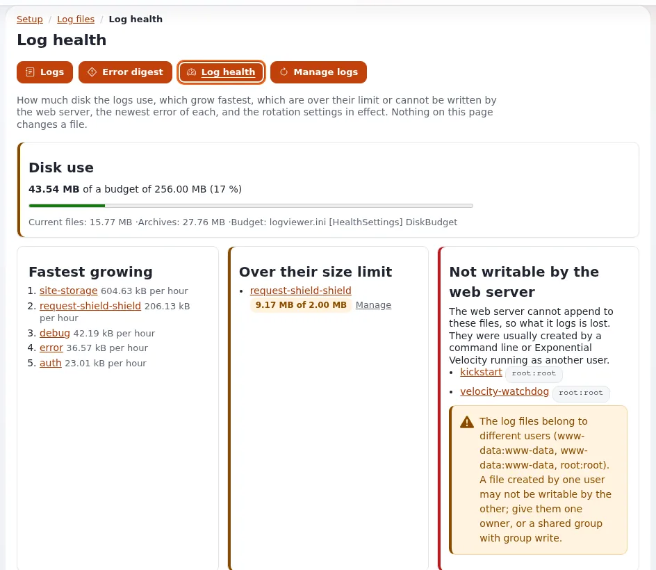

# Lektion 5.2: Der Log-Viewer und die Log-Rotation

Logs beantworten die meisten Support-Fragen, wenn Mitarbeitende sie schnell und sicher lesen können. Diese Lektion
vermittelt den Log-Viewer in der Administration und sein Gegenstück auf der Kommandozeile, die Fehlerreferenz, die von
einer Fehlerseite zu ihren Logzeilen führt, die Maskierung, die personenbezogene Daten schützt, und die Rotation, die
verhindert, dass Logs eine Festplatte füllen.

## Auf einen Blick

| | |
|---|---|
| Kurs | [Hosting und Betrieb](../README.md) |
| Modul | [Modul 5: Monitoring und Logs](README.md) |
| Dauer | 45 Minuten (20 Präsentation, 25 Übung) |
| Niveau | Fortgeschrittene |
| Zielgruppe | Support-Mitarbeitende im Hosting und Systemadministratoren |
| Voraussetzungen | [Lektion 5.1](monitoring-und-zustandspruefungen.md); ein Administratorkonto auf der Schulungsinstallation der Person |

## Lernziele

Nach dieser Lektion können die Teilnehmenden:

- ein Log unter **Setup**, **Logdateien** öffnen, verfolgen und durchsuchen und einen Permalink für ein Ticket kopieren;
- die Zeilen einer Anfrage anhand einer Fehlerreferenz wie `ERR-...` finden, im Browser und mit `exp:logs`;
- **Zustand der Logs** und die **Fehlerübersicht** lesen;
- erklären, was standardmäßig maskiert wird und welche Richtlinien das Lesen, Verwalten und Demaskieren von Logs
  erlauben;
- erklären, wie der Kernel Logs rotiert, komprimiert und aufräumt und wann stattdessen logrotate des Systems verwendet
  wird.

## Hinweise für Trainer

### So präsentieren Sie es

Quelle: [Log-Viewer und Rotation](../../../hosting/betrieb/log-viewer-und-log-rotation.md),
[Der Log-Viewer](../../../../../eng-us/features/6.0/log-viewer.md) und
[Log-Rotation und Aufräumen](../../../../../eng-us/features/6.0/log-rotation.md).

1. **Der Viewer** (5 Minuten). **Setup**, **Logdateien** zeigt jedes Log der Installation (`error.log`, `warning.log`,
   `404.log`, `security.log`, Cronjob- und Erweiterungslogs, Rotationen). Im Design admin4 sind die Log-Werkzeuge
   **Logs**, **Fehlerübersicht**, **Zustand der Logs** und **Logs verwalten**; eine Log-Ansicht hat **Verfolgen**,
   **Permalink kopieren**, **Unmaskiert zeigen** und **Herunterladen (gzip)**. Permalinks tragen keinen Query-String
   und sind in einem Ticket sicher.
2. **Datenschutz** (3 Minuten). E-Mail-Adressen, IP-Adressen, Passwörter, Tokens, Schlüssel, Sitzungs-IDs und Cookies
   werden maskiert; die Werte geheimer Einstellungen werden nie gezeigt. Richtlinien: `setup/logs`, `setup/managelogs`,
   `setup/unmasklogs`. Der Viewer ist standardmäßig nur lesend; jede Ansicht und Aktion wird im Audit protokolliert.
3. **Eine Anfrage** (4 Minuten). Eine Fehlerseite zeigt eine Referenz `ERR-...`; dieselbe Referenz steht in
   `error.log`. Suchen Sie danach und lesen Sie **Same request**. Nicht gefunden? Sie ist weggerotiert, oder ein anderer
   Knoten hat die Anfrage beantwortet.
4. **Rotation** (5 Minuten). Wenn ein Log über `[FileSettings] LogFileMaxSize` (2 MB) hinauswächst, rotiert der nächste
   Schreibvorgang es; `LogFileRotateCount` (3) Archive werden behalten. Die Rotation ist mit zwei Schreibern sicher
   (Velocity als root und PHP-FPM als Benutzer der Website): Sie sperrt, prüft die Größe erneut und behält Eigentümer,
   Gruppe und Modus. `exp:logs --prune` entfernt Archive über die Grenzen hinaus.
5. **Die Shell** (3 Minuten). `./console exp:logs --list`, `--tail`, `--follow`, `--search`, `--reference` verwenden
   dieselben Einstellungen und dieselbe Maskierung.

### Häufige Fragen

**Darf ein Administrator des Kunden Logs lesen?** Geben Sie `setup/logs` einer seiner Rollen; behalten Sie
`setup/unmasklogs` und `setup/managelogs` beim Support. Jede Installation zeigt nur ihre eigenen Dateien.

**Kann ich hier die Logs von Apache sehen?** Ja, wenn Sie sie in `logviewer.ini [LogViewerSettings]` angeben; sie sind
standardmäßig aus, werden nie erraten und von Exponential nie rotiert.

**Wovor warnt Zustand der Logs?** Vor dem von Logs belegten Speicherplatz im Verhältnis zu `[HealthSettings]
DiskBudget` (256 MB, eine Warnung ab 80 %), den am schnellsten wachsenden Logs, Dateien, die der Webserver nicht
schreiben kann, und gemischten Eigentümern, die die Rotation stoppen.

**Wo liegen die Logs von Velocity?** Unter `var/vc/qbix/log/`, vom Server selbst nach Datum rotiert.

### Stolperfallen

- **Demaskieren am Beamer.** Klicken Sie im Kurs nie auf **Unmaskiert zeigen**; die maskierte Ausgabe ist der Sinn der
  Sache.
- **Logs auf einer gemeinsam genutzten Website rotieren oder leeren.** Diese Aktionen werden deaktiviert ausgeliefert;
  lassen Sie sie im Kurs so.
- **Auf dem falschen Knoten suchen.** Jeder Server hat sein eigenes `var/log`.

## Praktische Übung

Verwenden Sie Ihre eigene Schulungsinstallation, als Administrator in ihrer Administration angemeldet, und eine Shell
als Benutzer der Website.

1. Öffnen Sie **Setup**, dann **Logdateien**. Notieren Sie, welches Log zuerst geöffnet wird und wie groß es ist.
2. Schalten Sie **Verfolgen** ein und öffnen Sie in einem anderen Tab eine Seite der Website, die es nicht gibt (zum
   Beispiel `/this-page-does-not-exist`). Öffnen Sie `404.log` im Viewer und suchen Sie die Zeile.
3. Klicken Sie auf **Permalink kopieren** und fügen Sie die Adresse in eine Textdatei ein; achten Sie darauf, dass sie
   keinen Query-String hat.
4. Öffnen Sie **Fehlerübersicht** und notieren Sie die Gruppen, die sie für die letzten 24 Stunden zeigt.
5. Öffnen Sie **Zustand der Logs** und notieren Sie den belegten Speicherplatz im Verhältnis zum Budget.
6. Listen Sie in der Shell die Logs auf: `php bin/php/console exp:logs --list`.
7. Zeigen Sie die letzten 20 Einträge von `error.log`: `php bin/php/console exp:logs --tail=var/log/error.log --lines=20`.
8. Wenn ein Eintrag eine Referenz trägt (`ERR-...`), schlagen Sie sie nach:
   `php bin/php/console exp:logs --reference=<reference>`.
9. Zeigen Sie die Archive und Grenzen jedes Logs: `php bin/php/console exp:logs --archives`.
10. Sehen Sie sich ein Aufräumen vorab an, ohne etwas zu entfernen: `php bin/php/console exp:logs --prune --dry-run`.
11. Lesen Sie die Einstellungen der Rotation: `php bin/php/console exp:ini get site.ini/FileSettings/LogFileMaxSize`
    und dasselbe für `LogFileRotateCount`.

## Erwartetes Ergebnis

- Schritt 2: Die Anfrage erscheint in `404.log` mit einem Feld `reason=` und einer maskierten Client-Adresse.
- Schritt 3: Der Permalink hat die Form `/setup/logs/view/<log>` ohne Query-String.
- Schritt 5 zeigt einen Prozentsatz des Budgets.
- Schritt 10 listet auf, was entfernt würde, und entfernt nichts.
- Schritt 11 gibt `2097152` und `3` aus, sofern nicht überschrieben.
- Der Trainer prüft das, indem er jede Person nach dem `reason=` ihrer Zeile aus Schritt 2 fragt.

## Quiz

1. Ein Kunde schickt einen Screenshot mit `ERR-0123456789`. Wo beginnen Sie?
2. Welche Richtlinie zeigt E-Mail- und IP-Adressen so, wie sie geschrieben wurden?
   A. `setup/logs` B. `setup/managelogs` C. `setup/unmasklogs` D. `setup/system_info`
3. Warum kann die Rotation kein Log hinterlassen, das einer von zwei Schreibern nicht schreiben kann?
4. Eine Logzeile ist nicht zu finden, obwohl der Kunde den Fehler gesehen hat. Nennen Sie zwei Gründe.
5. Wer rotiert Webserver-Logs, die im Viewer angezeigt werden?

Antworten

1. Suchen Sie die Referenz unter **Setup**, **Logdateien**, oder führen Sie `exp:logs --reference=ERR-0123456789` aus;
   lesen Sie **Same request**.
2. **C.** Nur für diesen Betrachter; die Maskierung ist standardmäßig eingeschaltet.
3. Die Rotation nimmt eine Sperre, prüft die Größe erneut und legt das neue Log mit Eigentümer, Gruppe und Modus des
   alten an ([Log-Viewer und Rotation](../../../hosting/betrieb/log-viewer-und-log-rotation.md#wie-der-kernel-seine-logs-rotiert)).
4. Das Log ist weggerotiert, oder ein anderer Knoten hat die Anfrage beantwortet.
5. Das Programm, das sie schreibt; Exponential rotiert oder räumt sie nie auf.

## Weiterführende Informationen

- [Log-Viewer und Rotation](../../../hosting/betrieb/log-viewer-und-log-rotation.md): die Anleitung für Hoster.
- [Der Log-Viewer](../../../../../eng-us/features/6.0/log-viewer.md): jede Ansicht und Einstellung.
- [Log-Rotation und Aufräumen](../../../../../eng-us/features/6.0/log-rotation.md): Rotation, Komprimierung und Aufräumen.
- [Einen Fehler über seine Referenz finden](../../../../anleitungen/fehler-anhand-der-referenz-finden.md): von der
  Fehlerseite zum Log.

## Verwandte Seiten

- [Modul 5: Monitoring und Logs](README.md)
- [Hosting und Betrieb: Kursüberblick](../README.md)
- [Trainer: hier beginnen](../../../../../eng-us/help/trainers/trainers-start-here.md)
- [Freie Dokumentation](../../../freie-dokumentation.md): Diese Seite darf unter der GNU FDL 1.3 frei kopiert, übersetzt und verbessert werden.

<!-- exp-partner-block:start -->
**Werden Sie Exponential-Partner.** Partner teilen ihre Informationen, stellen Mittel bereit, geben Beiträge zurück
und entwickeln die Produkte mit uns, und so wächst Exponential. Eine Partner-Website und ein Dashboard sind für Mitte
2027 geplant: Werden Sie noch heute Partner, damit wir schneller wachsen und neue Funktionen früher liefern. Beginnen
Sie mit [Partner: hier beginnen](../../../partner/partner-hier-beginnen.md) und
[Wie Sie sich bewerben](../../../partner/wie-sie-sich-bewerben.md).
<!-- exp-partner-block:end -->
