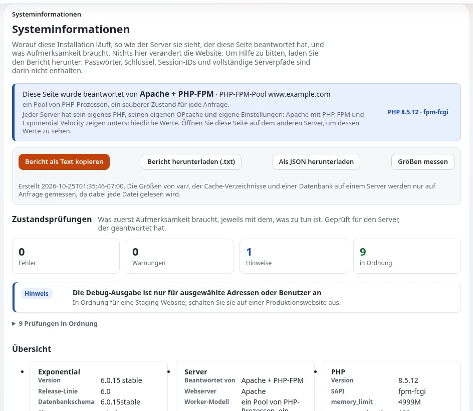

# Lektion 5.1: Monitoring und Zustandsprüfungen

Exponential hat keine einzelne Zustands-URL. Eine gute Monitoring-Einrichtung kombiniert eine Prüfung von außen mit
Statusbefehlen auf dem Server und kennt den Unterschied zwischen einem Ausfall und einem geplanten Wartungsfenster.
Diese Lektion vermittelt Hosting-Mitarbeitenden die vier Schichten des Monitorings und die Befehle und Endpunkte, die
jede davon speisen.

## Auf einen Blick

| | |
|---|---|
| Kurs | [Hosting und Betrieb](../README.md) |
| Modul | [Modul 5: Monitoring und Logs](README.md) |
| Dauer | 45 Minuten (20 Präsentation, 25 Übung) |
| Niveau | Fortgeschrittene |
| Zielgruppe | Systemadministratoren und Support-Mitarbeitende im Hosting |
| Voraussetzungen | [Modul 4](../modul-04-bereitstellung-und-cron/README.md); eine Schulungsinstallation, ausgeliefert von Velocity |

## Lernziele

Nach dieser Lektion können die Teilnehmenden:

- die vier Schichten des Monitorings nennen (Erreichbarkeit, Plattform, Anwendung, Integrität) und ein Werkzeug für
  jede;
- die Statusbefehle ausführen, die mit einem Rückgabewert oder `PASS` enden, und sagen, wie ein gesunder Zustand
  aussieht;
- erklären, warum neben der Startseite auch die Anmeldeseite der Administration geprüft wird;
- `/Q/health` von Velocity lesen und sagen, was es nicht beweist;
- eine Prüfung so einrichten, dass ein Wartungsfenster (`503` mit `Retry-After`) nicht als Ausfall gemeldet wird.

## Hinweise für Trainer

### So präsentieren Sie es

Quelle: [Überblick über das Monitoring](../../../hosting/betrieb/ueberblick-ueber-die-ueberwachung.md) und
[Zustandsprüfungen und Verfügbarkeit](../../../hosting/betrieb/zustandspruefungen-und-verfuegbarkeit.md).

1. **Vier Schichten** (4 Minuten). Erreichbarkeit (eine HTTP-Prüfung von außen, `/Q/health`), Plattform
   (`exp:systeminfo`, Cache-Status, Crontab), Anwendung (Logs, Fehlerübersicht, Status von E-Mail und
   Benachrichtigungen), Integrität (das Audit-Protokoll und `exp:audit verify`).
2. **Prüfungen von außen** (4 Minuten). Die Startseite kann aus einem Cache kommen, während die Datenbank ausgefallen
   ist; die Anmeldeseite der Administration geht durch den Kernel. Ein Wort, das nur die dargestellte Seite enthält, ist
   aussagekräftiger als ein Statuscode. Richten Sie das Monitoring auf die HTTPS-Adresse, die Besucher verwenden.
3. **Statusbefehle** (5 Minuten). `./console exp:systeminfo --json` endet mit 1, wenn eine Zustandsprüfung
   fehlschlägt; `php bin/php/cache.php status --json` endet mit `PASS`; `php bin/php/audit.php verify` endet mit 0, wenn
   jede Kette intakt ist. `exp:systeminfo` meldet das PHP der Kommandozeile; die Seite in der Administration zeigt den
   Server, der geantwortet hat.
4. **Velocity** (3 Minuten). `/Q/health` antwortet jedem mit `{"status":"ok"}` und zeigt Zahlen nur einem
   Administrator; `/Q/metrics` liefert Text für Prometheus. Es beweist, dass der Serverprozess antwortet, nicht dass die
   Website darstellt.
5. **Wartung** (4 Minuten). Der Wartungsmodus antwortet mit `503` und `Retry-After`; die Wartung endet nie von selbst,
   wenn die erwartete Zeit verstreicht. Halten Sie die Prüfung an oder akzeptieren Sie ein 503 mit `Retry-After`,
   solange die Wartung läuft, und alarmieren Sie, wenn das Fenster überschritten wird.

### Häufige Fragen

**Genügt ein Skript auf einem Server?** Für einen einzelnen Server sagen die Quellen, dass ein kleines Skript in der
Crontab des Benutzers der Website genügt, das diese Befehle ausführt und bei einem Rückgabewert ungleich null eine
E-Mail schickt. Bei vielen Servern führen Sie sie aus Ihrem Monitoring-Agenten aus.

**Was sollte ein Load Balancer prüfen?** Die Anmeldeseite der Administration (durch den Kernel, aufwendiger),
`/Q/health` (günstig, nur der Prozess) oder eine statische Datei (am günstigsten, bleibt grün, wenn PHP kaputt ist).
Sorgen Sie dafür, dass ein Knoten im Wartungsmodus herausgenommen wird.

**Alarmiert die Website von selbst?** Die Alarmregeln des Audit-Protokolls laufen im Cron-Teil `frequent`:
Brute-Force-Anmeldungen, eine vergebene Administratorrolle, Einstellungen, die außerhalb der Arbeitszeit geschrieben
wurden, Massenlöschungen.

**Nennt die Dokumentation Verfügbarkeitswerte für einen Tarif?** Nein; das ist eine geschäftliche Entscheidung.

### Stolperfallen

- **Nur die Startseite überwachen.** Sie bleibt aus einem Cache grün, während die Datenbank ausgefallen ist.
- **`/Q/`-Endpunkte zum Internet öffnen.** Lassen Sie `Remote` deaktiviert; verwenden Sie ein Token oder denselben
  Rechner.
- **Teilnehmende ohne Velocity.** Lassen Sie Schritt 6 der Übung aus und verwenden Sie stattdessen die Prüfungen über
  Apache.

## Praktische Übung

Verwenden Sie Ihre eigene Schulungsinstallation, ausgeliefert von Velocity, und eine Shell als Benutzer der Website.

1. Prüfen Sie die Website von außerhalb der Anwendung, mit der Adresse, die `exp:velocity status` zeigt:

   ```bash
   curl -s -o /dev/null -w '%{http_code} %{time_total}\n' http://127.0.0.1:8088/
   curl -s -o /dev/null -w '%{http_code}\n' http://127.0.0.1:8088/admin/user/login
   ```

2. Führen Sie die Zustandsprüfungen der Plattform aus und geben Sie den Rückgabewert aus:
   `php bin/php/console exp:systeminfo --json > var/training-systeminfo.json; echo "exit $?"`.
3. Prüfen Sie die Caches: `php bin/php/cache.php status --json | tail -3`.
4. Prüfen Sie das Audit-Protokoll: `php bin/php/audit.php verify; echo "exit $?"`.
5. Prüfen Sie den Speicherplatz: `df -h .`.
6. Fragen Sie den Zustands-Endpunkt von Velocity an: `curl -s http://127.0.0.1:8088/Q/health`.
7. Schalten Sie den Wartungsmodus mit einer erwarteten Dauer ein:
   `php bin/php/maintenance.php on --message="Monitoring practice" --until=15m`.
8. Wiederholen Sie die erste Anfrage aus Schritt 1 mit Headern: `curl -sI http://127.0.0.1:8088/ | head -5`.
   Notieren Sie den Status und `Retry-After`.
9. Fragen Sie einen Stylesheet-Pfad von der Startseite an und notieren Sie seinen Status.
10. Schalten Sie den Wartungsmodus aus: `php bin/php/maintenance.php off`.
11. Schreiben Sie die vier Zeilen eines Monitoring-Plans für Ihre Website, eine pro Schicht, jede mit einem Befehl oder
    einer URL und einer Beschreibung, wie ein gesunder Zustand aussieht.

## Erwartetes Ergebnis

- Schritt 1: `200` für beide, mit den notierten Zeiten.
- Die Schritte 2 und 4 enden mit `exit 0`; Schritt 3 endet mit `PASS`.
- Schritt 6 gibt `{"status":"ok"}` aus.
- Schritt 8 zeigt `503` mit einem Header `Retry-After`; Schritt 9 antwortet weiterhin mit `200`.
- Der Trainer prüft zwei Pläne aus Schritt 11 auf alle vier Schichten.



## Quiz

1. Warum genügt es nicht, nur die Startseite zu prüfen?
2. Was tut `exp:systeminfo --json`, wenn eine Zustandsprüfung fehlschlägt?
   A. gibt FAIL aus und endet mit 0 B. endet mit 1 C. schickt eine E-Mail D. schaltet den Wartungsmodus ein
3. Was beweist ein `{"status":"ok"}` von `/Q/health`, und was nicht?
4. Wie sieht ein Wartungsfenster für eine HTTP-Prüfung aus?
5. Welche Schicht deckt `php bin/php/audit.php verify` ab?

<details>
<summary>Antworten</summary>

1. Die Startseite kommt oft aus einem Cache und kann antworten, während die Datenbank ausgefallen ist; prüfen Sie auch
   die Anmeldeseite der Administration.
2. **B.** Es endet mit 1, wenn eine Prüfung fehlschlägt ([Überblick über das Monitoring](../../../hosting/betrieb/ueberblick-ueber-die-ueberwachung.md#statusbefehle-für-ein-überwachungssystem)).
3. Dass der Velocity-Serverprozess antwortet; nicht, dass die Website eine Seite darstellt.
4. Ein `503` mit `Retry-After` und `Cache-Control: no-store`; statische Dateien werden weiter ausgeliefert.
5. Integrität: Hat jemand etwas geändert, was er nicht hätte ändern dürfen?

</details>

## Weiterführende Informationen

- [Überblick über das Monitoring](../../../hosting/betrieb/ueberblick-ueber-die-ueberwachung.md): jedes Signal und wer es liest.
- [Zustandsprüfungen und Verfügbarkeit](../../../hosting/betrieb/zustandspruefungen-und-verfuegbarkeit.md): Prüfungen von außen,
  Load Balancer.
- [Systeminformationen](../../../../anleitungen/systeminformationen.md): die Zustandsprüfungen und was zu tun ist.
- [Wartungsmodus](../../../hosting/betrieb/wartungsmodus.md): Wartungsfenster für Hoster.

## Verwandte Seiten

- [Modul 5: Monitoring und Logs](README.md)
- [Hosting und Betrieb: Kursüberblick](../README.md)
- [Trainer: hier beginnen](../../trainer-hier-beginnen.md)
- [Freie Dokumentation](../../../freie-dokumentation.md): Diese Seite darf unter der GNU FDL 1.3 frei kopiert, übersetzt und verbessert werden.

<!-- exp-partner-block:start -->
**Werden Sie Exponential-Partner.** Partner teilen ihre Informationen, stellen Mittel bereit, geben Beiträge zurück
und entwickeln die Produkte mit uns, und so wächst Exponential. Eine Partner-Website und ein Dashboard sind für Mitte
2027 geplant: Werden Sie noch heute Partner, damit wir schneller wachsen und neue Funktionen früher liefern. Beginnen
Sie mit [Partner: hier beginnen](../../../partner/partner-hier-beginnen.md) und
[Wie Sie sich bewerben](../../../partner/wie-sie-sich-bewerben.md).
<!-- exp-partner-block:end -->
