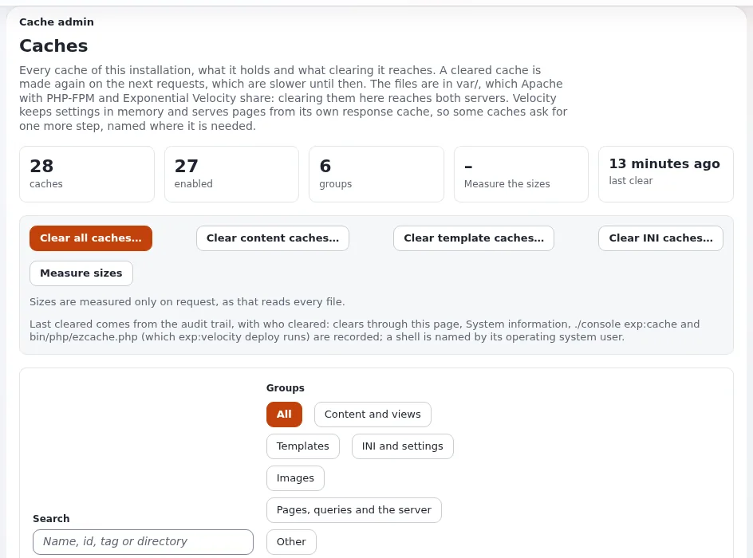

# Lektion 7.2: Cache-Schichten, HTTP-Header, Proxys und CDN

Eine Exponential-Website hat bis zu zwölf Cache-Schichten, vom Browser des Besuchers bis zu OPcache.
Support-Mitarbeitende, die sie kennen, können sagen, woher eine veraltete oder langsame Seite kommt; Hoster, die sie
kennen, entscheiden, was ein Tarif einschaltet, und verhindern, dass ein Proxy oder CDN jemals eine angemeldete Seite an
Fremde ausliefert. Diese Lektion bildet die Schichten und die Regeln ab.

## Auf einen Blick

| | |
|---|---|
| Kurs | [Hosting und Betrieb](../README.md) |
| Modul | [Modul 7: Leistung und Skalierung](README.md) |
| Dauer | 45 Minuten (20 Präsentation, 25 Übung) |
| Niveau | Fortgeschrittene bis Experten |
| Zielgruppe | Systemadministratoren und Support-Mitarbeitende im Hosting |
| Voraussetzungen | [Lektion 7.1](benchmarking.md); [Lektion 2.4](../modul-02-velocity/antwort-cache-und-https.md) |

## Lernziele

Nach dieser Lektion können die Teilnehmenden:

- die Cache-Schichten aufzählen, welche eingeschaltet und welche ausgeschaltet ausgeliefert werden und wie jede geleert
  wird;
- die Standard-Header einer Seite lesen und erklären, warum standardmäßig kein gemeinsam genutzter Cache eine Seite
  behalten darf;
- cachebare Header nur für anonyme Besucher einschalten und erklären, warum `OnlyForAnonymous` erforderlich ist;
- nennen, was ein vorgeschalteter Proxy senden muss und wie ihm vertraut wird;
- die Regeln für ein CDN nennen: statische Dateien am Edge, Seiten nur mit anonymen cachebaren Headern, nie eine
  angemeldete Antwort, und keine Purges, die Exponential sendet.

## Hinweise für Trainer

### So präsentieren Sie es

Quelle: [Cache-Schichten](../../../hosting/leistung/cache-schichten.md),
[HTTP-Cache-Header](../../../hosting/leistung/http-cache-header.md),
[Varnish und Reverse Proxys](../../../hosting/leistung/varnish-und-reverse-proxys.md) und
[CDN](../../../hosting/leistung/cdn.md).

1. **Die Schichten** (6 Minuten). Zeigen Sie die Tabelle aus *Cache-Schichten*: Browser-Cache für statische Dateien und
   für Seiten, CDN oder Proxy, der Antwort-Cache von Velocity, der rollenabhängige HTTP-Cache, der statische Cache, der
   Inhalts-View-Cache, Template-Blöcke, kompilierte Templates und INI, Redis oder Valkey (mit der Erweiterung), der
   SQL-Abfrage-Cache, OPcache und APCu. Zeigen Sie, welche eingeschaltet ausgeliefert werden (View-Cache,
   Template-Blöcke, Antwort-Cache unter Velocity) und welche ausgeschaltet.
2. **Standard-Header** (3 Minuten). Seiten tragen `Cache-Control: no-cache, must-revalidate`; nichts Persönliches kann
   durch einen gemeinsam genutzten Cache gelangen, den Sie nicht eingerichtet haben.
3. **Cachebare anonyme Seiten** (4 Minuten). `[HTTPHeaderSettings] CustomHeader=enabled` mit
   `OnlyForAnonymous=enabled` und einem kurzen `max-age`; ein angemeldeter Redakteur bekommt immer no-cache-Header.
   Bieten Sie es nie ohne `OnlyForAnonymous` an.
4. **Proxys** (4 Minuten). Velocity braucht für TLS keinen Proxy. Ein Proxy muss `X-Forwarded-Proto` und
   `X-Forwarded-For` setzen und den ursprünglichen `Host` weitergeben; ihm muss vertraut werden (`TrustedProxies[]`
   unter PHP-FPM, `Q.webserver.proxy.trusted` unter Velocity). Exponential sendet keine Purge-Anfragen.
5. **CDN** (3 Minuten). Statische Dateien und Inhaltsbilder am Edge (Bildadressen ändern sich, wenn sich das Bild
   ändert); Seiten nur mit anonymen cachebaren Headern; nie eine Antwort auf eine Anfrage mit dem Sitzungs-Cookie.

### Häufige Fragen

**Brauche ich noch Varnish?** Das Installationsbuch: Lassen Sie es entweder weg (der HTTP-Cache oder der Antwort-Cache
von Velocity erledigt dieselbe Aufgabe innerhalb von Exponential), lassen Sie es anonyme Seiten nur kurz
zwischenspeichern, oder führen Sie Purges selbst aus.

**Warum gehen Links hinter dem CDN auf `http://`?** Dem CDN wird nicht vertraut, oder es sendet kein
`X-Forwarded-Proto`.

**Ein Kunde sieht ein altes Stylesheet.** Velocity sendet für statische Dateien eine Lebensdauer von einem Jahr; eine
Datei, die unter demselben Namen ersetzt wird, wird erst nach Ablauf erneut abgerufen. Gepackte Dateien tragen ihre
Änderungszeit im Namen.

### Stolperfallen

- **Cachebare Header einschalten, ohne Velocity neu zu starten.** Velocity hält Einstellungen im Speicher; leeren Sie
  den INI-Cache und starten Sie neu, oder stellen Sie bereit.
- **Ein CDN so einrichten, dass es `private` oder `no-cache` ignoriert.** Niemals; eine am Edge zwischengespeicherte
  angemeldete Seite wird an Fremde ausgeliefert.
- **Die Header-Einstellungen der Übung stehen lassen.** Entfernen Sie das Override am Ende.

## Praktische Übung

Verwenden Sie Ihre eigene Schulungsinstallation, ausgeliefert von Velocity.

1. Lesen Sie die Header der Startseite als anonymer Besucher:
   `curl -sI http://127.0.0.1:8088/ | grep -iE 'cache-control|expires|x-cache|age'`.
2. Lesen Sie die Header eines Stylesheets der Startseite auf dieselbe Weise und vergleichen Sie `Cache-Control`.
3. Melden Sie sich in einem Browser an der Administration an, öffnen Sie die Startseite mit den Entwicklerwerkzeugen
   des Browsers und lesen Sie dort das `Cache-Control` der Seite.
4. Fügen Sie die anonymen cachebaren Header genau wie in
   [Cachebare Seiten für anonyme Besucher](../../../hosting/leistung/http-cache-header.md#zwischenspeicherbare-seiten-für-anonyme-besucher)
   in `settings/override/site.ini.append.php` ein.
5. Leeren Sie den INI-Cache und starten Sie neu: `php bin/php/ezcache.php --clear-tag=ini` und
   `php bin/php/console exp:velocity restart`.
6. Wiederholen Sie Schritt 1 und notieren Sie das neue `Cache-Control`.
7. Wiederholen Sie Schritt 3 angemeldet und prüfen Sie, dass die Seite weiterhin `no-cache` sagt.
8. Entfernen Sie die Zeilen, die Sie in Schritt 4 eingefügt haben, leeren Sie den INI-Cache und starten Sie erneut neu.
9. Schreiben Sie auf Papier die drei Einstellungen, die ein Proxy auf einem anderen Rechner braucht, bevor er vor Ihrer
   Website stehen kann: was er sendet und wo ihm vertraut wird.

## Erwartetes Ergebnis

- Schritt 1: `no-cache, must-revalidate` auf der Seite; Schritt 2: ein langes `max-age` beim Stylesheet.
- Schritt 6: `public, max-age=60` für den anonymen Besucher.
- Schritt 7: Die angemeldete Seite trägt weiterhin no-cache-Header.
- Nach Schritt 8 ist die Seite wieder bei den Standardwerten.
- Schritt 9 nennt `X-Forwarded-Proto`, `X-Forwarded-For`, den ursprünglichen `Host` und die Vertrauensliste für den
  verwendeten Server.
- Der Trainer prüft die Schritte 6 und 7 einer Person nebeneinander.

## Quiz

1. Welche Cache-Schichten werden eingeschaltet ausgeliefert? Nennen Sie zwei.
2. Warum ist `OnlyForAnonymous=enabled` erforderlich, wenn Seiten cachebar gemacht werden?
3. Sendet Exponential Purge-Anfragen an einen Proxy oder ein CDN?
   A. ja, bei jeder Veröffentlichung B. ja, mit dem HTTP-Cache C. nein D. nur für Bilder
4. Links hinter einem Load Balancer gehen auf `http://`. Was ist falsch?
5. Warum können Inhaltsbilder am Edge lange zwischengespeichert werden?

Antworten

1. Zwei beliebige von: der Inhalts-View-Cache, der Template-Block-Cache, kompilierte Templates und INI, der
   Antwort-Cache von Velocity unter Velocity ([Cache-Schichten](../../../hosting/leistung/cache-schichten.md#die-schichten-auf-einen-blick)).
2. Ein angemeldeter Redakteur bekommt dann immer no-cache-Header, sodass eine personalisierte Seite nie einen gemeinsam
   genutzten Cache erreicht.
3. **C.** Einem Proxy muss gesagt werden, was er wie lange speichert, oder Sie führen Purges selbst aus.
4. Dem Proxy wird nicht vertraut, oder er sendet kein `X-Forwarded-Proto`.
5. Exponential ändert die Adresse eines Bildes, wenn das Bild aktualisiert wird.

## Weiterführende Informationen

- [Cache-Schichten](../../../hosting/leistung/cache-schichten.md)
- [HTTP-Cache-Header](../../../hosting/leistung/http-cache-header.md)
- [Varnish und Reverse Proxys](../../../hosting/leistung/varnish-und-reverse-proxys.md)
- [CDN](../../../hosting/leistung/cdn.md)
- [Statischer Cache](../../../hosting/leistung/statischer-cache.md): warum er ausgeschaltet ausgeliefert wird.

## Verwandte Seiten

- [Modul 7: Leistung und Skalierung](README.md)
- [Hosting und Betrieb: Kursüberblick](../README.md)
- [Trainer: hier beginnen](../../../../../eng-us/help/trainers/trainers-start-here.md)
- [Freie Dokumentation](../../../freie-dokumentation.md): Diese Seite darf unter der GNU FDL 1.3 frei kopiert, übersetzt und verbessert werden.

<!-- exp-partner-block:start -->
**Werden Sie Exponential-Partner.** Partner teilen ihre Informationen, stellen Mittel bereit, geben Beiträge zurück
und entwickeln die Produkte mit uns, und so wächst Exponential. Eine Partner-Website und ein Dashboard sind für Mitte
2027 geplant: Werden Sie noch heute Partner, damit wir schneller wachsen und neue Funktionen früher liefern. Beginnen
Sie mit [Partner: hier beginnen](../../../partner/partner-hier-beginnen.md) und
[Wie Sie sich bewerben](../../../partner/wie-sie-sich-bewerben.md).
<!-- exp-partner-block:end -->
