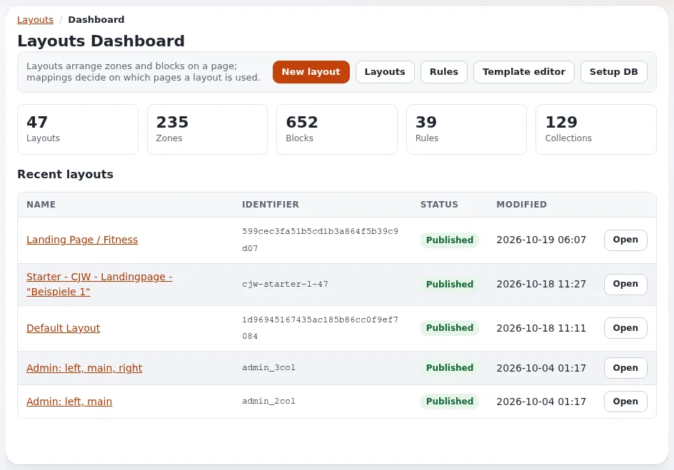

# Lektion 1.2: Sich zurechtfinden: das Dashboard und der Editor

Exponential Layouts hat in der Administration zwei Gesichter: formularbasierte Bildschirme für Listen, Zuordnungen und
Verwaltung und den visuellen Editor, in dem Layouts angeordnet werden. Diese Lektion führt durch beide, ohne etwas zu
ändern.

## Auf einen Blick

| | |
|---|---|
| Kurs | [Exponential Layouts](../README.md) |
| Modul | [Modul 1: Exponential Layouts kennenlernen](README.md) |
| Dauer | 45 Minuten (15 Präsentation, 30 Übung) |
| Niveau | Einsteiger |
| Zielgruppe | Redakteure und Website-Ersteller |
| Voraussetzungen | [Lektion 1.1](die-fuenf-ideen.md); ein Schulungskonto, das Layouts lesen darf |

## Lernziele

Nach dieser Lektion können die Teilnehmenden:

- den Reiter **Layouts** öffnen und das **Layouts-Dashboard** lesen (**Übersicht**, **Neueste Layouts**);
- die Einträge des linken Menüs nennen: **Layout-Zuordnungen**, **Layouts**, **Gemeinsame Layouts**, **Components**,
  **Export**, **Import**, **Template-Editor**;
- ein Layout in der Liste **Layouts** finden, seinen Bezeichner, Typ und die Anzahl seiner Zuordnungen ablesen und
  eine Vorschau davon ansehen;
- sagen, welche Adresse den visuellen Editor öffnet und dass das Öffnen eines Layouts dort einen Entwurf anlegt.

## Hinweise für Trainer

### So präsentieren Sie es

Quellen: [explayouts_ui](../../../../funktionen/6.0/erweiterungen/explayouts_ui.md#sich-zurechtfinden) und
[Der Layout-Editor](../../../layout-editor.md#ein-layout-finden).

1. **Der Reiter** (2 Minuten). **Layouts** im oberen Menü (`/explayouts_ui/dashboard`), angezeigt für Rollen mit der
   Lese-Richtlinie der Layouts-Module. Der Editor-Siteaccess bietet ihn nicht an.
2. **Das Dashboard** (4 Minuten). **Layouts-Dashboard**: *Layouts ordnen Zonen und Blöcke auf einer Seite an;
   Zuordnungen entscheiden, auf welchen Seiten ein Layout verwendet wird.* Die Schaltflächen **Neues Layout**,
   **Layouts**, **Regeln** und für Administratoren **Template-Editor** und **Datenbank einrichten**. **Übersicht**: die
   Anzahl der **Layouts**, **Zonen**, **Blöcke**, **Regeln** und **Collections**. **Neueste Layouts**: **Name**,
   **Bezeichner**, **Status**, **Geändert** und **Öffnen**.
3. **Das linke Menü** (3 Minuten): **Layout-Zuordnungen** (die Regeln), **Layouts**, **Gemeinsame Layouts**,
   **Components** (die Komponentenblöcke und wo sie verwendet werden), **Export**, **Import**, **Template-Editor**.
   Welche Einträge erscheinen, hängt vom Design und von der Rolle ab.
4. **Die Liste Layouts** (3 Minuten). **Sortieren nach** (**Name**, **Beschreibung**, **Zuletzt geändert**,
   **Layout-Typ**, **Zuordnungen**) und **Reihenfolge**; jede Karte zeigt Bezeichner, Typ, Datum und die Anzahl der
   Zuordnungen, mit **Öffnen**, **Vorschau** und **Löschen**.
5. **Der visuelle Editor** (3 Minuten). **Öffnen** führt in den visuellen Editor (`/explayouts_ui_api/app`). Warnen
   Sie: Wer dort ein Layout öffnet, arbeitet an einem **Entwurf**; für Besucher ist nichts sichtbar, bis er
   veröffentlicht wird, aber ein Entwurf entsteht. Verwenden Sie in dieser Lektion nur **Vorschau**.

### Häufige Fragen

**Warum gibt es zwei Oberflächen?** Sie arbeiten mit denselben Daten. Der visuelle Editor ordnet Blöcke an; die
formularbasierten Bildschirme enthalten die Listen, die Zuordnungen und die Verwaltungswerkzeuge.

**Was zeigt die Vorschau?** Das Layout, dargestellt mit einem repräsentativen Inhaltselement, sodass inhaltsgesteuerte
Blöcke echte Inhalte zeigen ([explayouts_ui](../../../../funktionen/6.0/erweiterungen/explayouts_ui.md#ein-layout-in-der-vorschau-ansehen)).

**Warum fehlt der Reiter?** Der Rolle fehlen die Layouts-Richtlinien (Lektion 1.3), oder Sie sind im
Editor-Siteaccess.

### Stolperfallen

- **Löschen neben Vorschau.** In der Liste steht **Löschen** direkt neben **Vorschau** und **Öffnen**. Erst lesen, dann
  klicken.
- **Ein Layout „zum Anschauen“ öffnen.** Das legt einen Entwurf an. Vermitteln Sie **Vorschau** zum Anschauen.
- **Viele Beispiel-Layouts.** Eine Schulungsinstallation mit Beispieldaten kann Dutzende Layouts auflisten; nutzen Sie
  **Sortieren nach** und die Suche des Browsers, um eines zu finden.

## Praktische Übung

Verwenden Sie die Schulungsinstallation und Ihr Layouts-Schulungskonto. In dieser Übung wird nichts geändert.

1. Klicken Sie auf den Reiter **Layouts**. Lesen Sie die **Übersicht** des **Layouts-Dashboards** und notieren Sie die
   Zahlen.
2. Notieren Sie unter **Neueste Layouts** Name, Bezeichner und Status des neuesten Layouts.
3. Klicken Sie im linken Menü auf **Layouts**. Stellen Sie **Sortieren nach** auf **Layout-Typ** und **Reihenfolge**
   auf **Aufsteigend**.
4. Suchen Sie ein Layout vom Typ `layout_2` und notieren Sie die Anzahl seiner Zuordnungen.
5. Klicken Sie bei diesem Layout auf **Vorschau** und sehen Sie sich das Ergebnis an. Gehen Sie zurück.
6. Öffnen Sie im linken Menü **Gemeinsame Layouts**. Notieren Sie das gemeinsame Layout mit den meisten Verweisen.
7. Öffnen Sie **Layout-Zuordnungen** und suchen Sie die Zuordnung, die das Layout aus Schritt 4 verwendet. Lesen Sie
   ihre **Ziele** und **Bedingungen**.
8. Öffnen Sie **Components** und lesen Sie, welche Seiten eine Komponente verwenden.
9. Fahren Sie bei einem Layout mit der Maus über **Öffnen** und lesen Sie die Adresse, zu der es führt (nicht
   klicken).

## Erwartetes Ergebnis

- Die Notizen enthalten die Zahlen des Dashboards, ein `layout_2`-Layout mit seinen Zuordnungen, das am häufigsten
  referenzierte gemeinsame Layout sowie Ziele und Bedingungen einer Zuordnung.
- Die Teilnehmenden haben eine Vorschau gesehen und den visuellen Editor nicht geöffnet.
- Der Trainer prüft das, indem er eine Person bittet, am Beamer die Zuordnung eines genannten Layouts zu finden.

## Quiz

1. Welche Zahlen zeigt die **Übersicht** des **Layouts-Dashboards**?
2. Wo finden Sie die Regeln, die entscheiden, welche Seite welches Layout bekommt?
   A. **Components** B. **Layout-Zuordnungen** C. **Template-Editor** D. **Import**
3. Was geschieht, wenn Sie bei einem Layout auf **Öffnen** klicken?
4. Wie sehen Sie sich ein Layout an, ohne einen Entwurf anzulegen?
5. Richtig oder falsch: Der Editor-Siteaccess bietet den Reiter Layouts an.

Antworten

1. **Layouts**, **Zonen**, **Blöcke**, **Regeln** und **Collections**.
2. **B.** ([explayouts_ui](../../../../funktionen/6.0/erweiterungen/explayouts_ui.md#ein-layout-einer-seite-zuordnen)).
3. Der visuelle Editor öffnet das Layout, und Sie arbeiten an einem Entwurf davon.
4. Mit **Vorschau**.
5. **Falsch.** Seine Layouts-Module antworten dort mit „nicht gefunden“
   ([Das neue Aussehen des Einrichtungsassistenten und der Editor-Siteaccess](../../../../funktionen/6.0/einrichtungsassistent-und-editor-siteaccess.md#die-drei-siteaccesses)).

## Weiterführende Informationen

- [explayouts_ui](../../../../funktionen/6.0/erweiterungen/explayouts_ui.md): jeder Bildschirm des Reiters Layouts.
- [explayouts_ui_api](../../../../funktionen/6.0/erweiterungen/explayouts_ui_api.md): der visuelle Editor und seine API.
- [Der Layout-Editor](../../../layout-editor.md): ein Layout finden.

## Verwandte Seiten

- [Modul 1: Exponential Layouts kennenlernen](README.md)
- [Exponential Layouts: Kursüberblick](../README.md)
- [Trainer: hier beginnen](../../trainer-hier-beginnen.md)
- [Freie Dokumentation](../../../freie-dokumentation.md): Diese Seite darf unter der GNU FDL 1.3 frei kopiert, übersetzt und verbessert werden.

<!-- exp-partner-block:start -->
**Werden Sie Exponential-Partner.** Partner teilen ihre Informationen, stellen Mittel bereit, geben Beiträge zurück
und entwickeln die Produkte mit uns, und so wächst Exponential. Eine Partner-Website und ein Dashboard sind für Mitte
2027 geplant: Werden Sie noch heute Partner, damit wir schneller wachsen und neue Funktionen früher liefern. Beginnen
Sie mit [Partner: hier beginnen](../../../partner/partner-hier-beginnen.md) und
[Wie Sie sich bewerben](../../../partner/wie-sie-sich-bewerben.md).
<!-- exp-partner-block:end -->
