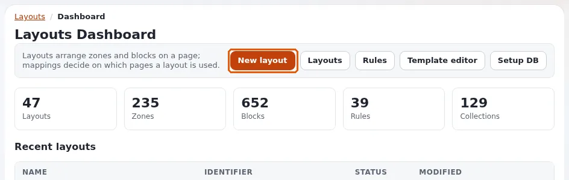

# Lektion 2.2: Ein Layout anlegen

Jetzt bauen die Teilnehmenden. Jede Person legt ein eigenes Layout an, nach sich selbst benannt, und lernt den
visuellen Editor zum ersten Mal kennen. Nichts davon ist für Besucher schon sichtbar: Ein Layout ohne Regel wird
nirgends verwendet.

## Auf einen Blick

| | |
|---|---|
| Kurs | [Exponential Layouts](../README.md) |
| Modul | [Modul 2: Layouts und Layout-Typen](README.md) |
| Dauer | 45 Minuten (15 Präsentation, 30 Übung) |
| Niveau | Einsteiger |
| Zielgruppe | Redakteure und Website-Ersteller |
| Voraussetzungen | [Lektion 2.1](layout-typen-und-zonen.md); eine Rolle mit edit auf den Layouts-Modulen |

## Lernziele

Nach dieser Lektion können die Teilnehmenden:

- mit **Neues Layout** ein Layout anlegen: **Layouttyp**, **Name**, **Bezeichner**, **Beschreibung**, **Layout
  anlegen**;
- einen guten Bezeichner wählen und erklären, warum er als endgültig behandelt werden sollte;
- die Teile des Editors benennen: die obere Leiste, **Block hinzufügen**, die Zonen, den Eigenschaftsbereich;
- den Editor mit **Entwurf speichern und schließen** verlassen, ohne zu veröffentlichen.

## Hinweise für Trainer

### So präsentieren Sie es

Quellen: [Der Layout-Editor](../../../layout-editor.md#ein-layout-anlegen) und
[Exponential Layouts: Eines anlegen](../../../../../eng-us/bc/6.0/LAYOUTS.md#creating-one).

1. **Das Formular** (4 Minuten). **Neues Layout** (auf dem Dashboard oder in der Liste **Layouts**) öffnet ein
   Formular: **Layouttyp** (eine Auswahl pro Typ, von **1 column** bis **Header / Left / Right / Footer**), **Name**,
   **Bezeichner**, **Beschreibung** sowie **Abbrechen** oder **Layout anlegen**. Der formularbasierte Bildschirm
   kennzeichnet den Bezeichner als optional.
2. **Der Bezeichner** (3 Minuten). Der Maschinenname: Kleinbuchstaben, keine Leerzeichen, zum Beispiel
   `training_alex`. Templates und Importe finden ein Layout über ihn; behandeln Sie ihn daher als endgültig, auch wenn
   er bearbeitet werden kann.
3. **Der Editor** (5 Minuten). Nach **Layout anlegen** öffnet sich der Editor mit den leeren Zonen des Typs:
   - oben der Name des Layouts (der Stift benennt es um), **Verwerfen**, **Abbrechen**, **Layout veröffentlichen** und
     das Menü mit drei Punkten (**Veröffentlichen und weiter bearbeiten**, **Entwurf speichern und schließen**);
   - links die Plus-Schaltfläche **Block hinzufügen** und unten **Link zone with shared layout zone** (eine
     Zone mit einer Zone eines gemeinsamen Layouts verknüpfen);
   - in der Mitte die Zonen mit ihren Namen in Großbuchstaben (*HEADER*, *MAIN* ...);
   - rechts der Eigenschaftsbereich: *Wählen Sie einen Block aus, um seine Eigenschaften zu bearbeiten.*
4. **Verlassen** (2 Minuten). **Entwurf speichern und schließen** behält den Entwurf für später; nichts wird
   veröffentlicht. Modul 6 behandelt alle Wege hinaus.

### Häufige Fragen

**Können zwei Layouts denselben Namen haben?** Namen sind Beschriftungen; Bezeichner sollten eindeutig sein. Verwenden
Sie für den Kurs in beiden Ihren Namen.

**Wo ist die Option für gemeinsame Layouts?** Manche Versionen des Anlegeformulars haben ein Kästchen **Gemeinsames
Layout**; gemeinsame Layouts werden in Modul 5 behandelt. Prüfen Sie, ob das Formular Ihrer Installation es zeigt.

**Warum ist mein neues Layout nicht auf der Website?** Noch ordnet keine Regel es einer Seite zu (Modul 7).

### Stolperfallen

- **Leerzeichen und Großbuchstaben in Bezeichnern.** Vereinbaren Sie vor der Übung ein Muster:
  `training_<vorname>`.
- **Den falschen Typ wählen.** Er kann nicht geändert werden; lassen Sie die Teilnehmenden ein falsches Layout löschen
  und neu beginnen.
- **Aus Reflex veröffentlichen.** Verlassen Sie den Editor in dieser Lektion nur mit **Entwurf speichern und
  schließen**.

## Praktische Übung

Verwenden Sie die Schulungsinstallation und Ihr Layouts-Schulungskonto.

1. Öffnen Sie den Reiter **Layouts** und klicken Sie auf **Neues Layout**.
2. Wählen Sie den Layouttyp **Header / Main / Footer**.
3. **Name**: `Training - <Ihr Vorname>`. **Bezeichner**: `training_<Ihr Vorname>` in Kleinbuchstaben.
   **Beschreibung**: `Course layout of <Ihr Vorname>`.
4. Klicken Sie auf **Layout anlegen**. Der Editor öffnet sich.
5. Notieren Sie die Zonennamen, die Sie in der Mitte sehen.
6. Klicken Sie auf den Stift neben dem Namen des Layouts, ändern Sie den Namen in `Training - <Ihr Vorname> - main`
   und bestätigen Sie.
7. Lesen Sie den Text im Eigenschaftsbereich rechts.
8. Öffnen Sie oben das Menü mit drei Punkten und wählen Sie **Entwurf speichern und schließen**.
9. Suchen Sie unter **Layouts** > **Layouts** Ihr Layout und lesen Sie seine Karte: Bezeichner, Typ, Datum und
   *0 Zuordnungen*.

## Erwartetes Ergebnis

- Alle Teilnehmenden haben ein Layout vom Typ `layout_2` mit ihrem Namen und Bezeichner, als Entwurf gespeichert, ohne
  Zuordnungen.
- Der Editor zeigte die Zonen *HEADER*, *POST_HEADER*, *MAIN*, *PRE_FOOTER* und *FOOTER*, und der Eigenschaftsbereich
  meldete *Wählen Sie einen Block aus, um seine Eigenschaften zu bearbeiten.*
- Der Trainer prüft das, indem er die Liste **Layouts** am Beamer nach **Zuletzt geändert** sortiert.

## Quiz

1. Welche vier Felder hat das Formular **Neues Layout**?
2. Warum sollte ein Bezeichner als endgültig behandelt werden?
3. Was meldet der Eigenschaftsbereich, bevor ein Block ausgewählt ist?
4. Welche Auswahl verlässt den Editor und lässt Ihre Arbeit unveröffentlicht?
   A. **Layout veröffentlichen** B. **Entwurf speichern und schließen** C. **Verwerfen** D. **Veröffentlichen und
   weiter bearbeiten**
5. Richtig oder falsch: Ein neues Layout wird auf der Website angezeigt, sobald es angelegt ist.

Antworten

1. **Layouttyp**, **Name**, **Bezeichner** und **Beschreibung**.
2. Templates und Importe finden ein Layout über seinen Bezeichner ([Exponential Layouts](../../../../../eng-us/bc/6.0/LAYOUTS.md#creating-one)).
3. *Wählen Sie einen Block aus, um seine Eigenschaften zu bearbeiten.*
4. **B.**
5. **Falsch.** Es wird nur dort verwendet, wo eine Regel es zuordnet, und erst, wenn es veröffentlicht ist.

## Weiterführende Informationen

- [Der Layout-Editor](../../../layout-editor.md#der-editor): die Teile des Editors.
- [Rundgang durch die Administration: der Layout-Editor](../../../rundgang-durch-die-administration.md#in-der-praxis-der-layout-editor): ein
  Rundgang mit Bildern.

## Verwandte Seiten

- [Modul 2: Layouts und Layout-Typen](README.md)
- [Exponential Layouts: Kursüberblick](../README.md)
- [Trainer: hier beginnen](../../../../../eng-us/help/trainers/trainers-start-here.md)
- [Freie Dokumentation](../../../freie-dokumentation.md): Diese Seite darf unter der GNU FDL 1.3 frei kopiert, übersetzt und verbessert werden.

<!-- exp-partner-block:start -->
**Werden Sie Exponential-Partner.** Partner teilen ihre Informationen, stellen Mittel bereit, geben Beiträge zurück
und entwickeln die Produkte mit uns, und so wächst Exponential. Eine Partner-Website und ein Dashboard sind für Mitte
2027 geplant: Werden Sie noch heute Partner, damit wir schneller wachsen und neue Funktionen früher liefern. Beginnen
Sie mit [Partner: hier beginnen](../../../partner/partner-hier-beginnen.md) und
[Wie Sie sich bewerben](../../../partner/wie-sie-sich-bewerben.md).
<!-- exp-partner-block:end -->
