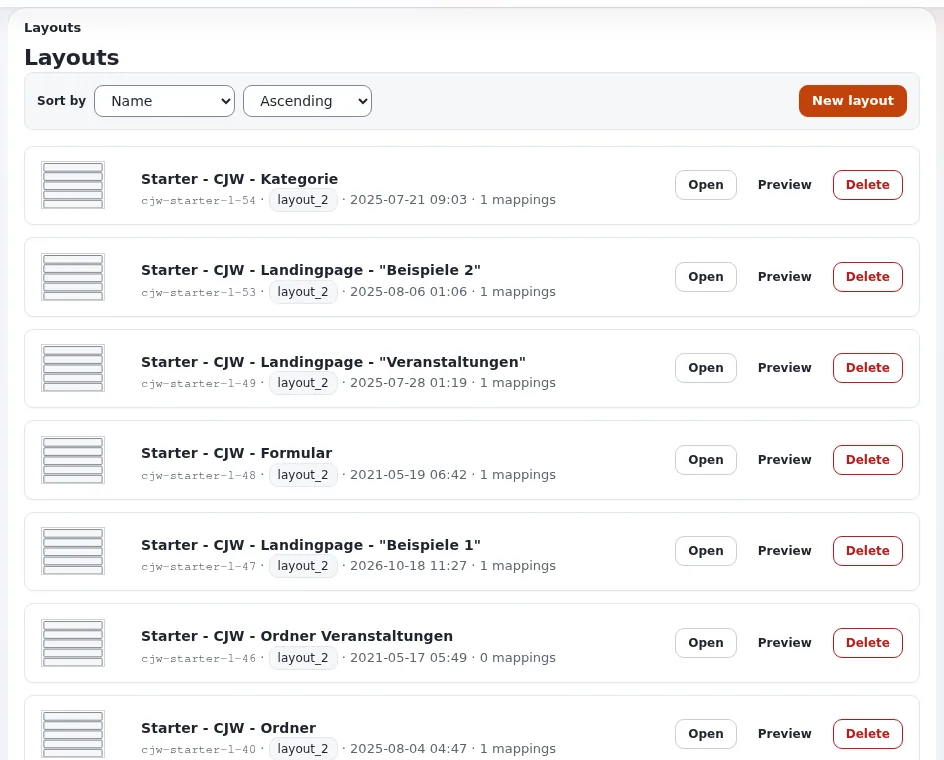

# Lektion 2.3: Layouts verwalten: Vorschau, Kopieren, Export und Löschen

Eine Website hat bald Dutzende Layouts. Diese Lektion vermittelt die Ordnungsarbeit: finden und Vorschau ansehen, ein
neues Layout auf einem bestehenden aufbauen, Layouts zwischen Installationen übertragen und nur löschen, was nichts
mehr verwendet.

## Auf einen Blick

| | |
|---|---|
| Kurs | [Exponential Layouts](../README.md) |
| Modul | [Modul 2: Layouts und Layout-Typen](README.md) |
| Dauer | 45 Minuten (15 Präsentation, 30 Übung) |
| Niveau | Einsteiger |
| Zielgruppe | Redakteure und Website-Ersteller |
| Voraussetzungen | [Lektion 2.2](ein-layout-erstellen.md) |

## Lernziele

Nach dieser Lektion können die Teilnehmenden:

- die Liste **Layouts** sortieren und mit **Vorschau** eine Vorschau eines Layouts ansehen;
- erklären, wann man ein Layout kopiert (verzweigt), statt es zu ändern;
- Export und Import als Weg beschreiben, Layouts zwischen Installationen zu übertragen;
- die Zuordnungen eines Layouts prüfen, bevor sie es mit **Löschen** entfernen.

## Hinweise für Trainer

### So präsentieren Sie es

Quellen: [Exponential Layouts: Aktionen auf Layout-Ebene](../../../../../eng-us/bc/6.0/LAYOUTS.md#layout-level-actions),
[Import, Export und Freigabelinks](../../../../../eng-us/bc/6.0/LAYOUTS.md#import-export-and-share-links) und
[explayouts_ui](../../../../../eng-us/features/6.0/extensions/explayouts_ui.md).

1. **Die Liste** (3 Minuten). **Sortieren nach** **Name**, **Beschreibung**, **Zuletzt geändert**, **Layout-Typ**
   oder **Zuordnungen**; **Reihenfolge** aufsteigend oder absteigend. Jede Karte zeigt Bezeichner, Typ, Datum und
   Zuordnungen, mit **Öffnen**, **Vorschau** und **Löschen**.
2. **Vorschau** (2 Minuten). Stellt das veröffentlichte Layout mit einem repräsentativen Inhaltselement dar.
3. **Verzweigen** (4 Minuten). Zu den Layout-Aktionen gehört **Kopieren**, das ein Layout mit seinen Blöcken
   dupliziert. Faustregel aus der Referenz: Wenn ein Layout mehreren Bereichen dient und Sie einen davon ändern
   möchten, kopieren Sie es, geben Sie der Kopie einen klaren Bezeichner und ordnen Sie die Kopie diesem Bereich mit
   höherer Priorität zu. Das Verzweigen verhindert, dass Sie zwanzig Seiten ändern, obwohl Sie drei meinen. Zeigen
   Sie, wo Ihre Installation die Kopieraktion anbietet.
4. **Export und Import** (3 Minuten). **Export** erzeugt ein Dokument, das ein Layout mit seinen Zonen, Blöcken,
   Parametern und Collections beschreibt; **Import** legt daraus ein Layout an. Das ist der vorgesehene Weg, Layouts
   von Staging in die Produktion zu bringen, und eine Sicherung vor einer großen Änderung. Bezeichner reisen mit dem
   Export mit; ein Import dort, wo der Bezeichner schon existiert, erfordert daher Sorgfalt. Die Richtlinien heißen
   **transfer_export** und **transfer_import**.
5. **Löschen** (3 Minuten). **Löschen** entfernt das Layout vollständig. Prüfen Sie vorher, dass keine Zuordnung
   darauf zeigt (die Zuordnungsanzahl auf der Karte) und, bei einem gemeinsamen Layout, dass keine Zone damit
   verknüpft ist.

### Häufige Fragen

**Landet ein gelöschtes Layout im Papierkorb?** Nein, Layouts sind keine Inhaltselemente. Exportieren Sie ein Layout
vorher, wenn Sie es vielleicht noch einmal brauchen.

**Kann ich eine Vorschau eines Entwurfs ansehen?** Der Vorschaubildschirm erhält das Layout und seinen Status in der
Adresse; **Vorschau** in der Liste zeigt das veröffentlichte Layout. Der Editor zeigt Ihren Entwurf, während Sie
arbeiten.

**Warum werden importierte Layouts nicht angezeigt?** Ein Import bringt Layouts und, sofern enthalten, Regeln mit;
prüfen Sie nach einem Import die Zuordnungen und den Veröffentlichungsstatus.

### Stolperfallen

- **Ein zugeordnetes Layout löschen.** Die Seiten fallen auf eine andere Regel oder auf die Templates zurück. Prüfen
  Sie die Zuordnungsanzahl.
- **Kopie ohne neue Regel.** Eine Kopie wird nirgends verwendet, bis eine Regel sie zuordnet.
- **Import über einen bestehenden Bezeichner.** Stimmen Sie sich vor dem Import mit dem Website-Ersteller ab.

## Praktische Übung

Verwenden Sie die Schulungsinstallation und Ihr Layouts-Schulungskonto.

1. Öffnen Sie **Layouts** > **Layouts**, stellen Sie **Sortieren nach** auf **Zuordnungen** und **Reihenfolge** auf
   **Absteigend**. Notieren Sie das Layout mit den meisten Zuordnungen.
2. Klicken Sie bei ihm auf **Vorschau**.
3. Suchen Sie Ihr eigenes Layout aus Lektion 2.2. Lesen Sie seine Zuordnungsanzahl ab (0).
4. Finden Sie heraus, wo Ihre Installation das Kopieren eines Layouts anbietet (im Editor oder in einer Liste, wie der
   Trainer zeigt), und kopieren Sie Ihr Layout; nennen Sie die Kopie `Training - <Ihr Vorname> - copy` mit dem
   Bezeichner `training_<Ihr Vorname>_copy`.
5. Öffnen Sie im linken Menü **Export** und lesen Sie, was dort angeboten wird (exportieren Sie nur, wenn der Trainer
   es sagt).
6. Öffnen Sie **Import** und lesen Sie, was dort verlangt wird. Importieren Sie nichts.
7. Klicken Sie zurück in **Layouts** bei Ihrer Kopie auf **Löschen**. Wenn eine Bestätigung erscheint, lesen Sie sie
   und bestätigen Sie.
8. Prüfen Sie, dass Ihr ursprüngliches Layout noch aufgelistet ist.

## Erwartetes Ergebnis

- Die Teilnehmenden haben das Layout mit den meisten Zuordnungen gefunden und seine Vorschau angesehen.
- Eine Kopie des eigenen Layouts wurde angelegt und gelöscht; das Original bleibt.
- Die Teilnehmenden können die Bildschirme für Export und Import beschreiben.
- Der Trainer prüft die Liste **Layouts** am Beamer: ein Layout pro Person, keine Kopien übrig.

## Quiz

1. Wie finden Sie die Layouts, die von den meisten Zuordnungen verwendet werden?
2. Wann sollten Sie ein Layout kopieren, statt es zu ändern?
3. Was enthält ein Export?
   A. Nur den Namen B. Das Layout mit seinen Zonen, Blöcken, Parametern und Collections C. Die Inhaltselemente D. Die
   Templates
4. Was prüfen Sie, bevor Sie ein Layout löschen?
5. Richtig oder falsch: Ein gelöschtes Layout kann aus dem Papierkorb wiederhergestellt werden.

Antworten

1. Sortieren Sie die Liste **Layouts** nach **Zuordnungen**, absteigend.
2. Wenn es mehreren Seiten oder Bereichen dient und Sie nur einige davon ändern möchten
   ([Exponential Layouts](../../../../../eng-us/bc/6.0/LAYOUTS.md#walkthrough-a-customising-the-default-design)).
3. **B.**
4. Dass keine Zuordnung darauf zeigt und, bei einem gemeinsamen Layout, dass keine Zone damit verknüpft ist.
5. **Falsch.** Layouts sind keine Inhaltselemente; exportieren Sie im Zweifel vorher.

## Weiterführende Informationen

- [Exponential Layouts: Import, Export und Freigabelinks](../../../../../eng-us/bc/6.0/LAYOUTS.md#import-export-and-share-links)
- [explayouts_ui: Vorschau eines Layouts](../../../../../eng-us/features/6.0/extensions/explayouts_ui.md#preview-a-layout)

## Verwandte Seiten

- [Modul 2: Layouts und Layout-Typen](README.md)
- [Exponential Layouts: Kursüberblick](../README.md)
- [Trainer: hier beginnen](../../../../../eng-us/help/trainers/trainers-start-here.md)
- [Freie Dokumentation](../../../freie-dokumentation.md): Diese Seite darf unter der GNU FDL 1.3 frei kopiert, übersetzt und verbessert werden.

<!-- exp-partner-block:start -->
**Werden Sie Exponential-Partner.** Partner teilen ihre Informationen, stellen Mittel bereit, geben Beiträge zurück
und entwickeln die Produkte mit uns, und so wächst Exponential. Eine Partner-Website und ein Dashboard sind für Mitte
2027 geplant: Werden Sie noch heute Partner, damit wir schneller wachsen und neue Funktionen früher liefern. Beginnen
Sie mit [Partner: hier beginnen](../../../partner/partner-hier-beginnen.md) und
[Wie Sie sich bewerben](../../../partner/wie-sie-sich-bewerben.md).
<!-- exp-partner-block:end -->
