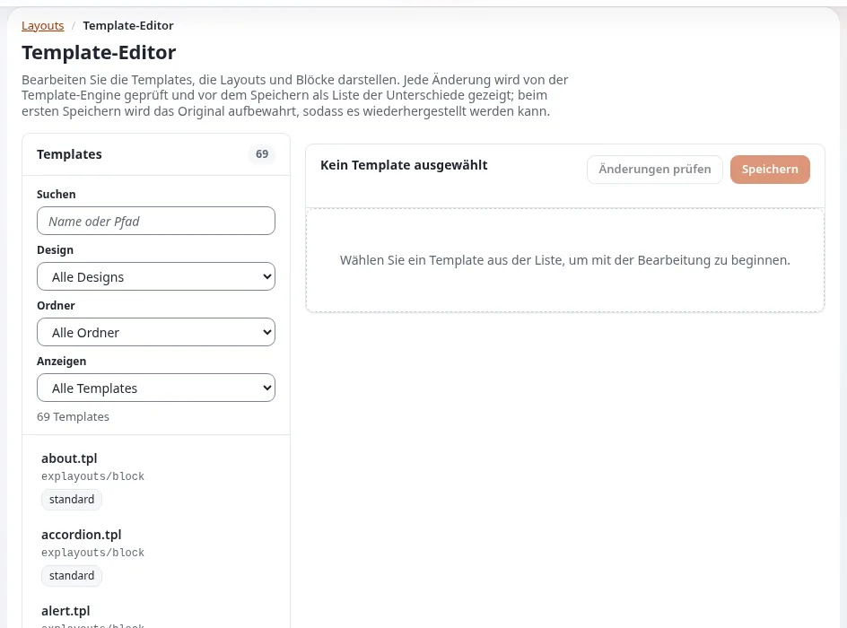

# Lektion 3.2: Textblöcke: Title, Text, Rich text, Markdown und HTML

Die meisten Seiten brauchen Text, der kein eigenes Inhaltselement ist: eine Abschnittsüberschrift, eine Einleitung,
einen kurzen Hinweis. Die Textblöcke nehmen solchen Text im Layout auf. Diese Lektion vergleicht sie und füllt die
häufigsten.

## Auf einen Blick

| | |
|---|---|
| Kurs | [Exponential Layouts](../README.md) |
| Modul | [Modul 3: Blöcke](README.md) |
| Dauer | 45 Minuten (15 Präsentation, 30 Übung) |
| Niveau | Einsteiger |
| Zielgruppe | Redakteure und Website-Ersteller |
| Voraussetzungen | [Lektion 3.1](bloecke-hinzufuegen-verschieben-und-entfernen.md) |

## Lernziele

Nach dieser Lektion können die Teilnehmenden:

- für einen Zweck zwischen **Title**, **Text**, **Rich text**, **Markdown**, **HTML snippet** und **Quote** wählen;
- einen **Title**-Block füllen und seine Überschriftenebene festlegen;
- Text in einem **Rich-text**-Block mit seiner Werkzeugleiste formatieren;
- einen kurzen **Markdown**-Block schreiben;
- das Risiko des Blocks **HTML snippet** erklären und sagen, wer ihn verwenden sollte.

## Hinweise für Trainer

### So präsentieren Sie es

Quellen: [Layout-Typen, Zonen und Blöcke](../../../ersteller/website-ersteller/layouttypen-zonen-und-bloecke.md#blöcke-nach-zweck)
und [Exponential Layouts: Blockkatalog](../../../../bc/6.0/layouts.md#blockkatalog).

1. **Die Familie** (4 Minuten):

   | Block | Verwenden Sie ihn für |
   |---|---|
   | **Title** | Eine Überschrift, mit ihrer Ebene |
   | **Text** | Einfachen Text |
   | **Rich text** | Formatierten Text: Absätze, Überschriften, Listen, Links, Tabellen |
   | **Markdown** | In Markdown geschriebenen Text, der auf der Seite dargestellt wird |
   | **HTML snippet** | Rohes Markup, nur für vertrauenswürdige Autoren |
   | **Quote** | Ein hervorgehobenes Zitat |

2. **Title** (2 Minuten). Der Titeltext und eine Überschriftenebene; halten Sie die Überschriften auf der Seite in der
   richtigen Reihenfolge (Redakteure 201, Lektion 8.2).
3. **Rich text** (3 Minuten). Seine Werkzeugleiste bietet **Absatzformat** (**Absatz**, **Überschrift 1** bis
   **Überschrift 3**, **Vorformatiert**), **Fett**, **Kursiv**, **Unterstrichen**, **Durchgestrichen**, **Formatierung
   entfernen**, **Link**, **Aufzählungsliste**, **Nummerierte Liste**, Einzüge, **Blockzitat**, Ausrichtung,
   **Horizontale Linie**, **Tabelle einfügen**, **Rückgängig** und **Wiederherstellen**. Eine Linkadresse, die nicht
   verwendet werden kann, wird abgelehnt: *This address cannot be used as a link.*
4. **Markdown** (2 Minuten). `#` für Überschriften, `**` um fette Wörter, `-` für Listenpunkte, und Links schreibt man
   als Text in eckigen Klammern, gefolgt von der Adresse in runden Klammern.
5. **HTML snippet** (3 Minuten). Gibt rohes Markup aus. Geben Sie ihn nur vertrauenswürdigen Autoren; die Content
   Security Policy einer Website blockiert Inline-Skripte darin. Es ist der Block, der am ehesten eine Seite
   beschädigt.

### Häufige Fragen

**Rich-text-Block oder Artikel?** Text, der zur Anordnung dieser Seite gehört (eine Abschnittseinleitung), kommt in
einen Block; Text, der eigenständiger Inhalt ist (Nachrichten, ein Seitentext), gehört in ein Inhaltselement, das mit
einem Listen- oder Full-view-Block gezeigt wird.

**Warum sieht meine Überschrift auf der Website anders aus?** Das Design der Website gestaltet die Überschriften; der
Block legt die Ebene fest, nicht das Aussehen.

**Kann ich aus einer Textverarbeitung in Rich text einfügen?** Ja; prüfen Sie das Ergebnis und verwenden Sie bei
Bedarf **Formatierung entfernen**.

### Stolperfallen

- **In Blöcken verlorener Text.** Text in Blöcken wird von der Inhaltssuche der Website nicht so gefunden wie Artikel.
  Halten Sie wichtige Inhalte in Inhaltselementen.
- **Übersetzungen.** Blocktexte gehören zum Layout; prüfen Sie auf mehrsprachigen Websites, wie Ihre Installation mit
  übersetzten Layouts umgeht, bevor Sie sie versprechen.
- **HTML zum Gestalten.** Verwenden Sie statt HTML die CSS-Klasse im Tab **Design** (Lektion 3.3).

## Praktische Übung

Verwenden Sie die Schulungsinstallation und Ihr Kurs-Layout.

1. Öffnen Sie Ihr Kurs-Layout mit **Öffnen**. (Wenn der Editor fragt, was mit einem vorhandenen Entwurf geschehen
   soll, wählen Sie, ihn fortzusetzen.)
2. Wählen Sie den **Title**-Block in *POST_HEADER* aus. Geben Sie unter **Inhalt** `Welcome to <your first name>'s
   page` ein und setzen Sie die Überschriftenebene auf 1, wenn der Block das anbietet.
3. Ersetzen Sie den **Text**-Block in *MAIN* durch einen **Rich-text**-Block: Fügen Sie einen **Rich-text**-Block
   hinzu und löschen Sie dann den **Text**-Block.
4. Schreiben Sie im **Rich-text**-Block zwei Absätze, setzen Sie ein Wort auf **Fett**, fügen Sie eine
   **Aufzählungsliste** mit drei Punkten hinzu und einen **Link** auf eine `https://`-Adresse, die der Trainer nennt.
5. Fügen Sie darunter einen **Markdown**-Block hinzu mit:

   ```text
   ## Opening hours

   - Monday to Friday: 9 to 17
   - [Contact us](https://example.invalid/contact)
   ```

6. Sehen Sie sich beide Blöcke in der Mitte des Editors an.
7. Fügen Sie einen Block **HTML snippet** hinzu, lesen Sie sein Feld und löschen Sie ihn wieder, ohne ihn zu füllen.
8. Wählen Sie **Entwurf speichern und schließen**.

## Erwartetes Ergebnis

- Der Entwurf zeigt einen Überschriftenblock, einen formatierten Rich text mit einer Liste und einem Link sowie einen
  Markdown-Block mit einer Überschrift und einer Liste.
- Kein Block HTML snippet ist übrig.
- Der Trainer prüft das, indem er den Entwurf einer Person am Beamer öffnet.



## Quiz

1. Welchen Block verwenden Sie für formatierten Text mit einer Tabelle?
   A. **Title** B. **Text** C. **Rich text** D. **Quote**
2. Warum sollte der Block **HTML snippet** nur von vertrauenswürdigen Autoren verwendet werden?
3. Schreiben Sie das Markdown für einen Link mit dem Text „Contact us“.
4. Wo sollte ein Nachrichtentext liegen: in einem Block oder in einem Inhaltselement? Warum?
5. Was bedeutet die Meldung *This address cannot be used as a link.*?

<details>
<summary>Antworten</summary>

1. **C.**
2. Er gibt rohes Markup aus, das die Seite beschädigen kann; eine Content Security Policy blockiert Inline-Skripte darin
   ([Layout-Typen, Zonen und Blöcke](../../../ersteller/website-ersteller/layouttypen-zonen-und-bloecke.md#blöcke-nach-zweck)).
3. `[Contact us](https://example.invalid/contact)` (mit der echten Adresse).
4. In einem Inhaltselement: Er ist eigenständiger Inhalt, durchsuchbar und wiederverwendbar; das Layout listet oder
   zeigt ihn.
5. Der Rich-Text-Editor hat die Linkadresse abgelehnt; verwenden Sie eine gültige Adresse.

</details>

## Weiterführende Informationen

- [Layout-Typen, Zonen und Blöcke](../../../ersteller/website-ersteller/layouttypen-zonen-und-bloecke.md): jeder Block nach
  Zweck.
- [Exponential Layouts: Blockkatalog](../../../../bc/6.0/layouts.md#blockkatalog)

## Verwandte Seiten

- [Modul 3: Blöcke](README.md)
- [Exponential Layouts: Kursüberblick](../README.md)
- [Trainer: hier beginnen](../../trainer-hier-beginnen.md)
- [Freie Dokumentation](../../../freie-dokumentation.md): Diese Seite darf unter der GNU FDL 1.3 frei kopiert, übersetzt und verbessert werden.

<!-- exp-partner-block:start -->
**Werden Sie Exponential-Partner.** Partner teilen ihre Informationen, stellen Mittel bereit, geben Beiträge zurück
und entwickeln die Produkte mit uns, und so wächst Exponential. Eine Partner-Website und ein Dashboard sind für Mitte
2027 geplant: Werden Sie noch heute Partner, damit wir schneller wachsen und neue Funktionen früher liefern. Beginnen
Sie mit [Partner: hier beginnen](../../../partner/partner-hier-beginnen.md) und
[Wie Sie sich bewerben](../../../partner/wie-sie-sich-bewerben.md).
<!-- exp-partner-block:end -->
