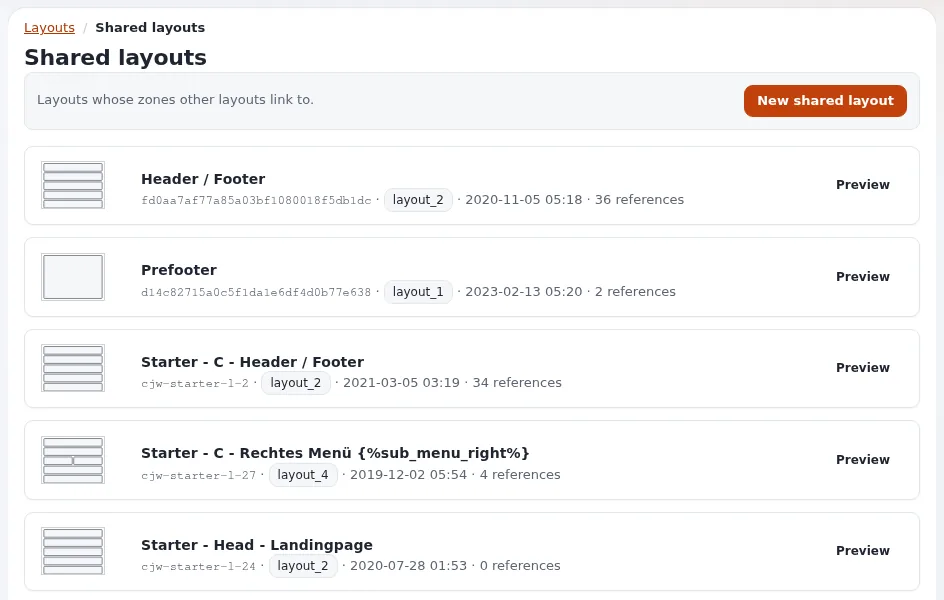

# Lektion 5.1: Was gemeinsame Layouts sind

Jede Seite hat dieselbe Kopf- und Fußzeile. Ohne gemeinsame Layouts hätte jedes Layout eine eigene Kopie, und eine
neue Telefonnummer in der Fußzeile hieße, jedes Layout zu bearbeiten. Ein **gemeinsames Layout** enthält solche Blöcke
einmal; andere Layouts **verknüpfen** eine Zone damit. Diese Lektion erklärt die Idee und wie man sie erkennt.

## Auf einen Blick

| | |
|---|---|
| Kurs | [Exponential Layouts](../README.md) |
| Modul | [Modul 5: Gemeinsame Layouts und Zonenverknüpfung](README.md) |
| Dauer | 30 Minuten (15 Präsentation, 15 Übung) |
| Niveau | Fortgeschrittene |
| Zielgruppe | Redakteure und Website-Ersteller |
| Voraussetzungen | [Modul 3](../modul-03-bloecke/README.md) |

## Lernziele

Nach dieser Lektion können die Teilnehmenden:

- erklären, was ein gemeinsames Layout ist und warum es Seiten nicht über eine Regel zugeordnet wird;
- den Bildschirm **Gemeinsame Layouts** lesen: jedes gemeinsame Layout mit Bezeichner, Typ, Datum und Anzahl der
  Verweise;
- eine verknüpfte Zone im Editor erkennen (rot gestrichelter Rahmen, schraffierte Blöcke);
- erklären, dass verknüpfte Blöcke im gemeinsamen Layout geändert werden, nicht im verknüpfenden.

## Hinweise für Trainer

### So präsentieren Sie es

Quellen: [Gemeinsame Layouts: Kopfzeile, Fußzeile und Prefooter](../../../../../eng-us/help/creators/website-creators/shared-header-and-footer.md)
und [Exponential Layouts: Gemeinsame Layouts und verknüpfte Zonen](../../../../../eng-us/bc/6.0/LAYOUTS.md#shared-layouts-and-linked-zones).

1. **Die Idee** (4 Minuten). Ein als **gemeinsam** gekennzeichnetes Layout existiert, um ausgeliehen zu werden. Jede
   Zone eines anderen Layouts kann mit einer seiner Zonen verknüpft werden und zeigt dann dessen Blöcke statt der
   eigenen. Ändern Sie das gemeinsame Layout, veröffentlichen Sie es, und jede Seite folgt.
2. **Der Bildschirm** (3 Minuten). **Layouts** > **Gemeinsame Layouts**: *Layouts, mit deren Zonen andere Layouts
   verknüpft sind.* Jede Karte: Name, Bezeichner, Typ, Datum und **Verweise** (wie viele Zonen damit verknüpft sind),
   mit **Vorschau**, und oben **Neues gemeinsames Layout**. Ein gemeinsames Layout mit null Verweisen ist gültig; es
   hat nur noch niemand übernommen.
3. **Im Editor** (4 Minuten). Eine Zone mit rot gestricheltem Rahmen und schraffierten Blöcken ist verknüpft: Ihre
   Blöcke kommen aus einem gemeinsamen Layout. Verknüpfte Blöcke lassen sich im verknüpfenden Layout nicht ändern;
   **Edit linked layout** führt zum gemeinsamen Layout, wo Sie einen Entwurf anlegen und bearbeiten.
4. **Typische gemeinsame Layouts** (2 Minuten). Eine Kopf- und Fußzeile (Typ `layout_2`), ein Prefooter (Typ
   `layout_1`), eine rechte Spalte für Artikel.

### Häufige Fragen

**Kann ein gemeinsames Layout auch als Seiten-Layout verwendet werden?** Es wird Seiten nicht über eine Regel
zugeordnet; es existiert, um verknüpft zu werden.

**Kann eine Zone mit einem Entwurf verknüpft werden?** Nein. Nur veröffentlichte gemeinsame Layouts lassen sich
verknüpfen, damit eine Zone nie auf die unfertige Arbeit eines anderen zeigt.

**Was geschieht mit den eigenen Blöcken der verknüpfenden Zone?** Sie werden ignoriert, solange die Verknüpfung
besteht, und kommen zurück, wenn die Zone getrennt wird.

### Stolperfallen

- **Ein gemeinsames Layout „nur schnell“ bearbeiten.** Das ändert jede Seite, die damit verknüpft ist; prüfen Sie
  zuerst die Zahl der Verweise.
- **Blöcke in eine verknüpfte Zone ablegen.** Sie werden nicht angezeigt, solange die Verknüpfung besteht.
- **Gemeinsame Layouts und Components verwechseln.** Components sind gestaltete Blöcke; gemeinsame Layouts sind ganze
  Layouts, deren Zonen ausgeliehen werden.

## Praktische Übung

Verwenden Sie die Schulungsinstallation und Ihr Layouts-Schulungskonto.

1. Öffnen Sie **Layouts** > **Gemeinsame Layouts**. Lesen Sie die Zeile unter dem Titel.
2. Notieren Sie von jedem gemeinsamen Layout Name, Typ und Anzahl der Verweise.
3. Klicken Sie beim gemeinsamen Layout mit den meisten Verweisen auf **Vorschau**.
4. Öffnen Sie **Layouts** > **Layouts**, suchen Sie ein Seiten-Layout vom Typ `layout_2`, das nicht gemeinsam ist, und
   klicken Sie auf **Vorschau**: Finden Sie die Kopf- und Fußzeile aus dem gemeinsamen Layout.
5. Der Trainer öffnet dieses Seiten-Layout am Beamer im Editor und zeigt auf die verknüpften Zonen (rot gestrichelter
   Rahmen, schraffierte Blöcke) und auf **Edit linked layout**.
6. Notieren Sie, welche Zonen dieses Seiten-Layouts verknüpft sind und mit welchem gemeinsamen Layout.

## Erwartetes Ergebnis

- Die Notizen listen die gemeinsamen Layouts mit ihren Verweiszahlen und die verknüpften Zonen eines Seiten-Layouts
  auf.
- Die Teilnehmenden können sagen, wo die Fußzeile der Schulungs-Website bearbeitet wird.
- Der Trainer prüft das mit der Frage, wo jemand die Telefonnummer in der Fußzeile ändern würde.

## Quiz

1. Warum ist ein gemeinsames Layout für eine Fußzeile sinnvoll?
2. Was sagt Ihnen die Anzahl der Verweise auf dem Bildschirm **Gemeinsame Layouts**?
3. Woran erkennen Sie im Editor eine verknüpfte Zone?
4. Richtig oder falsch: Eine Zone kann mit einem Entwurf eines gemeinsamen Layouts verknüpft werden.
5. Wo ändern Sie einen Block, den eine verknüpfte Zone zeigt?
   A. Im verknüpfenden Layout B. Im gemeinsamen Layout C. Im Inhaltsbaum D. In den Zuordnungen

Antworten

1. Die Fußzeile wird einmal definiert; das Ändern und Veröffentlichen des gemeinsamen Layouts ändert jede Seite
   ([Gemeinsame Layouts](../../../../../eng-us/help/creators/website-creators/shared-header-and-footer.md#why-shared-layouts)).
2. Wie viele Zonen anderer Layouts damit verknüpft sind.
3. An einem rot gestrichelten Rahmen und schraffierten Blöcken ([Rundgang durch die Administration](../../../rundgang-durch-die-administration.md#2-zonen-und-blöcke)).
4. **Falsch.** Nur veröffentlichte gemeinsame Layouts lassen sich verknüpfen.
5. **B.**

## Weiterführende Informationen

- [Gemeinsame Layouts: Kopfzeile, Fußzeile und Prefooter](../../../../../eng-us/help/creators/website-creators/shared-header-and-footer.md)
- [Rundgang durch die Administration: verknüpfte und gemeinsame Zonen](../../../rundgang-durch-die-administration.md#6-verknüpfte-und-gemeinsame-zonen)

## Verwandte Seiten

- [Modul 5: Gemeinsame Layouts und Zonenverknüpfung](README.md)
- [Exponential Layouts: Kursüberblick](../README.md)
- [Trainer: hier beginnen](../../../../../eng-us/help/trainers/trainers-start-here.md)
- [Freie Dokumentation](../../../freie-dokumentation.md): Diese Seite darf unter der GNU FDL 1.3 frei kopiert, übersetzt und verbessert werden.

<!-- exp-partner-block:start -->
**Werden Sie Exponential-Partner.** Partner teilen ihre Informationen, stellen Mittel bereit, geben Beiträge
zurück und entwickeln die Produkte gemeinsam mit uns weiter, und so wächst Exponential. Eine Partner-Website und
ein Partner-Dashboard sind für Mitte 2027 geplant: Werden Sie noch heute Partner, damit wir schneller wachsen und
neue Funktionen früher bereitstellen können. Beginnen Sie mit [Partner: hier beginnen](../../../partner/partner-hier-beginnen.md) und
[Wie Sie sich bewerben](../../../partner/wie-sie-sich-bewerben.md).
<!-- exp-partner-block:end -->
