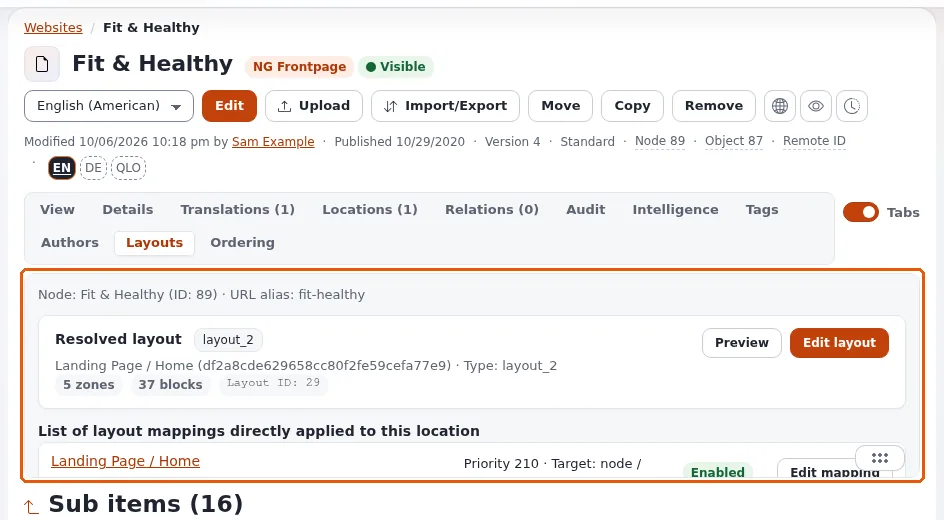

# Lektion 7.2: Eine Zuordnung anlegen

Die Teilnehmenden verweisen ihr Kurs-Layout jetzt auf eine eigene Seite. Sie legen eine Zuordnung mit einem Knotenziel
an, geben ihr eine Priorität über den breiteren Zuordnungen, aktivieren sie und prüfen die Seite. Alle verwenden ihre
eigene Testseite, sodass keine Zuordnung die Seite einer anderen Person berührt.

## Auf einen Blick

| | |
|---|---|
| Kurs | [Exponential Layouts](../README.md) |
| Modul | [Modul 7: Zuordnungsregeln](README.md) |
| Dauer | 60 Minuten (20 Präsentation, 40 Übung) |
| Niveau | Fortgeschrittene |
| Zielgruppe | Website-Ersteller und erfahrene Redakteure |
| Voraussetzungen | [Lektion 7.1](layout-zuordnungen-lesen.md); ein veröffentlichtes Kurs-Layout (Modul 6 oder vom Trainer veröffentlicht) |

## Lernziele

Nach dieser Lektion können die Teilnehmenden:

- mit **Neue Zuordnung** eine Zuordnung anlegen, das Layout wählen und ein Knotenziel hinzufügen;
- bei Bedarf eine Bedingung hinzufügen (zum Beispiel einen Siteaccess);
- eine Priorität festlegen, die breitere Zuordnungen schlägt, und die Zuordnung aktivieren;
- das Ergebnis auf der Seite und mit **View in CMS** prüfen;
- die Schnellaktionen der Zuordnung verwenden, um sie zu deaktivieren, zu kopieren oder zu löschen.

## Hinweise für Trainer

### So präsentieren Sie es

Quellen: [explayouts_ui: Ein Layout einer Seite zuordnen](../../../../../eng-us/features/6.0/extensions/explayouts_ui.md#map-a-layout-to-a-page)
und [Layout-Regeln: Rezepte](../../../../../eng-us/help/creators/website-creators/layout-rules.md#recipes).

1. **Neue Zuordnung** (4 Minuten). Auf **Layout-Zuordnungen** öffnet **Neue Zuordnung** einen Bereich; eine neue
   Zuordnung beginnt mit einer Priorität, die tatsächlich greift. Wählen Sie das Layout, fügen Sie ein Ziel und bei
   Bedarf Bedingungen hinzu. Aktivieren Sie sie.
2. **Knotenziel** (3 Minuten). Für eine einzelne Seite ein Knotenziel: der Ort der Seite. Es folgt der Seite, wenn sie
   umbenannt oder verschoben wird.
3. **Bedingungen** (3 Minuten). Eine Bedingung **siteaccess** beschränkt die Zuordnung auf eine Website einer
   Multisite-Installation; eine Bedingung **time** mit `from` und `to` macht daraus ein Kampagnen-Layout für einen
   Zeitraum.
4. **Prüfen** (3 Minuten). **View in CMS** bei einem Knotenziel öffnet den Knoten; laden Sie die Seite abgemeldet auf
   der Website. Wenn sich nichts ändert: Eine Zuordnung mit höherer Priorität passt zuerst, das Layout ist nicht
   veröffentlicht, oder eine zwischengespeicherte Seite wird angezeigt.
5. **Schnellaktionen** (2 Minuten). **More actions** bei einer Zuordnung: aktivieren, deaktivieren, Layout trennen,
   kopieren, löschen und ein Cache-Leeren für diese Zuordnung. Das Kopieren einer Zuordnung ist der schnellste Weg, eine
   Familie ähnlicher Zuordnungen aufzubauen.

### Häufige Fragen

**Welche Priorität sollte ich wählen?** Eine höhere als jede breitere Zuordnung, die ebenfalls zur Seite passen würde.
Lesen Sie die Liste (Lektion 7.1), bevor Sie wählen.

**Muss ich eine Zuordnung veröffentlichen?** Aktivieren Sie sie; das Layout, auf das sie verweist, muss veröffentlicht
sein, um angezeigt zu werden.

**Kann ich dasselbe Layout vielen Seiten zuordnen?** Ja, mit mehreren Zielen oder einem Teilbaumziel.

### Stolperfallen

- **Das Layout einer Person einer gemeinsam genutzten Seite zuordnen.** Alle ordnen nur ihre eigene Testseite zu.
- **Vergessen, dass das Layout ein Entwurf ist.** Eine Zuordnung zu einem nie veröffentlichten Layout zeigt nichts
  Neues.
- **Zwischengespeicherte Seiten.** Wenn sich die Seite nicht ändert, leeren Sie ihren Cache mit dem Cache-Leeren der
  Zuordnung oder fragen Sie den Trainer.

## Praktische Übung

Verwenden Sie die Schulungsinstallation. Alle Teilnehmenden haben eine veröffentlichte Testseite
`Layout test - <Vorname>` in ihrem Kursordner (von ihnen selbst wie in Redakteure 101 oder vom Trainer angelegt) und
ein veröffentlichtes Kurs-Layout.

1. Öffnen Sie **Layouts** > **Layout-Zuordnungen** und klicken Sie auf **Neue Zuordnung**.
2. Wählen Sie Ihr Kurs-Layout `Training - <Ihr Vorname>`.
3. Fügen Sie ein Ziel vom Typ Knoten hinzu und wählen Sie Ihre Testseite.
4. Lesen Sie die Priorität, die der Bereich vorschlägt. Vergleichen Sie sie mit der Priorität der breiteren Zuordnung,
   die die Seiten Ihres Kursordners bedient (finden Sie sie wie in Lektion 7.1), und stellen Sie sicher, dass Ihre höher
   ist.
5. Wenn die Schulungsinstallation mehrere Siteaccesses hat, fügen Sie eine Bedingung **siteaccess** für die öffentliche
   Website hinzu.
6. Aktivieren Sie die Zuordnung und speichern Sie sie.
7. Verwenden Sie **View in CMS** und öffnen Sie dann Ihre Testseite auf der öffentlichen Website in einem privaten
   Fenster. Ihr Kurs-Layout sollte sie einrahmen.
8. Öffnen Sie bei Ihrer Zuordnung **More actions** und deaktivieren Sie sie. Laden Sie die Seite neu: Sie hat wieder
   ihr vorheriges Aussehen (nachdem der Cache erneuert wurde).
9. Aktivieren Sie sie wieder.

## Erwartetes Ergebnis

- Die Testseite zeigt auf der Website das Kurs-Layout (Kopf- und Fußzeile aus dem gemeinsamen Layout, die Blöcke aus
  den Modulen 3 und 4 und den eigenen Inhalt der Seite im Full-view-Block).
- Das Deaktivieren der Zuordnung hat der Seite ihr vorheriges Aussehen zurückgegeben; das Aktivieren hat das Layout
  zurückgebracht.
- Der Trainer prüft das, indem er die Testseiten von zwei Teilnehmenden am Beamer in einem privaten Fenster öffnet.

## Quiz

1. Welchen Zieltyp verwenden Sie für eine einzelne Seite?
2. Warum muss die Priorität Ihrer Zuordnung höher sein als die der breiteren Zuordnung des Ordners?
3. Was bewirkt eine Bedingung **time**?
4. Ihre Zuordnung ist aktiviert, aber die Seite hat sich nicht geändert. Nennen Sie drei Dinge, die Sie prüfen.
5. Welche Schnellaktion ist der schnellste Weg, eine ähnliche Zuordnung für eine andere Seite aufzubauen?
   A. Löschen B. Kopieren C. Deaktivieren D. Layout trennen

Antworten

1. Ein Knotenziel ([Layout-Regeln](../../../../../eng-us/help/creators/website-creators/layout-rules.md#targets)).
2. Der erste Treffer nach Priorität gewinnt; sonst fängt die breitere Zuordnung die Seite zuerst ab.
3. Sie beschränkt die Zuordnung auf einen Zeitraum (`from` und `to`).
4. Eine Zuordnung mit höherer Priorität passt zuerst; das Layout ist nicht veröffentlicht; die zwischengespeicherte
   Kopie der Seite wird noch ausgeliefert.
5. **B.**

## Weiterführende Informationen

- [explayouts_ui: Ein Layout einer Seite zuordnen](../../../../../eng-us/features/6.0/extensions/explayouts_ui.md#map-a-layout-to-a-page)
- [Layout-Regeln: Rezepte](../../../../../eng-us/help/creators/website-creators/layout-rules.md#recipes)

## Verwandte Seiten

- [Modul 7: Zuordnungsregeln](README.md)
- [Exponential Layouts: Kursüberblick](../README.md)
- [Trainer: hier beginnen](../../../../../eng-us/help/trainers/trainers-start-here.md)
- [Freie Dokumentation](../../../freie-dokumentation.md): Diese Seite darf unter der GNU FDL 1.3 frei kopiert, übersetzt und verbessert werden.

<!-- exp-partner-block:start -->
**Werden Sie Exponential-Partner.** Partner teilen ihre Informationen, stellen Mittel bereit, geben Beiträge zurück
und entwickeln die Produkte mit uns, und so wächst Exponential. Eine Partner-Website und ein Dashboard sind für Mitte
2027 geplant: Werden Sie noch heute Partner, damit wir schneller wachsen und neue Funktionen früher liefern. Beginnen
Sie mit [Partner: hier beginnen](../../../partner/partner-hier-beginnen.md) und
[Wie Sie sich bewerben](../../../partner/wie-sie-sich-bewerben.md).
<!-- exp-partner-block:end -->
