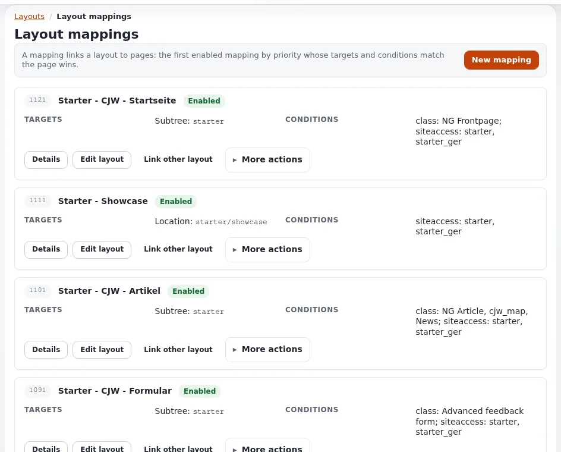

# Lektion 7.1: Layout-Zuordnungen lesen

Ein Layout erscheint auf einer Seite nur, wenn eine **Zuordnung** (Regel) diese Seite darauf verweist. Bevor die
Teilnehmenden Zuordnungen anlegen, müssen sie sie lesen können: Die Frage „Warum sieht diese Seite so aus?“ wird auf
dem Bildschirm **Layout-Zuordnungen** beantwortet.

## Auf einen Blick

| | |
|---|---|
| Kurs | [Exponential Layouts](../README.md) |
| Modul | [Modul 7: Zuordnungsregeln](README.md) |
| Dauer | 45 Minuten (20 Präsentation, 25 Übung) |
| Niveau | Fortgeschrittene |
| Zielgruppe | Redakteure und Website-Ersteller |
| Voraussetzungen | [Modul 2](../modul-02-layouts-und-layout-typen/README.md) |

## Lernziele

Nach dieser Lektion können die Teilnehmenden:

- eine Zuordnung lesen: ihre Priorität, ihr Layout, den Status **Aktiviert**, ihre **Ziele** und **Bedingungen**;
- die Zieltypen (Ort, Teilbaum, Pfad ...) und Bedingungstypen (Klasse, Siteaccess, Abfrageparameter, Zeit ...)
  nennen;
- die Regel *die erste aktivierte Zuordnung nach Priorität, deren Ziele und Bedingungen passen, gewinnt* anwenden;
- herausfinden, welche Zuordnung eine bestimmte Seite bedient.

## Hinweise für Trainer

### So präsentieren Sie es

Quellen: [Layout-Regeln: welche Seite welches Layout bekommt](../../../ersteller/website-ersteller/layout-regeln.md) und
[explayouts_ui: Ein Layout einer Seite zuordnen](../../../../funktionen/6.0/erweiterungen/explayouts_ui.md#ein-layout-einer-seite-zuordnen).

1. **Der Bildschirm** (4 Minuten). **Layouts** > **Layout-Zuordnungen**: *Eine Zuordnung verbindet ein Layout mit
   Seiten: Die erste aktivierte Zuordnung nach Priorität, deren Ziele und Bedingungen zur Seite passen, gewinnt.* Jede
   Zuordnung zeigt eine Zahl (ihre Priorität), den Namen des Layouts, **Aktiviert**, **Ziele**, **Bedingungen** sowie
   **Details**, **Layout bearbeiten**, **Link other layout** und **More actions**. Eine Zuordnung ohne Layout meldet
   *No mapped layout* und bietet **Link layout** an.
2. **Ziele** (4 Minuten): ein Knoten (angezeigt als *Location*), ein Teilbaum, ein Pfad, ein Pfadpräfix, ein
   Pfadmuster. Bevorzugen Sie Knoten und Teilbaum: Sie folgen dem Inhalt, wenn Redakteure ihn umbenennen oder
   verschieben; ein Pfad bricht.
3. **Bedingungen** (4 Minuten): **class** (der Inhaltstyp), **siteaccess**, Abfrageparameter, Routenparameter, Zeit.
   Klasse und Siteaccess werden aus Listen gewählt. Ohne Werte verlangt eine Parameterbedingung nur, dass der Parameter
   vorhanden ist.
4. **Priorität** (4 Minuten). Höher gewinnt, wenn mehrere passen. Die häufigste Verwirrung: Ein Layout erscheint nicht,
   weil eine breitere Zuordnung mit höherer Priorität die Seite zuerst abfängt. Geben Sie spezifischen Zuordnungen
   (ein Knoten) eine höhere Priorität als allgemeinen (ein Teilbaum, eine Klasse).
5. **Lesebeispiel** (4 Minuten). Lesen Sie zwei echte Zuordnungen Ihrer Schulungs-Website laut vor; zum Beispiel
   bedeutet „Subtree: X, class: Article, siteaccess: site“ „jeder Artikel unter X im Siteaccess site“.

### Häufige Fragen

**Was zeigt eine Seite, zu der keine Zuordnung passt?** Sie wird von den Templates der Website dargestellt, ohne
Layout.

**Ist eine unbekannte Bedingung sicher?** Nein: Ein unbekannter Bedingungstyp passt immer, sodass ein Tippfehler eine
Regel erweitert, statt sie abzuschalten ([Layout-Regeln](../../../ersteller/website-ersteller/layout-regeln.md#bedingungen)).

**Gibt es ein Ziel „route“?** Es ist deklariert, aber nicht implementiert und passt nie; verwenden Sie es nicht.

### Stolperfallen

- **Nur die erste Seite der Zuordnungen lesen.** Die Liste ist seitenweise aufgeteilt; verwenden Sie die
  Seitennavigation.
- **Deaktivierte Zuordnungen übersehen.** Eine deaktivierte Zuordnung bewirkt nichts, wie hoch ihre Priorität auch
  ist.
- **Pfadziele.** Sie brechen, wenn Inhalte umbenannt werden; ersetzen Sie sie durch Knoten- oder Teilbaumziele.

## Praktische Übung

Verwenden Sie die Schulungsinstallation und Ihr Layouts-Schulungskonto. Es wird nichts geändert.

1. Öffnen Sie **Layouts** > **Layout-Zuordnungen** und lesen Sie die Zeile unter dem Titel.
2. Notieren Sie die drei Zuordnungen mit der höchsten Priorität: ihr Layout, ihre Ziele und Bedingungen.
3. Suchen Sie eine Zuordnung mit einem Ziel **Subtree** und einer Bedingung **class**. Schreiben Sie sie als Satz
   („jeder ... unter ... bekommt ...“).
4. Klicken Sie bei einer Zuordnung auf **Details** und lesen Sie ihren Bereich.
5. Öffnen Sie die Startseite der Schulungs-Website in einem anderen Tab. Finden Sie anhand der Liste heraus, welche
   Zuordnung sie bedient. Notieren Sie Ihre Begründung.
6. Machen Sie dasselbe für eine Artikelseite der Schulungs-Website.
7. Suchen Sie eine Zuordnung mit *No mapped layout*, falls es eine gibt, und sagen Sie, was sie bewirkt (nichts, bis
   ein Layout verknüpft wird).
8. Vergleichen Sie Ihre Antworten für die Schritte 5 und 6 mit Ihrem Nachbarn; der Trainer bestätigt mit der
   Layout-Vorschau.

## Erwartetes Ergebnis

- Die Notizen enthalten drei Zuordnungen, einen Satz und eine begründete Antwort für die Startseite und eine
  Artikelseite.
- Die Antworten stimmen mit der Prüfung des Trainers überein.
- Der Trainer prüft das, indem er Schritt 5 am Beamer durchgeht.

## Quiz

1. Ergänzen Sie die Regel: Die erste aktivierte Zuordnung nach ..., deren ... und ... zur Seite passen, gewinnt.
2. Warum sind Knoten- und Teilbaumziele besser als Pfadziele?
3. Eine spezifische Zuordnung für eine Seite wirkt nicht. Was ist die wahrscheinlichste Ursache?
   A. Ein Tippfehler im Namen des Layouts B. Eine breitere Zuordnung mit höherer Priorität passt zuerst C. Die Seite
   ist zu lang D. Das Layout hat zu viele Blöcke
4. Was geschieht bei einem unbekannten Bedingungstyp?
5. Was zeigt eine Seite, wenn keine Zuordnung passt?

Antworten

1. Priorität; Ziele; Bedingungen.
2. Sie folgen dem Inhalt, wenn er umbenannt oder verschoben wird; ein Pfad bricht
   ([Layout-Regeln](../../../ersteller/website-ersteller/layout-regeln.md#ziele)).
3. **B.**
4. Er passt immer und erweitert damit die Regel.
5. Die normalen Templates der Website, ohne Layout.

## Weiterführende Informationen

- [Layout-Regeln: welche Seite welches Layout bekommt](../../../ersteller/website-ersteller/layout-regeln.md)
- [Exponential Layouts: Regeln](../../../../bc/6.0/layouts.md#regeln-entscheiden-welches-layout-eine-seite-erhält)

## Verwandte Seiten

- [Modul 7: Zuordnungsregeln](README.md)
- [Exponential Layouts: Kursüberblick](../README.md)
- [Trainer: hier beginnen](../../trainer-hier-beginnen.md)
- [Freie Dokumentation](../../../freie-dokumentation.md): Diese Seite darf unter der GNU FDL 1.3 frei kopiert, übersetzt und verbessert werden.

<!-- exp-partner-block:start -->
**Werden Sie Exponential-Partner.** Partner teilen ihre Informationen, stellen Mittel bereit, geben Beiträge zurück
und entwickeln die Produkte mit uns, und so wächst Exponential. Eine Partner-Website und ein Dashboard sind für Mitte
2027 geplant: Werden Sie noch heute Partner, damit wir schneller wachsen und neue Funktionen früher liefern. Beginnen
Sie mit [Partner: hier beginnen](../../../partner/partner-hier-beginnen.md) und
[Wie Sie sich bewerben](../../../partner/wie-sie-sich-bewerben.md).
<!-- exp-partner-block:end -->
