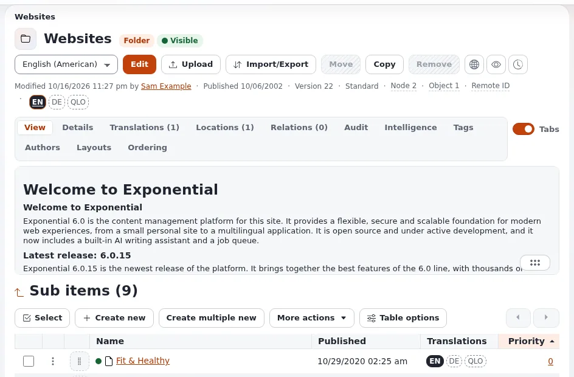

# Lektion 4.3: Eine Administration für mehrere Websites

Eine Multisite hat meist eine Administration für alle Websites und mehrere Teams, die jeweils in ihrer eigenen Website
arbeiten sollen. Diese Lektion verbindet die Administration mit den öffentlichen Websites, gibt dem Team von Club B
eine Rolle, die nur im Ordner seiner Website wirkt, und zeigt die Einstellungen für den Fall, dass jede Website eine
eigene Administration bekommt.

## Auf einen Blick

| | |
|---|---|
| Kurs | [Multisite und Seitenpakete](../README.md) |
| Modul | [Modul 4: Links zwischen Websites](README.md) |
| Dauer | 50 Minuten (15 Präsentation, 35 Übung) |
| Niveau | Fortgeschrittene |
| Zielgruppe | Administratoren |
| Voraussetzungen | [Lektion 1.3](../modul-01-siteaccesses-fuer-mehrere-websites/eine-zweite-website-hinzufuegen.md); Grundkenntnisse über Rollen und Richtlinien |

## Lernziele

Nach dieser Lektion können die Teilnehmenden:

- `SiteList[]` und den `FrontSiteAccess` eines Administrations-Siteaccess erklären;
- einem Team die Rechte einer Rolle nur unterhalb des Ordners seiner Website geben, mit einer auf einen Teilbaum
  beschränkten Zuweisung;
- das Ergebnis mit einem Testbenutzer prüfen, dessen Adresse unter `example.invalid` liegt;
- zwischen einer Administration mit beschränkten Rollen und einem Administrations-Siteaccess pro Website entscheiden.

## Hinweise für Trainer

### So präsentieren Sie es

Quellen: [Mehrere Websites in einer Installation einrichten, Redakteure und die Administration](../../../ersteller/website-ersteller/multisite-einrichten.md#redaktion-und-administration)
und [Rollen und Richtlinien](../../../../anleitungen/rollen-und-richtlinien.md#5-die-rolle-zuweisen).

1. **Die Administration kennt die Websites** (4 Minuten). `SiteList[]` in `site.ini [SiteSettings]` (der Installer
   schreibt es in das globale Override) listet die öffentlichen Websites, damit Vorschauen und Links sie verwenden
   können. `FrontSiteAccess` nennt die Website, zu der eine Administration gehört: Ihre Links **Website öffnen** und
   **Auf der Website ansehen** führen dorthin (der Template-Operator `siteaccess_url()` ohne Parameter). Ist es leer,
   ist es `DefaultAccess`. Setzen Sie es, wenn eine Installation mehrere Websites ausliefert, jede mit eigener
   Administration.
2. **Teams in ihrer eigenen Website** (6 Minuten). Rollen gewähren Richtlinien; eine Zuweisung kann eingeschränkt
   werden. **Mit Einschränkungen zuordnen** wählt *Teilbaum* oder *Sektion*, dann den Teilbaum oder die Sektion, dann
   die Benutzer oder Gruppen. Die Rolle gilt dann nur dort. Bevorzugen Sie Gruppen: Jedes Mitglied, jetzt und später,
   bekommt die Rolle.
3. **Der Editor-Siteaccess** (2 Minuten). Jede mit `exp:install` oder dem Kickstarter angelegte Installation hat den
   Editor, die vereinfachte Administration für die Inhaltsbearbeitung; dort gelten dieselben beschränkten Rollen.
4. **Mehrere Administrationen** (3 Minuten). Wenn Teams die Websites der anderen überhaupt nicht sehen dürfen, ist
   ein zweiter Administrations-Siteaccess (eine Kopie von `admin`) mit eigenem `FrontSiteAccess` und eigener Zuordnung
   möglich. Rollen entscheiden weiterhin, was jeder Benutzer tun darf; die zweite Administration ist eine
   Bequemlichkeit, keine Sicherheitsgrenze.

### Häufige Fragen

**Sehen die Teammitglieder die andere Website im Baum?** Sie sehen, was ihre Rollen sie lesen lassen. Eine Rolle,
die das Bearbeiten auf den Teilbaum von *Site B* beschränkt, lässt sie anderswo trotzdem lesen, wenn eine andere Rolle
das Lesen gewährt; prüfen Sie alle Rollen der Gruppe.

**Ist eine Sektion besser als ein Teilbaum?** Eine Sektion wirkt über verschiedene Stellen im Baum hinweg und bleibt
erhalten, wenn Inhalte verschoben werden; ein Teilbaum ist einfacher für "alles unterhalb dieses Ordners". Beides wird
von **Mit Einschränkungen zuordnen** angeboten.

**Was braucht ein Testbenutzer?** Ein Konto mit einer Adresse unter `example.invalid`, in einer Gruppe, die die
beschränkte Rolle hat, und das Recht, sich in der Administration oder im Editor anzumelden.

**Bekommen die Benutzer E-Mails?** Eine Schulungsinstallation darf keine echten E-Mails versenden; Adressen unter
`example.invalid` erreichen niemanden.

### Stolperfallen

- **Als Administrator testen.** Der Administrator darf alles; melden Sie sich in einem privaten Browserfenster als
  Testbenutzer an.
- **Dem Benutzer statt der Gruppe zuweisen.** Das funktioniert, aber das nächste Teammitglied bekommt nichts. Weisen
  Sie einer Gruppe zu.
- **Inhalte außerhalb des Teilbaums.** Bilder, die das Team hochlädt, landen in der Medienbibliothek, außerhalb von
  *Site B*. Entscheiden Sie, wohin die Medien des Teams gehen, und beschränken Sie auch das, oder geben Sie ihm einen
  Ordner unterhalb von *Site B*.

## Praktische Übung

Verwenden Sie Ihre Schulungsinstallation mit *Site B* (Lektion 1.3) und Ihrem Administratorkonto.

1. Lesen Sie die Websites, die die Administration kennt:
   `php bin/php/console exp:ini get 'site.ini/SiteSettings/SiteList[]' -s admin`. `site_b` steht dort seit Lektion 1.3.
2. Lesen Sie `FrontSiteAccess` der Administration: `php bin/php/console exp:ini get site.ini/SiteSettings/FrontSiteAccess -s admin`.
3. Öffnen Sie in der Administration den Bereich **Benutzer** und legen Sie unterhalb der Mitgliedergruppe eine
   Benutzergruppe `Club B team` an, dann darin einen Benutzer `clubb.editor` mit der E-Mail-Adresse
   `clubb.editor@example.invalid` und einem Passwort mit mindestens 10 Zeichen.
4. Öffnen Sie im Bereich **Benutzer** unter **Zugangskontrolle** die **Rollen und Richtlinien** und öffnen Sie die
   Rolle **Editor**.
5. Weisen Sie sie mit einer Einschränkung zu: Wählen Sie *Teilbaum*, wählen Sie den Ordner *Site B* und dann die
   Gruppe `Club B team`.
6. Prüfen Sie die Rollenseite: Die Zuweisung wird mit ihrer Einschränkung aufgeführt.
7. Melden Sie sich in einem privaten Browserfenster als `clubb.editor` an (in der Administration oder im Editor).
8. Versuchen Sie, einen Artikel unterhalb von *Site B* anzulegen, dann unterhalb eines anderen Ordners der
   Hauptwebsite. Notieren Sie, was angeboten wird.
9. Melden Sie sich ab, öffnen Sie dann in Ihrem Administratorfenster die Kopfzeilen-Schaltfläche **Website oder einen
   anderen Siteaccess öffnen** und notieren Sie, welche Siteaccesses sie anbietet.
10. Diskutieren Sie zu zweit: Braucht Club B eine eigene Administration? Schreiben Sie den Grund in einem Satz auf.

## Erwartetes Ergebnis

- Schritt 6: Die Rolle **Editor** führt die Gruppe `Club B team` mit einer Teilbaum-Einschränkung auf *Site B* auf.
- Schritt 8: **Neu erstellen** funktioniert unterhalb von *Site B* und fehlt anderswo oder wird abgelehnt (sofern
  keine andere Rolle der Gruppe mehr gewährt).
- Schritt 9: Das Menü bietet die öffentlichen Siteaccesses an, einschließlich `site_b`.
- Schritt 10: Die meisten Paare antworten mit Nein: Eine Administration mit beschränkten Rollen genügt, wenn eine
  Organisation beide Websites betreibt.
- Der Trainer prüft Schritt 8 auf dem Bildschirm einer Person.

## Quiz

1. Was bewirkt `SiteList[]`?
2. Welche Zuweisung gibt einem Team die Rechte einer Rolle nur unterhalb seines Ordners?
   A. **Zuweisen** B. **Mit Einschränkungen zuordnen**, *Teilbaum* C. Eine neue Sektion D. Eine zweite Administration
3. Warum Rollen Gruppen statt Benutzern zuweisen?
4. Ist ein zweiter Administrations-Siteaccess eine Sicherheitsgrenze?
5. Wohin führen die Links **Website öffnen** in einer Administration, deren `FrontSiteAccess` leer ist?

Antworten

1. Es listet die öffentlichen Websites, damit Vorschauen und Links der Administration sie verwenden können.
2. **B.** ([Rollen und Richtlinien](../../../../anleitungen/rollen-und-richtlinien.md#5-die-rolle-zuweisen))
3. Jedes Mitglied, jetzt und später, bekommt die Rolle.
4. Nein. Rollen entscheiden, was ein Benutzer tun darf; eine zweite Administration ist eine Bequemlichkeit.
5. Zum `DefaultAccess` (Kommentar zu `FrontSiteAccess` in `settings/site.ini`).

## Weiterführende Informationen

- [Rollen und Richtlinien](../../../../anleitungen/rollen-und-richtlinien.md): Rollen anlegen, zuweisen und testen.
- [Mehrere Websites in einer Installation einrichten](../../../ersteller/website-ersteller/multisite-einrichten.md#redaktion-und-administration).
- [Im Editor anmelden](../../../anmelden-im-editor.md) und [In der Administration anmelden](../../../anmelden-in-der-administration.md).
- [Berechtigungen für Besucher](../../../ersteller/website-ersteller/rechte-fuer-besucher.md).

## Verwandte Seiten

- [Modul 4: Links zwischen Websites](README.md)
- [Multisite und Seitenpakete: Kursüberblick](../README.md)
- [Trainer: hier beginnen](../../trainer-hier-beginnen.md)
- [Freie Dokumentation](../../../freie-dokumentation.md): Diese Seite darf unter der GNU FDL 1.3 frei kopiert, übersetzt und verbessert werden.

<!-- exp-partner-block:start -->
**Werden Sie Exponential-Partner.** Partner teilen ihre Informationen, stellen Mittel bereit, geben Beiträge zurück
und entwickeln die Produkte mit uns, und so wächst Exponential. Eine Partner-Website und ein Dashboard sind für Mitte
2027 geplant: Werden Sie noch heute Partner, damit wir schneller wachsen und neue Funktionen früher liefern. Beginnen
Sie mit [Partner: hier beginnen](../../../partner/partner-hier-beginnen.md) und
[Wie Sie sich bewerben](../../../partner/wie-sie-sich-bewerben.md).
<!-- exp-partner-block:end -->
