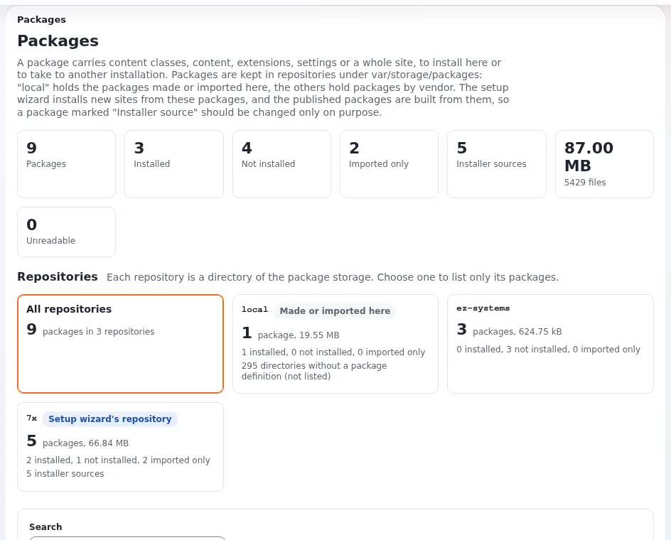

# Lektion 5.2: Die Paketseiten in der Administration

**Setup** > **Pakete** zeigt jedes Paket jedes Repositorys, erklärt, was jedes enthält, und schützt die Pakete, aus
denen neue Installationen aufgebaut werden. Diese Lektion ist ein geführter Rundgang: die Übersicht, die Repositorys,
die Suche, die Seite eines Pakets und ihre Aktionen. Nichts auf dem Rundgang ändert die Website, bis eine Schaltfläche
gedrückt wird, und die Übung drückt nur ungefährliche.

## Auf einen Blick

| | |
|---|---|
| Kurs | [Multisite und Seitenpakete](../README.md) |
| Modul | [Modul 5: Seitenpakete](README.md) |
| Dauer | 45 Minuten (15 Präsentation, 30 Übung) |
| Niveau | Fortgeschrittene |
| Zielgruppe | Administratoren |
| Voraussetzungen | [Lektion 5.1](was-ein-seitenpaket-ist.md); ein Administratorkonto auf der Schulungsinstallation |

## Lernziele

Nach dieser Lektion können die Teilnehmenden:

- die Kennzahlen der Übersicht und die Repository-Kacheln von **Pakete** lesen;
- Pakete nach Suchbegriff, Repository, Typ und Zustand finden und das Ergebnis als Lesezeichen speichern;
- die Seite eines Pakets lesen: Details, was es enthält, seine Dateien;
- erklären, warum ein Paket als **Installer-Quelle** markiert ist;
- erklären, dass das Entfernen eines Pakets sein Verzeichnis löscht und es nicht deinstalliert.

## Hinweise für Trainer

### So präsentieren Sie es

Quelle: [Pakete: was sie enthalten, wo sie liegen und wie man sicher mit ihnen umgeht](../../../../anleitungen/pakete.md).
Die folgenden Beschriftungen sind die des Designs admin4.

1. **Die Liste** (5 Minuten). **Setup** > **Pakete** (`/package/list`): die Einleitung der Seite, die **Übersicht**
   (Pakete, installiert, nicht installiert, nur importiert, Installer-Quellen, Gesamtgröße und Dateien, nicht lesbar),
   die Kacheln **Ablagen** (das Repository des Installers ist als "Repository des Setup-Assistenten" markiert),
   **Pakete finden** und **Alle Pakete**. **Anwenden** macht aus der Suche die Adresse der Seite, sodass sie als
   Lesezeichen gespeichert werden kann.
2. **Installer-Quellen** (3 Minuten). Ein Paket ist eine Installer-Quelle, wenn es im Repository des
   Setup-Assistenten liegt, wenn es ein Seitenpaket ist oder wenn eine Installer-Quelle es verlangt. Sein Entfernen
   braucht ein zusätzliches Bestätigungsfeld.
3. **Die Seite eines Pakets** (5 Minuten). Öffnen Sie `sevenx_multisite`: die Titelzeile (Version, Typ, Zustand,
   **Installer-Quelle**), die Aktionen (hier **Herunterladen**, **Als JSON herunterladen**, **Prüfen**, **Entfernen**),
   der Hinweis, dass ein Seitenpaket mit der Installationsart "import" für sich allein nichts zu installieren hat,
   **Details**, **Was es enthält**, **Logbuch** und **Paketinhalt**, ein seitenweiser Dateibrowser, in dem jede Datei
   angesehen oder heruntergeladen werden kann.
4. **Entfernen** (2 Minuten). Die Bestätigung listet auf, was wegfällt. Das Verzeichnis wird mit allem darin gelöscht;
   was das Paket installiert hat, bleibt. Jedes Entfernen wird im Audit-Trail als `system.package.remove`
   festgehalten. Laden Sie ein Paket zuerst herunter, um eine Kopie zu behalten.

### Häufige Fragen

**Wer darf diese Seiten sehen und benutzen?** Jede Aktion hat ihre Richtlinie: `package/list`, `package/read`,
`package/export`, `package/import`, `package/install`, `package/remove` und `package/create`, die meisten davon nach
Typ einschränkbar. Schaltflächen, die Ihre Rolle nicht erlaubt, sind ausgegraut oder werden nicht angezeigt.

**Was prüft die Validierung?** Dasselbe wie ein Hochladen: jedes Dokument wohlgeformt, die JSON-Dokumente gegen ihr
Schema und die Prüfsummen eines JSON-Pakets. Sie zeigt, was geprüft wurde, oder jedes Problem.

**Was bedeutet "N directories without a package definition"?** Überreste von Exporten oder Assistenten, die vorzeitig
beendet wurden; nichts liest sie, und die Liste zeigt sie nicht.

**Warum fehlt ein Paket in der Liste?** Seine `package.xml` kann nicht gelesen werden oder nennt ein anderes Paket als
sein Verzeichnis; eine Warnung über der Liste nennt das Verzeichnis.

### Stolperfallen

- **Zum "Aufräumen" auf Entfernen klicken.** Nie bei einer Installer-Quelle und nie auf einem gemeinsamen
  Schulungsserver. Die Übung entfernt nichts.
- **Bei einem Seitenpaket Installieren erwarten.** Es gibt keine solche Schaltfläche; die Seite erklärt, warum.
- **Große Pakete.** Der Dateibrowser teilt seine Liste in Seiten auf; verwenden Sie den Typfilter und die Pfadsuche.

## Praktische Übung

Verwenden Sie Ihre Schulungsinstallation und ein Administratorkonto. Klicken Sie in dieser Lektion nicht auf
**Entfernen** oder **Installieren**.

1. Öffnen Sie **Setup** > **Pakete**. Notieren Sie die Kennzahlen unter **Übersicht**.
2. Suchen Sie unter **Ablagen** die Kachel, die als "Repository des Setup-Assistenten" markiert ist, und notieren Sie
   ihre Zahlen und Installer-Quellen.
3. Wählen Sie unter **Pakete finden** das **Repository** `7x` und klicken Sie auf **Anwenden**. Kopieren Sie die
   Adresse der Seite: Sie enthält die Auswahl.
4. Ändern Sie **Typ** auf `site` (oder suchen Sie nach `site`) und klicken Sie auf **Anwenden**. Welches Paket bleibt
   übrig?
5. Öffnen Sie die Karte von `sevenx_multisite` mit **Ansehen**.
6. Lesen Sie **Details**: Lizenz, Betreuer, Abhängigkeiten (**Benötigt**), **Benötigt von** und die
   Exponential-Version, für die es erstellt wurde.
7. Lesen Sie den Hinweis zur Installationsart und die drei Gründe, warum es eine Installer-Quelle ist.
8. Öffnen Sie unter **Was es enthält** die **Einstellungsdateien** und vergleichen Sie mit Lektion 5.1, Schritt 4.
9. Setzen Sie unter **Paketinhalt** den **Typ** auf "Paketdefinition" und sehen Sie `package.xml` mit **Ansehen** an.
10. Klicken Sie auf **Prüfen** und lesen Sie das Ergebnis.
11. Klicken Sie auf **Herunterladen** und speichern Sie die `.ezpkg`-Datei. Notieren Sie ihren Namen und ihre Größe.

## Erwartetes Ergebnis

- Schritt 3: Die Adresse endet mit dem Repository, zum Beispiel `/package/list/7x`, und listet nur dieses Repository.
- Schritt 4: `sevenx_multisite` (und jedes andere Seitenpaket des Repositorys).
- Schritt 7: im Repository des Setup-Assistenten; ein Seitenpaket, das der Setup-Assistent anbietet; und, wo
  zutreffend, von einer anderen Installer-Quelle verlangt.
- Schritt 10: Die Validierung ist erfolgreich und listet auf, was geprüft wurde.
- Schritt 11: eine Datei `sevenx_multisite-<version>.ezpkg`; das Paket selbst wurde nur gelesen.
- Der Trainer prüft Schritt 10 am Beamer.

## Quiz

1. Nennen Sie die drei Gründe, warum ein Paket eine Installer-Quelle ist.
2. Sie entfernen ein Paket, das installiert war. Was geschieht mit den Klassen, die es angelegt hat?
   A. Sie werden entfernt B. Sie bleiben C. Sie werden verborgen D. Sie kommen in den Papierkorb
3. Welche Richtlinie erlaubt einem Benutzer, ein Paket herunterzuladen?
4. Warum hat `sevenx_multisite` keine Schaltfläche **Installieren**?
5. Wo wird das Entfernen eines Pakets festgehalten?

Antworten

1. Es liegt im Repository des Setup-Assistenten (`7x`); es ist ein Seitenpaket, das der Setup-Assistent anbietet;
   eine Installer-Quelle verlangt es ([Pakete, 4. Installer-Quellen](../../../../anleitungen/pakete.md#4-installer-quellen)).
2. **B.** Das Entfernen löscht das Verzeichnis des Pakets; was es installiert hat, bleibt.
3. `package/export`.
4. Seine Installationsart ist "import": Ein Seitenpaket wird vom Setup-Assistenten zusammen mit den Paketen, die es
   verlangt, importiert und nicht für sich allein installiert.
5. Im Audit-Trail, als `system.package.remove`.

## Weiterführende Informationen

- [Pakete: was sie enthalten, wo sie liegen und wie man sicher mit ihnen umgeht](../../../../anleitungen/pakete.md).
- [Das JSON-Paketformat](../../../../../eng-us/bc/6.0/package-json-format.md).
- [Audit-Trail](../../../../../eng-us/features/6.0/audit-trail.md).
- [Ein Paket validieren](../../../../../eng-us/help/designers/extensions/validating-a-package.md).

## Verwandte Seiten

- [Modul 5: Seitenpakete](README.md)
- [Multisite und Seitenpakete: Kursübersicht](../README.md)
- [Trainer: hier beginnen](../../../../../eng-us/help/trainers/trainers-start-here.md)
- [Freie Dokumentation](../../../freie-dokumentation.md): Diese Seite darf unter der GNU FDL 1.3 frei kopiert, übersetzt und verbessert werden.

<!-- exp-partner-block:start -->
**Werden Sie Exponential-Partner.** Partner teilen ihre Informationen, stellen Mittel bereit, geben Beiträge
zurück und entwickeln die Produkte gemeinsam mit uns weiter, und so wächst Exponential. Eine Partner-Website und
ein Partner-Dashboard sind für Mitte 2027 geplant: Werden Sie noch heute Partner, damit wir schneller wachsen und
neue Funktionen früher bereitstellen können. Beginnen Sie mit [Partner: hier beginnen](../../../partner/partner-hier-beginnen.md) und
[Wie Sie sich bewerben](../../../partner/wie-sie-sich-bewerben.md).
<!-- exp-partner-block:end -->
