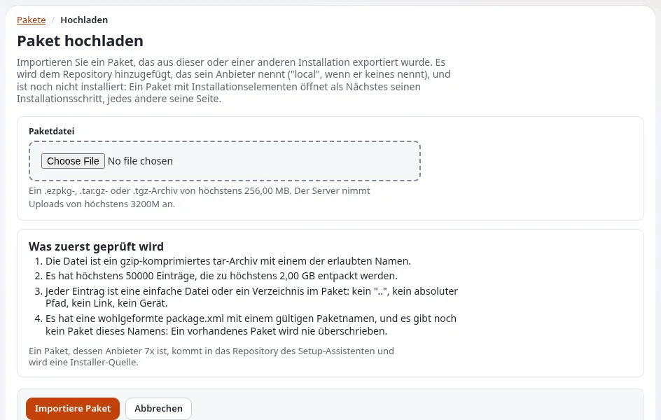

# Lektion 5.6: Pakete hochladen und installieren

Ein Paket wird auf einer Installation erstellt, um auf einer anderen installiert zu werden. Diese Lektion schließt den
Kreis: Die Teilnehmenden laden das Paket, das sie in Lektion 5.3 erstellt haben, auf eine zweite
Schulungsinstallation hoch, lesen, was das Hochladen prüft, installieren es zur Durchsicht als Entwürfe und lernen die
Einstellungen kennen, die den Browser-Installer vor Zeitüberschreitungen bewahren.

> **Hinweis**
> Installieren Sie nur auf einer Schulungsinstallation. Eine Installation schreibt Inhalte, und **Deinstallieren**
> lässt sich nicht rückgängig machen.

## Auf einen Blick

| | |
|---|---|
| Kurs | [Multisite und Seitenpakete](../README.md) |
| Modul | [Modul 5: Seitenpakete](README.md) |
| Dauer | 55 Minuten (15 Präsentation, 40 Übung) |
| Niveau | Experten |
| Zielgruppe | Administratoren |
| Voraussetzungen | [Lektion 5.3](pakete-auf-der-kommandozeile.md): das Archiv von `clubb_content`; eine zweite Schulungsinstallation (die Übungsumgebung der Nachbarn oder eine mit `exp:install` in einem anderen Verzeichnis angelegte) |

## Lernziele

Nach dieser Lektion können die Teilnehmenden:

- ein Paket hochladen und jede Prüfung erklären, die das Hochladen vornimmt, bevor etwas geschrieben wird;
- die Installationsseite lesen, einschließlich dessen, worauf die Installation auf dieser Website trifft;
- Inhalte zur Durchsicht als Entwürfe installieren und wissen, wann im Hintergrund installiert wird;
- `InstallBatchMaxItems` und `InstallBatchTimeBudgetSeconds` für einen langsamen Host setzen;
- sich von einer abgebrochenen Installation erholen.

## Hinweise für Trainer

### So präsentieren Sie es

Quellen: [Pakete, 6. Hochladen und 7. Installieren](../../../../anleitungen/pakete.md#6-ein-paket-hochladen) und
[Ein Paket-Installer, der große Pakete übersteht](../../../../funktionen/6.0/paketinstallation-in-teilschritten.md).

1. **Das Hochladen** (4 Minuten). **Neues Paket importieren** in der Liste öffnet **Paket hochladen**. Die Seite listet
   **Was zuerst geprüft wird**: ein gzip-komprimiertes tar mit einem erlaubten Namen; höchstens 50000 Einträge, die
   entpackt höchstens 2 GB ergeben; jeder Eintrag eine einfache Datei oder ein Verzeichnis innerhalb des Pakets (kein
   `..`, kein absoluter Pfad, kein Link, kein Gerät); eine wohlgeformte `package.xml` mit gültigem Namen und noch kein
   Paket dieses Namens. Ein Paket, dessen Anbieter `7x` ist, kommt in das Repository des Setup-Assistenten und wird
   eine Installer-Quelle. Die Grenzen stehen in `package.ini [UploadSettings]`.
2. **Die Installationsseite** (4 Minuten). **Paket installieren** oder **Installation überspringen**; die Seite zeigt,
   worauf die Installation hier trifft, wobei jedes Objekt über seine Remote-ID gesucht wird: neu, vorhanden, ein
   Konflikt oder ohne seine Klasse. **Als Entwürfe installieren** schreibt Inhaltsobjekte als Entwürfe: Nichts wird
   veröffentlicht, und Klassen, Einstellungen und Design-Dateien werden nicht installiert. **Im Hintergrund
   installieren** führt die Installation als Inhaltsauftrag aus; die Seite schlägt das oberhalb von
   `[ContentJobSettings] SynchronousLimit` Objekten vor.
3. **Stapel** (4 Minuten). Jedes Element wird in einer eigenen Transaktion installiert; der Browser installiert einige
   Elemente, leitet dann auf sich selbst weiter und macht weiter. `package.ini [InstallerSettings]`:
   `InstallBatchMaxItems` (12) und `InstallBatchTimeBudgetSeconds` (6). Für einen langsamen Shared-Host: 4 Elemente
   und 3 Sekunden.
4. **Wenn sie abbricht** (3 Minuten). Die Fehlerseite nennt den Typ und den Namen des Elements. Beheben Sie die
   Ursache und laden Sie dann den Installationsschritt neu: Die Position des aktuellen Elements bleibt zwischen den
   Anfragen erhalten. Es gibt keine Schaltfläche "Retry".

### Häufige Fragen

**Warum wurde mein Hochladen mit "already exists" abgelehnt?** Ein Paket dieses Namens liegt in einem Repository;
entfernen Sie zuerst das alte oder geben Sie dem neuen einen anderen Namen. Ein vorhandenes Paket wird nie
überschrieben.

**Kommt die Größengrenze für das Hochladen von Exponential oder von PHP?** Von beiden: Zuerst gelten
`upload_max_filesize` und `post_max_size` von PHP; die Seite zeigt die Grenze des Servers.

**Kann ich stattdessen aus der Shell installieren?** Ja: `php ezpm.php import <file>`, dann
`php ezpm.php install <name>`, mit denselben Prüfungen des Archivs (Lektion 5.3).

**Was entfernt Deinstallieren?** Das, was das Deinstallieren von der Website entfernt, Inhalte eingeschlossen; es
lässt sich nicht rückgängig machen.

### Stolperfallen

- **Auf der Quellinstallation installieren.** Die Objekte existieren bereits; die Installationsseite zeigt sie als
  vorhanden. Verwenden Sie eine zweite Installation.
- **Die Durchsicht vergessen.** Entwürfe aus **Als Entwürfe installieren** warten auf einen Redakteur;
  veröffentlichen oder verwerfen Sie sie.
- **Einstellungen ohne Leeren des INI-Caches.** Leeren Sie ihn nach einer Änderung von `[InstallerSettings]`.

## Praktische Übung

Arbeiten Sie zu zweit: Jede Person installiert das Archiv `clubb_content` der Nachbarn (aus `var/tmp/course/`) auf der
eigenen Installation oder auf einer zweiten, mit `exp:install` in einem anderen Verzeichnis angelegten Installation.

1. Kopieren Sie die klassische `.ezpkg` von Ihren Nachbarn (gemeinsamer Ordner oder USB-Stick) auf Ihren Rechner.
2. Öffnen Sie in der Administration **Setup** > **Pakete** und klicken Sie auf **Neues Paket importieren**.
3. Lesen Sie **Was zuerst geprüft wird** und die unter **Paketdatei** angezeigte Größengrenze.
4. Wählen Sie die Datei und klicken Sie auf **Importiere Paket**.
5. Der Installationsschritt öffnet sich. Lesen Sie die Liste dessen, was installiert wird, und worauf die Installation
   hier trifft.
6. Wählen Sie **Als Entwürfe installieren** und führen Sie es aus. Lesen Sie den Bericht: jedes Objekt mit dem, was
   die Installation getan hat, und wohin sein Hauptort gekommen ist.
7. Öffnen Sie auf dem Dashboard **Meine Entwürfe** und sehen Sie zwei Entwürfe durch. Veröffentlichen Sie einen,
   verwerfen Sie den anderen.
8. Setzen Sie kleinere Stapel für einen langsamen Host und leeren Sie den INI-Cache:

   ```bash
   php bin/php/console exp:ini set package.ini/InstallerSettings/InstallBatchMaxItems 4 global
   php bin/php/console exp:ini set package.ini/InstallerSettings/InstallBatchTimeBudgetSeconds 3 global
   ```

9. Öffnen Sie erneut die Seite des Pakets und lesen Sie den Installationszustand und die Aktionen, die es jetzt
   anbietet.
10. Setzen Sie die Stapeleinstellungen am Ende zurück (`exp:ini rem ... global` für beide).

## Erwartetes Ergebnis

- Schritt 4: Das Hochladen ist erfolgreich, und der Installationsschritt öffnet sich, weil das Paket
  Installationselemente hat.
- Schritt 6: Der Bericht listet den Ordner *Site B* und seine Unterelemente als Entwürfe, mit ihren Orten.
- Schritt 7: ein Entwurf veröffentlicht, einer verworfen.
- Schritt 8: `exp:ini where package.ini/InstallerSettings/InstallBatchMaxItems` zeigt `4` im globalen Override.
- Der Trainer prüft Schritt 6 in einer Übungsumgebung.



## Quiz

1. Nennen Sie drei Prüfungen, die das Hochladen vornimmt, bevor etwas geschrieben wird.
2. Was installiert **Als Entwürfe installieren** nicht?
   A. Inhaltsobjekte B. Klassen, Einstellungen und Design-Dateien C. Nichts D. Nur Bilder
3. Welche zwei Einstellungen bestimmen die Größe eines Installationsstapels im Browser?
4. Eine Installation bricht bei Element 37 mit einem Fehler ab. Was tun Sie, nachdem Sie die Ursache behoben haben?
5. Der Anbieter eines Pakets ist `7x`. Was geschieht, wenn Sie es hochladen?

<details>
<summary>Antworten</summary>

1. Drei beliebige aus: gzip-tar mit einem erlaubten Namen; Größe, Einträge und entpackte Größe innerhalb der Grenzen;
   jeder Eintrag eine einfache Datei oder ein Verzeichnis innerhalb des Pakets; eine wohlgeformte `package.xml` mit
   gültigem Namen; es existiert kein Paket dieses Namens ([Pakete, 6](../../../../anleitungen/pakete.md#6-ein-paket-hochladen)).
2. **B.**
3. `InstallBatchMaxItems` und `InstallBatchTimeBudgetSeconds` in `package.ini [InstallerSettings]`.
4. Den Installationsschritt neu laden; die Position des aktuellen Elements bleibt erhalten.
5. Es kommt in das Repository des Setup-Assistenten und wird eine Installer-Quelle.

</details>

## Weiterführende Informationen

- [Pakete: was sie enthalten, wo sie liegen und wie man sicher mit ihnen umgeht](../../../../anleitungen/pakete.md).
- [Ein Paket-Installer, der große Pakete übersteht](../../../../funktionen/6.0/paketinstallation-in-teilschritten.md).
- [Das JSON-Paketformat](../../../../bc/6.0/package-json-format.md): als Entwürfe installieren.
- [Ihr Paket auf einer Testwebsite installieren](../../../designer/erweiterungen/ihr-paket-auf-einer-testseite-installieren.md).
- [Meine Entwürfe und meine Warteliste](../../../../anleitungen/entwuerfe-und-ausstehende-objekte.md).

## Verwandte Seiten

- [Modul 5: Seitenpakete](README.md)
- [Multisite und Seitenpakete: Kursüberblick](../README.md)
- [Trainer: hier beginnen](../../trainer-hier-beginnen.md)
- [Freie Dokumentation](../../../freie-dokumentation.md): Diese Seite darf unter der GNU FDL 1.3 frei kopiert, übersetzt und verbessert werden.

<!-- exp-partner-block:start -->
**Werden Sie Exponential-Partner.** Partner teilen ihre Informationen, stellen Mittel bereit, geben Beiträge zurück
und entwickeln die Produkte mit uns, und so wächst Exponential. Eine Partner-Website und ein Dashboard sind für Mitte
2027 geplant: Werden Sie noch heute Partner, damit wir schneller wachsen und neue Funktionen früher liefern. Beginnen
Sie mit [Partner: hier beginnen](../../../partner/partner-hier-beginnen.md) und
[Wie Sie sich bewerben](../../../partner/wie-sie-sich-bewerben.md).
<!-- exp-partner-block:end -->
