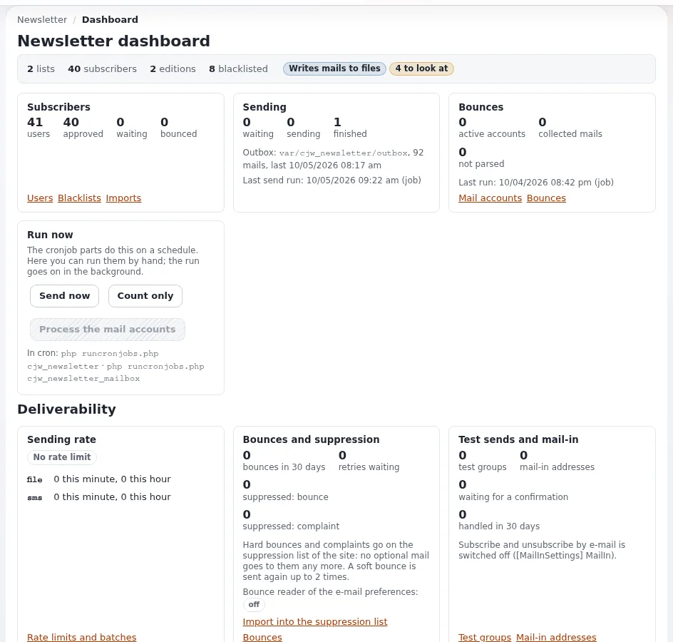

# Lektion 1.3: Das Newsletter-Dashboard

Die Startseite des Newsletter-Bereichs ist ein Dashboard. Es beantwortet die Fragen, die jeden Tag gestellt werden:
wie viele Abonnenten, was wurde gesendet, ist Cron gelaufen und stimmt etwas nicht. Diese Lektion bringt den
Teilnehmenden bei, es zu lesen, bevor sie handeln: eine Gewohnheit, die die meisten Newsletter-Unfälle verhindert.

> **Hinweis**
> Diese Lektion beschreibt das Design admin4 von Exponential 6.0.15 mit `cjw_newsletter` 4.2. Andere Designs zeigen
> dieselben Informationen in einer anderen Anordnung.

## Auf einen Blick

| | |
|---|---|
| Kurs | [Newsletter mit CJW Newsletter](../README.md) |
| Modul | [Modul 1: Erste Schritte](README.md) |
| Dauer | 30 Minuten (15 Präsentation, 15 Übung) |
| Niveau | Einsteiger |
| Zielgruppe | Redakteure und Administratoren |
| Voraussetzungen | [Lektion 1.2](eine-sichere-schulungsinstallation-vorbereiten.md): Die Schulungsinstallation schreibt Mail in Dateien |

## Lernziele

Nach dieser Lektion können die Teilnehmenden:

- das Dashboard öffnen und seine Hauptabschnitte nennen;
- die Tabelle **Listen** lesen (angenommene, wartende und alle Abonnenten pro Liste);
- die letzten Versände und ihren Status finden;
- die Hinweise unter **Probleme und Hinweise** erklären und sagen, wozu jeder einzelne auffordert;
- sagen, welche Knöpfe Arbeit im Hintergrund starten und warum sie im Kurs nicht ohne den Trainer gedrückt werden.

## Hinweise für Trainer

### So präsentieren Sie es

Quelle: [Dashboard, Befehle und Hintergrundläufe](../../../../../eng-us/features/6.0/extensions/cjw_newsletter.md#dashboard-commands-and-background-runs-4117)
und [Probleme, die das Dashboard meldet](../../../../spezifikationen/6.0/cjw_newsletter.md#probleme-die-das-dashboard-meldet).

1. **Der Weg dorthin** (2 Minuten). **Newsletter** im oberen Menü oder die Kachel **Newsletter** auf dem
   Haupt-Dashboard. Das linke Menü des Bereichs enthält **Übersicht**, **Benutzer**, **Blacklists**, **Rückläufer**,
   **E-Mail-Konten**, **Importe**, **Formular Abonnement** und **INI Einstellungen**.
2. **Von oben nach unten** (8 Minuten). Gehen Sie die Abschnitte am Beamer durch: **Abonnenten**, **Versand**,
   **Rückläufer**, **Jetzt ausführen**, dann die Blöcke der Bereiche aus 4.2 (**Zustellbarkeit**, **Redaktion**,
   **Layouts, Sprachen und Interessen**, **Statistiken**, **Importe und Übernahme**), dann **Probleme und Hinweise**,
   **Listen**, **Letzte Sendungen**, **Newsletter-Systeme** und **Letzte Aktionen**. Nennen Sie die Blöcke aus 4.2 nur;
   die Module 2 bis 6 kommen darauf zurück.
3. **Jetzt ausführen** (3 Minuten). **Jetzt senden** erzeugt die Warteschlange und sendet, was fällig ist; **Nur
   zählen** meldet, was ein Lauf tun würde, ohne etwas zu ändern; **Mailkonten verarbeiten** liest die Bounce-Konten.
   Jeder Knopf startet einen Hintergrundlauf und zeigt dessen Fortschritt auf der Seite. Im Kurs wird bis Modul 4 nur
   **Nur zählen** gedrückt, und nur vom Trainer.
4. **Probleme und Hinweise** (2 Minuten). Jedes Problem nennt seine Abhilfe. Beispiele aus der Spezifikation: fehlende
   Tabellen, fehlender Newsletter-Ordner, Mails werden in Dateien geschrieben, Standard-Absenderadresse, verwaiste
   Abonnements (mit einem Knopf **Entfernen**), hängende Versände.

### Häufige Fragen

**Gibt es eine Kommandozeilenversion des Dashboards?** Ja: `php bin/php/console ext:cjw_newsletter:status` gibt aus,
was das Dashboard zeigt ([Spezifikation](../../../../spezifikationen/6.0/cjw_newsletter.md#konsolenbefehle)).

**Was bedeutet „Wartend“ in der Tabelle Listen?** Abonnements, die noch nicht angenommen oder bestätigt sind, zum
Beispiel Personen, die den Bestätigungslink noch nicht angeklickt haben.

**Warum sagt das Dashboard, dass Mails in Dateien geschrieben werden?** Weil wir es in Lektion 1.2 so eingerichtet
haben. Auf einer Live-Website bedeutet dieser Hinweis, dass nichts bei den Abonnenten ankommt.

**Wer darf das Dashboard sehen?** Benutzer, deren Rolle die Richtlinienfunktion `newsletter/index` gewährt. Die Blöcke
aus 4.2 brauchen eigene Funktionen, zum Beispiel `newsletter/deliverability` und `newsletter/editorial`.

### Stolperfallen

- **Auf Entfernen drücken.** Der Knopf entfernt verwaiste Abonnements wirklich. Lassen Sie die Teilnehmenden den
  Hinweis lesen, nicht drücken.
- **Jetzt senden auf einer gemeinsam genutzten Installation.** Wenn eine Person ihn drückt, werden die
  Warteschlangen aller Teilnehmenden abgearbeitet. Mit dem Datei-Transport ist das harmlos, bringt aber die späteren
  Übungen durcheinander. Vereinbaren Sie die Regel vor der Übung.
- **Alte Daten.** Eine gemeinsam genutzte Schulungswebsite kann Versände aus früheren Kursen zeigen. Sagen Sie den
  Teilnehmenden, welche Liste ihre ist.

## Praktische Übung

Verwenden Sie die gemeinsame Schulungsinstallation (Datei-Transport, siehe Lektion 1.2) und Ihr Schulungskonto für
die Administration. Sie lesen nur.

1. Öffnen Sie **Newsletter** und stellen Sie sicher, dass im linken Menü **Übersicht** ausgewählt ist.
2. Schreiben Sie unter **Listen** jeden Listennamen mit seinen Zahlen **Angenommen**, **Wartend** und **Alle** auf.
3. Notieren Sie unter **Letzte Sendungen** den **Status**, die **E-Mails** und die **Fehlgeschlagen** des neuesten
   Versands, falls es einen gibt.
4. Notieren Sie unter **Newsletter-Systeme**, wie viele Systeme die Installation hat.
5. Lesen Sie **Probleme und Hinweise**. Schreiben Sie für jede Zeile in einem Satz auf, wozu sie Sie auffordert.
6. Suchen Sie den Abschnitt **Jetzt ausführen** und nennen Sie seine drei Knöpfe. Drücken Sie sie nicht.
7. Öffnen Sie ein Terminal auf Ihrer eigenen Schulungsinstallation (falls Sie eine haben) und führen Sie aus:

   ```bash
   php bin/php/console ext:cjw_newsletter:status
   ```

8. Vergleichen Sie die Ausgabe des Befehls mit dem, was Sie vom Dashboard notiert haben.

## Erwartetes Ergebnis

- Alle Teilnehmenden haben eine kleine Tabelle der Listen mit ihren Zahlen und einen Satz pro Hinweis.
- Teilnehmende mit einem Terminal sehen dieselben Listen, Versände und Probleme in der Ausgabe des Statusbefehls.
- Es wurde kein Hintergrundlauf gestartet (der Abschnitt **Letzte Aktionen** zeigt nichts Neues).
- Der Trainer prüft das, indem er jedes Paar bittet, einen Hinweis und seine Abhilfe zu erklären.



## Quiz

1. Welcher Knopf zeigt, was ein Lauf der Warteschlange tun würde, ohne etwas zu ändern?
   A. **Jetzt senden** B. **Nur zählen** C. **Mailkonten verarbeiten** D. **Entfernen**
2. Nennen Sie den Konsolenbefehl, der die Informationen des Dashboards ausgibt.
3. Das Dashboard meldet hängende Versände („Stuck sends“). Was prüfen Sie zuerst?
4. Was zählt die Spalte **Wartend** der Tabelle Listen?
5. Warum ist der Hinweis „Mails werden in Dateien geschrieben“ in diesem Kurs eine gute Nachricht und auf einer
   Live-Website eine schlechte?

<details>
<summary>Antworten</summary>

1. **B.** **Nur zählen** startet einen Probelauf der Warteschlange ([Funktionsseite](../../../../../eng-us/features/6.0/extensions/cjw_newsletter.md#dashboard-commands-and-background-runs-4117)).
2. `ext:cjw_newsletter:status` ([Spezifikation](../../../../spezifikationen/6.0/cjw_newsletter.md#konsolenbefehle)).
3. Ob Cron den Teil `cjw_newsletter` ausführt ([Spezifikation](../../../../spezifikationen/6.0/cjw_newsletter.md#probleme-die-das-dashboard-meldet)).
4. Abonnements, die noch nicht bestätigt oder angenommen sind.
5. Im Kurs darf nichts den Rechner verlassen; auf einer Live-Website bedeutet es, dass kein Abonnent etwas erhält
   ([Spezifikation](../../../../spezifikationen/6.0/cjw_newsletter.md#probleme-die-das-dashboard-meldet)).

</details>

## Weiterführende Informationen

- [cjw_newsletter: Newsletter in der Administration](../../../../../eng-us/features/6.0/extensions/cjw_newsletter.md#dashboard-commands-and-background-runs-4117):
  das Dashboard und Hintergrundläufe.
- [Spezifikation: die Erweiterung cjw_newsletter](../../../../spezifikationen/6.0/cjw_newsletter.md#probleme-die-das-dashboard-meldet):
  jedes Problem, das das Dashboard meldet.
- [Rollen und Richtlinien](../../../../anleitungen/rollen-und-richtlinien.md): die Richtlinienfunktionen des Newsletters
  gewähren.

## Verwandte Seiten

- [Modul 1: Erste Schritte](README.md)
- [Newsletter mit CJW Newsletter: Kursüberblick](../README.md)
- [Trainer: hier beginnen](../../../../../eng-us/help/trainers/trainers-start-here.md)
- [Freie Dokumentation](../../../freie-dokumentation.md): Diese Seite darf unter der GNU FDL 1.3 frei kopiert, übersetzt und verbessert werden.

<!-- exp-partner-block:start -->
**Werden Sie Exponential-Partner.** Partner teilen ihre Informationen, stellen Mittel bereit, geben Beiträge zurück
und entwickeln die Produkte mit uns, und so wächst Exponential. Eine Partner-Website und ein Dashboard sind für Mitte
2027 geplant: Werden Sie noch heute Partner, damit wir schneller wachsen und neue Funktionen früher liefern. Beginnen
Sie mit [Partner: hier beginnen](../../../partner/partner-hier-beginnen.md) und
[Wie Sie sich bewerben](../../../partner/wie-sie-sich-bewerben.md).
<!-- exp-partner-block:end -->
