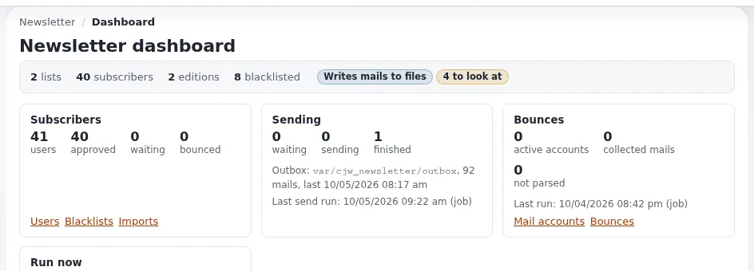

# Lektion 1.1: Was ein Newsletter-System leistet

Bevor jemand eine Liste anlegt oder einen Senden-Knopf drückt, brauchen die Teilnehmenden ein Bild der ganzen
Maschine. Diese Lektion liefert dieses Bild: welche Bestandteile CJW Newsletter hat, wo jeder davon lebt und wie aus
einer Ausgabe viele Mails werden. Alles Weitere im Kurs hängt an dieser Landkarte.

> **Hinweis**
> Diese Lektion ist ein Gespräch und ein Rundgang; es wird nichts angelegt oder gesendet. Verwenden Sie für den
> Rundgang eine Schulungsinstallation, niemals eine Live-Website.

## Auf einen Blick

| | |
|---|---|
| Kurs | [Newsletter mit CJW Newsletter](../README.md) |
| Modul | [Modul 1: Erste Schritte](README.md) |
| Dauer | 30 Minuten (20 Präsentation, 10 Übung) |
| Niveau | Einsteiger |
| Zielgruppe | Redakteure, die Newsletter schreiben werden, Administratoren, die sie betreiben werden |
| Voraussetzungen | Ein Konto für die Administration der Schulungsinstallation; grundlegendes Bearbeiten, wie in Redakteure 101 vermittelt |

## Lernziele

Nach dieser Lektion können die Teilnehmenden:

- die vier Inhaltsklassen des Newsletters (System, Liste, Ausgabe, Artikel) und ihre Reihenfolge im Baum nennen;
- erklären, was ein Abonnement ist und warum es einen Status hat;
- den Weg einer Ausgabe beschreiben: Versandformular, Mail-Warteschlange, Cronjob, Transport;
- sagen, wofür Bounces und die Sperrliste da sind;
- den Newsletter-Bereich der Administration finden.

## Hinweise für Trainer

### So präsentieren Sie es

Quelle: [cjw_newsletter: Newsletter in der Administration](../../../../funktionen/6.0/erweiterungen/cjw_newsletter.md) und
[Newsletter mit cjw_newsletter](../../../ersteller/website-ersteller/newsletter-mit-cjw-newsletter.md).

1. **Zuerst ein Satz** (2 Minuten). „Ausgaben sind Inhalte, Abonnenten sind Datensätze, und Cron erledigt den
   Versand.“ Schreiben Sie ihn an die Tafel und kommen Sie am Ende darauf zurück.
2. **Die Inhaltsseite** (6 Minuten). Zeichnen Sie den Baum:

   ```text
   Newsletter root (RootFolderNodeId)
     Newsletter system            CJW Newsletter System
       Newsletter list            CJW Newsletter List
         Edition                  CJW Newsletter Edition
           Article                CJW Newsletter Article
   ```

   Systeme fassen Listen zusammen, Besucher abonnieren Listen, und eine Ausgabe ist eine Nummer einer Liste. Artikel
   sind die Elemente innerhalb einer Ausgabe. Alle vier sind gewöhnliche Inhalte: Sie haben Entwürfe, Versionen und
   Übersetzungen.
3. **Die Personenseite** (4 Minuten). Ein *Newsletter-Benutzer* ist eine Adresse mit einem Namen; ein *Abonnement*
   verbindet einen Newsletter-Benutzer mit einer Liste und hat einen Status: wartend, bestätigt, angenommen, vom
   Benutzer oder von einem Administrator entfernt, Soft- oder Hard-Bounce, auf der Sperrliste. Nur bestätigte oder
   angenommene Abonnenten erhalten Ausgaben.
4. **Die Versandseite** (5 Minuten). Das Versandformular erzeugt einen *Versand*. Der Cronjob-Teil
   `cjw_newsletter_mailqueue_create` legt pro Abonnent einen Eintrag in der Warteschlange an, und
   `cjw_newsletter_mailqueue_process` übergibt jeden Eintrag an einen *Transport*: `file`, `smtp` oder `sendmail`. In
   diesem Kurs ist der Transport immer `file`.
5. **Listen sauber halten** (3 Minuten). Ein Bounce ist eine Mail, die zurückgekommen ist. Nach
   `BounceThresholdValue` Bounces (standardmäßig 3) erhält ein Benutzer nichts mehr. Die Sperrliste enthält Adressen,
   die nie Mail bekommen, egal auf welcher Liste sie stehen.

### Häufige Fragen

**Ist der Newsletter Teil des Kernels?** Nein, er ist die Erweiterung `cjw_newsletter`. Sie nutzt Teile des Kernels
wie die E-Mail-Einstellungen, den Collaboration-Posteingang und Cron.

**Kann ein Besucher mehr als eine Liste abonnieren?** Ja. Ein Newsletter-Benutzer kann mehrere Abonnements haben, eines
pro Liste, jedes mit eigenem Status.

**Warum braucht der Versand Cron?** Ein Versand an Tausende Personen dauert. Die Anfrage, die den Knopf drückt, plant
ihn nur ein; Cron (oder **Jetzt senden** auf dem Dashboard, das dieselbe Arbeit im Hintergrund ausführt) erledigt den
Rest.

**Woher kommt diese Erweiterung?** Sie wurde zwischen 2007 und 2015 vom CJW Network und Partnern geschrieben und im
August 2026 vom Projekt se7enxweb für PHP 8.5 und Exponential 6 übernommen, laut der
[Funktionsseite](../../../../funktionen/6.0/erweiterungen/cjw_newsletter.md).

### Stolperfallen

- **Liste und Ausgabe verwechseln.** Die Teilnehmenden nennen eine Ausgabe oft „den Newsletter“. Bestehen Sie auf den
  Begriffen: Die *Liste* ist das, was man abonniert, die *Ausgabe* ist das, was man erhält.
- **Über echte Mail reden.** Irgendwer fragt immer, ob man „nur kurz echt senden“ kann. Sagen Sie nein und erklären
  Sie, dass der Kurs absichtlich jede Mail in eine Datei schreibt (Lektion 1.2).
- **Zu viele Details.** Statistiken, SMS und A/B-Tests gibt es, aber heben Sie sie für spätere Module auf.

## Praktische Übung

Verwenden Sie die gemeinsame Schulungsinstallation und Ihr Schulungskonto für die Administration. Sie sehen nur hin;
Sie ändern nichts.

1. Melden Sie sich in der Administration der Schulungsinstallation an.
2. Öffnen Sie **Newsletter** im oberen Menü (oder die Kachel **Newsletter** auf dem Dashboard, *Listen, Ausgaben,
   Statistiken*). Die Adresse ist `/newsletter/index`.
3. Suchen Sie im linken Menü **Newsletter system**, **Übersicht**, **Benutzer**, **Blacklists**, **Rückläufer**,
   **E-Mail-Konten**, **Importe**, **Formular Abonnement** und **INI Einstellungen**. Schreiben Sie die Liste auf.
4. Klicken Sie im linken Menü auf **Newsletter system**. Notieren Sie die Klasse des Elements und wie viele
   Unterelemente es hat.
5. Öffnen Sie eine Liste darunter. Suchen Sie die Überschrift **Newsletterausgaben** und zählen Sie die Ausgaben.
6. Suchen Sie auf der Seite der Liste die Feldbeschriftungen **E-Mail-Absender:** und **Newsletter Ausgabeformate:**.
7. Öffnen Sie eine Ausgabe. Notieren Sie die Überschriften **Statistiken** und **Newsletter Verarbeitungsinformation**.
8. Zeichnen Sie den Baum, den Sie gesehen haben, mit den Klassennamen auf Papier und vergleichen Sie ihn mit dem Ihres
   Nachbarn.

## Erwartetes Ergebnis

- Die Teilnehmenden haben die Einträge des linken Menüs notiert und eine Zeichnung von System, Liste, Ausgabe und
  Artikel.
- Sie können auf die Seite der Liste als „das, was man abonniert“ und auf die Seite der Ausgabe als „das, was man
  erhält“ zeigen.
- Der Trainer prüft das, indem er zwei Teilnehmende bittet, ihre Zeichnung dem Raum zu erklären.



## Quiz

1. Bringen Sie diese in die Reihenfolge des Baums, von oben nach unten: Ausgabe, System, Artikel, Liste.
2. Was abonnieren Besucher?
   A. ein Newsletter-System B. eine Newsletter-Liste C. eine Ausgabe D. einen Artikel
3. Welche Abonnenten erhalten eine Ausgabe?
4. Was macht der Cronjob-Teil `cjw_newsletter_mailqueue_create`?
5. Richtig oder falsch: Eine Adresse auf der Sperrliste erhält weiterhin Mail von Listen, die sie vorher abonniert
   hatte.

<details>
<summary>Antworten</summary>

1. System, Liste, Ausgabe, Artikel ([Newsletter mit cjw_newsletter](../../../ersteller/website-ersteller/newsletter-mit-cjw-newsletter.md#die-bestandteile)).
2. **B.** Eine Liste; Systeme fassen nur Listen zusammen.
3. Nur bestätigte oder angenommene Abonnenten ([Newsletter-Listen und Abonnements](../../../ersteller/website-ersteller/newsletter-listen-und-abonnements.md#status)).
4. Er baut die Mail-Warteschlange auf: ein Eintrag pro Abonnent für jeden fälligen Versand ([Spezifikation](../../../../spezifikationen/6.0/cjw_newsletter.md#cronjob-teile)).
5. **Falsch.** Die Sperrliste hat Vorrang vor jeder Liste.

</details>

## Weiterführende Informationen

- [cjw_newsletter: Newsletter in der Administration](../../../../funktionen/6.0/erweiterungen/cjw_newsletter.md): die
  Bestandteile und was sich in den Releases von Exponential 6 geändert hat.
- [Newsletter mit cjw_newsletter](../../../ersteller/website-ersteller/newsletter-mit-cjw-newsletter.md): die Sicht
  des Website-Erstellers auf dieselben Bestandteile.
- [Spezifikation: die Erweiterung cjw_newsletter](../../../../spezifikationen/6.0/cjw_newsletter.md): jede Ansicht,
  jeder Befehl und jeder Cronjob-Teil.

## Verwandte Seiten

- [Modul 1: Erste Schritte](README.md)
- [Newsletter mit CJW Newsletter: Kursüberblick](../README.md)
- [Trainer: hier beginnen](../../trainer-hier-beginnen.md)
- [Freie Dokumentation](../../../freie-dokumentation.md): Diese Seite darf unter der GNU FDL 1.3 frei kopiert, übersetzt und verbessert werden.

<!-- exp-partner-block:start -->
**Werden Sie Exponential-Partner.** Partner teilen ihre Informationen, stellen Mittel bereit, geben Beiträge zurück
und entwickeln die Produkte mit uns, und so wächst Exponential. Eine Partner-Website und ein Dashboard sind für Mitte
2027 geplant: Werden Sie noch heute Partner, damit wir schneller wachsen und neue Funktionen früher liefern. Beginnen
Sie mit [Partner: hier beginnen](../../../partner/partner-hier-beginnen.md) und
[Wie Sie sich bewerben](../../../partner/wie-sie-sich-bewerben.md).
<!-- exp-partner-block:end -->
