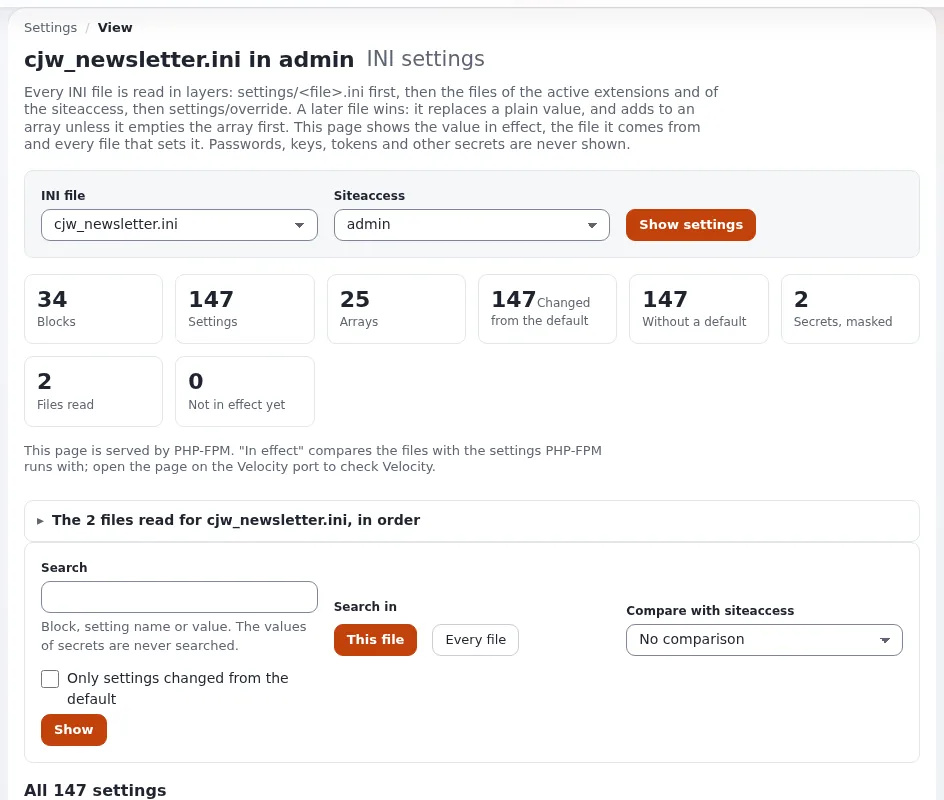

# Lektion 2.1: Newsletter-Systeme und der Baum

Jeder Newsletter lebt im Inhaltsbaum, unterhalb eines Wurzelordners, den die Einstellungen benennen. Ein
*Newsletter-System* fasst Listen zusammen, die zusammengehören, zum Beispiel alle Newsletter einer Marke oder einer
Abteilung. In dieser Lektion finden die Teilnehmenden die Wurzel, verstehen, woher die Administration weiß, wo sie
liegt, und legen ein eigenes System an.

> **Hinweis**
> Verwenden Sie eine Schulungsinstallation. Auf einer gemeinsam genutzten Schulungswebsite legt jede Person ein System
> mit ihrem eigenen Namen an, damit niemand die Arbeit anderer bearbeitet.

## Auf einen Blick

| | |
|---|---|
| Kurs | [Newsletter mit CJW Newsletter](../README.md) |
| Modul | [Modul 2: Systeme, Listen und Ausgaben](README.md) |
| Dauer | 45 Minuten (15 Präsentation, 30 Übung) |
| Niveau | Einsteiger |
| Zielgruppe | Redakteure und Administratoren |
| Voraussetzungen | [Modul 1](../modul-01-erste-schritte/README.md); ein Schulungskonto für die Administration |

## Lernziele

Nach dieser Lektion können die Teilnehmenden:

- die Newsletter-Wurzel und die Systeme darunter über das linke Menü des Newsletter-Bereichs finden;
- erklären, was `[NewsletterSettings] RootFolderNodeId` bewirkt, und seinen Wert in der Einstellungsansicht ablesen;
- erklären, warum der Newsletter-Baum eine eigene Sektion hat;
- ein Newsletter-System mit **Title**, **Short title** und **Short description** anlegen.

## Hinweise für Trainer

### So präsentieren Sie es

Quellen: [Die Bestandteile](../../../../funktionen/6.0/erweiterungen/cjw_newsletter.md#die-bestandteile),
[Einrichtung](../../../ersteller/website-ersteller/newsletter-mit-cjw-newsletter.md#einrichten) und
[Der Newsletter-Baum einer neuen Installation](../../../../funktionen/6.0/erweiterungen/cjw_newsletter.md#der-newsletter-baum-einer-neuen-installation).

1. **Die Wurzel** (4 Minuten). `cjw_newsletter.ini [NewsletterSettings] RootFolderNodeId` benennt den Knoten, dessen
   Kinder die Newsletter-Systeme sind. Der mitgelieferte Wert ist `1`, deshalb setzt jede Installation ihren eigenen
   in `settings/override/cjw_newsletter.ini.append.php`. Die Installer-Klasse der Erweiterung kann eine Wurzel
   (`cjw_newsletter_root`), ein System und eine Liste anlegen und diese Einstellung schreiben; Administratoren lesen
   darüber auf der Funktionsseite.
2. **Die Sektion** (3 Minuten). Der Newsletter-Baum liegt in der Sektion „CJW Newsletter“ mit dem Navigationsteil des
   Newsletters. Deshalb bleibt beim Öffnen eines Newsletter-Elements das linke Menü des Newsletters statt des
   Inhaltsmenüs stehen. Siehe [Sektionen](../../../../anleitungen/sektionen.md).
3. **Die Klasse** (3 Minuten). `CJW Newsletter System` hat drei Felder: **Title** (Pflicht), **Short title** und
   **Short description**. Sein Name in Listen ist der Kurztitel, wenn er ausgefüllt ist, sonst der Titel.
4. **Wann ein zweites System sinnvoll ist** (5 Minuten). Ein System pro Marke, Sprachmarkt oder Abteilung mit eigenen
   Listen. Die meisten Websites brauchen eines. Diskutieren Sie: Was bräuchte Ihre Organisation?

### Häufige Fragen

**Kann ich einen vorhandenen Ordner unter die Wurzel verschieben und als System verwenden?** Nein. Systeme, Listen und
Ausgaben sind eigene Klassen; ein einfacher Ordner ist kein Newsletter-System.

**Was passiert, wenn `RootFolderNodeId` falsch ist?** Das Dashboard meldet, dass der Newsletter-Ordner fehlt
(„Newsletter folder missing“, [Probleme, die das Dashboard meldet](../../../../spezifikationen/6.0/cjw_newsletter.md#probleme-die-das-dashboard-meldet)).

**Können Redakteure ohne Administratorrechte hier arbeiten?** Ja, wenn ihre Rolle das Bearbeiten in der
Newsletter-Sektion und die benötigten Richtlinienfunktionen des Newsletters erlaubt. Lektion 3.2 und
[Rollen und Richtlinien](../../../../anleitungen/rollen-und-richtlinien.md) behandeln das.

### Stolperfallen

- **Das System an der falschen Stelle anlegen.** Ein System unterhalb eines gewöhnlichen Ordners findet der
  Newsletter-Bereich nicht. Prüfen Sie den Pfad vor dem Anlegen.
- **Ein System entfernen.** Das entfernt auch seine Listen und Ausgaben (sie kommen in den Papierkorb). Im Kurs
  entfernt niemand etwas, das nicht sein eigenes ist.
- **Sektion nicht gesetzt.** Wenn die Wurzel von Hand angelegt und die Sektion vergessen wurde, zeigen
  Newsletter-Elemente das Inhaltsmenü. Das ist ein Einrichtungsfehler des Trainers, nicht der Teilnehmenden.

## Praktische Übung

Verwenden Sie die Schulungsinstallation und Ihr Schulungskonto für die Administration. Ersetzen Sie `<name>` durch
Ihren Vornamen.

1. Öffnen Sie **Newsletter** und klicken Sie im linken Menü auf **INI Einstellungen**; suchen Sie
   `[NewsletterSettings]` und notieren Sie den Wert von `RootFolderNodeId`.
2. Klicken Sie im linken Menü auf **Newsletter system**. Sehen Sie sich die Brotkrumennavigation oben an: Notieren Sie
   den Namen der Wurzel über dem System.
3. Öffnen Sie den Reiter **Details** des Systems und suchen Sie seine Knoten-ID.
4. Gehen Sie hinauf zur Newsletter-Wurzel (über die Brotkrumennavigation). Vergleichen Sie ihre Knoten-ID mit dem
   Wert aus Schritt 1.
5. Klicken Sie auf der Seite der Wurzel unter **Unterelemente** auf **Neu erstellen** und wählen Sie **CJW Newsletter
   System**.
6. Geben Sie in **Title** `Training system <name>` ein. Geben Sie in **Short title** `TS <name>` ein.
7. Schreiben Sie in **Short description** einen Satz: für wen dieses System gedacht ist.
8. Klicken Sie auf **Zur Veröffentlichung schicken**.
9. Öffnen Sie Ihr neues System. Prüfen Sie, dass das linke Menü weiterhin die Newsletter-Einträge zeigt
   (**Übersicht**, **Benutzer** und die anderen).
10. Öffnen Sie den Reiter **Orte** und notieren Sie den Pfad Ihres Systems.

## Erwartetes Ergebnis

- Das System `TS <name>` der Person ist direkt unterhalb der Newsletter-Wurzel veröffentlicht.
- Der Wert von `RootFolderNodeId` stimmt mit der Knoten-ID der Wurzel überein.
- Das linke Menü des Newsletters bleibt auf der Seite des neuen Systems sichtbar, was zeigt, dass die Sektion
  funktioniert.
- Der Trainer prüft das, indem er die Wurzel öffnet und pro Person ein neues System zählt.

## Quiz

1. Was benennt `[NewsletterSettings] RootFolderNodeId`?
2. Welches Feld eines Newsletter-Systems ist Pflicht?
   A. **Short title** B. **Title** C. **Short description** D. keines
3. Warum hat der Newsletter-Baum eine eigene Sektion?
4. Das Dashboard meldet „Newsletter folder missing“. Nennen Sie zwei Wege, das zu beheben.
5. Richtig oder falsch: Jeder Ordner unterhalb der Wurzel funktioniert als Newsletter-System.

Antworten

1. Den Knoten, dessen Kinder die Newsletter-Systeme sind ([Funktionsseite](../../../../funktionen/6.0/erweiterungen/cjw_newsletter.md#einstellungen-die-sie-verwenden-werden)).
2. **B.** **Title** ist das einzige Pflichtfeld von `CJW Newsletter System`.
3. Damit Newsletter-Elemente den Navigationsteil und das linke Menü des Newsletters verwenden ([Sektionen](../../../../anleitungen/sektionen.md)).
4. Den Baum anlegen (die Installer-Klasse der Erweiterung kann das) oder `RootFolderNodeId` auf den richtigen Knoten
   setzen ([Spezifikation](../../../../spezifikationen/6.0/cjw_newsletter.md#probleme-die-das-dashboard-meldet)).
5. **Falsch.** Ein System muss von der Klasse `CJW Newsletter System` sein.

## Weiterführende Informationen

- [cjw_newsletter: Newsletter in der Administration](../../../../funktionen/6.0/erweiterungen/cjw_newsletter.md#der-newsletter-baum-einer-neuen-installation):
  wie eine neue Installation zu ihrem Newsletter-Baum kommt.
- [Newsletter mit cjw_newsletter](../../../ersteller/website-ersteller/newsletter-mit-cjw-newsletter.md#einrichten):
  die Einrichtungsschritte für eine Website.
- [Sektionen](../../../../anleitungen/sektionen.md): Sektionen und Navigationsteile.

## Verwandte Seiten

- [Modul 2: Systeme, Listen und Ausgaben](README.md)
- [Newsletter mit CJW Newsletter: Kursüberblick](../README.md)
- [Trainer: hier beginnen](../../trainer-hier-beginnen.md)
- [Freie Dokumentation](../../../freie-dokumentation.md): Diese Seite darf unter der GNU FDL 1.3 frei kopiert, übersetzt und verbessert werden.

<!-- exp-partner-block:start -->
**Werden Sie Exponential-Partner.** Partner teilen ihre Informationen, stellen Mittel bereit, geben Beiträge zurück
und entwickeln die Produkte mit uns, und so wächst Exponential. Eine Partner-Website und ein Dashboard sind für Mitte
2027 geplant: Werden Sie noch heute Partner, damit wir schneller wachsen und neue Funktionen früher liefern. Beginnen
Sie mit [Partner: hier beginnen](../../../partner/partner-hier-beginnen.md) und
[Wie Sie sich bewerben](../../../partner/wie-sie-sich-bewerben.md).
<!-- exp-partner-block:end -->
